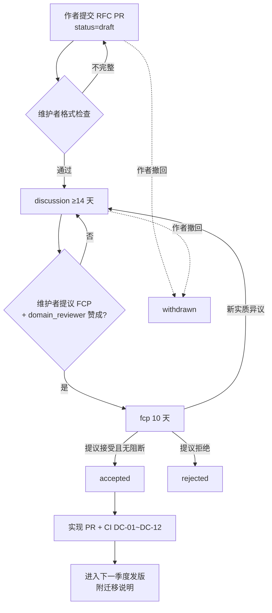

# 02 数据点字典规范

## 0. 文档信息

| 项目 | 内容 |
|---|---|
| 版本 | v0.1 |
| 日期 | 2026-10-18 |
| 依赖文档 | 00-prd-v2（§3、§4.4、§5、§6）、_baseline（B、D、H、I） |
| 被依赖 | 03（证据图与数据契约）、04（编排与 Agent）、05（计算库）、06（审批与风险）、08（交付与回填）、09（开源治理）及其余全部文档 |
| 读者 | 字典维护者、领域审阅人、`question-parser` / `filler-file` / `calc-service` / `consistency-auditor` 开发者、社区贡献者 |
| 仓库 | `belegt-dictionary`（CC BY 4.0） |

本文是 Belegt 全部文档的数据基准：任何文档中出现的 DataPoint ID、单位代码、期间类型、口径枚举、`TemplateMapping` 字段，均以本文为准。本文只定义"字典层"（开源、无租户数据）；`Answer`、`Evidence` 等证据图对象如何引用字典，见 03。

设计取向有三条。第一，**同一数据点只采集一次**：问卷题目千变万化，但背后的事实（Scope 1 总量、ISO 14001 证书有效期、某产品的 CN 编码）是有限的，字典把它们规范成稳定 ID，让历史答案、证据和计算可以跨客户、跨模板复用。第二，**字典描述"是什么"，不描述"值是多少"**：字典里没有任何企业的数值，只有定义、单位、期间和口径规则，因此可以完整开源。第三，**模板映射是确定性数据**：题号→数据点的对应关系写在 YAML 里，经 CI 校验，`question-parser` 命中时直接采用（`Mapping.method=exact_template`），不依赖 LLM 判断。

---

## 1. DataPoint schema

### 1.1 字段表

| 字段 | 类型 | 必填 | 说明 |
|---|---|---|---|
| `id` | string | 是 | `dp:<domain>.<topic>.<metric>[.<qualifier>]`，规则见 §2 |
| `version` | string（SemVer） | 是 | 数据点自身版本，如 `1.2.0`；引用写 `dp:env.ghg.scope1_total@1.2.0` |
| `label` | object `{de,en,zh}` | 是 | 三语短标签，每种 ≤ 80 字符；德语、英语必须由母语审阅（NFR-06） |
| `definition` | object `{de,en,zh}` | 是（`en` 必填，其余可后补） | 用我方语言写的操作性定义：包含什么、不包含什么、与相邻数据点的边界；**不得复制法规或问卷原文**，可引用条款号 |
| `value_type` | enum | 是 | 与 `Answer.value_type` 同一枚举：`number|text|enum|bool|date|file|geo` |
| `cardinality` | enum | 否，默认 `one` | `one` 或 `many`；`many` 表示值为记录列表（如冶炼厂清单），需配 `record_fields` |
| `record_fields` | array | `cardinality=many` 时必填 | 每个元素 `{name, value_type, unit?, enum_ref?, required}`，描述列表中单条记录的结构 |
| `enum_ref` | string | `value_type=enum` 时必填 | 指向 `enums/` 下的枚举文件，如 `enums/iso3166_alpha2.yaml` |
| `unit` | string | `value_type=number` 时必填 | 规范单位（canonical unit），写 Belegt 单位代码（见 §3.1），并在单位表中对应 UCUM 码；无量纲写 `1`，比例写 `%` |
| `allowed_units` | array | 否 | 允许采集时出现的单位，必须与 `unit` 同量纲且在 `units/conversions.yaml` 中可换算；落库前一律换算为 `unit` |
| `period_type` | enum | 是 | `calendar_year`、`fiscal_year`、`reporting_period`、`point_in_time`、`validity_range`，含义见 §3.3 |
| `boundary` | array（enum） | 是 | 允许的口径：`organization`、`site`、`product`、`product_per_unit`（实例化时 `site` 写成 `site:<site_id>`，`product` 写成 `product:<prod_id>`，与 `Answer.boundary` 一致） |
| `consolidation` | array（enum） | `boundary` 含 `organization` 时必填 | 允许的合并方法：`operational_control|financial_control|equity_share`；首选项放第一位 |
| `methodology_refs` | array | 否 | 方法论引用，每项 `{ref, clause?, note?}`，如 `{ref: "ghg_protocol_corporate", clause: "Ch.4"}`；引用名在 `refs/methodologies.yaml` 登记 |
| `sensitivity` | enum | 是 | `public`（可公开，如证书有效期）、`customer_shared`（默认仅对授权客户共享）、`confidential`（商业敏感，如能耗绝对值、供应商名单）、`restricted`（需 `compliance_owner` 显式批准才能外发，如冶炼厂清单、坐标）。驱动 06 的审批与 `egress-gateway` 策略 |
| `evidence_requirements` | object | 是 | `{accepted_source_types[], min_sources, max_age_days?, requires_calculation, human_confirmation_allowed}`；`accepted_source_types` 取 `Evidence.source_type` 枚举。实现 FR-401 的"什么样的证据算数" |
| `validity_rule` | object | 否 | 校验规则：硬约束 `min`、`max`、`regex`、`enum_ref`；软约束 `plausibility[]`（相对相关数据点的合理范围，触发告警而非拒绝）；`expires_by`（值自身的到期依据，FR-404） |
| `related_datapoints` | array | 否 | `{id, relation}`，`relation` 取 `component_of`、`sum_of`、`derived_from`、`alternative_of`、`see_also`；`consistency-auditor` 按 `sum_of` 等关系生成一致性规则（FR-402） |
| `status` | enum | 是 | `draft`→`active`→`deprecated`→`retired`（_baseline B） |
| `deprecation` | object | `status ∈ {deprecated, retired}` 时必填 | `{since, reason, replaced_by[], retire_after, migration}`，见 §6.4 |
| `aliases` | array | 否 | 旧 ID 或社区常用别名（只读重定向），见 §2.5 |
| `tags` | array | 否 | 自由标签，如 `vsme_basic`、`cbam`，便于检索，不参与语义 |
| `introduced_in` | string | 是 | 首次进入的字典发版，如 `v2027.1` |

字段约束补充：

- `value_type=number` 的数据点，`evidence_requirements.requires_calculation` 或 `accepted_source_types` 至少给出一种；运行时 `Answer` 仍须满足硬规则 R-NUM（_baseline B）。字典层不放宽 R-NUM。
- `human_confirmation_allowed=true` 只允许出现在 `bool`、`enum`、`date`、`text` 类数据点，或明确标为"可人工确认的数字"（如员工人数）的数据点上；排放类数字一律 `false`，必须来自文档、ERP 或 `calc-service`。
- `boundary` 含 `product_per_unit` 时，`unit` 必须是"每功能单位/每声明单位"的复合单位（如 `kgCO2e/kg`、`kgCO2e/kWh`），声明单位本身另设数据点（如 `dp:prod.pcf.declared_unit`）。

### 1.2 YAML 示例

```yaml
id: dp:env.ghg.scope2_location_based
version: 1.0.0
introduced_in: v2027.1
status: active
label:
  de: "Scope-2-Emissionen (standortbasiert)"
  en: "Scope 2 GHG emissions (location-based)"
  zh: "范围二排放（基于位置）"
definition:
  en: >
    Gross indirect GHG emissions from purchased or acquired electricity,
    steam, heat and cooling consumed within the reporting boundary,
    calculated with grid-average emission factors. Excludes market
    instruments (GoO, PPA). Biogenic CO2 reported separately.
  zh: >
    报告边界内消耗的外购电力、蒸汽、热和冷所产生的间接温室气体排放毛值，
    使用电网平均排放因子计算；不考虑绿证、PPA 等市场工具；生物源 CO2 单列。
value_type: number
unit: tCO2e
allowed_units: [kgCO2e, tCO2e]
period_type: reporting_period
boundary: [organization, site]
consolidation: [operational_control, financial_control, equity_share]
methodology_refs:
  - { ref: ghg_protocol_scope2_guidance, clause: "Ch.6" }
  - { ref: eu_2026_1560_vcs, clause: "B3 Para 33(b)" }
sensitivity: customer_shared
evidence_requirements:
  accepted_source_types: [document, erp, historical_answer]
  min_sources: 1
  max_age_days: 550
  requires_calculation: true
  human_confirmation_allowed: false
validity_rule:
  min: 0
  plausibility:
    - expr: "value <= dp:energy.consumption.electricity_total * 1.2"
      note: "上限按 1.2 tCO2e/MWh 粗估，超出提示单位或口径错误"
      severity: warn
related_datapoints:
  - { id: dp:env.ghg.scope2_market_based, relation: alternative_of }
  - { id: dp:energy.consumption.electricity_total, relation: derived_from }
tags: [vsme_basic, cdp, ghg]
```

### 1.3 JSON Schema（`schema/datapoint.schema.json`）

```json
{
  "$schema": "https://json-schema.org/draft/2020-12/schema",
  "$id": "https://schema.belegt.org/dictionary/datapoint/0.1.0",
  "title": "Belegt DataPoint",
  "type": "object",
  "required": ["id","version","introduced_in","status","label","definition","value_type","period_type","boundary","sensitivity","evidence_requirements"],
  "additionalProperties": false,
  "properties": {
    "id": { "type": "string", "pattern": "^dp:(org|env|energy|prod|mat|supply|cert|gov|social)\\.[a-z][a-z0-9_]{1,40}\\.[a-z][a-z0-9_]{1,48}(\\.[a-z][a-z0-9_]{0,40})?$" },
    "version": { "type": "string", "pattern": "^\\d+\\.\\d+\\.\\d+$" },
    "introduced_in": { "type": "string", "pattern": "^v\\d{4}\\.[1-4]$" },
    "status": { "enum": ["draft","active","deprecated","retired"] },
    "label": { "$ref": "#/$defs/i18n_required" },
    "definition": { "type": "object", "required": ["en"], "properties": { "de": {"type":"string"}, "en": {"type":"string","minLength":20}, "zh": {"type":"string"} }, "additionalProperties": false },
    "value_type": { "enum": ["number","text","enum","bool","date","file","geo"] },
    "cardinality": { "enum": ["one","many"], "default": "one" },
    "record_fields": { "type": "array", "items": { "type": "object", "required": ["name","value_type","required"], "properties": { "name": {"type":"string","pattern":"^[a-z][a-z0-9_]*$"}, "value_type": {"enum":["number","text","enum","bool","date","file","geo"]}, "unit": {"type":"string"}, "enum_ref": {"type":"string"}, "required": {"type":"boolean"} } } },
    "enum_ref": { "type": "string", "pattern": "^enums/[a-z0-9_]+\\.yaml$" },
    "unit": { "type": "string" },
    "allowed_units": { "type": "array", "items": { "type": "string" }, "uniqueItems": true },
    "period_type": { "enum": ["calendar_year","fiscal_year","reporting_period","point_in_time","validity_range"] },
    "boundary": { "type": "array", "minItems": 1, "items": { "enum": ["organization","site","product","product_per_unit"] } },
    "consolidation": { "type": "array", "items": { "enum": ["operational_control","financial_control","equity_share"] } },
    "methodology_refs": { "type": "array", "items": { "type": "object", "required": ["ref"], "properties": { "ref": {"type":"string"}, "clause": {"type":"string"}, "note": {"type":"string"} } } },
    "sensitivity": { "enum": ["public","customer_shared","confidential","restricted"] },
    "evidence_requirements": { "type": "object", "required": ["accepted_source_types","min_sources","requires_calculation","human_confirmation_allowed"], "properties": {
      "accepted_source_types": { "type": "array", "items": { "enum": ["document","erp","human_confirmation","supplier_response","historical_answer","public_source"] } },
      "min_sources": { "type": "integer", "minimum": 0 },
      "max_age_days": { "type": "integer", "minimum": 1 },
      "requires_calculation": { "type": "boolean" },
      "human_confirmation_allowed": { "type": "boolean" } } },
    "validity_rule": { "type": "object", "properties": {
      "min": {"type":"number"}, "max": {"type":"number"}, "regex": {"type":"string"},
      "expires_by": { "enum": ["value","evidence_valid_until","period_end_plus_days"] },
      "expires_after_days": {"type":"integer"},
      "plausibility": { "type": "array", "items": { "type": "object", "required": ["expr","severity"], "properties": { "expr": {"type":"string"}, "note": {"type":"string"}, "severity": {"enum":["warn","block"]} } } } } },
    "related_datapoints": { "type": "array", "items": { "type": "object", "required": ["id","relation"], "properties": { "id": {"type":"string","pattern":"^dp:"}, "relation": {"enum":["component_of","sum_of","derived_from","alternative_of","see_also"]} } } },
    "deprecation": { "type": "object", "required": ["since","reason","replaced_by","retire_after"], "properties": { "since": {"type":"string"}, "reason": {"type":"string"}, "replaced_by": {"type":"array","items":{"type":"string"}}, "retire_after": {"type":"string"}, "migration": {"type":"string"} } },
    "aliases": { "type": "array", "items": { "type": "string" } },
    "tags": { "type": "array", "items": { "type": "string" } }
  },
  "allOf": [
    { "if": { "properties": { "value_type": { "const": "number" } } }, "then": { "required": ["unit"] } },
    { "if": { "properties": { "value_type": { "const": "enum" } } }, "then": { "required": ["enum_ref"] } },
    { "if": { "properties": { "cardinality": { "const": "many" } } }, "then": { "required": ["record_fields"] } },
    { "if": { "properties": { "status": { "enum": ["deprecated","retired"] } } }, "then": { "required": ["deprecation"] } }
  ],
  "$defs": { "i18n_required": { "type": "object", "required": ["de","en","zh"], "properties": { "de": {"type":"string","maxLength":80}, "en": {"type":"string","maxLength":80}, "zh": {"type":"string","maxLength":80} }, "additionalProperties": false } }
}
```

`expr` 采用 CEL（Common Expression Language）子集：只允许算术、比较、逻辑运算和对 `dp:` 标识的引用，不允许函数调用外部资源。表达式由 `consistency-auditor` 确定性求值，LLM 只负责把违例解释成人话。

### 1.4 复合数据点示例与定义写作要求

冶炼厂清单这类"表格型"事实用 `cardinality=many` 表达，单条记录的结构由 `record_fields` 给出，`Answer.value` 为记录数组（JSON），`value_type` 取 `file`（结构化附件）。

```yaml
id: dp:mat.conflict_minerals.smelter_list
version: 1.0.0
introduced_in: v2027.1
status: draft
label: { de: "Schmelzhüttenliste", en: "Smelter list", zh: "冶炼厂清单" }
definition:
  en: >
    List of smelters and refiners of tin, tantalum, tungsten and gold known
    to be in the supply chain of the reported products, identified where
    possible by the RMI smelter identification number.
value_type: file
cardinality: many
record_fields:
  - { name: metal, value_type: enum, enum_ref: enums/conflict_metals.yaml, required: true }
  - { name: smelter_name, value_type: text, required: true }
  - { name: country, value_type: enum, enum_ref: enums/iso3166_alpha2.yaml, required: true }
  - { name: smelter_id, value_type: text, required: false }
period_type: point_in_time
boundary: [organization, product]
sensitivity: restricted
evidence_requirements:
  accepted_source_types: [supplier_response, document, historical_answer]
  min_sources: 1
  max_age_days: 365
  requires_calculation: false
  human_confirmation_allowed: true
validity_rule:
  plausibility:
    - { expr: "size(value) > 0 || !dp:mat.conflict_minerals.intentionally_added.tin", severity: warn, note: "声明有意添加锡却无冶炼厂" }
```

`definition` 的写作要求：

1. **先说包含什么，再说不包含什么**。例如范围二必须写明"不考虑市场工具"，否则与基于市场的数据点无法区分。
2. **写操作口径，不写政策目标**。"报告期内实际消耗的电量，以电费账单或电表读数为准"比"反映企业用电情况"有用得多，`evidence-miner` 会把定义当作提取指引。
3. **点名相邻数据点**。凡是容易混淆的（总量与分项、含与不含生物源、组织级与产品级），定义里直接写出另一个 ID。
4. **引用条款号而不是原文**。条款号写在 `methodology_refs`，定义正文用自己的话，避免版权问题，也避免法规更新后定义与原文不一致。
5. **三语义等**。德语版由德语母语的领域审阅人确认，中文版主要服务亚洲上游供应商（FR-703），三种语言出现分歧时以英文为准。

---

## 2. ID 命名规则

### 2.1 结构与 domain 枚举

格式固定为 `dp:<domain>.<topic>.<metric>[.<qualifier>]`：全小写、点分段、段内用下划线连词，每段以字母开头。

| domain | 含义 | 典型 topic | 不放什么 |
|---|---|---|---|
| `org` | 组织身份、规模、财务基础信息 | `identity`、`employees`、`financials`、`sites`、`reporting` | 员工结构细分（放 `social`） |
| `env` | 排放、污染、水、废弃物、生物多样性 | `ghg`、`ghg_target`、`pollution`、`water`、`waste`、`biodiversity` | 能耗（放 `energy`）、产品碳足迹（放 `prod`） |
| `energy` | 能源消耗、自发电、采购工具 | `consumption`、`generation`、`procurement` | 由能源计算的排放（放 `env`） |
| `prod` | 产品级属性与产品级排放 | `identity`、`pcf`、`cbam`、`battery`、`mass` | 物质合规（放 `mat`） |
| `mat` | 材料、物质、矿物合规 | `reach`、`scip`、`rohs`、`conflict_minerals`、`recycled_content` | 电池法定再生含量（放 `prod.battery`，因其按电池型号申报） |
| `supply` | 供应链尽调、溯源、供应商信息 | `eudr`、`code_of_conduct`、`due_diligence` | 冶炼厂清单（放 `mat.conflict_minerals`） |
| `cert` | 证书与认证 | `iso14001`、`iso50001`、`iso45001`、`iatf16949` | 证书所证明的绩效数据 |
| `gov` | 治理、政策、合规事件 | `anticorruption`、`policy`、`board` | — |
| `social` | 员工与社会 | `workforce`、`health_safety`、`remuneration`、`training` | 个人数据（PRD §2 非目标：不处理员工个人数据，只存汇总值） |

### 2.2 命名禁忌

1. **不带模板名**：禁止 `dp:env.cdp_scope1`、`dp:prod.pact_pcf`。模板只出现在 `TemplateMapping` 中。例外：当数据点的定义本身由某法规唯一确定、且不存在模板无关的等价概念时，可把法规名作 topic，如 `dp:prod.cbam.see_direct`、`dp:supply.eudr.dds_reference`、`dp:mat.scip.scip_number`。
2. **不带单位**：禁止 `scope1_total_t`、`electricity_mwh`；单位只在 `unit` 字段。
3. **不带年份或期间**：禁止 `scope1_2025`；期间属于 `Answer.period`。
4. **不带口径或租户信息**：禁止 `scope1_site_a`；口径属于 `Answer.boundary`。
5. **不用缩写歧义词**：`ghg`、`pcf`、`see`、`svhc`、`eac`、`dds`、`cn_code` 是白名单缩写（`refs/abbreviations.yaml`），其它缩写须 RFC 登记。
6. **不用否定式**：用 `svhc_present`（bool），不用 `no_svhc`。
7. **数字不能开头**：3TG 写作 `conflict_minerals`，Scope 3 第 1 类写 `c01`（qualifier），段落以字母开头。
8. **长度**：整体 ≤ 120 字符，单段 ≤ 48 字符。

### 2.3 qualifier 用法

qualifier 只用于**同一指标沿一个固定维度的枚举切片**，且每个切片在多个模板中会被单独询问。允许的维度与取值登记在 `enums/qualifiers.yaml`：

| 维度 | 取值示例 | 例 |
|---|---|---|
| 气体/生物源 | `including_biogenic`、`excluding_biogenic` | `dp:prod.pcf.cradle_to_gate.including_biogenic` |
| Scope 3 类别 | `c01`…`c15` | `dp:env.ghg.scope3_category.c01` |
| 金属 | `tin`、`tantalum`、`tungsten`、`gold`、`cobalt`、`lithium`、`nickel`、`lead`、`mica` | `dp:prod.battery.recycled_content.cobalt` |
| 废弃物性质 | `hazardous`、`non_hazardous` | `dp:env.waste.generated.hazardous` |
| 性别 | `female`、`male`、`other`、`not_reported` | `dp:social.workforce.headcount.female` |

不该用 qualifier 的情况：期间（放 `Answer.period`）、地点（放 `boundary`）、单位、客户。不带 qualifier 的父数据点（如 `dp:env.waste.generated`）表示总量，且应在 `related_datapoints` 中以 `sum_of` 关联全部切片，供一致性审计校验"分项之和 = 总量"。

### 2.4 重命名、拆分、合并

ID 一经 `active` 即**永不复用、永不改义**。所有结构变化都通过"新 ID + 旧 ID 弃用"表达，并须走 RFC（§7）。

| 操作 | 何时用 | 做法 | 历史 `Answer` 如何处理 |
|---|---|---|---|
| 重命名 | 语义不变，只是名字不好 | 新建 ID（版本 `1.0.0`），旧 ID `status=deprecated`，`replaced_by=[新ID]`，旧 ID 写入新 ID 的 `aliases` | 证据图中自动解析为新 ID，可直接复用（L0） |
| 拆分 | 一个数据点混了两个概念（如"能耗总量"未区分电与燃料） | 新建 N 个子数据点，旧 ID 弃用，`replaced_by=[子ID…]`，并在迁移说明中给出 `split` 规则 | 历史值不能自动拆；`consistency-auditor` 把它作为子数据点之和的校验约束，缺失切片生成 `ClosedQuestion` |
| 合并 | 两个 ID 实为同一概念 | 保留更通用的一个（或新建），其余弃用，`replaced_by=[保留ID]`，写入 `aliases` | 若两者均有历史值且不相等，生成 `Conflict`，不自动裁决 |
| 改义（收窄/放宽定义、改量纲） | 法规或方法论变化 | 新建 ID；旧 ID 弃用；**禁止**仅升 MAJOR 版本继续用同一 ID | 历史值保留在旧 ID 下，标注不可直接复用 |

同 ID 内允许的 MAJOR 变更仅限：去掉某个 `allowed_units`、收紧 `boundary`/`consolidation` 可选项、删除枚举值——即不改变"它是什么"，只缩小"可以怎么填"。

### 2.5 别名表

`aliases/aliases.yaml` 记录所有旧 ID 与外部常用叫法到现行 ID 的单向重定向，加载器在解析时透明替换并记录告警。

```yaml
- alias: dp:env.ghg.scope2_total
  target: dp:env.ghg.scope2_location_based
  kind: deprecated_id        # deprecated_id | community_alias
  since: v2027.2
  note: "v2027.1 草案中未区分两种方法，拆分后默认指向 location-based；market-based 需人工确认"
- alias: dp:energy.consumption.green_power_share
  target: dp:energy.consumption.renewable_share
  kind: community_alias
  since: v2027.1
```

规则：别名不能指向另一个别名（CI 检查无链）；别名本身也必须满足 ID 正则，便于统一解析；`community_alias` 一旦登记，该写法即被保留，不得再作为新数据点的 ID。

---

## 3. 单位、期间与口径规范

### 3.1 单位代码与 UCUM 对应

字典的规范单位遵循 _baseline A 的 SI 写法（`t`、`kg`、`kWh`、`MWh`、`tCO2e`、`kgCO2e`），机器交换时对应 UCUM 码。UCUM 无"CO2 当量"与货币概念，前者用 UCUM 注释语法 `{CO2e}`，后者用 ISO 4217。

| Belegt 代码 | UCUM | 量纲 | 说明 |
|---|---|---|---|
| `t` | `t` | 质量 | 公吨 |
| `kg` | `kg` | 质量 | — |
| `tCO2e` | `t{CO2e}` | 质量（当量） | GWP 取值版本由 `Calculation.methodology_version` 记录 |
| `kgCO2e` | `kg{CO2e}` | 质量（当量） | — |
| `kWh` / `MWh` / `GJ` | `kW.h` / `MW.h` / `GJ` | 能量 | — |
| `m3` | `m3` | 体积 | 水量 |
| `L` | `L` | 体积 | — |
| `m2` / `ha` | `m2` / `har` | 面积 | EUDR 地块面积 |
| `%` | `%` | 无量纲 | 比例统一存百分数（0–100） |
| `%w/w` | `%{w/w}` | 无量纲（质量分数） | REACH 浓度 |
| `ppm` | `[ppm]` | 无量纲 | 仅作 `allowed_units`，落库换算为 `%w/w` |
| `1` | `1` | 计数 | 人数、件数、次数 |
| `h` | `h` | 时间 | 培训小时 |
| `EUR` | — | 货币 | ISO 4217；其他币种换算须走 `calc-service` 并记录汇率来源 |
| `tCO2e/t` | `t{CO2e}/t` | 强度 | CBAM SEE |
| `kgCO2e/kg` | `kg{CO2e}/kg` | 强度 | PCF 每声明单位（声明单位为 kg 时） |
| `kgCO2e/kWh` | `kg{CO2e}/(kW.h)` | 强度 | 电池碳足迹每功能单位 |
| `MWh/t` | `MW.h/t` | 强度 | CBAM 比电耗 |
| `tCO2e/EUR` | — | 强度 | 单位营收排放强度；导出时常需换算为 tCO2e/百万 EUR（×1e6，属线性换算） |
| `tCO2e/MWh` | `t{CO2e}/(MW.h)` | 强度（因子） | 计算内部单位，仅出现在 FactorSet 行（电网/残余组合因子），不作 DataPoint 单位（05 §1.3） |
| `tCO2e/GJ` | `t{CO2e}/GJ` | 强度（因子） | 计算内部单位，燃料排放因子（05 §1.3） |
| `kgCO2e/L` | `kg{CO2e}/L` | 强度（因子） | 计算内部单位，液体燃料排放因子（05 §1.3） |
| `kg/MWh` | `kg/(MW.h)` | 强度（因子） | 计算内部单位，单一气体质量（CH4、N2O）每能量（05 §1.3） |
| `EUR/tCO2e` | — | 价格 | 计算内部单位，CBAM 证书/EU ETS 价格（05 §1.3、§6.7） |

### 3.2 换算表（`units/conversions.yaml`）

| 从 | 到 | 系数 | 备注 |
|---|---|---|---|
| `kg` | `t` | ×0.001 | 精确 |
| `kgCO2e` | `tCO2e` | ×0.001 | 精确 |
| `kWh` | `MWh` | ×0.001 | 精确 |
| `GJ` | `MWh` | ÷3.6（`factor: "1/3.6"`，有理数精确值） | 1 MWh = 3.6 GJ；不用 ×0.277778 截断系数（见 05 §1.3、TV-09） |
| `MWh` | `GJ` | ×3.6 | 精确 |
| `L` | `m3` | ×0.001 | 精确 |
| `ha` | `m2` | ×10000 | 精确 |
| `ppm` | `%w/w` | ×0.0001 | 1000 ppm = 0.1 %w/w |
| `%` | `1`（比值） | ×0.01 | 仅模板导出时使用 |
| `kgCO2e/kg` | `tCO2e/t` | ×1 | 数值相同，量纲一致 |

**单位换算 vs 计算**：上表只收录"不依赖任何外部参数的线性换算"。凡是需要热值、密度、排放因子、汇率的转换（升柴油→kWh、Nm³ 天然气→MWh、kWh→tCO2e、USD→EUR），**不是单位换算**，禁止写进 `TemplateMapping.transform`，必须由 `calc-service` 产出 `Calculation`（带 `factor_set_version`），以满足 NFR-02 可复现。CI 检查 DC-05 会拒绝任何跨量纲的 `unit_convert`。

舍入：换算在内部用十进制（Python `Decimal`）保留至少 6 位有效数字，只在 `filler-file` 导出时按模板要求舍入，舍入规则写在映射的 `transform.round` 中。

### 3.3 期间类型

| `period_type` | 含义 | `Answer.period` 形态 | 例 |
|---|---|---|---|
| `calendar_year` | 必须是 1 月 1 日–12 月 31 日 | `{start: 2026-01-01, end: 2026-12-31}` | CBAM 年度申报相关量 |
| `fiscal_year` | 企业财年，起止由 `Organization` 设置 | `{start: 2025-10-01, end: 2026-09-30}` | 营业额 |
| `reporting_period` | 与企业报告期一致，财年或日历年均可，由答案注明 | 任意 12 个月区间 | Scope 1/2、能耗 |
| `point_in_time` | 某一时点的状态 | `{start: d, end: d}` | 员工人数（期末）、是否含 SVHC |
| `validity_range` | 值在一段时间内有效 | `{start: 签发日, end: 到期日}` | 证书、PCF 参考期、EUDR 生产日期区间 |

### 3.4 期间对齐规则（财年 vs 日历年）

问卷要求的期间（`Mapping.period_hint`）与已有证据期间不一致时，按以下顺序处理，任何一步都不得由 LLM 估算数字：

1. **完全匹配**：直接复用。
2. **可重组**：若证据图中存在覆盖目标期间的月度或季度 `Evidence`（如 ERP 月度能耗），由 `calc-service` 按月累加生成新 `Calculation`，`Answer.is_estimate=false`。
3. **重叠 ≥ 9 个月且客户接受报告期口径**：沿用企业报告期的值，`Answer.period` 如实填写实际区间，并在答案备注中写明"按财年 2025-10-01 至 2026-09-30 报告"；导出时若模板有期间字段，填实际区间。风险等级至少 L2。
4. **按时间比例折算**：只有在数据点 `validity_rule` 未禁止且客户方法论允许时，由 `calc-service` 用 `method=time_proration` 计算，`is_estimate=true`，风险等级 L2；排放类首次提交时按 _baseline F 升为 L3。
5. **都不满足**：生成 `ClosedQuestion`（"是否接受以财年数据代替？是/否"），或转 `upstream-chaser` / 内部 `contributor` 补数据。

`point_in_time` 数据点的对齐：取不晚于目标时点的最近一次值；若相差超过 `validity_rule.expires_after_days`，视为过期，触发 FR-404 预警。

### 3.5 口径冲突处理指引

口径由两部分组成：`boundary`（组织 / 工厂 / 产品 / 每单位产品）和 `consolidation`（运营控制 / 财务控制 / 股权比例）。常见冲突与处理：

| 冲突 | 例子 | 处理 |
|---|---|---|
| 不同客户要求不同合并方法 | 客户 A 要运营控制，客户 B 要股权比例 | 按客户分别计算，各自生成 `Answer`（`customer_scope` 分别为 A、B），由 `consistency-auditor` 记录为 `accepted_divergence` 类 `Conflict`，审批时提示（PRD §8） |
| 组织级与工厂级混用 | 问卷问"贵司 Scope 1"，但供货只来自一个工厂 | 以题目字面为准取 `organization`；若题目注明"供货工厂"，取 `site:<id>`。`question-parser` 不确定时置信度降到 0.85 以下，生成 `ClosedQuestion` |
| 总量与强度混用 | PCF 题目给了 `kgCO2e` 无声明单位 | 判为 `product_per_unit`，必须同时拿到 `dp:prod.pcf.declared_unit`，缺失则 `unmapped` |
| 同一数据点跨期不一致 | 去年答 1200 tCO2e，今年答 800 tCO2e 且无减排措施记录 | `plausibility` 告警 + `Conflict`，要求人工说明，不阻断 |
| 方法差异（location vs market） | 客户只写"Scope 2" | 默认映射 `location_based`（VSME B3 Para 33(b) 口径），同时生成 `ClosedQuestion` 询问是否另报 `market_based` |
| 系统边界差异（PCF） | cradle-to-gate vs cradle-to-grave | 不同 ID，不视为冲突；映射时必须明确 |

原则：**口径是答案的一部分，不是答案的注释**。同一 `datapoint_id` 在同一期间只要口径不同，就是两个 `Answer`；`consistency-auditor` 只在"同口径不同值"或"同客户前后口径不一"时报冲突（FR-402）。

### 3.6 采集时的数值与单位清洗

`belegt-io` 与 `evidence-miner` 把原始字符串转成数值时，遵循下列确定性规则，任何一条无法判定时都不猜测，而是生成 `ClosedQuestion`：

- **小数与千分位**：德语文档"1.234,5"与英语文档"1,234.5"含义相同。先按文档语言判定，再用同一文档中其它数字的格式交叉验证；两种解读都合理且相差 1000 倍时，必须人工确认。
- **歧义单位**："t"在少数美国来源中可能指短吨，"ton"一律视为歧义；"kWh"与"KWh""kwh"视为同一单位；"tCO2"与"tCO2e"不等价，前者只含二氧化碳，映射到 CO2e 数据点时须标注并降低置信度。
- **百分数与小数**：模板给出"0.35"而单位列写"%"时，按模板约定解释；无约定时，数值 ≤ 1 视为歧义并确认。
- **区间与上下限**：如"< 0.1 %"、"0.3–1.0 %"，不得取中值入库，存为文本区间并标记 `is_estimate=true`，数值类答案仍须证据。
- **空值语义**：区分"0"、"不适用"、"暂无数据"、"保密不披露"四种情况，后三者用 `Answer` 的状态字段表达（见 03），不写成数字 0。

---

## 4. 模板映射 `TemplateMapping`

### 4.1 设计要点

- **一个模板版本一个文件**：`mappings/<template_id>/<template_version>.yaml`，文件 ID 为 `tm:<template_id>@<template_version>`。
- **只存定位与短标签**：`locator` 存题号、单元格、JSON 路径或字段名；`short_label` 是我方撰写的 ≤ 60 字符摘要，**不得复制问卷原文**（PRD §5.2、§12）。CDP 等受版权保护的模板尤其如此 [需法务确认]。
- **方向**：`direction=import`（解析问卷→数据点，供 `question-parser` 的 `exact_template` 命中，FR-102）、`export`（数据点→回填，供 `filler-file`，FR-501）、`both`。
- **transform 是确定性的**，由 `belegt-io` 执行，类型限定为下表。

| `transform.type` | 作用 | 关键参数 |
|---|---|---|
| `identity` | 原样 | — |
| `unit_convert` | 同量纲单位换算 | `from_unit`、`to_unit`、`round?` |
| `enum_map` | 枚举/布尔互转 | `map`（模板值→字典值）、`default?` |
| `aggregate` | 多个数据点合成一个模板字段 | `op: sum|max|min|concat`、`inputs[]` |
| `split` | 一个模板字段拆到多个数据点 | `outputs[{datapoint_id, selector}]` |
| `format` | 日期、数字、坐标格式 | `pattern`（如 `YYYY-MM-DD`、GeoJSON） |
| `pipeline` | 上述步骤顺序组合 | `steps[]` |

### 4.2 文件格式

```yaml
template_mapping: tm:vsme@eu-2026-1560
template_id: vsme
template_version: eu-2026-1560
template_source: "Delegated Regulation (EU) 2026/1560, Annex (Basic/Comprehensive Module)"
dictionary_min_version: v2027.1
license_note: "仅题号与短标签；原文请查阅官方来源"
maintainers: ["@belegt/dict-maintainers"]
entries:
  - entry_id: b3_33a_scope1
    locator: { kind: paragraph, ref: "B3 Para 33(a)" }
    short_label: "Scope 1 GHG, tCO2e"
    datapoint_id: dp:env.ghg.scope1_total
    direction: both
    unit_hint: tCO2e
    period_hint: reporting_period
    boundary_hint: organization
    transform: { type: identity }
    notes: "Basic Module；≤10 名员工企业为自愿项"
```

`locator.kind` 取 `paragraph`（法规段落号）、`question`（问卷题号）、`cell`（`sheet!A1`）、`column`（表格列名）、`json_path`、`xml_path`、`field`（数据模型字段名）。`entry_id` 在文件内唯一，`Mapping` 对象引用时写 `tm:vsme@eu-2026-1560#b3_33a_scope1`。

`template_id` 枚举（v0.1）：`vsme`、`cdp_climate`、`pact_pcf`、`catenax_pcf`、`cbam_communication`、`eudr_dds`、`reach_scip`、`cmrt`、`eu_battery_passport`。PACT 与 Catena-X 同属一个"模板族"（Catena-X PCF 基于 PACT 数据模型），计入 PRD"8 个模板"中的一个。

### 4.3 八个模板的映射示例

以下字段名据公开规范撰写，标 [需核对] 处须在发版前对照官方当年版本逐条确认。

#### 4.3.1 VSME（`vsme@eu-2026-1560`）

VSME 以 Delegated Regulation (EU) 2026/1560 形式（价值链上限自愿标准）发布，段落号据该法规附件；EFRAG 2024-12 原版的段落号不同，另建 `vsme@efrag-2024-12` 文件。

```yaml
entries:
  - entry_id: b3_32_energy_total
    locator: { kind: paragraph, ref: "B3 Para 32" }
    short_label: "Total energy consumption, MWh"
    datapoint_id: dp:energy.consumption.total
    direction: both
    transform: { type: unit_convert, from_unit: MWh, to_unit: MWh, round: 1 }
  - entry_id: b3_33b_scope2_lb
    locator: { kind: paragraph, ref: "B3 Para 33(b)" }
    short_label: "Scope 2 location-based, tCO2e"
    datapoint_id: dp:env.ghg.scope2_location_based
    direction: both
    transform: { type: identity }
  - entry_id: b7_39a_waste
    locator: { kind: paragraph, ref: "B7 Para 39(a)" }
    short_label: "Waste generated, hazardous / non-hazardous"
    datapoint_id: dp:env.waste.generated
    direction: import
    transform:
      type: split
      outputs:
        - { datapoint_id: dp:env.waste.generated.hazardous, selector: "hazardous" }
        - { datapoint_id: dp:env.waste.generated.non_hazardous, selector: "non_hazardous" }
  - entry_id: b9_41a_accidents
    locator: { kind: paragraph, ref: "B9 Para 41(a)" }
    short_label: "Recordable work-related accidents, number and rate"
    datapoint_id: dp:social.health_safety.recordable_accidents
    direction: both
    notes: "同段的比率映射到 dp:social.health_safety.recordable_accident_rate（另一条）"
  - entry_id: b11_43_fines
    locator: { kind: paragraph, ref: "B11 Para 43" }
    short_label: "Corruption fines, total amount"
    datapoint_id: dp:gov.anticorruption.fines_amount
    direction: both
    transform: { type: identity }
```

#### 4.3.2 CDP Climate（`cdp_climate@2025`）

CDP 自 2024 年起采用整合问卷新编号（气候主题在 Module 7），旧版为 C0–C15 编号。**题号每年可能变动，需按当年版本核对** [需核对]；旧编号作为 `legacy_ref` 保存，便于导入历史答卷（FR-201）。

```yaml
entries:
  - entry_id: m7_6_scope1
    locator: { kind: question, ref: "7.6", legacy_ref: "C6.1" }   # [需核对]
    short_label: "Gross global Scope 1, tCO2e"
    datapoint_id: dp:env.ghg.scope1_total
    direction: both
    transform: { type: identity }
  - entry_id: m7_7_scope2_mb
    locator: { kind: column, ref: "7.7", column: "market-based", legacy_ref: "C6.3" }  # [需核对]
    short_label: "Gross global Scope 2, market-based"
    datapoint_id: dp:env.ghg.scope2_market_based
    direction: both
    transform: { type: identity }
  - entry_id: m7_30_1_energy
    locator: { kind: question, ref: "7.30.1", legacy_ref: "C8.2a" }  # [需核对]
    short_label: "Total energy consumption, MWh"
    datapoint_id: dp:energy.consumption.total
    direction: both
    transform: { type: unit_convert, from_unit: MWh, to_unit: MWh }
  - entry_id: m7_8_scope3_c01
    locator: { kind: question, ref: "7.8", row: "Purchased goods and services", legacy_ref: "C6.5" }  # [需核对]
    short_label: "Scope 3 cat.1 emissions"
    datapoint_id: dp:env.ghg.scope3_category.c01
    direction: both
```

#### 4.3.3 PACT / Catena-X PCF（`pact_pcf@2.3.0`、`pact_pcf@3.0.0`、`catenax_pcf@cx-0136`）

PACT Technical Specifications v2.x 的 `ProductFootprint.pcf`（`CarbonFootprint`）字段为 camelCase；v3 对若干字段改名（`pcfExcludingBiogenicUptake`、`declaredUnitOfMeasurement` 已由 05 §4.6 在 PACT Tech Spec v3.0.3 中核实）。Catena-X 的 PCF 交换（标准 CX-0136 [需核对]）复用 PACT 数据模型并加扩展字段。

```yaml
# mappings/pact_pcf/2.3.0.yaml
entries:
  - entry_id: pcf_excl_biogenic
    locator: { kind: json_path, ref: "$.pcf.pCfExcludingBiogenic" }
    short_label: "PCF excl. biogenic, kgCO2e per declared unit"
    datapoint_id: dp:prod.pcf.cradle_to_gate.excluding_biogenic
    direction: both
    unit_hint: kgCO2e/kg
    boundary_hint: product_per_unit
  - entry_id: declared_unit
    locator: { kind: json_path, ref: "$.pcf.declaredUnit" }
    short_label: "Declared unit"
    datapoint_id: dp:prod.pcf.declared_unit
    direction: both
    transform: { type: enum_map, map: { kilogram: kg, liter: L, kilowatt hour: kWh, cubic meter: m3, square meter: m2, megajoule: MJ, ton kilometer: tkm } }
  - entry_id: primary_data_share
    locator: { kind: json_path, ref: "$.pcf.primaryDataShare" }
    short_label: "Primary data share, %"
    datapoint_id: dp:prod.pcf.primary_data_share
    direction: both
  - entry_id: reference_period
    locator: { kind: json_path, ref: "$.pcf.referencePeriodStart|$.pcf.referencePeriodEnd" }
    short_label: "Reference period"
    datapoint_id: dp:prod.pcf.reference_period
    direction: both
    transform: { type: format, pattern: "RFC3339" }
# mappings/pact_pcf/3.0.0.yaml（字段名差异）
  - entry_id: pcf_excl_biogenic_uptake
    locator: { kind: json_path, ref: "$.pcf.pcfExcludingBiogenicUptake" }   # v3.0.3 已核实（05 §4.6）
    datapoint_id: dp:prod.pcf.cradle_to_gate.excluding_biogenic
  - entry_id: declared_unit_v3
    locator: { kind: json_path, ref: "$.pcf.declaredUnitOfMeasurement" }    # v3.0.3 已核实（05 §4.6）
    datapoint_id: dp:prod.pcf.declared_unit
```

`dp:prod.pcf.cradle_to_gate` 不带 qualifier 时，默认指 PACT 的"含生物源"值：v2 为 `pCfIncludingBiogenic`，v3 为 `pcfIncludingBiogenicUptake`（v3.0.3 中必填，见 05 §4.6）。Catena-X 扩展字段（如 `extWBCSD_` 或 `extTFS_` 前缀的属性）按需映射到 `see_also` 数据点，v0.1 不强制。

#### 4.3.4 CBAM（`cbam_communication@2024`）

指欧盟委员会发布的"安装运营者向进口商传达隐含排放"Excel 沟通模板（Communication template for installations），依据 Implementing Regulation (EU) 2023/1773 附件；定义期后（2026 起）版本以当年官方模板为准 [需核对]。

```yaml
entries:
  - entry_id: inst_id
    locator: { kind: cell, ref: "A_InstData!<installation identifier>" }   # [需核对单元格]
    short_label: "Installation identifier"
    datapoint_id: dp:prod.cbam.installation_id
    direction: both
  - entry_id: cn_code
    locator: { kind: column, ref: "Summary_Products", column: "CN code" }   # [需核对]
    short_label: "CN code (8 digits)"
    datapoint_id: dp:prod.identity.cn_code
    direction: both
    transform: { type: format, pattern: "^[0-9]{8}$" }
  - entry_id: see_direct
    locator: { kind: column, ref: "Summary_Products", column: "SEE (direct)" }   # [需核对]
    short_label: "Specific embedded emissions, direct, tCO2e/t"
    datapoint_id: dp:prod.cbam.see_direct
    direction: both
    unit_hint: tCO2e/t
    boundary_hint: product_per_unit
  - entry_id: see_indirect
    locator: { kind: column, ref: "Summary_Products", column: "SEE (indirect)" }   # [需核对]
    short_label: "Specific embedded emissions, indirect, tCO2e/t"
    datapoint_id: dp:prod.cbam.see_indirect
    direction: both
  - entry_id: production_route
    locator: { kind: column, ref: "D_Processes", column: "Production route" }   # [需核对]
    short_label: "Production route"
    datapoint_id: dp:prod.cbam.production_route
    direction: both
    transform: { type: enum_map, map: { "Blast furnace route": bf_bof, "Electric arc furnace": eaf, "DRI-EAF": dri_eaf } }   # 模板值 [需核对]
```

#### 4.3.5 EUDR（`eudr_dds@2023-1115`）

依据 Regulation (EU) 2023/1115 第 9 条与附件 II 的尽职调查声明（DDS）内容，并经 Regulation (EU) 2025/2650 修订；提交通过 EU 信息系统（TRACES）。字段名据信息系统 API 公开文档 [需核对]。

```yaml
entries:
  - entry_id: geolocation
    locator: { kind: field, ref: "geolocation (GeoJSON, per plot)" }   # [需核对字段名]
    short_label: "Plot geolocation"
    datapoint_id: dp:supply.eudr.geolocation
    direction: both
    transform: { type: format, pattern: "GeoJSON RFC7946; >4 ha 地块须为 Polygon，≤4 ha 可为 Point" }
  - entry_id: production_date
    locator: { kind: field, ref: "date or time range of production" }
    short_label: "Production date / range"
    datapoint_id: dp:supply.eudr.production_date
    direction: both
    transform: { type: format, pattern: "YYYY-MM-DD" }
  - entry_id: dds_reference
    locator: { kind: field, ref: "referenceNumber + verificationNumber" }   # [需核对]
    short_label: "DDS reference number"
    datapoint_id: dp:supply.eudr.dds_reference
    direction: both
    transform:
      type: split
      outputs:
        - { datapoint_id: dp:supply.eudr.dds_reference, selector: "referenceNumber" }
        - { datapoint_id: dp:supply.eudr.dds_verification_number, selector: "verificationNumber" }
  - entry_id: country_of_production
    locator: { kind: field, ref: "country of production" }
    short_label: "Country of production (ISO 3166)"
    datapoint_id: dp:supply.eudr.country_of_production
    direction: both
```

#### 4.3.6 REACH / SCIP（`reach_scip@echa-scip-3`）

REACH 第 33 条：物品中候选清单 SVHC 浓度超过 0.1 %w/w 时须传递信息；废弃物框架指令要求向 ECHA SCIP 数据库通报，通报后得到 SCIP number。SCIP 格式基于 IUCLID，版本号 [需核对]。

```yaml
entries:
  - entry_id: svhc_present
    locator: { kind: field, ref: "Candidate List substance present > 0.1 % w/w" }
    short_label: "SVHC above 0.1 % w/w?"
    datapoint_id: dp:mat.reach.svhc_present
    direction: both
    transform: { type: enum_map, map: { "Yes": true, "No": false, "Ja": true, "Nein": false } }
  - entry_id: svhc_identity
    locator: { kind: field, ref: "Candidate List substance (EC/CAS)" }
    short_label: "SVHC identity"
    datapoint_id: dp:mat.reach.svhc_list
    direction: both
  - entry_id: concentration_range
    locator: { kind: field, ref: "Concentration range (w/w)" }   # 枚举区间 [需核对]
    short_label: "Concentration range"
    datapoint_id: dp:mat.reach.svhc_concentration
    direction: export
    transform: { type: enum_map, map: { "0.1-0.3": "[0.1,0.3)", "0.3-1.0": "[0.3,1.0)", "1.0-10": "[1.0,10)", "10-20": "[10,20)", ">20": "[20,100]" } }
    notes: "字典存精确值（%w/w），导出时归入 SCIP 区间；导入时只得到区间，存为 text 并 is_estimate=true"
  - entry_id: scip_number
    locator: { kind: field, ref: "SCIP number" }
    short_label: "SCIP number (UUID)"
    datapoint_id: dp:mat.scip.scip_number
    direction: both
    transform: { type: format, pattern: "UUID" }
```

#### 4.3.7 CMRT（`cmrt@6.5`）

RMI Conflict Minerals Reporting Template（Excel），版本以 RMI 当年发布为准（6.4/6.5 [需核对]）。工作表包括 Declaration、Smelter List、Product List 等。

```yaml
entries:
  - entry_id: decl_q1_intentional
    locator: { kind: question, ref: "Declaration!Q1", per_metal: [tantalum, tin, gold, tungsten] }
    short_label: "3TG intentionally added? (per metal)"
    datapoint_id: dp:mat.conflict_minerals.intentionally_added
    direction: both
    transform:
      type: split
      outputs:
        - { datapoint_id: dp:mat.conflict_minerals.intentionally_added.tin, selector: "Tin" }
        - { datapoint_id: dp:mat.conflict_minerals.intentionally_added.tantalum, selector: "Tantalum" }
        - { datapoint_id: dp:mat.conflict_minerals.intentionally_added.tungsten, selector: "Tungsten" }
        - { datapoint_id: dp:mat.conflict_minerals.intentionally_added.gold, selector: "Gold" }
  - entry_id: decl_q5_all_identified
    locator: { kind: question, ref: "Declaration!Q5" }   # 题号含义 [需核对]
    short_label: "All smelters identified?"
    datapoint_id: dp:mat.conflict_minerals.all_smelters_identified
    direction: both
    transform: { type: enum_map, map: { "Yes": true, "No": false } }
  - entry_id: smelter_list
    locator: { kind: column, ref: "Smelter List", columns: ["Metal","Smelter Name","Smelter Country","Smelter Identification"] }   # [需核对列名]
    short_label: "Smelter list"
    datapoint_id: dp:mat.conflict_minerals.smelter_list
    direction: both
    notes: "record_fields: metal, smelter_name, country, smelter_id(CID…)；导出时按 CID 回查 RMI 标准名"
  - entry_id: company_policy_url
    locator: { kind: question, ref: "Company Questions!B" }   # [需核对]
    short_label: "Conflict minerals policy (URL)"
    datapoint_id: dp:mat.conflict_minerals.policy_url
    direction: both
```

#### 4.3.8 电池护照（`eu_battery_passport@2023-1542`）

依据 Regulation (EU) 2023/1542 第 77 条与附件 XIII（电池护照信息），碳足迹按第 7 条（每功能单位 kgCO2e/kWh，功能单位为电池在服役寿命内提供的总能量），再生含量按第 8 条（钴、锂、镍、铅）。数据模型字段名参考 Battery Pass 联盟与 DIN DKE SPEC 99100 [需核对]。

```yaml
entries:
  - entry_id: annex13_1c_cf
    locator: { kind: paragraph, ref: "Annex XIII 1(c) → Art. 7(1)", field: "batteryCarbonFootprint" }   # field [需核对]
    short_label: "Carbon footprint per functional unit"
    datapoint_id: dp:prod.battery.carbon_footprint_per_kwh
    direction: export
    unit_hint: kgCO2e/kWh
    boundary_hint: product_per_unit
  - entry_id: annex13_1e_rc_cobalt
    locator: { kind: paragraph, ref: "Annex XIII 1(e) → Art. 8(1)", field: "recycledContent.cobalt" }   # [需核对]
    short_label: "Recycled content share, cobalt"
    datapoint_id: dp:prod.battery.recycled_content.cobalt
    direction: export
  - entry_id: annex13_1e_rc_lithium
    locator: { kind: paragraph, ref: "Annex XIII 1(e)", field: "recycledContent.lithium" }   # [需核对]
    short_label: "Recycled content share, lithium"
    datapoint_id: dp:prod.battery.recycled_content.lithium
    direction: export
  - entry_id: annex13_1b_chemistry
    locator: { kind: paragraph, ref: "Annex XIII 1(b)", field: "batteryChemistry" }   # [需核对]
    short_label: "Battery chemistry"
    datapoint_id: dp:prod.battery.chemistry
    direction: export
    transform: { type: enum_map, map: { NMC: nmc, LFP: lfp, NCA: nca } }
```

电池护照与 PACT 均属 FR-503（V2）；但字典条目在 v0.1 即进入 `draft`，便于二级供应商先行收集电池包上游零部件的 PCF。

### 4.4 映射的使用与维护规则

- **一题多点**：一道题可能同时要数值和单位、或要多个分项。用多条 `entries` 指向同一 `locator`（不同 `entry_id`），或用 `split`；不要为了"一题一点"去造复合数据点。
- **多题一点**：同一问卷中重复问同一事实（常见于 OEM 自定义问卷），各题分别映射到同一 `datapoint_id`，回填时值一致由一致性审计保证。
- **条件题**：只有前置题答"是"才出现的题，在条目中写 `condition: "dp:env.ghg_target.has_target == true"`；`filler-file` 据此决定是否回填。
- **命中优先级**：`question-parser` 先按 `template_id` + `template_version` 精确匹配 `locator`；模板版本未知时，按问卷文件指纹（表头、工作表名）推断版本，推断置信度低于 0.85 时不使用精确映射，退回历史与语义匹配（FR-102）。
- **OEM 自定义问卷**：大量二级供应商收到的是主机厂自制 Excel，不在 8 个公开模板中。这些映射属于租户私有数据，存放在 `belegt-core` 的租户空间，格式与本文完全相同，`template_id` 加前缀 `private_`；经租户同意可脱敏后以 RFC 形式贡献回公开仓库，计入外部贡献占比。
- **映射错误的修复**：被人工在 `ClosedQuestion` 中否决的精确映射，会以匿名统计形式上报给维护者（仅在托管版且租户允许时），作为修订映射文件的线索；字典仓库本身不接收任何租户数值。

---

## 5. 初始字典 v0.1 数据点清单

覆盖模板缩写：V=VSME、C=CDP、P=PACT/Catena-X、B=CBAM、E=EUDR、R=REACH/SCIP、M=CMRT、BP=电池护照、—=常见于 OEM 自定义问卷。v0.1 共 91 个数据点，状态均为 `draft`，随 v2027.1 发版转 `active`。

### 5.1 org（9）

| ID | 中文名 | 类型 | 单位 | 覆盖模板 |
|---|---|---|---|---|
| `dp:org.identity.legal_name` | 法定名称 | text | — | V、C、P、B、E、M |
| `dp:org.identity.registration_number` | 商业登记号 | text | — | V、B、E |
| `dp:org.identity.eori_number` | EORI 号 | text | — | B、E |
| `dp:org.identity.nace_code` | NACE 行业代码 | enum | — | V、C |
| `dp:org.identity.hq_country` | 总部所在国 | enum | — | V、C、M |
| `dp:org.employees.headcount` | 员工人数（期末） | number | 1 | V、C |
| `dp:org.employees.fte` | 全职当量人数 | number | 1 | V |
| `dp:org.financials.turnover` | 营业额 | number | EUR | V、C |
| `dp:org.reporting.module_option` | VSME 模块选择 | enum | — | V |

### 5.2 env（17）

| ID | 中文名 | 类型 | 单位 | 覆盖模板 |
|---|---|---|---|---|
| `dp:env.ghg.scope1_total` | 范围一排放总量 | number | tCO2e | V、C、— |
| `dp:env.ghg.scope2_location_based` | 范围二（基于位置） | number | tCO2e | V、C |
| `dp:env.ghg.scope2_market_based` | 范围二（基于市场） | number | tCO2e | C、— |
| `dp:env.ghg.scope3_total` | 范围三排放总量 | number | tCO2e | C、— |
| `dp:env.ghg.scope3_category.c01` | 范围三第 1 类外购商品与服务 | number | tCO2e | C |
| `dp:env.ghg.scope3_category.c04` | 范围三第 4 类上游运输 | number | tCO2e | C |
| `dp:env.ghg.intensity_turnover` | 单位营收排放强度 | number | tCO2e/EUR | V（C 模块）、C |
| `dp:env.ghg_target.has_target` | 是否有减排目标 | bool | — | V、C、— |
| `dp:env.ghg_target.reduction_pct` | 目标减排比例 | number | % | V、C |
| `dp:env.ghg_target.target_year` | 目标年 | date | — | V、C |
| `dp:env.pollution.emissions_reported` | 污染物排放（法定申报） | file | — | V |
| `dp:env.water.withdrawal_total` | 取水总量 | number | m3 | V、C |
| `dp:env.waste.generated` | 废弃物产生总量 | number | t | V |
| `dp:env.waste.generated.hazardous` | 危险废弃物 | number | t | V |
| `dp:env.waste.generated.non_hazardous` | 非危险废弃物 | number | t | V |
| `dp:env.waste.diverted_share` | 回收/再利用比例 | number | % | V |
| `dp:env.biodiversity.sites_near_sensitive_area` | 是否有临近生物多样性敏感区的场址 | bool | — | V |

`dp:env.waste.generated` 与两个切片构成 `sum_of` 关系。

### 5.3 energy（7）

| ID | 中文名 | 类型 | 单位 | 覆盖模板 |
|---|---|---|---|---|
| `dp:energy.consumption.total` | 总能耗 | number | MWh | V、C |
| `dp:energy.consumption.electricity_total` | 电力消耗 | number | MWh | V、C、B |
| `dp:energy.consumption.fuels_total` | 燃料消耗 | number | MWh | V、C |
| `dp:energy.consumption.natural_gas` | 天然气消耗 | number | MWh | C、— |
| `dp:energy.consumption.renewable_share` | 可再生能源占比 | number | % | V、C、— |
| `dp:energy.generation.onsite_renewable` | 自发可再生电力 | number | MWh | C |
| `dp:energy.procurement.eac_volume` | 绿证/原产地证明电量 | number | MWh | C、P |

### 5.4 prod（20）

| ID | 中文名 | 类型 | 单位 | 覆盖模板 |
|---|---|---|---|---|
| `dp:prod.identity.product_id` | 产品标识 | text | — | P、B、R、BP |
| `dp:prod.identity.cn_code` | CN 编码 | text | — | B、E、R |
| `dp:prod.mass.net_per_unit` | 单件净重 | number | kg | P、B、R |
| `dp:prod.pcf.cradle_to_gate` | 产品碳足迹（摇篮到大门，含生物源） | number | kgCO2e/kg | P、BP、— |
| `dp:prod.pcf.cradle_to_gate.excluding_biogenic` | 产品碳足迹（不含生物源） | number | kgCO2e/kg | P |
| `dp:prod.pcf.declared_unit` | 声明单位 | enum | — | P |
| `dp:prod.pcf.primary_data_share` | 一手数据占比 | number | % | P |
| `dp:prod.pcf.reference_period` | PCF 参考期 | date | — | P |
| `dp:prod.cbam.installation_id` | CBAM 生产装置标识 | text | — | B |
| `dp:prod.cbam.production_route` | 生产路线 | enum | — | B |
| `dp:prod.cbam.see_direct` | 直接比隐含排放 | number | tCO2e/t | B |
| `dp:prod.cbam.see_indirect` | 间接比隐含排放 | number | tCO2e/t | B |
| `dp:prod.cbam.specific_electricity_consumption` | 比电耗 | number | MWh/t | B |
| `dp:prod.cbam.carbon_price_paid` | 原产国已付碳价 | number | EUR | B |
| `dp:prod.battery.carbon_footprint_per_kwh` | 电池碳足迹（每功能单位） | number | kgCO2e/kWh | BP |
| `dp:prod.battery.recycled_content.cobalt` | 再生钴含量占比 | number | % | BP |
| `dp:prod.battery.recycled_content.lithium` | 再生锂含量占比 | number | % | BP |
| `dp:prod.battery.recycled_content.nickel` | 再生镍含量占比 | number | % | BP |
| `dp:prod.battery.recycled_content.lead` | 再生铅含量占比 | number | % | BP |
| `dp:prod.battery.chemistry` | 电池化学体系 | enum | — | BP |

### 5.5 mat（14）

| ID | 中文名 | 类型 | 单位 | 覆盖模板 |
|---|---|---|---|---|
| `dp:mat.reach.svhc_present` | 是否含 >0.1 %w/w 的 SVHC | bool | — | R、— |
| `dp:mat.reach.svhc_list` | SVHC 清单（EC/CAS） | text（many） | — | R |
| `dp:mat.reach.svhc_concentration` | SVHC 浓度 | number | %w/w | R |
| `dp:mat.reach.candidate_list_version` | 依据的候选清单版本 | date | — | R、— |
| `dp:mat.scip.scip_number` | SCIP 编号 | text | — | R |
| `dp:mat.rohs.compliant` | 是否符合 RoHS | bool | — | — |
| `dp:mat.conflict_minerals.intentionally_added.tin` | 是否有意添加锡 | bool | — | M |
| `dp:mat.conflict_minerals.intentionally_added.tantalum` | 是否有意添加钽 | bool | — | M |
| `dp:mat.conflict_minerals.intentionally_added.tungsten` | 是否有意添加钨 | bool | — | M |
| `dp:mat.conflict_minerals.intentionally_added.gold` | 是否有意添加金 | bool | — | M |
| `dp:mat.conflict_minerals.all_smelters_identified` | 冶炼厂是否全部识别 | bool | — | M |
| `dp:mat.conflict_minerals.smelter_list` | 冶炼厂清单 | file（many） | — | M |
| `dp:mat.conflict_minerals.policy_url` | 冲突矿产政策链接 | text | — | M |
| `dp:mat.recycled_content.steel_share` | 钢材再生料占比 | number | % | P、— |

### 5.6 supply（7）

| ID | 中文名 | 类型 | 单位 | 覆盖模板 |
|---|---|---|---|---|
| `dp:supply.eudr.geolocation` | 地块地理坐标 | geo（many） | — | E |
| `dp:supply.eudr.production_date` | 生产日期/区间 | date | — | E |
| `dp:supply.eudr.country_of_production` | 生产国 | enum | — | E |
| `dp:supply.eudr.commodity_quantity` | 商品净质量 | number | kg | E |
| `dp:supply.eudr.dds_reference` | DDS 参考号 | text | — | E |
| `dp:supply.eudr.dds_verification_number` | DDS 验证号 | text | — | E |
| `dp:supply.code_of_conduct.supplier_coc_in_place` | 是否有供应商行为准则 | bool | — | C、— |

### 5.7 cert（5）

| ID | 中文名 | 类型 | 单位 | 覆盖模板 |
|---|---|---|---|---|
| `dp:cert.iso14001.valid_until` | ISO 14001 有效期至 | date | — | —（OEM 问卷普遍） |
| `dp:cert.iso14001.certificate_file` | ISO 14001 证书文件 | file | — | — |
| `dp:cert.iso50001.valid_until` | ISO 50001 有效期至 | date | — | C、— |
| `dp:cert.iso45001.valid_until` | ISO 45001 有效期至 | date | — | — |
| `dp:cert.iatf16949.valid_until` | IATF 16949 有效期至 | date | — | — |

### 5.8 gov（4）

| ID | 中文名 | 类型 | 单位 | 覆盖模板 |
|---|---|---|---|---|
| `dp:gov.anticorruption.convictions_count` | 腐败定罪次数 | number | 1 | V |
| `dp:gov.anticorruption.fines_amount` | 腐败罚款金额 | number | EUR | V |
| `dp:gov.policy.climate_transition_plan` | 是否有气候转型计划 | bool | — | V、C |
| `dp:gov.policy.human_rights_policy` | 是否有人权政策 | bool | — | V、— |

### 5.9 social（8）

| ID | 中文名 | 类型 | 单位 | 覆盖模板 |
|---|---|---|---|---|
| `dp:social.workforce.headcount.female` | 女性员工人数 | number | 1 | V |
| `dp:social.workforce.headcount.male` | 男性员工人数 | number | 1 | V |
| `dp:social.workforce.temporary_count` | 临时合同员工人数 | number | 1 | V |
| `dp:social.health_safety.recordable_accidents` | 可记录工伤事故数 | number | 1 | V |
| `dp:social.health_safety.recordable_accident_rate` | 可记录工伤事故率 | number | 1 | V |
| `dp:social.remuneration.min_wage_compliance` | 是否不低于最低工资 | bool | — | V |
| `dp:social.collective_bargaining.coverage_rate` | 集体协议覆盖率 | number | % | V |
| `dp:social.training.avg_hours_per_employee` | 人均年培训小时 | number | h | V |

合计：9+17+7+20+14+7+5+4+8 = 91 个，满足 v0.1 ≥ 60 的要求；PRD"覆盖 ≥ 8 个模板"的目标由 §4.3 的 9 个映射文件（8 个模板族）满足。

---

## 6. 仓库、CI 与版本

### 6.1 目录结构

```text
belegt-dictionary/
├── LICENSE                     # CC BY 4.0（数据）；tools/ 下代码 Apache-2.0
├── README.md  CONTRIBUTING.md  MAINTAINERS.md  CHANGELOG.md  SECURITY.md
├── schema/
│   ├── datapoint.schema.json
│   ├── template_mapping.schema.json
│   └── migration.schema.json
├── datapoints/<domain>/<topic>/<metric>[.<qualifier>].yaml   # 一个文件一个 DataPoint
├── mappings/<template_id>/<template_version>.yaml
├── units/units.yaml            # 代码、UCUM、量纲
├── units/conversions.yaml
├── enums/                      # iso3166_alpha2、nace_rev2、cbam_production_route、pcf_declared_unit…
├── refs/methodologies.yaml  refs/abbreviations.yaml
├── aliases/aliases.yaml
├── rfcs/0000-template.md  rfcs/NNNN-<slug>.md
├── migrations/vYYYY.Q.yaml  migrations/vYYYY.Q.md
├── bench/                      # 与 belegt-bench 共享的公开题号样例（无原文）
└── tools/belegt_dict/          # lint / build / diff CLI（Python 3.12）
```

构建产物：`dist/dictionary.json`（全部 active+deprecated 条目）、`dist/mappings/*.json`，发布为 PyPI 包 `belegt-dictionary` 与 npm 包 `@belegt/dictionary`，`belegt-core` 启动时按锁定版本加载。

### 6.2 校验 CI

每个 PR 运行 `belegt-dict lint`，任一 `error` 级失败不得合并。

| 检查 | 内容 | 级别 |
|---|---|---|
| DC-01 schema lint | 所有 DataPoint、TemplateMapping、迁移文件通过 JSON Schema；YAML 格式化一致 | error |
| DC-02 ID 唯一 | 全仓 DataPoint ID 唯一，且与文件路径一致；`retired` ID 不得被新文件复用 | error |
| DC-03 ID 规范 | 正则、白名单缩写、命名禁忌（含模板名、单位、年份） | error |
| DC-04 映射引用存在 | 每条映射的 `datapoint_id` 及 `transform` 中引用的数据点存在且非 `retired`；引用 `deprecated` 给 warn | error |
| DC-05 单位可换算 | `allowed_units`、`unit_hint`、`unit_convert` 两端同量纲且在换算表中有路径 | error |
| DC-06 枚举映射完备 | `enum_map` 目标值都在 `enum_ref` 中 | error |
| DC-07 别名无环 | 别名不指向别名，不与现行 ID 冲突 | error |
| DC-08 i18n 完整 | `label.de/en/zh` 齐全；`definition.en` 非空 | error |
| DC-09 版本递增 | 修改已发布条目必须提升 `version`，且提升级别与 diff 类型一致（§6.3） | error |
| DC-10 原文检测 | `short_label`、`definition` 与已知模板原文语料做 n-gram 相似度检测，超阈值阻断 | error |
| DC-11 关系一致 | `sum_of` 两侧单位一致；`replaced_by` 指向存在的 ID | error |
| DC-12 覆盖报告 | 输出每模板映射覆盖率与外部贡献占比（PRD §9 指标） | info |

### 6.3 版本策略

- **DataPoint 版本（SemVer）**：PATCH = 标签、翻译、定义措辞澄清（语义不变）；MINOR = 新增 `allowed_units`、枚举值、`methodology_refs`、`related_datapoints`、放宽 `validity_rule`；MAJOR = 删除枚举值或允许单位、收紧口径可选项（§2.4）。改义一律新 ID。
- **字典包版本（SemVer）**：`0.y.z` 阶段允许 MINOR 含破坏性变更；`1.0.0` 起，任一 DataPoint MAJOR 或任何 `retired` 即包 MAJOR。
- **季度发版 `vYYYY.Q`**：每季度首月第二个周一冻结、当月月底前发布，如 v2027.1；发版标签同时标注包版本（如 `v2027.1 = 0.2.0`）。首个公开版 v0.1 内容即 `v2027.1`，在 MVP 内完成（FR-701）。
- **模板版本**：模板每发布新版（CDP 年度、CMRT 版本）新建映射文件，旧文件保留只读，用于历史答卷导入。
- **紧急补丁**：法规更正等可在季度之间发 `vYYYY.Q.N`（如 v2027.1.1），仅限 PATCH/MINOR。

### 6.4 弃用周期

`active` → `deprecated`：须在发版说明中公告，至少保留**两个季度发版**（约 6 个月）；`deprecated` 期间可继续被新 `Answer` 引用但给出告警，`question-parser` 优先映射到 `replaced_by`。→ `retired`：不得用于新 `Answer`，历史 `Answer` 永久可读、可审计。法规强制废止的字段可缩短为一个季度，需维护者多数同意。

### 6.5 迁移说明格式

每个发版附 `migrations/vYYYY.Q.yaml`（机器可读，供 `belegt-core` 自动迁移）与同名 `.md`（人读）。

```yaml
release: v2027.2
package_version: 0.3.0
previous: v2027.1
changes:
  - kind: rename            # rename | split | merge | deprecate | retire | add | major_change
    rfc: RFC-0007
    from: dp:energy.consumption.green_power_share
    to: [dp:energy.consumption.renewable_share]
    auto_migrate: true
  - kind: split
    rfc: RFC-0009
    from: dp:env.ghg.scope2_total
    to: [dp:env.ghg.scope2_location_based, dp:env.ghg.scope2_market_based]
    auto_migrate: false
    default_target: dp:env.ghg.scope2_location_based
    action_required: "历史值转为待确认；生成 ClosedQuestion 询问其方法"
mapping_files_added: [mappings/cdp_climate/2026.yaml]
mapping_files_frozen: [mappings/cdp_climate/2025.yaml]
```

`auto_migrate=false` 的变更，`belegt-core` 不改写任何 `Answer`，只生成待确认任务（经 `approval-router`），符合"对象不可就地修改"的约定。

### 6.6 贡献流程

外部贡献者（咨询顾问、行业协会、核查机构）的典型路径：fork 仓库 → 用 `belegt-dict new datapoint` 或 `belegt-dict new mapping` 生成骨架 → 本地运行 `belegt-dict lint` → 提交 PR 并在描述中写明涉及的模板版本与题号来源 → 由对应 domain 的 `domain_reviewer` 审语义、`maintainer` 审命名 → CI 全绿后合并。贡献者须签署 DCO（Developer Certificate of Origin），声明所提交的短标签与定义为自行撰写，未复制受版权保护的原文。每个季度发版说明中列出外部贡献者与贡献占比，作为 PRD §9"字典外部贡献占比"的数据来源。

---

## 7. RFC 流程

### 7.1 何时需要 RFC

需要：新增 domain/topic、新增 DataPoint（PR 中批量新增 ≥ 5 个可合并为一份 RFC）、任何 MAJOR 变更、重命名/拆分/合并/弃用、新增模板族、修改 schema 或换算表。不需要（普通 PR + 一名领域审阅人批准）：翻译修正、PATCH、现有模板版本内新增映射条目、新增模板年度版本文件。

### 7.2 角色

| 角色 | 职责 | 人选 |
|---|---|---|
| `rfc_author` | 撰写 RFC、回应意见、提交实现 PR | 任何贡献者 |
| `domain_reviewer` | 对某 domain 或模板族有专业判断（如 CBAM 核查员、汽车行业协会 ESG 专家），审语义 | 按 domain 登记在 `MAINTAINERS.md`，每 domain ≥ 2 人 |
| `maintainer` | 审一致性与命名、主持 FCP、合并与发版 | 3–7 人，至少 1 名非 Belegt 公司成员（V2 目标过半外部） |

这些是仓库治理角色，与产品 RBAC 角色（_baseline G）无关。

### 7.3 状态与时限

| 状态 | 含义 | 时限 |
|---|---|---|
| `draft` | 作者起草，PR 已开 | 不限 |
| `discussion` | 维护者确认格式完整后进入公开讨论 | ≥ 14 天 |
| `fcp` | Final Comment Period：一名维护者提议接受或拒绝，且至少一名对应 `domain_reviewer` 赞成 | 10 天；期间出现新的实质异议则退回 `discussion` |
| `accepted` | FCP 结束无阻断异议，≥ 2 名维护者批准 | 实现 PR 须在 60 天内合并，否则回到 `discussion` |
| `rejected` | 维护者多数否决，须写明理由 | — |
| `withdrawn` | 作者撤回 | — |

法规紧急变更可走快速通道：`discussion` 缩至 5 天、`fcp` 缩至 3 天，需全体维护者过半同意并在 RFC 中注明法规来源。

### 7.4 流程图



### 7.5 RFC 模板（`rfcs/0000-template.md`）

```markdown
# RFC-NNNN: <标题>
- 状态: draft | discussion | fcp | accepted | rejected | withdrawn
- 作者 / domain / 涉及模板:
- 目标发版: vYYYY.Q
## 动机（哪些问卷、多少企业被问到；附题号，不附原文）
## 提案（新增/变更的 DataPoint YAML 全文；涉及的 TemplateMapping 条目）
## 与现有数据点的关系（related_datapoints、为何不复用现有 ID）
## 迁移影响（rename/split/merge；auto_migrate 是否可行）
## 方法论与法规依据（条款号）
## 备选方案与不做的理由
## 未决问题
```

---

## 8. FR 追溯

| FR / NFR | 本文对应 |
|---|---|
| FR-002 证据图与数据契约 | §1 schema 是 `DataPoint` 契约；`value_type`、`boundary`、`consolidation`、`period_type` 与 `Answer` 字段同源 |
| FR-004 评测与 CI | §6.2 字典 CI；`bench/` 公开题号样例供 `belegt-bench` |
| FR-102 题目映射+置信度 | §4 `TemplateMapping` 命中即 `Mapping.method=exact_template`、置信度 1.0；未命中再走 historical/semantic |
| FR-201 历史答卷导入 | §4.3.2 `legacy_ref`、§6.3 旧模板版本文件只读保留 |
| FR-204 PCF 与 Scope 1/2 | §3.2 区分单位换算与计算；`requires_calculation` |
| FR-205 CBAM | `dp:prod.cbam.*`、§4.3.4 |
| FR-303 EUDR | `dp:supply.eudr.*`、§4.3.5 |
| FR-401 证据链+数字强制引用 | `evidence_requirements`、`human_confirmation_allowed=false` 用于排放数字 |
| FR-402 一致性审计 | §3.4–3.5 期间与口径规则；`related_datapoints` 与 `plausibility` |
| FR-404 有效期预警 | `validity_rule.expires_by`、`cert.*.valid_until` |
| FR-501 原格式回填 | `direction=export` 与 `transform`（舍入、枚举、区间化） |
| FR-503 Catena-X/PACT+电池护照 | §4.3.3、§4.3.8 |
| FR-701 字典仓库+RFC | §6、§7 |
| NFR-02 计算可复现 | 换算表精确系数、禁止在映射中做因子计算 |
| NFR-03 数字禁止模型生成 | transform 全确定性，CEL 表达式确定性求值 |
| NFR-06 多语言 | `label{de,en,zh}`、DC-08 |

---

## 本文新增标识

| 标识 | 类别 | 说明 |
|---|---|---|
| `cardinality`（`one|many`）、`record_fields`、`enum_ref`、`allowed_units`、`aliases`、`tags`、`introduced_in` | DataPoint 字段 | §1.1 |
| `sensitivity`：`public`、`customer_shared`、`confidential`、`restricted` | DataPoint 枚举 | §1.1 |
| `evidence_requirements.{accepted_source_types,min_sources,max_age_days,requires_calculation,human_confirmation_allowed}` | DataPoint 字段 | §1.1 |
| `validity_rule.{min,max,regex,expires_by,expires_after_days,plausibility}`；`plausibility.severity=warn|block` | DataPoint 字段 | §1.1 |
| `related_datapoints.relation`：`component_of`、`sum_of`、`derived_from`、`alternative_of`、`see_also` | 枚举 | §1.1 |
| `deprecation.{since,reason,replaced_by,retire_after,migration}` | DataPoint 字段 | §1.1、§6.4 |
| qualifier 维度登记 `enums/qualifiers.yaml`；Scope 3 类别 `c01`…`c15` | 命名规则 | §2.3 |
| 别名 `kind=deprecated_id|community_alias` | 别名表 | §2.5 |
| 单位代码 `tCO2e/EUR`、`%w/w`、`tCO2e/t`、`kgCO2e/kg`、`kgCO2e/kWh`、`MWh/t`、UCUM `t{CO2e}`、`kg{CO2e}`；计算内部单位 `tCO2e/MWh`、`tCO2e/GJ`、`kgCO2e/L`、`kg/MWh`、`EUR/tCO2e`（收录自 05 §1.3，2026-10-18 统一修订） | 单位 | §3.1 |
| `method=time_proration` | 计算方法名（`calc-service`） | §3.4 |
| `TemplateMapping` ID `tm:<template_id>@<template_version>`；条目引用 `tm:…#<entry_id>` | 对象标识 | §4.2 |
| `TemplateMapping` 字段 `template_source`、`dictionary_min_version`、`entries[].{entry_id,locator,short_label,datapoint_id,direction,unit_hint,period_hint,boundary_hint,transform,condition,notes}`、`locator.legacy_ref` | 字段 | §4.2、§4.4 |
| 私有模板前缀 `private_<name>`（租户 OEM 自定义问卷映射） | 枚举约定 | §4.4 |
| CLI 命令 `belegt-dict lint`、`belegt-dict new datapoint`、`belegt-dict new mapping`；贡献须签 DCO | 工具 | §6.2、§6.6 |
| `direction=import|export|both`；`locator.kind=paragraph|question|cell|column|json_path|xml_path|field` | 枚举 | §4.2 |
| `transform.type=identity|unit_convert|enum_map|aggregate|split|format|pipeline` | 枚举 | §4.1 |
| `template_id`：`vsme`、`cdp_climate`、`pact_pcf`、`catenax_pcf`、`cbam_communication`、`eudr_dds`、`reach_scip`、`cmrt`、`eu_battery_passport` | 枚举 | §4.2 |
| §5 全部 91 个 DataPoint ID（含 `dp:org.identity.eori_number`、`dp:supply.eudr.dds_verification_number` 等） | DataPoint | §5 |
| CI 检查 `DC-01`…`DC-12` | CI | §6.2 |
| 发版补丁号 `vYYYY.Q.N`；迁移 `kind=rename|split|merge|deprecate|retire|add|major_change`、`auto_migrate`、`default_target` | 版本 | §6.3、§6.5 |
| 包名 `@belegt/dictionary`（npm）、`belegt-dictionary`（PyPI） | 发布 | §6.1 |
| RFC 编号 `RFC-NNNN`；仓库治理角色 `rfc_author`、`domain_reviewer`、`maintainer` | 治理 | §7 |

## 待决问题

1. 是否在 _baseline 的 `value_type` 枚举中增加 `record`，替代当前"`cardinality=many` + 基础类型"的表达（冶炼厂清单、SVHC 清单、地块坐标列表）。
2. CDP 题号与短标签的发布是否构成侵权风险，需法务确认（PRD §5.2）；在确认前 `cdp_climate` 映射是否只在商业版提供。
3. `tools/` 代码的许可是否统一为 Apache-2.0，与 CC BY 4.0 数据分仓或同仓。
4. VSME 以 Delegated Regulation (EU) 2026/1560 为准后，EFRAG 2024-12 原版映射是否继续维护。
5. PACT v3 与 Catena-X 对含/不含生物源字段的默认值，以及 `dp:prod.pcf.cradle_to_gate` 无 qualifier 时的默认含义，需在 RFC 中最终确定。
6. `sensitivity` 与 06 风险等级、07 RBAC 的映射关系由 06/07 细化。
