# 03 数据模型与证据图

## 0. 文档信息

| 项目 | 内容 |
|---|---|
| 版本 | v0.1 |
| 日期 | 2026-10-18 |
| 依赖文档 | 00 PRD v2（§3、§4.4、§6、§7）、_baseline（统一基准）、02 数据点字典（`DataPoint`、`TemplateMapping`、`boundary`） |
| 被依赖 | 04 编排与工作流、05 Agent 设计、06 风险与审批、07 安全与权限、08 计算库、10 非功能与部署、11 评测（均以本文对象、字段、边、错误码为准） |
| 读者 | 后端工程师、数据工程师、Agent 工程师、安全评审、核查机构技术对接人 |
| 定位 | 证据图的"基准文档"：把 _baseline §B 扩展到可直接建表、写 JSON Schema、写写入校验的程度 |

阅读约定：
- 本文出现的对象名、状态名、ID 前缀、Agent ID、FR 编号均来自 _baseline，未改动；新增标识全部列在文末"本文新增标识"。
- "版本引用"写作 `ObjectRef`：`<id>#v<version>`，如 `ans_01JB2Q7R8M3K9V0X4T6YPZ5N1C#v3`；DataPoint 仍用 SemVer 引用 `dp:env.ghg.scope2_market_based@1.1.0`；FactorSet 自身 ID 即带版本 `fs:<source>@<version>`。
- 示例中的排放因子、电量、客户名均为**示例值**，不代表真实数据。

## 1. 证据图概念模型

### 1.1 设计目标

1. **唯一事实源**：所有答案、证据、计算、批准、冲突都以带 schema 的对象写入同一张图，Agent 之间只经图协作（PRD §4.1 黑板协作）。
2. **可追溯**：任一提交出去的数字，都能沿边回溯到原文定位（文件哈希 + 页/单元格/bbox）或可复现的计算（FR-401、NFR-02）。
3. **不可变**：对象只追加版本，不就地修改、不物理删除（GDPR 删除走"加密擦除"，见 §6.7）。
4. **可时间旅行**：能回答"2027-03-01 提交给 OEM-A 时，系统认为 Scope 2 是多少、依据是什么"。
5. **信任分区可执行**：隔离区（`quarantine`）的产出在数据库层面就无法冒充正式数据。

### 1.2 节点类型

节点 = 一个对象的一个版本。逻辑对象由 `id` 标识，物理行由 `(org_id, id, version)` 标识。

| 节点类型 | ID 前缀 | 层 | 作用域 | 写入者（主） | 默认 trust_zone |
|---|---|---|---|---|---|
| `DataPoint` | `dp:` | 字典 | 全局（开源，见 02） | 字典发版流水线 | `trusted` |
| `Request` | `req_` | 工作 | 租户 | `intake-triage` → `guard` 晋升 | 先 `quarantine` 后 `trusted` |
| `Question` | `q_` | 工作 | 租户，属于 Request | `question-parser` | `quarantine` → `trusted` |
| `Mapping` | `map_` | 工作 | 租户 | `question-parser` → `guard` 晋升 / 人 | 同上 |
| `Evidence` | `ev_` | 事实 | 租户 | `evidence-miner`、`supplier-reply-reviewer`、人 | 视来源 |
| `Calculation` | `calc_` | 事实 | 租户 | `calc-service` | `trusted` |
| `Answer` | `ans_` | 结论 | 租户 | `answer-drafter`、`calc-service`（数字答案装配）、人 | `trusted` |
| `Approval` | `apr_` | 决策 | 租户 | `approval-router`（建 pending）、人（裁决） | `trusted` |
| `Conflict` | `cfl_` | 决策 | 租户 | `consistency-auditor` | `trusted` |
| `SupplierRequest` | `sreq_` | 协作 | 租户 | `upstream-chaser` | `trusted` |
| `ClosedQuestion` | `cq_` | 协作 | 租户 | 任一 trusted Agent/服务；人作答 | `trusted` |
| `Organization` | `org_` | 主数据 | 租户根 | `org_admin` | `trusted` |
| `Counterparty` | `cp_` | 主数据 | 租户 | 人、`intake-triage`（候选） | `trusted` |
| `Site` / `Product` | `site_` / `prod_` | 主数据 | 租户 | 人、ERP 连接器 | `trusted` |
| `FactorSet` | `fs:` | 参考数据 | 全局或租户（自带许可） | 因子导入流水线 | `trusted` |
| `AuditEvent` | `aud_` | 日志 | 租户 | 图写入 API（自动） | 不适用 |
| `Trace` | `trc_` | 观测 | 租户 | `guard`（自动） | 不适用 |

`AuditEvent` 与 `Trace` 不参与图遍历的业务语义，只作为旁路日志，但图中每个节点通过 `provenance` 指向 `Trace`，每次写入产生一条 `AuditEvent`。

### 1.3 边类型

边全部**由对象字段派生**（见 §1.5 规则 SSOT-3），在写入同一事务内物化到 `graph.edge` 表，供遍历和索引；不允许单独写边。

| 边 | 方向（from → to） | 来源字段 | 基数 | 语义 |
|---|---|---|---|---|
| `answers` | `Answer` → `Question` | `Answer.question_refs[]` | N:M | 该答案回答了这道题（一个答案可回答多份问卷中的同义题） |
| `cites` | `Answer`/`Calculation` → `Evidence` | `Answer.evidence_refs[]`、`Calculation.inputs[].ref` | N:M | 直接引用证据 |
| `derived_from` | `Calculation` → `Calculation`/`Evidence`；`Answer` → `Calculation`；`Answer` → `Answer`（历史复用）；`Evidence` → `Evidence`（人工更正） | `calculation_ref`、`inputs[].ref`、`reused_from`、`corrects` | N:1 / N:M | 数值或结论由另一对象推导 |
| `maps_to` | `Mapping` → `DataPoint` | `Mapping.datapoint_id` | N:1 | 映射目标（含 SemVer） |
| `part_of` | `Question` → `Request`；`Mapping` → `Question`；`ClosedQuestion` → `Request` | `request_id`、`question_id` | N:1 | 归属 |
| `supersedes` | 新版本/新对象 → 旧版本/旧对象 | 通用字段 `supersedes` | 1:1 | 版本链；跨对象替换（新账单替换旧账单） |
| `approves` | `Approval` → `Answer`/`SupplierRequest` | `Approval.subject_ref` | N:1 | 审批记录（`decision` 区分批准/驳回/修改）；`SupplierRequest` 为首次外发确认（06 §4.4） |
| `conflicts_with` | `Conflict` → `Answer`/`Evidence`/`Calculation` | `Conflict.subject_refs[]` | 1:N（≥2） | 冲突涉及的对象 |
| `resolves` | `Approval`/`ClosedQuestion` → `Conflict`/`Mapping`/`Evidence` | `Conflict.resolution.approval_ref`、`ClosedQuestion.target_ref` | N:1 | 人的裁决关闭了某个待定对象 |
| `requested_from` | `SupplierRequest` → `Counterparty` | `SupplierRequest.counterparty_id` | N:1 | 向哪家上游请求 |
| `fulfills` | `Evidence` → `SupplierRequest` | `Evidence.supplier_request_ref` | N:1 | 上游回复构成的证据 |
| `computed_with` | `Calculation` → `FactorSet` | `Calculation.factor_set_version` | N:1 | 使用的因子库版本 |
| `scoped_to` | `Answer`/`Evidence` → `Counterparty`/`Site`/`Product` | `customer_scope[]`、`boundary` | N:M | 客户范围与口径对象 |

基准列出的 8 种边（`answers`、`cites`、`derived_from`、`maps_to`、`supersedes`、`approves`、`conflicts_with`、`requested_from`）语义不变；`part_of`、`resolves`、`fulfills`、`computed_with`、`scoped_to` 为本文新增。

边表列：`(org_id, edge_type, from_id, from_version, to_id, to_version, attrs jsonb, created_at)`。`to_version` 可空：指向"该对象的版本链"（如 `answers` 指向 Question 逻辑对象），非空时为钉住版本（如 `cites` 必须钉住 Evidence 版本，保证复现）。规则：**数值相关边（`cites`、`derived_from`、`computed_with`）必须钉住版本**。

### 1.4 append-only 版本语义

1. **修改 = 新版本**：任何字段（含 `status`）变化都写入新行，`version = 旧 version + 1`，`supersedes = 旧 ObjectRef`，`id` 不变。
2. **替换 = 新对象**：语义上换了一份事实（2026 年电费单替代 2025 年的估算）时，创建新 `id`，其 `supersedes` 指向旧对象最新版本；旧对象随后由写入 API 自动追加一个 `status=superseded` 的版本。
3. **head 指针**：`graph.object_head` 记录每个逻辑对象的当前版本，只能由写入函数在同一事务内推进（乐观并发：请求携带 `expected_version`）。
4. **不删除**：撤回用状态（`rejected`、`dismissed`、`retired`）表达。物理删除仅限 §6.7 的加密擦除与租户注销。
5. **双时间轴（bitemporal）**：
   - 事务时间 `created_at`（系统何时知道），由数据库 `clock_timestamp()` 赋值，不接受客户端传入；
   - 业务有效时间：`Evidence.valid_from/valid_until`、`Answer.period`、`FactorSet.valid_from/valid_until`。
   - "as-of" 查询分两个参数：`as_of_tx`（系统当时的认知）和 `as_of_valid`（业务上某天有效），见 §4.6。
6. **内容哈希**：每个版本计算 `content_hash = sha256(JCS(body 去掉 content_hash、created_at))`，并写入 `AuditEvent`，形成可核验链。

### 1.5 "唯一事实源"规则（SSOT）

| 规则 | 内容 |
|---|---|
| SSOT-1 | 业务事实只存在于证据图对象。Temporal 工作流状态、LangGraph checkpoint、前端缓存只保存 `ObjectRef`，不保存值；恢复/重放时一律回图读取。 |
| SSOT-2 | 所有写入必须经 `POST /graph/objects`（或批量端点）。数据库角色对业务表无 `UPDATE`/`DELETE` 权限，`INSERT` 仅授予写入函数 `graph.commit_version()`。 |
| SSOT-3 | 边由字段派生，同事务物化；边与字段不一致视为数据损坏，由夜间校验任务报警。 |
| SSOT-4 | 数字只能来源于 `Evidence.extracted_value` 或 `Calculation.result`（R-NUM + R-VAL）。LLM 输出中的数字只作为"定位提示"，永远不进入 `value` 字段。 |
| SSOT-5 | 同一 `answer_key`（`org_id + datapoint_id + boundary + consolidation + period + customer_scope`）在任一时刻最多一个 `status ∈ {approved, submitted}` 的有效 head（R-ONE）。不同客户口径必须用不同 `customer_scope` 分开，冲突由 `Conflict` 显式记录（PRD §8）。 |
| SSOT-6 | 导出物（回填后的 Excel、门户提交、审计包）是派生产物，必须记录其输入 `ObjectRef` 集合的 `input_hash`；导出物本身不是事实源。 |
| SSOT-7 | 向量索引、搜索索引、看板物化视图都可由图完全重建，不得作为写入依据。 |

### 1.6 读写权限按 trust_zone

| 执行者 | 可读 | 可写（新建/新版本） | 禁止 |
|---|---|---|---|
| `intake-triage`（quarantine） | 本次收件原文、`Counterparty`（仅名称/域名）、`DataPoint` | `Request` v1（`quarantine`, `received`）、`Counterparty` 候选 | 任何 trusted 对象；外发 |
| `question-parser`（quarantine） | 本 Request 的原文、`DataPoint`、`TemplateMapping` | `Question`、`Mapping`（`quarantine`, `candidate`） | 读 `Answer`/`Evidence` |
| `supplier-reply-reviewer`（quarantine） | 当前 `SupplierRequest`、回复原文、对应 `DataPoint` | `Evidence`（`quarantine`, `candidate`, `source_type=supplier_response`）、合理性标记 | 读其他供应商数据 |
| `guard`（横切） | 全部元数据 | **唯一可执行晋升**：quarantine 版本 → trusted 新版本（R-PROMO） | 改值 |
| `evidence-miner` | trusted 全部、连接器只读数据 | `Evidence`、`ClosedQuestion` | `Answer` |
| `calc-service` | trusted `Evidence`、`Calculation`、`FactorSet` | `Calculation`、数字类 `Answer`（`draft`） | 引用 quarantine 对象作为输入 |
| `answer-drafter` | trusted 全部 | 文字类 `Answer`（`draft`）、`ClosedQuestion` | `value_type=number` 的 `value`（R-NUM/R-VAL 拦截） |
| `consistency-auditor` | trusted 全部 | `Conflict`、`Evidence` 的 `expired` 版本 | `Answer` |
| `approval-router` | trusted 全部 | `Approval`（`pending`）、`Answer.status=in_review`、`risk_level` | 裁决 |
| `upstream-chaser` | trusted 全部 | `SupplierRequest` | 直接外发（必须经 `egress-gateway`） |
| `filler` | `approved` 的 `Answer` | `Answer.status=submitted`、导出物登记 | 读 draft |
| `sales-assistant` | `approved`/`submitted` 的 `Answer`（按 customer_scope 授权过滤） | 无 | 一切写入 |
| 人（按 07 RBAC） | 按角色 | `Approval` 裁决、`ClosedQuestion` 作答、`human_confirmation` Evidence、主数据 | 绕过 R-NUM |

晋升规则 R-PROMO：`trust_zone` 只能 `quarantine → trusted`，只能由 `created_by=agent:guard` 或人（经 `ClosedQuestion`/审批界面）写入，晋升版本必须与上一版本 body 除 `trust_zone`、`status`、`promotion` 外完全相同（`guard` 只盖章不改值）；`promotion` 字段记录 `{rule, schema_version, checked_at}`。trusted 对象可以引用 `quarantine` 的 `Request`/`Question`（它们是外部文本的容器），但 `Calculation.inputs` 与 `Answer.evidence_refs` 只能引用 trusted 对象（R-ZONE）。

## 2. 通用约定

### 2.1 通用字段

| 字段 | 类型 | 必填 | 约束 | 说明 |
|---|---|---|---|---|
| `id` | string | 是 | `^<prefix>[0-9A-HJKMNP-TV-Z]{26}$`（ULID，Crockford Base32） | 逻辑 ID，跨版本不变；`DataPoint`/`FactorSet` 例外，见各自规则 |
| `org_id` | string | 是 | `org_` + ULID；全局对象为 `org_global` | 租户；分区键 |
| `version` | integer | 是 | ≥1，连续递增 | 由写入 API 分配，客户端只传 `expected_version` |
| `created_at` | string(date-time) | 是 | UTC，服务端赋值 | 事务时间 |
| `created_by` | string | 是 | `^(user:[a-z0-9_]+|agent:[a-z-]+|service:[a-z-]+)$`，agent 必须在 _baseline §C 列表 | 执行者 |
| `trust_zone` | enum | 是 | `quarantine|trusted` | 见 §1.6 |
| `provenance` | string | 是 | `trc_` + ULID | 产生该版本的 Trace |
| `supersedes` | string\|null | 否 | `ObjectRef`；version=1 时为 null 或跨对象替换目标 | 版本链 |
| `schema_version` | string | 是 | 如 `belegt.graph/2026-10` | 所用 JSON Schema 版本 |
| `content_hash` | string | 是 | `^sha256:[0-9a-f]{64}$` | 服务端计算 |
| `status` | enum | 视类型 | 各类型枚举 | 有状态对象必填 |
| `tags` | string[] | 否 | ≤20 个 | 非语义标签，不参与校验 |
| `promotion` | object | 条件 | 晋升版本必填：`{rule, schema_version, checked_at}` | 记录 `guard` 晋升依据（R-PROMO） |

### 2.2 值表示

- **数字一律用十进制字符串（DEC-STR）**：`^-?(0|[1-9][0-9]*)(\.[0-9]+)?$`，最多 18 位有效数字，禁止科学计数法与 NaN。数据库列用 `numeric`。原因：JSON 浮点会破坏 `input_hash` 复现（NFR-02）。
- 单位用 UCUM 兼容的 SI 写法，枚举由 02 的单位表约束：`t`、`kg`、`kWh`、`MWh`、`tCO2e`、`kgCO2e`、`tCO2e/MWh`、`%`、`1`（无量纲）。
- `period`：`{start, end}`，ISO 日期，闭区间，`start ≤ end`。
- `boundary`：02 定义的枚举字符串：`organization`、`site:<site_id>`、`product:<prod_id>`、`product_per_unit`。
- 多语言文本：`{"de": "...", "en": "..."}`（`I18nText`），至少一种语言。

### 2.3 写入校验规则总表

| 规则 ID | 适用对象 | 内容 | 失败错误码 |
|---|---|---|---|
| R-SCHEMA | 全部 | 通过对应 JSON Schema（Draft 2020-12） | `GRAPH_SCHEMA_INVALID` |
| R-IMM | 全部 | 只追加；`expected_version` 必须等于当前 head | `GRAPH_VERSION_CONFLICT` |
| R-ZONE | 全部 | quarantine 执行者只能写 quarantine；数值输入只引用 trusted | `GRAPH_TRUST_ZONE_VIOLATION` |
| R-PROMO | 晋升 | 见 §1.6 | `GRAPH_PROMOTION_DENIED` |
| R-REF | 全部 | 被引用对象存在、同租户（或全局）、引用版本存在、未 `rejected` | `GRAPH_REF_NOT_FOUND` / `GRAPH_REF_CROSS_TENANT` |
| R-STATE | 有状态对象 | 状态迁移合法且执行者有权（§3 各状态机） | `GRAPH_ILLEGAL_TRANSITION` |
| **R-NUM** | `Answer` | `value_type=number` 时 `evidence_refs` 或 `calculation_ref` 至少一个非空（FR-401） | `GRAPH_NUM_UNREFERENCED` |
| R-VAL | `Answer` | 数字值必须等于所引 `Calculation.result.value`，或等于所引唯一数值 `Evidence.extracted_value`（经确定性单位换算后逐位相等） | `GRAPH_NUM_VALUE_MISMATCH` |
| R-UNIT | `Answer`/`Evidence`/`Calculation` | 单位与 DataPoint 声明的量纲兼容 | `GRAPH_UNIT_INCOMPATIBLE` |
| R-PERIOD | `Answer` | 所引 Evidence 的有效期或期间覆盖 `Answer.period` | `GRAPH_PERIOD_UNCOVERED` |
| R-ONE | `Answer` | 见 SSOT-5 | `GRAPH_DUPLICATE_EFFECTIVE_ANSWER` |
| R-HASH | `Calculation` | 服务端重算 `input_hash` 与提交值一致 | `GRAPH_HASH_MISMATCH` |
| R-FS1 | `Calculation` | 一个 Calculation 只用一个 `factor_set_version`；多因子库须拆分为子计算链 | `GRAPH_SCHEMA_INVALID` |
| R-APR | `Answer` | 进入 `approved` 必须存在 `decision=approved` 的 `Approval`，且审批人角色满足 `risk_level`（L3 仅 `compliance_owner`/`executive`，不得批量） | `GRAPH_APPROVAL_REQUIRED` |
| R-EST | `Answer` | `is_estimate=true` 必须有 `estimate_method`；`legal_commitment=true` 时 `risk_level` 必须为 `L3` | `GRAPH_SCHEMA_INVALID` |
| R-LOC | `Evidence` | `source_type=document` 必须有 `locator.blob_sha256` 和至少一种定位（page/cell/bbox） | `GRAPH_LOCATOR_MISSING` |
| R-SUBMIT | `Answer` | 进入 `submitted` 时所有 `cites` 的 Evidence 在提交日有效（非 `expired`）且无 `open` 的 blocking `Conflict` | `GRAPH_SUBMIT_BLOCKED` |

## 3. 核心对象

以下字段表**不重复列出 §2.1 通用字段**。"执行者"写法同 `created_by`。

### 3.1 DataPoint（简述，权威定义见 02）

`DataPoint` 是全局对象（`org_id=org_global`），ID 即 `dp:<domain>.<topic>.<metric>[.<qualifier>]`，版本用 SemVer（`semver` 字段），不使用整数 `version` 语义以外的含义：整数 `version` 仍随每次发布递增，`semver` 为对外引用版本。图内其它对象引用时**必须钉住 SemVer**（`datapoint_id` 写成 `dp:...@1.1.0`），以保证 DataPoint 定义升级不改变历史答案的含义。本文依赖的字段：`semver`、`value_type`、`unit`（规范单位）、`dimension`（量纲）、`allowed_boundaries[]`、`requires_consolidation`、`status`（`draft→active→deprecated→retired`）。租户只读；字典升级时，引用 `deprecated` 版本的 `draft` 答案由 `approval-router` 标记需重映射。

### 3.2 Request

| 字段 | 类型 | 必填 | 约束 | 说明 |
|---|---|---|---|---|
| `counterparty_id` | string | 是 | `cp_`，`role=customer` | 发问卷的客户 |
| `channel` | enum | 是 | `email|portal|upload|api|a2a` | 来源渠道 |
| `source_ref` | object | 是 | `{message_id?, portal_task_id?, blob_sha256[]}` | 原始邮件/门户任务/文件 |
| `template_ref` | string\|null | 否 | 02 定义的模板 ID | 识别出的问卷模板 |
| `title` | string | 是 | ≤300 | 问卷标题（外部文本，按数据处理） |
| `language` | string | 是 | BCP 47 | 问卷语言 |
| `due_date` | date | 否 | | 截止日期（FR-101） |
| `reporting_period` | Period | 否 | | 问卷要求的报告期 |
| `priority` | enum | 是 | `low|normal|high|urgent` | 由分拣给出 |
| `triage_confidence` | number | 是 | 0–1 | ≥0.90 自动建 Request |
| `status` | enum | 是 | _baseline §E | 工作流状态 |
| `status_reason` | string | 否 | | 进入侧路状态的原因（如 `halted:budget`） |
| `workflow_id` | string | 否 | Temporal workflow ID | 只存引用（SSOT-1） |
| `assignee` | string | 否 | `user:` | 负责人 |

状态机：**权威定义见 04 §3.1（状态图）与 §3.2（转移表 T01…T23）**；本文只约束写入合法性（R-STATE），下图与 04 §3.1 逐条一致（2026-10-18 统一修订），如有出入以 04 为准。

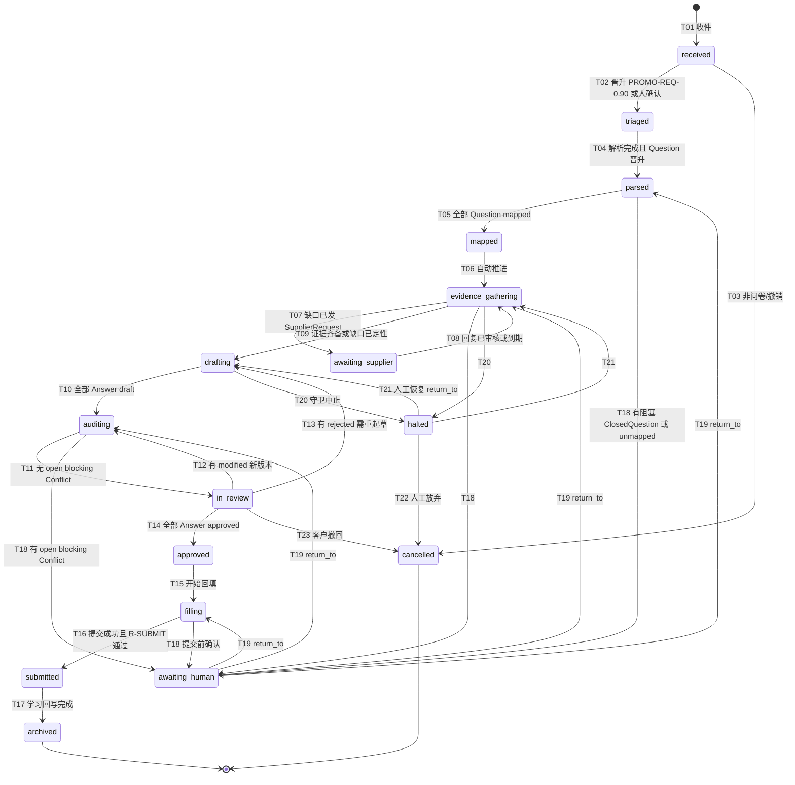

写入合法性摘要（执行者与超时见 04 §3.2）：

| 转移 | 写入 `Request` 新版本的执行者（`created_by`） |
|---|---|
| T01 | `agent:intake-triage`（`trust_zone=quarantine`） |
| T02 | `agent:guard` 或 `user:`（经 ClosedQuestion） |
| T03、T21、T22、T23 | `user:`（T21 限 `org_admin`/`compliance_owner`） |
| T04 | `agent:guard`（`question-parser` 产物晋升后） |
| T05 | `agent:guard` 或 `user:` |
| T06、T09、T17 | `service:workflow` |
| T07 | `agent:upstream-chaser` |
| T08 | `agent:supplier-reply-reviewer` 或 `service:workflow`（timer 到期） |
| T10 | `agent:answer-drafter` 或 `agent:calc-service` |
| T11 | `agent:consistency-auditor` 或 `agent:approval-router` |
| T12、T13、T14 | `agent:approval-router` |
| T15、T16 | `agent:filler`（T16 链中须有 `user:` 确认） |
| T18 | 任一组件；T19 由人作答后 `service:workflow` 写入 |
| T20 | `agent:guard` |

不变量：`awaiting_human` 与 `halted` 可从任一非终态（`submitted`、`archived`、`cancelled` 除外）进入，`status_reason` 记录 `awaiting_human:<cq|conflict|confirm>;return_to=<state>` 或 `halted:<reason>;return_to=<state>`，返回时只能回到 `return_to`（04 §3.1）；`cancelled` 可从任一 `submitted` 之前的状态进入；`submitted` 之前所有关联 `Answer` 必须 `approved`；`trust_zone=quarantine` 时 `status` 只能是 `received`。

### 3.3 Question

| 字段 | 类型 | 必填 | 约束 | 说明 |
|---|---|---|---|---|
| `request_id` | string | 是 | `req_` | 所属问卷（`part_of`） |
| `ordinal` | integer | 是 | ≥1，Request 内唯一 | 顺序 |
| `native_id` | string | 否 | ≤64 | 问卷原题号（如 `C7.3`、`B-12`） |
| `text` | I18nText | 是 | ≤8000 字符/语言 | 原文（外部文本，永远按数据处理） |
| `answer_format` | enum | 是 | `number|text|enum|bool|date|file|geo|table` | 题目要求格式 |
| `options` | string[] | 否 | | 单选/多选选项原文 |
| `unit_requested` | string | 否 | | 题目要求的单位 |
| `period_requested` | Period | 否 | | 题目要求的期间 |
| `locator` | Locator | 是 | | 题目在问卷文件中的位置（回填用，FR-501） |
| `parent_question_id` | string | 否 | `q_` | 表格题的子行 |
| `status` | enum | 是 | `parsed|mapped|unmapped|answered` | |

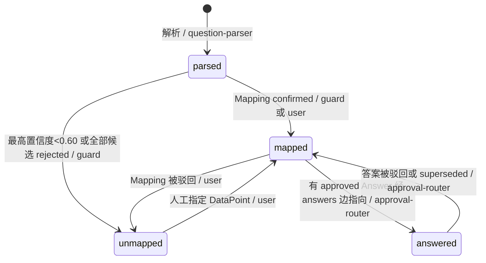

不变量：`mapped` 时至少有一个 `confirmed` 的 Mapping；`(request_id, ordinal)` 唯一；`text` 不得作为任何 Agent 的系统指令拼接（提示词隔离见 07 §3）。

### 3.4 Mapping

| 字段 | 类型 | 必填 | 约束 | 说明 |
|---|---|---|---|---|
| `question_id` | string | 是 | `q_` | |
| `datapoint_id` | string | 是 | `dp:...@semver`，DataPoint 必须 `active` | 目标 |
| `confidence` | number | 是 | 0–1 | |
| `rank` | integer | 是 | 1–3 | 同一题候选排名 |
| `method` | enum | 是 | `exact_template|historical|semantic|human` | |
| `template_mapping_ref` | string | 否 | 02 的 `TemplateMapping` ID | `method=exact_template` 时必填 |
| `unit_hint` | string | 否 | | |
| `period_hint` | Period | 否 | | |
| `boundary_hint` | string | 否 | `boundary` 枚举 | |
| `transform` | object | 否 | `{kind: "unit_convert"|"percent_to_ratio"|"enum_map", params}` | 确定性转换，回填时使用 |
| `status` | enum | 是 | `candidate|confirmed|rejected` | |
| `decided_by_cq` | string | 否 | `cq_` | 由封闭式问题裁决时 |

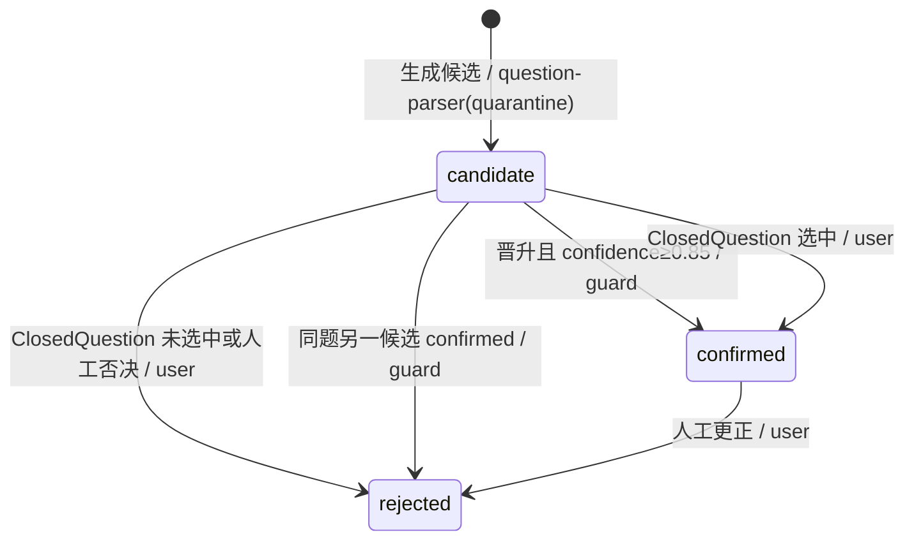

不变量：同一 `question_id` 最多一个 `confirmed`（`table` 题按子 Question 区分）；`0.60 ≤ confidence < 0.85` 的 Top-3 候选必须伴随一个 `open` 的 ClosedQuestion（`kind=single_choice`）；`method=human` 时 `created_by` 必须为 `user:`。

### 3.5 Evidence

| 字段 | 类型 | 必填 | 约束 | 说明 |
|---|---|---|---|---|
| `source_type` | enum | 是 | `document|erp|human_confirmation|supplier_response|historical_answer|public_source` | |
| `datapoint_id` | string | 否 | `dp:...@semver` | 证据直接对应的数据点（若是活动数据可为空） |
| `fact_key` | string | 是 | 02 的活动数据键，如 `activity.electricity.purchased` | 事实类型 |
| `extracted_value` | DEC-STR\|string\|bool\|object | 是 | 按 `value_type` | 提取值（数字为 DEC-STR） |
| `value_type` | enum | 是 | 同 Answer | |
| `unit` | string | 条件 | number 必填 | |
| `period` | Period | 否 | | 事实所属期间（如账单期） |
| `boundary` | string | 是 | `boundary` 枚举 | |
| `locator` | Locator | 是 | 见下 | 原文定位 |
| `valid_from` / `valid_until` | date | 是 / 否 | `valid_from ≤ valid_until` | 有效期（证书到期，FR-404） |
| `confidence` | number | 是 | 0–1 | 提取置信度 |
| `verification` | object | 条件 | `verified` 必填：`{method: auto_rule|closed_question|human_review|connector_attested, cq_ref?, rule_id?, by}` | 核验方式 |
| `supplier_request_ref` | string | 否 | `sreq_` | `source_type=supplier_response` 必填 |
| `corrects` | string | 否 | ObjectRef | 人工更正时指向被更正证据 |
| `plausibility` | object | 否 | `{flag: ok|outlier|unit_suspect, basis}` | 上游回复合理性（FR-302） |
| `status` | enum | 是 | `candidate|verified|expired|superseded|rejected` | `rejected` 为本文新增 |

`Locator` 结构：`{blob_sha256, mime, page?, sheet?, cell?, bbox?: [x0,y0,x1,y1] (PDF 点坐标), text_excerpt_hash?, connector?: {connector_id, query_hash, record_key, fetched_at}}`。`erp` 来源用 `connector` 子结构替代页/单元格；`human_confirmation` 用 `{cq_ref}` 或 `{approval_ref}`。

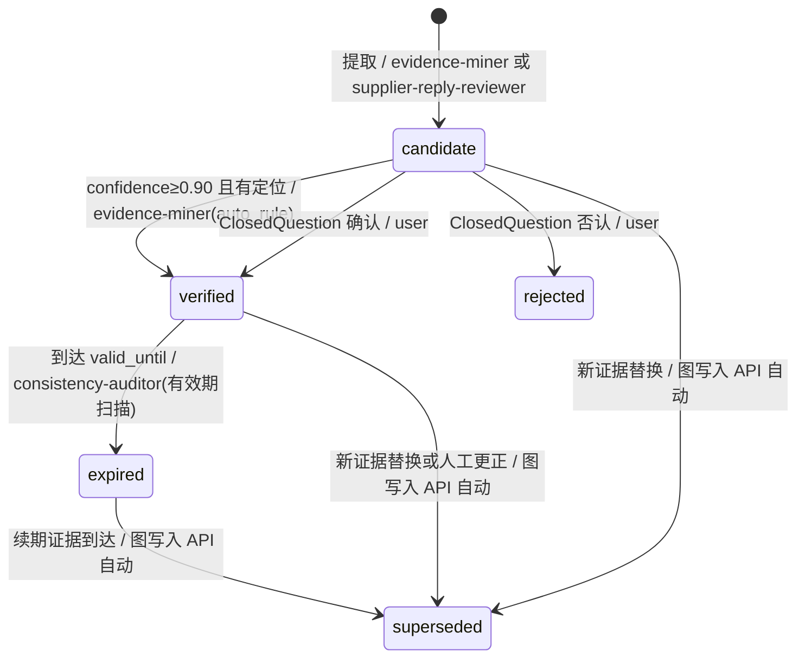

不变量：R-LOC；`quarantine` 的 Evidence 只能是 `candidate`，需经 `guard` 晋升后才能 `verified`；`supplier_response` 且 `plausibility.flag≠ok` 不得 `auto_rule` 核验；`human_confirmation` 的 `created_by` 必须为 `user:`；`expired` 证据不能被新 `Answer` 引用（R-REF），已引用它的 `submitted` 答案不受影响，但会触发 FR-404 预警。

### 3.6 Calculation

| 字段 | 类型 | 必填 | 约束 | 说明 |
|---|---|---|---|---|
| `method_id` | string | 是 | 由 05 定义（05 §1.5 method_id 列表），如 `ghg.scope2.market_based` | 计算方法 |
| `methodology_version` | string | 是 | `<method_family>@<semver>`，family 取自 05 §1.5（如 `ghg-scope2-market@1.0.0`） | 方法论版本 |
| `factor_set_version` | string | 是 | `fs:<source>@<version>`，FactorSet 存在 | 因子库版本（R-FS1） |
| `engine_version` | string | 是 | `belegt-calc@<semver>` | 计算库版本 |
| `inputs` | array | 是 | ≥1；元素 `{name, ref(ObjectRef), value(DEC-STR), unit}` | 钉住版本的输入 |
| `factors_used` | array | 是 | 元素 `{factor_key, value, unit, source_row_id}` | 实际使用的因子 |
| `params` | object | 否 | | 方法参数（如 `consolidation`） |
| `result` | object | 是 | `{value: DEC-STR, unit, rounding: {mode, digits}}` | 结果 |
| `breakdown` | array | 否 | | 分项（便于解释） |
| `input_hash` | string | 是 | `sha256:` | §4.5 |
| `output_hash` | string | 是 | `sha256:` | `JCS(result + breakdown)` 的哈希 |
| `boundary` / `period` | string / Period | 是 | | 计算口径与期间 |
| `customer_scope` | string[]\|"all" | 是 | | 按客户分别计算时区分（PRD §8） |
| `status` | enum | 是 | `computed|superseded` | |

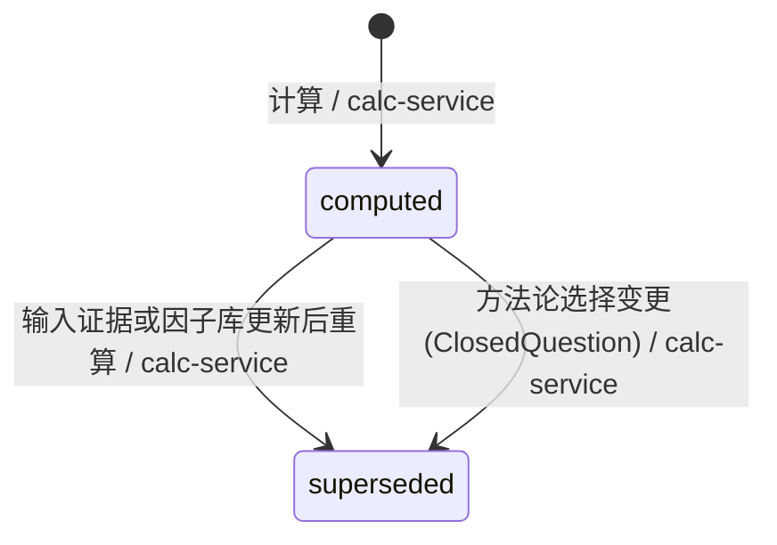

不变量：R-HASH、R-FS1、R-ZONE（`inputs[].ref` 全部 trusted 且 `verified`，或为 `computed` 的 Calculation）；`inputs[].value` 必须等于被引对象版本的值；`created_by` 只能是 `agent:calc-service`；同一 `input_hash + engine_version` 必须产生同一 `output_hash`（重放校验，§4.7）。

### 3.7 Answer

| 字段 | 类型 | 必填 | 约束 | 说明 |
|---|---|---|---|---|
| `datapoint_id` | string | 是 | `dp:...@semver` | |
| `value` | 按类型 | 是 | number→DEC-STR；enum→DataPoint 枚举；file→`{blob_sha256}`；geo→GeoJSON | |
| `value_type` | enum | 是 | `number|text|enum|bool|date|file|geo` | 必须等于 DataPoint 的 `value_type` |
| `unit` | string | 条件 | number 必填 | |
| `text_lang` | string | 条件 | text 必填，BCP 47 | |
| `period` | Period | 是 | | |
| `boundary` | string | 是 | `allowed_boundaries` 之一 | |
| `consolidation` | enum | 条件 | `operational_control|financial_control|equity_share`；`boundary=organization` 且 DataPoint 要求时必填 | |
| `customer_scope` | string[]\|"all" | 是 | `cp_` 列表，升序去重 | |
| `question_refs` | string[] | 否 | `q_` | `answers` 边 |
| `evidence_refs` | string[] | 条件 | ObjectRef（钉住版本） | `cites` 边 |
| `calculation_ref` | string\|null | 条件 | ObjectRef | `derived_from` 边 |
| `reused_from` | string | 否 | ObjectRef（历史 `submitted` 答案） | L0 复用 |
| `origin` | enum | 是 | `generated|imported|human` | `imported` 用于 FR-201 |
| `answer_key` | string | 是 | 服务端计算 `sha256:` | R-ONE |
| `status` | enum | 是 | `draft|in_review|approved|rejected|submitted|superseded` | |
| `risk_level` | enum | 条件 | `L0|L1|L2|L3`；`in_review` 起必填 | 由 `approval-router` 写入 |
| `is_estimate` | bool | 是 | | |
| `estimate_method` | string | 条件 | `is_estimate=true` 必填 | |
| `legal_commitment` | bool | 是 | | |
| `approval_ref` | string | 条件 | `apr_`；`approved` 起必填 | 生效的审批 |
| `submission` | object | 条件 | `submitted` 必填：`{request_id, channel, submitted_at, export_input_hash}` | |
| `drafting_note` | I18nText | 否 | | LLM 解释（不含新数字，guard 扫描） |

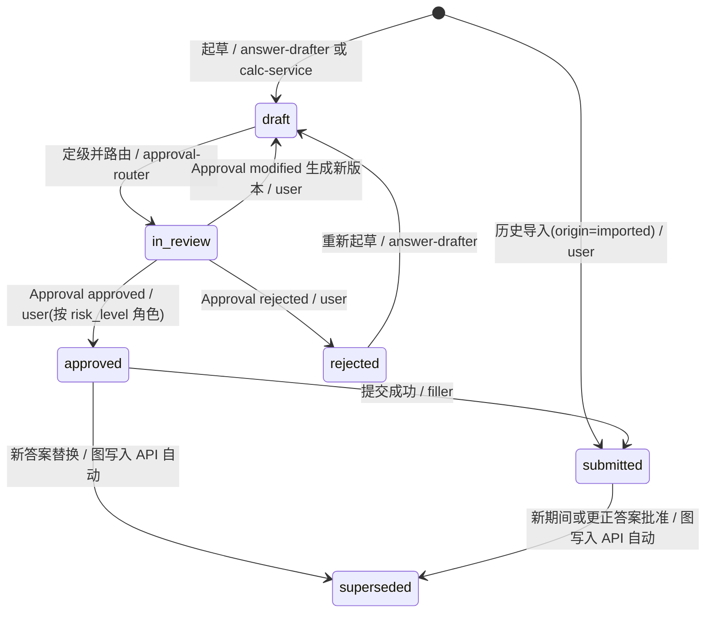

不变量：R-NUM、R-VAL、R-UNIT、R-PERIOD、R-ONE、R-APR、R-EST、R-SUBMIT。补充：
- `value_type=number` 时 `created_by` 不得为 `agent:answer-drafter`（文字答案起草者不碰数字，NFR-03）。
- 人工"修改"数字：审批界面先写一条 `source_type=human_confirmation` 的 Evidence（`verification.method=human_review`），再生成引用它的新 Answer 版本，从而仍满足 R-NUM。
- `risk_level=L3` 的批准不能来自批量 Approval（`Approval.batch_id` 必须为空）。
- `drafting_note` 中出现的数字 token 必须都能在所引对象中找到，否则 `GRAPH_NUM_IN_TEXT`。

### 3.8 Approval

| 字段 | 类型 | 必填 | 约束 | 说明 |
|---|---|---|---|---|
| `subject_ref` | string | 是 | ObjectRef（Answer 版本、Conflict，或 SupplierRequest 版本——首次外发确认，08 §2.3） | `approves` / `resolves` 边 |
| `request_id` | string | 否 | `req_` | |
| `risk_level` | enum | 是 | Answer：复制自 Answer；非 Answer 对象：按 06 §4.4 `approval-policy@1.0.0` 的 `non_answer_subjects` | |
| `required_role` | string[] | 是 | _baseline §G 角色 | 由 `approval-router` 计算 |
| `assignee` | string | 否 | `user:` | |
| `decision` | enum | 条件 | `approved|rejected|modified`，裁决后必填 | |
| `decided_by` | string | 条件 | `user:`，角色 ∈ `required_role` | |
| `decided_at` | date-time | 条件 | | |
| `comment` | string | 否 | ≤4000 | |
| `modified_answer_ref` | string | 条件 | `modified` 必填，新 Answer ObjectRef | |
| `batch_id` | string | 否 | `apb_` + ULID | 一键批量批准（FR-403），L3 禁用 |
| `policy_version` | string | 是 | 06 的审批策略版本 | |
| `status` | enum | 是 | `pending|approved|rejected|modified` | |

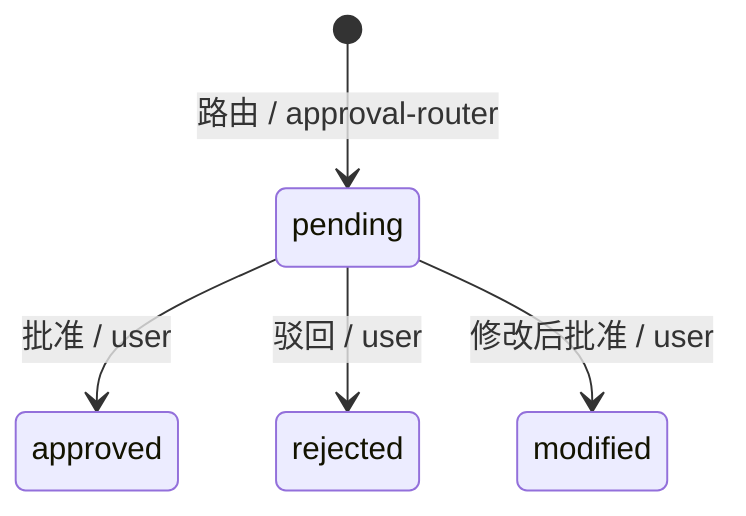

不变量：`status` 与 `decision` 一致；终态后不再有新版本；`subject_ref` 必须钉住 `in_review` 的 Answer 版本，若该 Answer 在审批期间出现新版本，pending 审批由 `approval-router` 作废重建（旧审批追加 `rejected` + `comment="stale"`）。

### 3.9 Conflict

| 字段 | 类型 | 必填 | 约束 | 说明 |
|---|---|---|---|---|
| `rule_id` | string | 是 | `CR-xxx`（§3.9.1） | 触发规则 |
| `severity` | enum | 是 | `blocking|warning` | blocking 阻止提交 |
| `datapoint_id` | string | 是 | | |
| `subject_refs` | string[] | 是 | ≥1 ObjectRef，跨对象冲突 ≥2 | `conflicts_with` 边 |
| `detail` | object | 是 | 确定性生成：`{values[], delta?, threshold?}` | 机器可读 |
| `explanation` | I18nText | 否 | LLM 生成，不含新数字 | 人读解释 |
| `request_id` | string | 否 | | |
| `resolution` | object | 条件 | 终态必填：`{kind, note, approval_ref, resolved_by, divergence?}`；`kind=accepted_divergence` 时 `divergence` 必填 | `divergence` 为结构化差异记录，字段同 06 §3.3 `ADR/1`：`{format:"ADR/1", reason_code, customer_requirement_refs[], sides[{answer, customer_scope, basis}], disclosure_text, include_in_export, review_by}` |
| `status` | enum | 是 | `open|resolved|accepted_divergence|dismissed` | |

#### 3.9.1 冲突规则 ID（MVP 集，04/06 可扩）

| rule_id | 内容 | 默认 severity |
|---|---|---|
| `CR-001` | 同 `answer_key` 除 `customer_scope` 外相同、数值不同且无口径说明 | blocking |
| `CR-002` | 同 DataPoint 跨期间变化超过阈值（默认 ±30%） | warning |
| `CR-003` | 分项之和 ≠ 总量（如 location/market-based 与电量不自洽） | blocking |
| `CR-004` | 引用证据在提交日已 `expired` 或将于 30 天内到期 | blocking / warning |
| `CR-005` | 与已 `submitted` 的历史答案不一致（同期间） | blocking |
| `CR-006` | 两个 Agent 对同一事实给出不同值（如 ERP 与账单） | blocking |

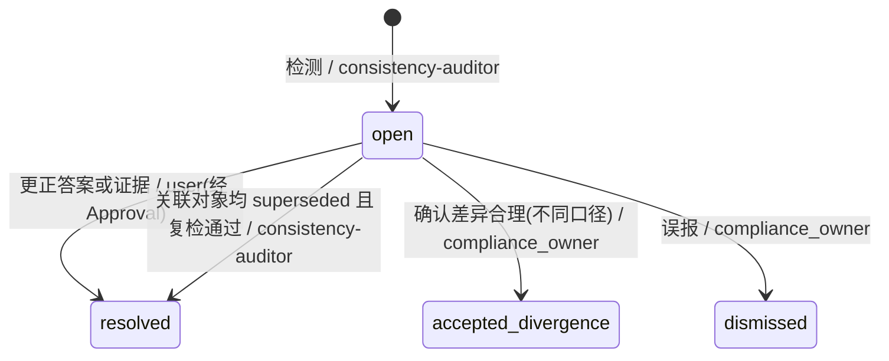

不变量：`accepted_divergence` 必须在 `resolution.divergence` 中记录结构化差异理由（`reason_code` 等，06 §3.3），`sides[].customer_scope` 两两互斥且与两侧 Answer 一致；`note` 仅作人读说明；`dismissed` 计入评测集作为误报样本（FR-004）；同一 `rule_id + subject 集合` 只能有一个 `open`（去重键 `conflict_key`）。

### 3.10 SupplierRequest

| 字段 | 类型 | 必填 | 约束 | 说明 |
|---|---|---|---|---|
| `counterparty_id` | string | 是 | `cp_`，`role=supplier` | `requested_from` 边 |
| `datapoint_ids` | string[] | 是 | ≥1 | 请求的数据点 |
| `product_ids` | string[] | 否 | `prod_` | 如 CBAM 进口品 |
| `period` | Period | 是 | | |
| `language` | string | 是 | BCP 47 | 多语言模板（FR-301） |
| `template_id` | string | 是 | 08 §3.1 定义的消息模板 ID `stpl:<family>.<locale>@<semver>`（与 02 的问卷 `template_id` 不同） | 外发只允许 `reviewed` 模板 |
| `channel` | enum | 是 | `email|supplier_portal` | |
| `portal_token_hash` | string | 否 | `sha256:` | 供应商端一次性链接（明文不入库） |
| `due_date` | date | 是 | | |
| `reminder_count` | integer | 是 | ≥0，≤租户上限 | |
| `last_sent_at` | date-time | 否 | | |
| `trigger_ref` | string | 否 | ObjectRef（缺口 Answer 或 Question） | 为何追数 |
| `default_cost_estimate_ref` | string | 否 | ObjectRef（Calculation） | 不回复时默认值成本（PRD §8） |
| `status` | enum | 是 | `draft|sent|reminded|responded|reviewed|closed|escalated|expired` | |

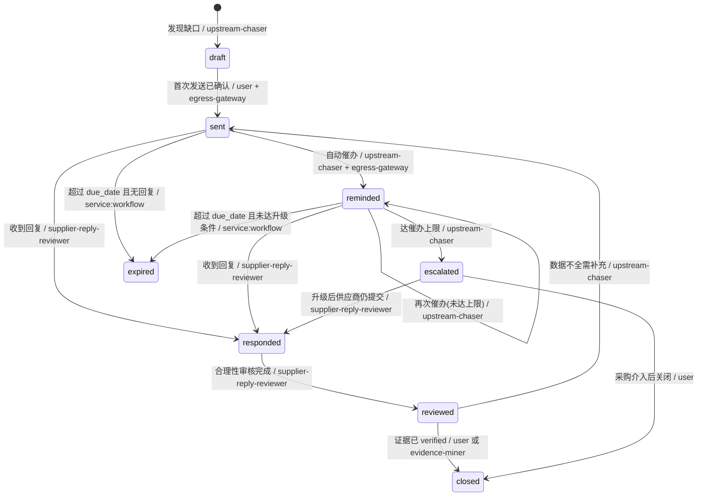

不变量：`sent` 的版本必须有对应 `egress-gateway` 的 `AuditEvent`；首次 `sent` 必须有 `decision=approved` 的 `Approval(subject_ref=sreq_…#vN)`，风险级别与审批人按 06 §4.4（PRD §4.3）；`reminded → expired` 与 `escalated → responded` 两条转移来自 08 §2.3（2026-10-18 统一修订并入）；`reminder_count` 只增不减。

### 3.11 ClosedQuestion

| 字段 | 类型 | 必填 | 约束 | 说明 |
|---|---|---|---|---|
| `target_ref` | string | 是 | ObjectRef（Mapping/Evidence/Calculation 方法选择/Request） | `resolves` 边 |
| `request_id` | string | 否 | | |
| `kind` | enum | 是 | `yes_no|single_choice|numeric_confirm|file_request` | `file_request`：要求上传文件（如续期证书），见 01 §3.2 |
| `prompt` | I18nText | 是 | 模板化生成 | |
| `options` | array | 条件 | single_choice 2–4 项：`{key, label: I18nText, ref?}` | |
| `proposed_value` | object | 条件 | numeric_confirm 必填：`{value: DEC-STR, unit, evidence_ref}` | 只确认已有值，不让人输入新值以外的自由文本 |
| `context_refs` | string[] | 否 | ObjectRef | 展示用证据截图等 |
| `assignee_role` | string | 是 | §G 角色 | |
| `assignee` | string | 否 | `user:` | |
| `expires_at` | date-time | 是 | | |
| `answer` | object | 条件 | `answered` 必填：`{choice?, bool?, corrected_value?, blob_sha256[]?, answered_by, answered_at}`；`kind=file_request` 时 `blob_sha256[]` ≥1 或 `bool=false`（声明暂无） | 数值更正会生成 human_confirmation Evidence；上传文件经 `POST /blobs` 后由 `evidence-miner` 生成候选 Evidence |
| `status` | enum | 是 | `open|answered|expired` | |

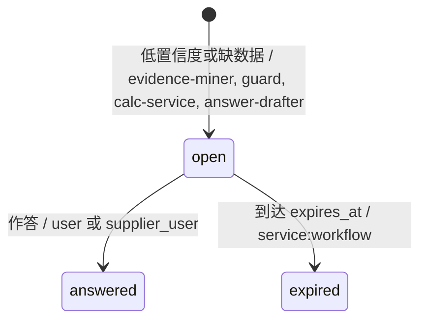

不变量：`answered` 后写入 API 在同一事务追加目标对象的新版本（Mapping→confirmed/rejected，Evidence→verified/rejected）；`expired` 时目标对象保持原状态，Request 留在 `awaiting_human` 并升级提醒。

### 3.12 主数据：Organization / Counterparty / Site / Product

| 对象 | 关键字段（类型，约束） |
|---|---|
| `Organization` | `legal_name`(string)、`country`(ISO 3166-1)、`vat_id`(string，可空)、`eori`(string，CBAM 用)、`default_consolidation`(enum)、`data_residency`(enum `eu|private`)、`locale_default`(`de|en`) |
| `Counterparty` | `role`(`customer|supplier`)、`legal_name`、`country`、`domains[]`（邮件识别）、`portal_ids[]`、`contacts[]`（只存角色邮箱，不处理员工个人数据）、`data_sharing_grant`(object，FR-601 授权) |
| `Site` | `name`、`country`、`address`、`geo`(GeoJSON Point)、`grid_region`(string，选因子用)、`operational_control`(bool) |
| `Product` | `name`、`sku`、`cn_code`(`^[0-9]{8}$`)、`declared_unit`(如 `t`、`1`)、`site_ids[]`、`cbam_relevant`(bool) |

主数据无状态机（_baseline 为 "—"），用 `tags` 中的 `inactive` 表示停用；仍是 append-only 版本。

### 3.13 FactorSet

| 字段 | 类型 | 必填 | 约束 | 说明 |
|---|---|---|---|---|
| `id` | string | 是 | `^fs:[a-z0-9-]+@[0-9A-Za-z.\-]+$` | 版本即 ID，不可复用 |
| `source` | string | 是 | 如 `eu-cbam-default`、`uba`、`aib-residual-mix`、`ecoinvent`（适配器） | |
| `license` | string | 是 | SPDX 或 `proprietary-byol` | 商业库需租户自带许可 |
| `published_at` | date | 是 | | |
| `valid_from` / `valid_until` | date | 是 / 否 | | 适用期间 |
| `row_count` / `rows_hash` | integer / string | 是 | `sha256:` | 因子行整体哈希 |
| `status` | enum | 是 | `active|deprecated` | |

因子行存 `ref.factor`（§6.2），每行 `{factor_key, geography, year, value(DEC-STR), unit, source_row_id}`。`deprecated` 的因子库不能被新 Calculation 使用，历史 Calculation 可继续重放。状态迁移 `active → deprecated` 由因子导入流水线（`service:factor-import`）或 `org_admin` 执行，不可逆。

### 3.14 AuditEvent

| 字段 | 类型 | 必填 | 说明 |
|---|---|---|---|
| `id` / `org_id` / `created_at` / `created_by` | — | 是 | 同通用字段，`version` 恒为 1 |
| `seq` | bigint | 是 | 租户内单调递增 |
| `action` | enum | 是 | `object.create|object.version|object.promote|edge.derive|export.create|egress.send|egress.block|auth.login|authz.change|authz.deny|key.rotate|policy.halt|crypto.erase|dsr.fulfil`（`authz.*`、`key.rotate`、`egress.block`、`dsr.fulfil` 来自 07 §7.1，2026-10-18 统一修订并入） |
| `object_ref` | string | 否 | ObjectRef |
| `content_hash` | string | 否 | 被写对象版本哈希 |
| `trace_id` | string | 是 | `trc_` |
| `prev_hash` / `event_hash` | string | 是 | 哈希链：`event_hash = sha256(prev_hash ‖ JCS(event 去掉 event_hash))` |
| `ip` / `user_agent` | string | 否 | 仅人类操作 |

不变量：只插入；每日由 `service:audit-anchor` 把当日最后 `event_hash` 写入 WORM 对象存储（可选 RFC 3161 时间戳），用于审计包核验。

### 3.15 Trace

| 字段 | 类型 | 必填 | 说明 |
|---|---|---|---|
| `id`（trace_id）/ `span_id` / `parent_span_id` | string | 是/是/否 | 与 OpenTelemetry 兼容（`trc_` 映射到 W3C traceparent） |
| `actor` | string | 是 | `agent:<id>` / `service:<id>` |
| `request_id` | string | 否 | |
| `model` / `model_provider` | string | 否 | LLM 调用时必填 |
| `prompt_version` | string | 否 | 04 §2.0 的提示词版本 `prompt:<agent_id>@<semver>` |
| `input_hash` / `output_hash` | string | 是 | 全链路输入输出哈希（PRD §4.7） |
| `tokens_in` / `tokens_out` / `cost_eur` | int/int/DEC-STR | 否 | 成本 |
| `started_at` / `ended_at` / `status` | — | 是 | `ok|error|halted` |
| `payload_blob` | string | 否 | 加密的完整提示与输出（对象存储，保留期 10 定义） |

### 3.16 全局 ER 图

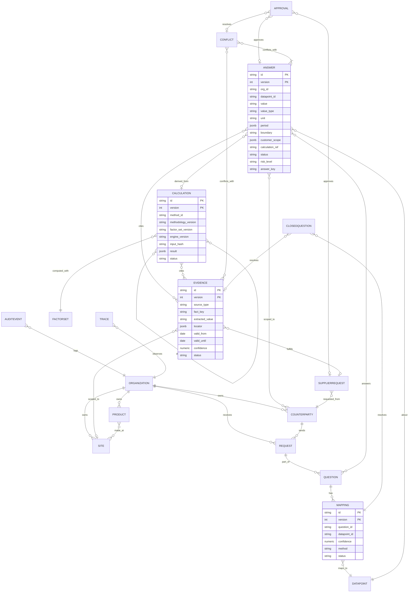

所有实体还隐含 §2.1 通用字段；`PK` 为 `(org_id, id, version)` 中的逻辑部分。

## 4. 版本控制

### 4.1 四种版本

| 版本 | 载体 | 格式 | 递增规则 | 谁决定 |
|---|---|---|---|---|
| 对象版本 | 所有图对象 `version` | 整数，从 1 起 | 每次写入 +1 | 写入 API |
| DataPoint 版本 | `DataPoint.semver` | SemVer `MAJOR.MINOR.PATCH` | MAJOR：语义/单位/量纲变化；MINOR：新增允许口径或枚举值；PATCH：描述、翻译 | 字典 RFC（FR-701，02） |
| 因子库版本 | `FactorSet.id` | `fs:<source>@<version>`（版本沿用来源发布号，如 `2025.1`） | 新发布即新 ID，旧 ID 永不改内容 | 因子导入流水线 |
| 方法论版本 | `Calculation.methodology_version` | `<family>@<semver>`（family 列表见 05 §1.5） | 公式、取舍规则或舍入变化即 MINOR 以上（细则见 05 §1.4） | `belegt-calc` 发版（05） |

另有 `engine_version`（`belegt-calc@x.y.z`）与 `schema_version`（`belegt.graph/YYYY-MM`）。字典发版 `belegt-dictionary vYYYY.Q` 是 DataPoint SemVer 的集合快照，图中对象只引用 DataPoint SemVer。

### 4.2 对象版本规则

1. 版本号连续；head 推进使用 `expected_version` 乐观锁，冲突返回 `GRAPH_VERSION_CONFLICT`（409），客户端重读后重试，最多 3 次，之后转 `ClosedQuestion` 或报警。
2. 引用分"钉住"（`ans_…#v3`）和"浮动"（`ans_…`）。写入时浮动引用一律被服务端解析为当前 head 的钉住引用后再存储；数据库中**只存钉住引用**，"浮动"只是 API 便利。
3. 被引对象出新版本不会改变引用者；若需传播（如 Evidence 更正后 Calculation 应重算），由 `outbox` 事件通知 `calc-service`，它产生新 Calculation 版本，再由工作流推动新 Answer 版本。传播路径即 §4.7 的"影响分析"。

### 4.3 DataPoint SemVer 对图的影响

| 字典变更 | 已 `submitted` 的 Answer | `draft`/`in_review` 的 Answer | Mapping |
|---|---|---|---|
| PATCH | 不变 | 不变 | 不变 |
| MINOR | 不变 | 不变（可选升级） | `TemplateMapping` 新增映射时，新问卷使用新版本 |
| MAJOR | 不变（历史语义钉住旧版本） | `approval-router` 生成 `ClosedQuestion`：确认按新定义重做 | 旧 Mapping 保留，新问卷重映射 |
| `deprecated`/`retired` | 不变 | 阻止进入 `approved`（`GRAPH_DATAPOINT_DEPRECATED`） | 不可新建 |

`answer_key` 使用不带 SemVer 的 DataPoint ID，因此同一指标在 MINOR/PATCH 升级前后仍属同一唯一性分组；MAJOR 升级若改变量纲，02 规定必须换新 DataPoint ID。

### 4.4 FactorSet 与 methodology_version

- 一个 Calculation 只绑定一个 `factor_set_version`（R-FS1）。location-based 与 market-based 是两个 Calculation；PCF 的多来源因子拆为子计算链，用 `derived_from` 串联。
- 因子库新版本发布不会自动重算已批准答案；`consistency-auditor` 生成 `warning` 级提示"有更新因子可用"，由人决定是否在下一期间采用。
- 客户要求不同方法论（PRD §8）时：按 `customer_scope` 分别生成 Calculation 与 Answer，两者 `answer_key` 不同，不触发 `CR-001`。

### 4.5 input_hash 计算方式

`input_hash = "sha256:" + hex(SHA-256(UTF-8(JCS(M))))`，其中 JCS 为 RFC 8785 JSON Canonicalization Scheme，M 为：

```json
{
  "method_id": "...",
  "methodology_version": "...",
  "factor_set_version": "...",
  "factor_set_rows_hash": "sha256:...",
  "boundary": "...",
  "period": {"start": "YYYY-MM-DD", "end": "YYYY-MM-DD"},
  "params": {},
  "inputs": [{"name": "...", "ref": "<ObjectRef>", "value": "<DEC-STR>", "unit": "..."}]
}
```

规范化细则：
1. `inputs` 按 `name` 升序，`name` 在计算内唯一；`ref` 必须钉住版本。
2. 所有数字为 DEC-STR，并做规范化：去掉前导零与末尾无意义的零（`"4820.0"→"4820"`），`"-0"→"0"`。
3. 键名按 JCS 排序；字符串 NFC 规范化；空对象 `{}` 保留，`null` 字段删除。
4. 不纳入 `engine_version`：同一 `input_hash` 在不同引擎版本下结果不同，正是重放要发现的"漂移"。
5. `output_hash` 同理，对 `{"result": ..., "breakdown": ...}` 求哈希。
6. 参考实现在 `belegt-calc` 的 `belegt_calc.hashing.input_hash()`，测试向量随 FR-702 发布；`belegt-core` 写入时以服务端重算为准（R-HASH）。

`content_hash`（任一对象版本）与 `Trace.input_hash/output_hash` 使用同一规范化函数。

### 4.6 "as-of" 时间旅行查询

API：`GET /graph/objects/{id}?as_of_tx=2027-03-01T10:00:00Z`，`GET /graph/answers?datapoint_id=...&as_of_tx=...&as_of_valid=2026-12-31`。

语义：
- `as_of_tx`：取 `created_at ≤ as_of_tx` 的最大版本，即"系统当时知道什么"。用于审计"提交那一刻的依据"。
- `as_of_valid`：在上述结果上过滤业务有效：Evidence `valid_from ≤ d ≤ coalesce(valid_until, +∞)`；Answer `period` 覆盖 d。
- 同时给两个参数即双时间查询。

SQL（对象版本表，§6.2）：

```sql
SELECT DISTINCT ON (id) *
FROM graph.answer_v
WHERE org_id = current_setting('app.org_id')
  AND datapoint_id LIKE 'dp:env.ghg.scope2_market_based@%'
  AND created_at <= $1                      -- as_of_tx
  AND period_start <= $2 AND period_end >= $2 -- as_of_valid
ORDER BY id, version DESC;
```

谱系查询 `GET /graph/lineage/{object_ref}?direction=up&depth=8`：以递归 CTE 沿 `graph.edge`（钉住版本）向上遍历，返回节点集与边集，用于审批界面"证据链"展示和审计包。

### 4.7 重放（Replay）

| 重放类型 | 入口 | 做法 | 通过条件 |
|---|---|---|---|
| 计算重放 | `POST /graph/replay/calculation`（`{calc_ref, engine_version?}`） | 读取钉住输入与 FactorSet 行，调用指定引擎重算 | `output_hash` 相同；否则记录 `drift` 报告，不写图 |
| 答案链重放 | `POST /graph/replay/answer` | 对 Answer 谱系中所有 Calculation 逐个重放，再校验 R-VAL | 全部通过 |
| 工作流重放 | Temporal replay（04） | 用历史事件重放，Activity 结果按 `ObjectRef` 从图读回 | 产出 `ObjectRef` 集合一致 |
| 影响分析 | `GET /graph/impact/{object_ref}` | 沿边向下遍历，列出受某证据/因子更正影响的 Calculation、Answer、已提交 Request | — |

CI（FR-004）对 `belegt-calc` 每次发版执行全量测试向量重放；生产每周抽样重放 1% 已提交 Calculation，漂移即报警（NFR-02）。

## 5. JSON Schema 与实例

Schema 统一 `$id` 前缀 `https://schemas.belegt.org/graph/2026-10/`，公共定义在 `common.json`。以下 4 份为完整可用版本（省略的 `common.json` 定义见 5.1）。

### 5.1 common.json（节选）

```json
{
  "$schema": "https://json-schema.org/draft/2020-12/schema",
  "$id": "https://schemas.belegt.org/graph/2026-10/common.json",
  "$defs": {
    "ulid": { "type": "string", "pattern": "^[0-9A-HJKMNP-TV-Z]{26}$" },
    "objectRef": { "type": "string", "pattern": "^(req|q|map|ev|calc|ans|apr|cfl|sreq|cq|cp|site|prod)_[0-9A-HJKMNP-TV-Z]{26}#v[1-9][0-9]*$" },
    "datapointRef": { "type": "string", "pattern": "^dp:[a-z]+(\\.[a-z0-9_]+){2,3}@(0|[1-9][0-9]*)\\.(0|[1-9][0-9]*)\\.(0|[1-9][0-9]*)$" },
    "decStr": { "type": "string", "pattern": "^-?(0|[1-9][0-9]*)(\\.[0-9]+)?$", "maxLength": 40 },
    "sha256": { "type": "string", "pattern": "^sha256:[0-9a-f]{64}$" },
    "actor": { "type": "string", "pattern": "^(user:[a-z0-9_]+|agent:(intake-triage|question-parser|evidence-miner|calc-service|consistency-auditor|answer-drafter|approval-router|upstream-chaser|supplier-reply-reviewer|filler|reg-radar|sales-assistant|guard|egress-gateway)|service:[a-z-]+)$" },
    "period": {
      "type": "object",
      "required": ["start", "end"],
      "properties": { "start": { "type": "string", "format": "date" }, "end": { "type": "string", "format": "date" } },
      "additionalProperties": false
    },
    "boundary": { "type": "string", "pattern": "^(organization|product_per_unit|site:site_[0-9A-HJKMNP-TV-Z]{26}|product:prod_[0-9A-HJKMNP-TV-Z]{26})$" },
    "customerScope": {
      "oneOf": [
        { "const": "all" },
        { "type": "array", "minItems": 1, "uniqueItems": true, "items": { "type": "string", "pattern": "^cp_[0-9A-HJKMNP-TV-Z]{26}$" } }
      ]
    },
    "i18nText": {
      "type": "object", "minProperties": 1,
      "propertyNames": { "pattern": "^[a-z]{2}(-[A-Z]{2})?$" },
      "additionalProperties": { "type": "string", "maxLength": 8000 }
    },
    "envelope": {
      "type": "object",
      "required": ["id", "org_id", "version", "created_at", "created_by", "trust_zone", "provenance", "schema_version", "content_hash"],
      "properties": {
        "org_id": { "type": "string", "pattern": "^(org_[0-9A-HJKMNP-TV-Z]{26}|org_global)$" },
        "version": { "type": "integer", "minimum": 1 },
        "created_at": { "type": "string", "format": "date-time" },
        "created_by": { "$ref": "#/$defs/actor" },
        "trust_zone": { "enum": ["quarantine", "trusted"] },
        "provenance": { "type": "string", "pattern": "^trc_[0-9A-HJKMNP-TV-Z]{26}$" },
        "supersedes": { "oneOf": [ { "type": "null" }, { "$ref": "#/$defs/objectRef" } ] },
        "schema_version": { "const": "belegt.graph/2026-10" },
        "content_hash": { "$ref": "#/$defs/sha256" },
        "tags": { "type": "array", "maxItems": 20, "items": { "type": "string" } }
      }
    }
  }
}
```

写入时客户端可省略 `version`、`created_at`、`content_hash`，由服务端补齐后再做完整校验（"两段校验"：`input` 模式与 `stored` 模式，见 §6.8）。

### 5.2 answer.json

```json
{
  "$schema": "https://json-schema.org/draft/2020-12/schema",
  "$id": "https://schemas.belegt.org/graph/2026-10/answer.json",
  "title": "Answer",
  "type": "object",
  "required": ["id", "datapoint_id", "value", "value_type", "period", "boundary", "customer_scope", "origin", "answer_key", "status", "is_estimate", "legal_commitment"],
  "properties": {
    "id": { "type": "string", "pattern": "^ans_[0-9A-HJKMNP-TV-Z]{26}$" },
    "org_id": true, "version": true, "created_at": true, "created_by": true, "trust_zone": { "const": "trusted" },
    "provenance": true, "supersedes": true, "schema_version": true, "content_hash": true, "tags": true,
    "datapoint_id": { "$ref": "common.json#/$defs/datapointRef" },
    "value_type": { "enum": ["number", "text", "enum", "bool", "date", "file", "geo"] },
    "value": true,
    "unit": { "type": "string", "maxLength": 32 },
    "text_lang": { "type": "string", "pattern": "^[a-z]{2}(-[A-Z]{2})?$" },
    "period": { "$ref": "common.json#/$defs/period" },
    "boundary": { "$ref": "common.json#/$defs/boundary" },
    "consolidation": { "enum": ["operational_control", "financial_control", "equity_share"] },
    "customer_scope": { "$ref": "common.json#/$defs/customerScope" },
    "question_refs": { "type": "array", "uniqueItems": true, "items": { "type": "string", "pattern": "^q_[0-9A-HJKMNP-TV-Z]{26}$" } },
    "evidence_refs": { "type": "array", "uniqueItems": true, "items": { "type": "string", "pattern": "^ev_[0-9A-HJKMNP-TV-Z]{26}#v[1-9][0-9]*$" } },
    "calculation_ref": { "oneOf": [ { "type": "null" }, { "type": "string", "pattern": "^calc_[0-9A-HJKMNP-TV-Z]{26}#v[1-9][0-9]*$" } ] },
    "reused_from": { "type": "string", "pattern": "^ans_[0-9A-HJKMNP-TV-Z]{26}#v[1-9][0-9]*$" },
    "origin": { "enum": ["generated", "imported", "human"] },
    "answer_key": { "$ref": "common.json#/$defs/sha256" },
    "status": { "enum": ["draft", "in_review", "approved", "rejected", "submitted", "superseded"] },
    "risk_level": { "enum": ["L0", "L1", "L2", "L3"] },
    "is_estimate": { "type": "boolean" },
    "estimate_method": { "type": "string", "maxLength": 200 },
    "legal_commitment": { "type": "boolean" },
    "approval_ref": { "type": "string", "pattern": "^apr_[0-9A-HJKMNP-TV-Z]{26}#v[1-9][0-9]*$" },
    "submission": {
      "type": "object",
      "required": ["request_id", "channel", "submitted_at", "export_input_hash"],
      "properties": {
        "request_id": { "type": "string", "pattern": "^req_[0-9A-HJKMNP-TV-Z]{26}$" },
        "channel": { "enum": ["file_export", "portal", "api", "a2a"] },
        "submitted_at": { "type": "string", "format": "date-time" },
        "export_input_hash": { "$ref": "common.json#/$defs/sha256" }
      },
      "additionalProperties": false
    },
    "drafting_note": { "$ref": "common.json#/$defs/i18nText" }
  },
  "additionalProperties": false,
  "allOf": [
    { "$ref": "common.json#/$defs/envelope" },
    {
      "if": { "properties": { "value_type": { "const": "number" } } },
      "then": {
        "required": ["unit"],
        "properties": { "value": { "$ref": "common.json#/$defs/decStr" } },
        "anyOf": [
          { "required": ["evidence_refs"], "properties": { "evidence_refs": { "minItems": 1 } } },
          { "required": ["calculation_ref"], "properties": { "calculation_ref": { "type": "string" } } }
        ]
      }
    },
    { "if": { "properties": { "value_type": { "const": "text" } } }, "then": { "required": ["text_lang"], "properties": { "value": { "type": "string", "maxLength": 20000 } } } },
    { "if": { "properties": { "value_type": { "const": "bool" } } }, "then": { "properties": { "value": { "type": "boolean" } } } },
    { "if": { "properties": { "value_type": { "const": "date" } } }, "then": { "properties": { "value": { "type": "string", "format": "date" } } } },
    { "if": { "properties": { "value_type": { "const": "file" } } }, "then": { "properties": { "value": { "type": "object", "required": ["blob_sha256"], "properties": { "blob_sha256": { "$ref": "common.json#/$defs/sha256" } } } } } },
    { "if": { "properties": { "is_estimate": { "const": true } } }, "then": { "required": ["estimate_method"] } },
    { "if": { "properties": { "legal_commitment": { "const": true } }, "required": ["risk_level"] }, "then": { "properties": { "risk_level": { "const": "L3" } } } },
    { "if": { "properties": { "status": { "enum": ["in_review", "approved", "submitted"] } } }, "then": { "required": ["risk_level"] } },
    { "if": { "properties": { "status": { "enum": ["approved", "submitted"] } } }, "then": { "required": ["approval_ref"] } },
    { "if": { "properties": { "status": { "const": "submitted" } } }, "then": { "required": ["submission"] } }
  ]
}
```

说明：`properties` 中对通用字段写 `true` 是为了在 `additionalProperties: false` 下放行，具体约束由 `allOf` 中的 envelope 提供。R-NUM 由 `anyOf` 在 schema 层第一次拦截，再由 R-VAL 在语义层第二次拦截（引用存在且值一致）。

### 5.3 evidence.json

```json
{
  "$schema": "https://json-schema.org/draft/2020-12/schema",
  "$id": "https://schemas.belegt.org/graph/2026-10/evidence.json",
  "title": "Evidence",
  "type": "object",
  "required": ["id", "source_type", "fact_key", "extracted_value", "value_type", "boundary", "locator", "valid_from", "confidence", "status"],
  "properties": {
    "id": { "type": "string", "pattern": "^ev_[0-9A-HJKMNP-TV-Z]{26}$" },
    "org_id": true, "version": true, "created_at": true, "created_by": true, "trust_zone": true,
    "provenance": true, "supersedes": true, "schema_version": true, "content_hash": true, "tags": true,
    "source_type": { "enum": ["document", "erp", "human_confirmation", "supplier_response", "historical_answer", "public_source"] },
    "datapoint_id": { "$ref": "common.json#/$defs/datapointRef" },
    "fact_key": { "type": "string", "pattern": "^[a-z]+(\\.[a-z0-9_]+)+$" },
    "value_type": { "enum": ["number", "text", "enum", "bool", "date", "file", "geo"] },
    "extracted_value": true,
    "unit": { "type": "string", "maxLength": 32 },
    "period": { "$ref": "common.json#/$defs/period" },
    "boundary": { "$ref": "common.json#/$defs/boundary" },
    "locator": {
      "type": "object",
      "properties": {
        "blob_sha256": { "$ref": "common.json#/$defs/sha256" },
        "mime": { "type": "string" },
        "page": { "type": "integer", "minimum": 1 },
        "sheet": { "type": "string" },
        "cell": { "type": "string", "pattern": "^[A-Z]{1,3}[1-9][0-9]*(:[A-Z]{1,3}[1-9][0-9]*)?$" },
        "bbox": { "type": "array", "items": { "type": "number" }, "minItems": 4, "maxItems": 4 },
        "text_excerpt_hash": { "$ref": "common.json#/$defs/sha256" },
        "connector": {
          "type": "object",
          "required": ["connector_id", "query_hash", "record_key", "fetched_at"],
          "properties": {
            "connector_id": { "type": "string" }, "query_hash": { "$ref": "common.json#/$defs/sha256" },
            "record_key": { "type": "string" }, "fetched_at": { "type": "string", "format": "date-time" }
          }
        },
        "cq_ref": { "type": "string", "pattern": "^cq_[0-9A-HJKMNP-TV-Z]{26}#v[1-9][0-9]*$" },
        "approval_ref": { "type": "string", "pattern": "^apr_[0-9A-HJKMNP-TV-Z]{26}#v[1-9][0-9]*$" }
      },
      "additionalProperties": false,
      "minProperties": 1
    },
    "valid_from": { "type": "string", "format": "date" },
    "valid_until": { "type": "string", "format": "date" },
    "confidence": { "type": "number", "minimum": 0, "maximum": 1 },
    "verification": {
      "type": "object",
      "required": ["method", "by"],
      "properties": {
        "method": { "enum": ["auto_rule", "closed_question", "human_review", "connector_attested"] },
        "rule_id": { "type": "string" },
        "cq_ref": { "type": "string" },
        "by": { "$ref": "common.json#/$defs/actor" }
      }
    },
    "supplier_request_ref": { "type": "string", "pattern": "^sreq_[0-9A-HJKMNP-TV-Z]{26}$" },
    "corrects": { "type": "string", "pattern": "^ev_[0-9A-HJKMNP-TV-Z]{26}#v[1-9][0-9]*$" },
    "plausibility": {
      "type": "object", "required": ["flag"],
      "properties": { "flag": { "enum": ["ok", "outlier", "unit_suspect"] }, "basis": { "type": "string" } }
    },
    "status": { "enum": ["candidate", "verified", "expired", "superseded", "rejected"] }
  },
  "additionalProperties": false,
  "allOf": [
    { "$ref": "common.json#/$defs/envelope" },
    { "if": { "properties": { "value_type": { "const": "number" } } }, "then": { "required": ["unit"], "properties": { "extracted_value": { "$ref": "common.json#/$defs/decStr" } } } },
    { "if": { "properties": { "source_type": { "const": "document" } } }, "then": { "properties": { "locator": { "required": ["blob_sha256"], "anyOf": [ { "required": ["page"] }, { "required": ["cell"] }, { "required": ["bbox"] } ] } } } },
    { "if": { "properties": { "source_type": { "const": "erp" } } }, "then": { "properties": { "locator": { "required": ["connector"] } } } },
    { "if": { "properties": { "source_type": { "const": "human_confirmation" } } }, "then": { "properties": { "created_by": { "pattern": "^user:" }, "locator": { "anyOf": [ { "required": ["cq_ref"] }, { "required": ["approval_ref"] } ] } } } },
    { "if": { "properties": { "source_type": { "const": "supplier_response" } } }, "then": { "required": ["supplier_request_ref", "plausibility"] } },
    { "if": { "properties": { "status": { "const": "verified" } } }, "then": { "required": ["verification"], "properties": { "trust_zone": { "const": "trusted" } } } },
    { "if": { "properties": { "trust_zone": { "const": "quarantine" } } }, "then": { "properties": { "status": { "const": "candidate" } } } }
  ]
}
```

### 5.4 calculation.json

```json
{
  "$schema": "https://json-schema.org/draft/2020-12/schema",
  "$id": "https://schemas.belegt.org/graph/2026-10/calculation.json",
  "title": "Calculation",
  "type": "object",
  "required": ["id", "method_id", "methodology_version", "factor_set_version", "engine_version", "inputs", "factors_used", "result", "input_hash", "output_hash", "boundary", "period", "customer_scope", "status"],
  "properties": {
    "id": { "type": "string", "pattern": "^calc_[0-9A-HJKMNP-TV-Z]{26}$" },
    "org_id": true, "version": true, "created_at": true, "provenance": true, "supersedes": true, "schema_version": true, "content_hash": true, "tags": true,
    "created_by": { "const": "agent:calc-service" },
    "trust_zone": { "const": "trusted" },
    "method_id": { "type": "string", "pattern": "^[a-z0-9_]+(\\.[a-z0-9_]+)+$" },
    "methodology_version": { "type": "string", "pattern": "^[a-z0-9-]+@(0|[1-9][0-9]*)\\.(0|[1-9][0-9]*)\\.(0|[1-9][0-9]*)$" },
    "factor_set_version": { "type": "string", "pattern": "^fs:[a-z0-9-]+@[0-9A-Za-z.\\-]+$" },
    "engine_version": { "type": "string", "pattern": "^belegt-calc@[0-9]+\\.[0-9]+\\.[0-9]+$" },
    "inputs": {
      "type": "array", "minItems": 1,
      "items": {
        "type": "object",
        "required": ["name", "ref", "value", "unit"],
        "properties": {
          "name": { "type": "string", "pattern": "^[a-z0-9_]+$" },
          "ref": { "type": "string", "pattern": "^(ev|calc)_[0-9A-HJKMNP-TV-Z]{26}#v[1-9][0-9]*$" },
          "value": { "$ref": "common.json#/$defs/decStr" },
          "unit": { "type": "string" }
        },
        "additionalProperties": false
      }
    },
    "factors_used": {
      "type": "array",
      "items": {
        "type": "object",
        "required": ["factor_key", "value", "unit", "source_row_id"],
        "properties": {
          "factor_key": { "type": "string" }, "value": { "$ref": "common.json#/$defs/decStr" },
          "unit": { "type": "string" }, "source_row_id": { "type": "string" }
        },
        "additionalProperties": false
      }
    },
    "params": { "type": "object" },
    "result": {
      "type": "object",
      "required": ["value", "unit", "rounding"],
      "properties": {
        "value": { "$ref": "common.json#/$defs/decStr" },
        "unit": { "type": "string" },
        "rounding": {
          "type": "object", "required": ["mode", "digits"],
          "properties": { "mode": { "enum": ["half_even", "half_up", "none"] }, "digits": { "type": "integer", "minimum": 0, "maximum": 12 } }
        }
      },
      "additionalProperties": false
    },
    "breakdown": {
      "type": "array",
      "items": { "type": "object", "required": ["name", "value", "unit"], "properties": { "name": { "type": "string" }, "value": { "$ref": "common.json#/$defs/decStr" }, "unit": { "type": "string" } } }
    },
    "input_hash": { "$ref": "common.json#/$defs/sha256" },
    "output_hash": { "$ref": "common.json#/$defs/sha256" },
    "boundary": { "$ref": "common.json#/$defs/boundary" },
    "period": { "$ref": "common.json#/$defs/period" },
    "customer_scope": { "$ref": "common.json#/$defs/customerScope" },
    "status": { "enum": ["computed", "superseded"] }
  },
  "additionalProperties": false,
  "allOf": [ { "$ref": "common.json#/$defs/envelope" } ]
}
```

### 5.5 conflict.json

```json
{
  "$schema": "https://json-schema.org/draft/2020-12/schema",
  "$id": "https://schemas.belegt.org/graph/2026-10/conflict.json",
  "title": "Conflict",
  "type": "object",
  "required": ["id", "rule_id", "severity", "datapoint_id", "subject_refs", "detail", "status"],
  "properties": {
    "id": { "type": "string", "pattern": "^cfl_[0-9A-HJKMNP-TV-Z]{26}$" },
    "org_id": true, "version": true, "created_at": true, "provenance": true, "supersedes": true, "schema_version": true, "content_hash": true, "tags": true,
    "created_by": { "$ref": "common.json#/$defs/actor" },
    "trust_zone": { "const": "trusted" },
    "rule_id": { "type": "string", "pattern": "^CR-[0-9]{3}$" },
    "severity": { "enum": ["blocking", "warning"] },
    "datapoint_id": { "$ref": "common.json#/$defs/datapointRef" },
    "subject_refs": { "type": "array", "minItems": 1, "uniqueItems": true, "items": { "$ref": "common.json#/$defs/objectRef" } },
    "detail": {
      "type": "object",
      "required": ["values"],
      "properties": {
        "values": {
          "type": "array", "minItems": 1,
          "items": { "type": "object", "required": ["ref", "value"], "properties": { "ref": { "$ref": "common.json#/$defs/objectRef" }, "value": { "$ref": "common.json#/$defs/decStr" }, "unit": { "type": "string" }, "customer_scope": { "$ref": "common.json#/$defs/customerScope" } } }
        },
        "delta": { "$ref": "common.json#/$defs/decStr" },
        "delta_ratio": { "$ref": "common.json#/$defs/decStr" },
        "threshold": { "$ref": "common.json#/$defs/decStr" }
      }
    },
    "explanation": { "$ref": "common.json#/$defs/i18nText" },
    "explanation_by": { "type": "string", "const": "agent:consistency-auditor" },
    "request_id": { "type": "string", "pattern": "^req_[0-9A-HJKMNP-TV-Z]{26}$" },
    "conflict_key": { "$ref": "common.json#/$defs/sha256" },
    "resolution": {
      "type": "object",
      "required": ["kind", "note", "resolved_by"],
      "properties": {
        "kind": { "enum": ["corrected", "accepted_divergence", "dismissed", "auto_cleared"] },
        "note": { "type": "string", "minLength": 1, "maxLength": 4000 },
        "approval_ref": { "type": "string", "pattern": "^apr_[0-9A-HJKMNP-TV-Z]{26}#v[1-9][0-9]*$" },
        "resolved_by": { "$ref": "common.json#/$defs/actor" },
        "divergence": {
          "type": "object",
          "description": "结构化差异记录，字段同 06 §3.3 ADR/1",
          "required": ["format", "reason_code", "customer_requirement_refs", "sides", "include_in_export", "review_by"],
          "properties": {
            "format": { "const": "ADR/1" },
            "reason_code": { "enum": ["customer_methodology", "consolidation", "period", "product_scope", "boundary", "timing_correction"] },
            "customer_requirement_refs": { "type": "array", "minItems": 1, "items": { "type": "string" } },
            "sides": {
              "type": "array", "minItems": 2,
              "items": {
                "type": "object",
                "required": ["answer", "customer_scope", "basis"],
                "properties": {
                  "answer": { "$ref": "common.json#/$defs/objectRef" },
                  "customer_scope": { "$ref": "common.json#/$defs/customerScope" },
                  "basis": { "type": "string", "maxLength": 200 }
                },
                "additionalProperties": false
              }
            },
            "disclosure_text": { "$ref": "common.json#/$defs/i18nText" },
            "include_in_export": { "type": "boolean" },
            "review_by": { "type": "string", "format": "date" }
          },
          "additionalProperties": false
        }
      },
      "additionalProperties": false
    },
    "status": { "enum": ["open", "resolved", "accepted_divergence", "dismissed"] }
  },
  "additionalProperties": false,
  "allOf": [
    { "$ref": "common.json#/$defs/envelope" },
    { "if": { "properties": { "status": { "const": "open" } } }, "then": { "properties": { "created_by": { "const": "agent:consistency-auditor" } } }, "else": { "required": ["resolution"] } },
    { "if": { "properties": { "status": { "enum": ["accepted_divergence", "dismissed"] } } }, "then": { "properties": { "resolution": { "properties": { "resolved_by": { "pattern": "^user:" } }, "required": ["approval_ref"] } } } },
    { "if": { "properties": { "status": { "const": "accepted_divergence" } } }, "then": { "properties": { "resolution": { "required": ["divergence"] } } } }
  ]
}
```

### 5.6 串联实例：OEM 问卷 Scope 2 题的完整链

场景（示例数据）：德国 OEM 客户 `cp_01JC2B3C4D5E6F7G8H9J0K1M2N`（下称 OEM-A）通过邮件发来年度供应商可持续自评问卷（Excel），第 37 题（原题号 `E-2.3`，`Environment!F42`）要求填报 2025 年 Scope 2 market-based 排放（tCO2e）。我方租户 `org_01JC0A1B2C3D4E5F6G7H8J9K0M` 2025 年外购电 4 820 MWh，其中 1 200 MWh 有已注销的绿证（Herkunftsnachweise）；剩余电量使用残余组合因子 0.56 tCO2e/MWh（**示例值**，非 AIB 实际发布值）。结果：(4820 − 1200) × 0.56 = 2027.2 tCO2e。这是该租户首次对外提交排放数字，因此 `risk_level=L3`。

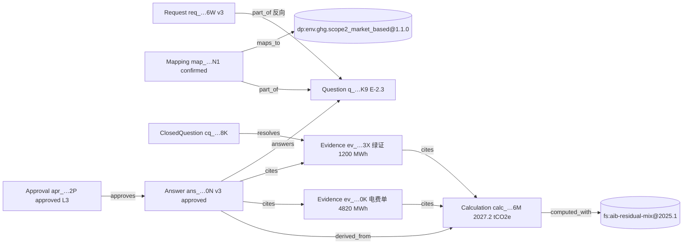

时间线（UTC）：08:14 分拣并晋升 Request → 08:16 解析 Question，Mapping 置信度 0.93 由 `guard` 晋升为 `confirmed` → 08:31 `evidence-miner` 从电费结算单第 2 页提取 4820 MWh（0.96，有 bbox，自动 `verified`）→ 绿证电量置信度 0.82，生成 `numeric_confirm` 封闭式问题 → 09:02 合规负责人确认 → 09:03 `calc-service` 计算 → `calc-service` 装配 Answer v1（`draft`）→ `approval-router` 定级 L3，Answer v2（`in_review`）+ Approval v1（`pending`）→ 次日 07:45 合规负责人单条批准，Approval v2 与 Answer v3（`approved`）同事务写入。下文 `content_hash`、`input_hash`、`output_hash`、`answer_key` 均按 §4.5 实际计算（参考脚本 `work/gen_chain.py`），四份对象已通过 §5.2–5.4 schema 校验。

#### 5.6.1 Calculation 的 input_hash 原文 M

```json
{"boundary":"organization","factor_set_rows_hash":"sha256:35f78fd009ad6f51b4973c5a50e77fdf25d81dfaa58395010609c6a7e3b1b460","factor_set_version":"fs:aib-residual-mix@2025.1","inputs":[{"name":"electricity_contractual_renewable","ref":"ev_01JD8Z4M5N6P7Q8R9S0T1V2W3X#v2","unit":"MWh","value":"1200"},{"name":"electricity_purchased","ref":"ev_01JD8Z1A2B3C4D5E6F7G8H9J0K#v2","unit":"MWh","value":"4820"}],"method_id":"ghg.scope2.market_based","methodology_version":"ghg-scope2-market@1.0.0","params":{"consolidation":"operational_control","grid_region":"DE"},"period":{"end":"2025-12-31","start":"2025-01-01"}}
```

#### 5.6.2 Request（v3，已晋升并解析）

```json
{
  "id": "req_01JD8Y3K5M2N4P6Q8R0S2T4V6W",
  "org_id": "org_01JC0A1B2C3D4E5F6G7H8J9K0M",
  "version": 3,
  "created_at": "2026-11-03T08:14:02Z",
  "created_by": "service:workflow",
  "trust_zone": "trusted",
  "provenance": "trc_01JD8Y3K5M2N4P6Q8R0S2T4V70",
  "supersedes": "req_01JD8Y3K5M2N4P6Q8R0S2T4V6W#v2",
  "schema_version": "belegt.graph/2026-10",
  "counterparty_id": "cp_01JC2B3C4D5E6F7G8H9J0K1M2N",
  "channel": "email",
  "source_ref": {
    "message_id": "<a1b2c3@oem-a.example>",
    "blob_sha256": [
      "sha256:86d6de80ddae30b828a399aec56a52461f268b508227ddbbd808d8d858b963f8"
    ]
  },
  "template_ref": null,
  "title": "Supplier Sustainability Self-Assessment 2026",
  "language": "en",
  "due_date": "2026-11-30",
  "reporting_period": {
    "start": "2025-01-01",
    "end": "2025-12-31"
  },
  "priority": "high",
  "triage_confidence": 0.94,
  "status": "parsed",
  "content_hash": "sha256:1ae93bb43c9861e8aa2a8baf381370957094b8f3f8c8847dfcb669db83ccbffc"
}
```

#### 5.6.3 Question（v2）

```json
{
  "id": "q_01JD8YA0B1C2D3E4F5G6H7J8K9",
  "org_id": "org_01JC0A1B2C3D4E5F6G7H8J9K0M",
  "version": 2,
  "created_at": "2026-11-03T08:16:40Z",
  "created_by": "agent:guard",
  "trust_zone": "trusted",
  "provenance": "trc_01JD8Y3K5M2N4P6Q8R0S2T4V71",
  "supersedes": "q_01JD8YA0B1C2D3E4F5G6H7J8K9#v1",
  "schema_version": "belegt.graph/2026-10",
  "request_id": "req_01JD8Y3K5M2N4P6Q8R0S2T4V6W",
  "ordinal": 37,
  "native_id": "E-2.3",
  "text": {
    "en": "Please state your company's Scope 2 GHG emissions (market-based) for reporting year 2025 in tCO2e."
  },
  "answer_format": "number",
  "unit_requested": "tCO2e",
  "period_requested": {
    "start": "2025-01-01",
    "end": "2025-12-31"
  },
  "locator": {
    "blob_sha256": "sha256:86d6de80ddae30b828a399aec56a52461f268b508227ddbbd808d8d858b963f8",
    "sheet": "Environment",
    "cell": "F42"
  },
  "status": "mapped",
  "content_hash": "sha256:dc135a43356d2933fdf902480e0f871bdc53a070b44bb17545d15a4bf1c76c3c"
}
```

#### 5.6.4 Mapping（v2，guard 晋升为 confirmed）

```json
{
  "id": "map_01JD8YC2D3E4F5G6H7J8K9M0N1",
  "org_id": "org_01JC0A1B2C3D4E5F6G7H8J9K0M",
  "version": 2,
  "created_at": "2026-11-03T08:16:41Z",
  "created_by": "agent:guard",
  "trust_zone": "trusted",
  "provenance": "trc_01JD8Y3K5M2N4P6Q8R0S2T4V71",
  "supersedes": "map_01JD8YC2D3E4F5G6H7J8K9M0N1#v1",
  "schema_version": "belegt.graph/2026-10",
  "question_id": "q_01JD8YA0B1C2D3E4F5G6H7J8K9",
  "datapoint_id": "dp:env.ghg.scope2_market_based@1.1.0",
  "confidence": 0.93,
  "rank": 1,
  "method": "historical",
  "unit_hint": "tCO2e",
  "period_hint": {
    "start": "2025-01-01",
    "end": "2025-12-31"
  },
  "boundary_hint": "organization",
  "promotion": {
    "rule": "PROMO-MAP-0.85",
    "schema_version": "belegt.graph/2026-10",
    "checked_at": "2026-11-03T08:16:41Z"
  },
  "status": "confirmed",
  "content_hash": "sha256:3bb64934caedf58e0cf4f53964d056bf77cbb410a298d6057f9ee5d784454f6e"
}
```

#### 5.6.5 Evidence：年度电费结算单（v2，自动核验）

```json
{
  "id": "ev_01JD8Z1A2B3C4D5E6F7G8H9J0K",
  "org_id": "org_01JC0A1B2C3D4E5F6G7H8J9K0M",
  "version": 2,
  "created_at": "2026-11-03T08:31:12Z",
  "created_by": "agent:evidence-miner",
  "trust_zone": "trusted",
  "provenance": "trc_01JD8Y3K5M2N4P6Q8R0S2T4V72",
  "supersedes": "ev_01JD8Z1A2B3C4D5E6F7G8H9J0K#v1",
  "schema_version": "belegt.graph/2026-10",
  "source_type": "document",
  "fact_key": "activity.electricity.purchased",
  "extracted_value": "4820",
  "value_type": "number",
  "unit": "MWh",
  "period": {
    "start": "2025-01-01",
    "end": "2025-12-31"
  },
  "boundary": "organization",
  "locator": {
    "blob_sha256": "sha256:c9c2548450165ddb78c597f020912adfe8ab438569f68ac1e8e8016d341c7105",
    "mime": "application/pdf",
    "page": 2,
    "bbox": [
      72.0,
      410.5,
      520.0,
      428.0
    ]
  },
  "valid_from": "2025-01-01",
  "valid_until": "2025-12-31",
  "confidence": 0.96,
  "verification": {
    "method": "auto_rule",
    "rule_id": "EV-AUTO-0.90-LOC",
    "by": "agent:evidence-miner"
  },
  "status": "verified",
  "content_hash": "sha256:cff6a7fe9c80cdff7c807e2e5b4a73f6ecc70a66857cf42ca36553340fe1bafc"
}
```

#### 5.6.6 ClosedQuestion：确认绿证电量（v2，已作答）

```json
{
  "id": "cq_01JD8Z9A0B1C2D3E4F5G6H7J8K",
  "org_id": "org_01JC0A1B2C3D4E5F6G7H8J9K0M",
  "version": 2,
  "created_at": "2026-11-03T09:02:55Z",
  "created_by": "user:u_compliance01",
  "trust_zone": "trusted",
  "provenance": "trc_01JD8Y3K5M2N4P6Q8R0S2T4V73",
  "supersedes": "cq_01JD8Z9A0B1C2D3E4F5G6H7J8K#v1",
  "schema_version": "belegt.graph/2026-10",
  "target_ref": "ev_01JD8Z4M5N6P7Q8R9S0T1V2W3X#v1",
  "request_id": "req_01JD8Y3K5M2N4P6Q8R0S2T4V6W",
  "kind": "numeric_confirm",
  "prompt": {
    "de": "Herkunftsnachweise 2025 entwertet: 1.200 MWh – korrekt?",
    "en": "Guarantees of origin cancelled for 2025: 1,200 MWh – correct?"
  },
  "proposed_value": {
    "value": "1200",
    "unit": "MWh",
    "evidence_ref": "ev_01JD8Z4M5N6P7Q8R9S0T1V2W3X#v1"
  },
  "assignee_role": "compliance_owner",
  "expires_at": "2026-11-10T17:00:00Z",
  "answer": {
    "bool": true,
    "answered_by": "user:u_compliance01",
    "answered_at": "2026-11-03T09:02:55Z"
  },
  "status": "answered",
  "content_hash": "sha256:afb1ac926a07c539ffbfe71c1fd1c45694b668bd637b741535f70b2ba6e3f3cc"
}
```

#### 5.6.7 Evidence：绿证（Herkunftsnachweis）注销证明（v2，经封闭式确认核验）

```json
{
  "id": "ev_01JD8Z4M5N6P7Q8R9S0T1V2W3X",
  "org_id": "org_01JC0A1B2C3D4E5F6G7H8J9K0M",
  "version": 2,
  "created_at": "2026-11-03T09:02:55Z",
  "created_by": "user:u_compliance01",
  "trust_zone": "trusted",
  "provenance": "trc_01JD8Y3K5M2N4P6Q8R0S2T4V73",
  "supersedes": "ev_01JD8Z4M5N6P7Q8R9S0T1V2W3X#v1",
  "schema_version": "belegt.graph/2026-10",
  "source_type": "document",
  "fact_key": "activity.electricity.contractual_renewable",
  "extracted_value": "1200",
  "value_type": "number",
  "unit": "MWh",
  "period": {
    "start": "2025-01-01",
    "end": "2025-12-31"
  },
  "boundary": "organization",
  "locator": {
    "blob_sha256": "sha256:3c416a905379c95d186d6d81cd391c8ed1204302ccdae80aaafb7e060adf3fc2",
    "mime": "application/pdf",
    "page": 1,
    "bbox": [
      60.0,
      300.0,
      540.0,
      318.0
    ]
  },
  "valid_from": "2025-01-01",
  "valid_until": "2025-12-31",
  "confidence": 0.82,
  "verification": {
    "method": "closed_question",
    "cq_ref": "cq_01JD8Z9A0B1C2D3E4F5G6H7J8K#v2",
    "by": "user:u_compliance01"
  },
  "status": "verified",
  "content_hash": "sha256:e23e1338bebb7a245ce1d54a9e02ec7dfae03378b90c5996a355abddd7baf071"
}
```

#### 5.6.8 Calculation：Scope 2 market-based（v1）

```json
{
  "id": "calc_01JD9A7B8C9D0E1F2G3H4J5K6M",
  "org_id": "org_01JC0A1B2C3D4E5F6G7H8J9K0M",
  "version": 1,
  "created_at": "2026-11-03T09:03:20Z",
  "created_by": "agent:calc-service",
  "trust_zone": "trusted",
  "provenance": "trc_01JD8Y3K5M2N4P6Q8R0S2T4V74",
  "supersedes": null,
  "schema_version": "belegt.graph/2026-10",
  "method_id": "ghg.scope2.market_based",
  "methodology_version": "ghg-scope2-market@1.0.0",
  "factor_set_version": "fs:aib-residual-mix@2025.1",
  "engine_version": "belegt-calc@0.3.0",
  "inputs": [
    {
      "name": "electricity_contractual_renewable",
      "ref": "ev_01JD8Z4M5N6P7Q8R9S0T1V2W3X#v2",
      "value": "1200",
      "unit": "MWh"
    },
    {
      "name": "electricity_purchased",
      "ref": "ev_01JD8Z1A2B3C4D5E6F7G8H9J0K#v2",
      "value": "4820",
      "unit": "MWh"
    }
  ],
  "factors_used": [
    {
      "factor_key": "residual_mix.electricity.DE",
      "value": "0.56",
      "unit": "tCO2e/MWh",
      "source_row_id": "DE-2024-RM"
    },
    {
      "factor_key": "contractual.electricity.goo",
      "value": "0",
      "unit": "tCO2e/MWh",
      "source_row_id": "GOO-ZERO"
    }
  ],
  "params": {
    "consolidation": "operational_control",
    "grid_region": "DE"
  },
  "result": {
    "value": "2027.2",
    "unit": "tCO2e",
    "rounding": {
      "mode": "half_even",
      "digits": 1
    }
  },
  "breakdown": [
    {
      "name": "residual_mix_consumption",
      "value": "3620",
      "unit": "MWh"
    },
    {
      "name": "emissions_unrounded",
      "value": "2027.2",
      "unit": "tCO2e"
    }
  ],
  "input_hash": "sha256:fa52b131cff377ebdaec89df24a2a00382ad4837e8dc577c3989a7a302ede446",
  "output_hash": "sha256:12a0337f066e03cf2dfa6be6bc7263bf2d5ac3b4a476a1997464a7b24ae7611c",
  "boundary": "organization",
  "period": {
    "start": "2025-01-01",
    "end": "2025-12-31"
  },
  "customer_scope": "all",
  "status": "computed",
  "content_hash": "sha256:64ad3db0cb73c01c3b0f8d49bfee5217e198c6a24e2b4f0669cd9f0f17802a12"
}
```

#### 5.6.9 Answer（v3，approved）

```json
{
  "id": "ans_01JD9B1C2D3E4F5G6H7J8K9M0N",
  "org_id": "org_01JC0A1B2C3D4E5F6G7H8J9K0M",
  "version": 3,
  "created_at": "2026-11-04T07:45:10Z",
  "created_by": "agent:approval-router",
  "trust_zone": "trusted",
  "provenance": "trc_01JD8Y3K5M2N4P6Q8R0S2T4V76",
  "supersedes": "ans_01JD9B1C2D3E4F5G6H7J8K9M0N#v2",
  "schema_version": "belegt.graph/2026-10",
  "datapoint_id": "dp:env.ghg.scope2_market_based@1.1.0",
  "value": "2027.2",
  "value_type": "number",
  "unit": "tCO2e",
  "period": {
    "start": "2025-01-01",
    "end": "2025-12-31"
  },
  "boundary": "organization",
  "consolidation": "operational_control",
  "customer_scope": "all",
  "question_refs": [
    "q_01JD8YA0B1C2D3E4F5G6H7J8K9"
  ],
  "evidence_refs": [
    "ev_01JD8Z1A2B3C4D5E6F7G8H9J0K#v2",
    "ev_01JD8Z4M5N6P7Q8R9S0T1V2W3X#v2"
  ],
  "calculation_ref": "calc_01JD9A7B8C9D0E1F2G3H4J5K6M#v1",
  "origin": "generated",
  "answer_key": "sha256:267504cea4fdb3dee09c93bd2312b2587e2e845febb1b0857999ba809c5034b4",
  "status": "approved",
  "risk_level": "L3",
  "is_estimate": false,
  "legal_commitment": false,
  "approval_ref": "apr_01JD9C3D4E5F6G7H8J9K0M1N2P#v2",
  "content_hash": "sha256:9ccc06b71bc62af5cc83959d7d5670fc76b04248bb8d3ac98d4130f66b48b14b"
}
```

#### 5.6.10 Approval（v2，approved）

```json
{
  "id": "apr_01JD9C3D4E5F6G7H8J9K0M1N2P",
  "org_id": "org_01JC0A1B2C3D4E5F6G7H8J9K0M",
  "version": 2,
  "created_at": "2026-11-04T07:45:10Z",
  "created_by": "user:u_compliance01",
  "trust_zone": "trusted",
  "provenance": "trc_01JD8Y3K5M2N4P6Q8R0S2T4V76",
  "supersedes": "apr_01JD9C3D4E5F6G7H8J9K0M1N2P#v1",
  "schema_version": "belegt.graph/2026-10",
  "subject_ref": "ans_01JD9B1C2D3E4F5G6H7J8K9M0N#v2",
  "request_id": "req_01JD8Y3K5M2N4P6Q8R0S2T4V6W",
  "risk_level": "L3",
  "required_role": [
    "compliance_owner",
    "executive"
  ],
  "assignee": "user:u_compliance01",
  "decision": "approved",
  "decided_by": "user:u_compliance01",
  "decided_at": "2026-11-04T07:45:10Z",
  "comment": "Erstmalige Angabe Scope 2 market-based; HKN geprüft.",
  "policy_version": "approval-policy@1.0.0",
  "status": "approved",
  "content_hash": "sha256:caf12c0761ac2bdb75f32b8562fecfd335b77966db7bcaf757e8ed91b8cc18c2"
}
```

## 6. PostgreSQL 物理设计

### 6.1 Schema 与数据库角色

| Schema | 内容 | 说明 |
|---|---|---|
| `graph` | 各对象版本表 `*_v`、`object_head`、`edge`、`outbox`、`idempotency` | 证据图主体，按 `org_id` 分区 |
| `dict` | `datapoint`、`template_mapping` | 全局字典镜像（从 `belegt-dictionary` 发版同步，只读） |
| `ref` | `factor_set`、`factor` | 因子库；全局行 `org_id='org_global'`，自带许可的租户行带 `org_id` |
| `doc` | `blob` | 对象存储登记表（内容寻址） |
| `vec` | `embedding` | pgvector 语义索引 |
| `audit` | `audit_event`、`anchor` | 哈希链审计日志 |
| `obs` | `trace_span` | 追踪（按月范围分区） |

| 数据库角色 | 权限 |
|---|---|
| `belegt_owner` | DDL，仅迁移流水线使用 |
| `belegt_writer` | 仅 `EXECUTE graph.commit_version(...)`、`graph.commit_batch(...)`（`SECURITY DEFINER`）；对表无直接 `INSERT/UPDATE/DELETE` |
| `belegt_reader_trusted` | `SELECT` trusted 行（RLS 过滤） |
| `belegt_reader_quarantine` | `SELECT` 仅 quarantine 行与 `dict.*`（RLS 过滤） |
| `belegt_auditor` | `SELECT` 审计相关视图（`auditor_readonly` 用） |

服务连接池按执行者信任区选用角色：隔离区 Agent 的进程**物理上**只拿到 `belegt_reader_quarantine` 凭据，写入仍经 API。

### 6.2 主要表

公共列（每张 `graph.*_v` 都有）：

```sql
-- 公共列模板（迁移脚本按对象类型展开）
org_id         text        NOT NULL,
id             text        NOT NULL,
version        integer     NOT NULL CHECK (version >= 1),
created_at     timestamptz NOT NULL DEFAULT clock_timestamp(),
created_by     text        NOT NULL,
trust_zone     text        NOT NULL CHECK (trust_zone IN ('quarantine','trusted')),
provenance     text        NOT NULL,
supersedes     text,
schema_version text        NOT NULL,
content_hash   text        NOT NULL,
status         text,
body           jsonb       NOT NULL,          -- 完整对象（权威）
PRIMARY KEY (org_id, id, version)
```

`body` 是权威内容；热点字段另外抽成**生成列或冗余列**（写入函数从 `body` 填充，并 CHECK 与 body 一致），用于索引和 RLS。示例 `graph.answer_v`：

```sql
CREATE TABLE graph.answer_v (
  -- 公共列 ...
  datapoint_id    text    NOT NULL,                -- 含 SemVer
  datapoint_base  text    GENERATED ALWAYS AS (split_part(datapoint_id,'@',1)) STORED,
  value_type      text    NOT NULL,
  value_num       numeric,                         -- value_type=number 时非空
  unit            text,
  period_start    date    NOT NULL,
  period_end      date    NOT NULL,
  boundary        text    NOT NULL,
  customer_scope  text[]  NOT NULL,                -- 'all' 存为 '{all}'
  calculation_ref text,
  evidence_refs   text[]  NOT NULL DEFAULT '{}',
  answer_key      text    NOT NULL,
  risk_level      text,
  CONSTRAINT r_num CHECK (value_type <> 'number'
        OR calculation_ref IS NOT NULL OR cardinality(evidence_refs) > 0),
  CONSTRAINT num_has_value CHECK (value_type <> 'number' OR value_num IS NOT NULL),
  CONSTRAINT period_ok CHECK (period_start <= period_end),
  PRIMARY KEY (org_id, id, version)
) PARTITION BY HASH (org_id);
```

R-NUM 因此有三道防线：JSON Schema（`anyOf`）→ 写入函数语义校验（R-VAL）→ 表级 `CHECK r_num`。

| 表 | 冗余/关键列（除公共列外） | 说明 |
|---|---|---|
| `graph.request_v` | `counterparty_id`、`due_date`、`priority` | |
| `graph.question_v` | `request_id`、`ordinal`、`native_id` | `UNIQUE (org_id, request_id, ordinal, version)` |
| `graph.mapping_v` | `question_id`、`datapoint_id`、`confidence numeric(4,3)`、`method` | |
| `graph.evidence_v` | `source_type`、`fact_key`、`value_num`、`unit`、`valid_from`、`valid_until`、`blob_sha256` | |
| `graph.calculation_v` | `method_id`、`factor_set_version`、`methodology_version`、`engine_version`、`input_hash`、`output_hash`、`result_num` | |
| `graph.answer_v` | 见上 | |
| `graph.approval_v` | `subject_id`、`subject_version`、`risk_level`、`batch_id`、`decided_by` | |
| `graph.conflict_v` | `rule_id`、`severity`、`conflict_key`、`request_id` | |
| `graph.supplier_request_v` | `counterparty_id`、`due_date`、`reminder_count` | |
| `graph.closed_question_v` | `target_id`、`assignee_role`、`expires_at` | |
| `graph.organization_v` / `counterparty_v` / `site_v` / `product_v` | `role`、`country`、`cn_code` | |
| `graph.object_head` | `org_id, id, type, head_version, status, trust_zone, updated_at` | PK `(org_id,id)`；仅写入函数更新（唯一允许 UPDATE 的表） |
| `graph.edge` | `org_id, edge_type, from_id, from_version, to_id, to_version, attrs` | PK `(org_id, edge_type, from_id, from_version, to_id)` |
| `graph.outbox` | `seq bigserial, org_id, object_ref, event_type, payload, published_at` | 事务外发（Temporal signal、索引重建） |
| `graph.idempotency` | `org_id, idempotency_key, request_hash, response, expires_at` | 24 小时幂等 |
| `ref.factor_set` | 见 §3.13 | `org_id` 为 `org_global` 或租户 |
| `ref.factor` | `factor_set_id, factor_key, geography, year, value numeric, unit, source_row_id` | PK `(factor_set_id, source_row_id)` |
| `dict.datapoint` | `id, semver, value_type, unit, dimension, status, body` | PK `(id, semver)` |
| `doc.blob` | `org_id, sha256, size, mime, s3_key, kms_key_id, uploaded_by, created_at, retention_until` | PK `(org_id, sha256)` |
| `audit.audit_event` | §3.14 | PK `(org_id, seq)` |
| `obs.trace_span` | §3.15 | `PARTITION BY RANGE (started_at)` 按月 |

### 6.3 索引

| 索引 | 用途 |
|---|---|
| `answer_v (org_id, answer_key, version DESC)` | R-ONE 检查、按口径取最新 |
| `answer_v (org_id, datapoint_base, period_end DESC) WHERE status IN ('approved','submitted')` | 历史答案复用（L0）、一致性审计 |
| `answer_v USING gin (customer_scope)` | 按客户授权过滤（NFR-01） |
| `evidence_v (org_id, valid_until) WHERE status = 'verified'` | FR-404 到期扫描 |
| `evidence_v (org_id, fact_key, period_end)` | 证据挖掘去重 |
| `evidence_v (org_id, blob_sha256)` | 文档 → 证据反查 |
| `calculation_v (org_id, input_hash)` | 计算缓存命中（同 input_hash + engine 直接复用） |
| `edge (org_id, to_id, edge_type)` | 向下影响分析 |
| `edge (org_id, from_id, from_version)` | 向上谱系 |
| `object_head (org_id, type, status)` | 工作台列表 |
| `conflict_v (org_id, conflict_key) WHERE status='open'` | 去重 |
| `*_v (org_id, created_at)` BRIN | as-of 查询 |

R-ONE 在数据库层用 `graph.effective_answer (org_id, answer_key) PRIMARY KEY, answer_id, version` 表实现：写入函数在 Answer 进入 `approved` 时 upsert，若已有不同 `answer_id` 且旧者未被本次写入 supersede，则报 `GRAPH_DUPLICATE_EFFECTIVE_ANSWER`。

### 6.4 分区

- 所有 `graph.*_v`、`graph.edge`、`audit.audit_event`、`doc.blob`、`vec.embedding`：`PARTITION BY HASH (org_id)`，默认 `MODULUS 32`。PK 与所有唯一索引以 `org_id` 开头，保证分区裁剪和局部唯一。
- 大租户（> 5 000 万版本行或付费隔离）：迁出到专属分区（`LIST` 子分区或独立数据库），由 `org_admin` 无感知；私有化部署通常单租户，`MODULUS 1`。
- `obs.trace_span`：先按月 `RANGE (started_at)`，再按 `HASH (org_id)` 子分区；保留期由 10 定义，过期分区整体 detach 后归档到对象存储。
- 跨区数据驻留（NFR-01）：数据库实例按区域部署，租户的 `Organization.data_residency` 决定归属实例，不做跨区分区。

### 6.5 行级安全（RLS）

每个连接在事务开头执行 `SET LOCAL app.org_id = '...'; SET LOCAL app.actor = '...'; SET LOCAL app.zone = 'trusted|quarantine'; SET LOCAL app.cp_scope = '{cp_..}'|'*'`（由 API 层依据令牌设置，客户端不可控）。

```sql
ALTER TABLE graph.answer_v ENABLE ROW LEVEL SECURITY;
ALTER TABLE graph.answer_v FORCE ROW LEVEL SECURITY;

-- 1) 租户隔离
CREATE POLICY p_tenant ON graph.answer_v
  USING (org_id = current_setting('app.org_id', true));

-- 2) 信任区：隔离区角色只能看 quarantine 行（Answer 永远 trusted，故其不可见）
CREATE POLICY p_zone ON graph.answer_v AS RESTRICTIVE
  USING (current_setting('app.zone', true) = 'trusted' OR trust_zone = 'quarantine');

-- 3) 按客户授权（sales、customer_buyer、sales-assistant）
CREATE POLICY p_customer_scope ON graph.answer_v AS RESTRICTIVE
  USING (
    current_setting('app.cp_scope', true) = '*'
    OR customer_scope && string_to_array(current_setting('app.cp_scope', true), ',')
    OR customer_scope = '{all}'
  );

-- 4) 只读已批准（sales-assistant、customer_buyer）
CREATE POLICY p_approved_only ON graph.answer_v AS RESTRICTIVE
  USING (current_setting('app.approved_only', true) IS DISTINCT FROM 'on'
         OR status IN ('approved','submitted'));
```

其它表复用 `p_tenant` 与 `p_zone`；`dict.*` 与 `org_global` 的 `ref.*` 对所有角色可读。`audit.audit_event` 对 `belegt_auditor` 仅暴露 `object_ref`、哈希和动作，不暴露 `ip`。

### 6.6 pgvector 用法

```sql
CREATE TABLE vec.embedding (
  org_id       text NOT NULL,
  object_ref   text NOT NULL,              -- 'q_…#v2' / 'ans_…#v3' / 'ev_…#v1' / 'dp:…@1.1.0'
  kind         text NOT NULL CHECK (kind IN ('question_text','datapoint_desc','answer_text','evidence_chunk')),
  space_id     text NOT NULL,              -- 'emb:<model>@<dim>'，换模型=新空间
  trust_zone   text NOT NULL,
  lang         text,
  embedding    vector(1024) NOT NULL,
  PRIMARY KEY (org_id, object_ref, kind, space_id)
) PARTITION BY HASH (org_id);
CREATE INDEX ON vec.embedding USING hnsw (embedding vector_cosine_ops) WITH (m = 16, ef_construction = 64);
```

- 用途：`question-parser` 的 `semantic`/`historical` 映射（问题文本 ↔ `datapoint_desc`、↔ 历史已批准 Question）；`evidence-miner` 的文档块召回。
- 检索一律带 `org_id` 与 `space_id` 过滤，且只返回 `object_ref`，调用方再回图读取（SSOT-7）。
- 隔离区 Agent 只能检索 `trust_zone='quarantine'` 行与全局 `datapoint_desc`（`org_id='org_global'`）。
- 维度：默认 1024；模型维度不同则用独立表 `vec.embedding_<dim>`。模型可替换（NFR-05）靠 `space_id` 并行重建、切换读指针。

### 6.7 对象存储布局

```
s3://belegt-<region>-<env>/
  org/<org_id>/blobs/sha256/<ab>/<cd>/<sha256>          # 原件：问卷、账单、证书（内容寻址，Object Lock）
  org/<org_id>/derived/<sha256>/pages/<n>.png             # 页面渲染/OCR 结果（可重建）
  org/<org_id>/derived/<sha256>/text.jsonl                # 分块文本 + bbox
  org/<org_id>/requests/<req_id>/exports/<export_input_hash>.<ext>   # 回填导出物
  org/<org_id>/audit-packs/<req_id>/<created_at>_<pack_hash>.zip     # 审计包（WORM）
  org/<org_id>/traces/<yyyy>/<mm>/<trace_id>.json.enc     # 加密的 Trace 载荷
  global/factor-sets/<source>/<version>/rows.parquet      # 开放因子库
  global/audit-anchors/<org_id>/<yyyy-mm-dd>.json          # 每日哈希锚点
```

- 加密：SSE-KMS，每租户一把数据密钥（`doc.blob.kms_key_id`）；私有化部署可接本地 KMS/Vault。
- 不可变：`blobs/` 与 `audit-packs/` 启用 Object Lock（compliance 模式），保留期默认 10 年（10 可调）。
- 加密擦除（crypto-erase）：租户注销或 GDPR 请求时销毁租户数据密钥，并写 `AuditEvent action=crypto.erase`；数据库中的 `body` 对个人数据字段（仅联系人邮箱等少量字段）使用同一密钥做字段级加密，从而无需破坏 append-only。
- 上传流程：客户端/连接器先 `POST /blobs`（返回 `sha256`），服务端校验哈希后登记 `doc.blob`；图对象只引用 `blob_sha256`。

### 6.8 写入 API

端点：

| 方法 | 路径 | 说明 |
|---|---|---|
| `POST` | `/graph/objects` | 写一个对象版本（新建或新版本） |
| `POST` | `/graph/objects:batch` | 原子批量（≤500 个），如 Approval + Answer 同事务、批量批准 |
| `GET` | `/graph/objects/{id}` | 取 head；`?version=`、`?as_of_tx=`、`?as_of_valid=` |
| `GET` | `/graph/lineage/{object_ref}` | 谱系（向上） |
| `GET` | `/graph/impact/{object_ref}` | 影响分析（向下） |
| `POST` | `/graph/replay/calculation`、`/graph/replay/answer` | 重放（§4.7） |
| `POST` | `/graph/validate` | 只校验不写入（Agent 自检、CI 用） |
| `POST` | `/requests/{req_id}/audit-pack` | 生成审计包（§7） |

请求体：

```json
{
  "type": "Answer",
  "expected_version": 2,
  "idempotency_key": "wf:req_01JD8Y3K5M2N4P6Q8R0S2T4V6W:act:approve:37",
  "object": { "id": "ans_01JD9B1C2D3E4F5G6H7J8K9M0N", "status": "approved", "approval_ref": "apr_01JD9C3D4E5F6G7H8J9K0M1N2P#v2" },
  "patch_mode": "merge_from_head"
}
```

`patch_mode=merge_from_head` 允许只传变化字段，服务端以 `expected_version` 的 body 为底合并后生成完整新版本再校验；`replace` 则要求完整 body。

校验流程（同步，单事务）：

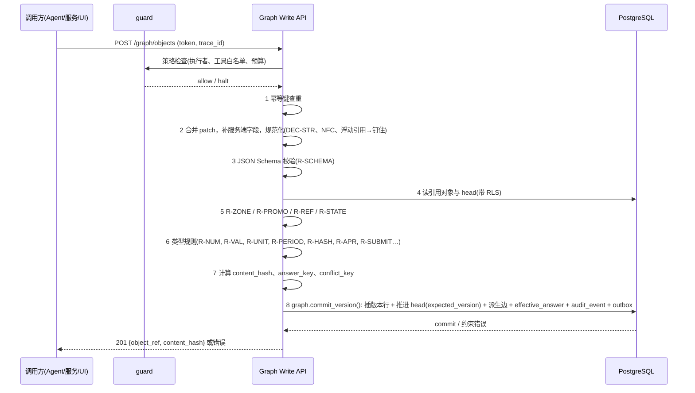

任何一步失败都不落库，但会写一条 `AuditEvent action=object.create` 的拒绝记录（含错误码与 `trace_id`），用于评测 Agent 的"被拒率"。

错误码（响应体 `{"error": {"code", "message", "rule_id", "path", "details"}}`）：

| HTTP | code | 规则 | 典型原因 | 调用方处理 |
|---|---|---|---|---|
| 400 | `GRAPH_SCHEMA_INVALID` | R-SCHEMA、R-EST、R-FS1 | 字段缺失、格式错 | Agent 修正后重试一次，再失败转人工 |
| 400 | `GRAPH_UNIT_INCOMPATIBLE` | R-UNIT | MWh 填到 tCO2e | 修正或走 `transform` |
| 403 | `GRAPH_TRUST_ZONE_VIOLATION` | R-ZONE | 隔离区写 trusted；计算引用 quarantine 证据 | 不重试，告警 |
| 403 | `GRAPH_PROMOTION_DENIED` | R-PROMO | 非 guard 晋升或晋升时改值 | 不重试，告警 |
| 403 | `GRAPH_ACTOR_NOT_ALLOWED` | §1.6 | 执行者无权写该类型/状态 | 不重试 |
| 404 | `GRAPH_REF_NOT_FOUND` | R-REF | 引用不存在或已 `rejected`/`expired` | 重新取证 |
| 403 | `GRAPH_REF_CROSS_TENANT` | R-REF | 跨租户引用 | 安全事件 |
| 409 | `GRAPH_VERSION_CONFLICT` | R-IMM | `expected_version` 过期 | 重读后重试（≤3） |
| 409 | `GRAPH_ILLEGAL_TRANSITION` | R-STATE | 如 `draft→approved` | 检查工作流 |
| 409 | `GRAPH_DUPLICATE_EFFECTIVE_ANSWER` | R-ONE | 同口径已有生效答案 | supersede 旧答案或区分 customer_scope |
| 409 | `GRAPH_IDEMPOTENCY_MISMATCH` | — | 同幂等键不同请求体 | 修复调用方 |
| 422 | `GRAPH_NUM_UNREFERENCED` | **R-NUM** | 数字无证据/计算引用 | 转 `calc-service` 或生成 ClosedQuestion |
| 422 | `GRAPH_NUM_VALUE_MISMATCH` | R-VAL | 值与所引对象不一致（典型：LLM 改写数字） | 不重试，记入评测 |
| 422 | `GRAPH_NUM_IN_TEXT` | §3.7 | 文字说明含无来源数字 | 重写说明 |
| 422 | `GRAPH_PERIOD_UNCOVERED` | R-PERIOD | 证据期间不覆盖答案期间 | 补证据或标估算 |
| 422 | `GRAPH_HASH_MISMATCH` | R-HASH | input_hash 不一致 | 计算库 bug，告警 |
| 422 | `GRAPH_LOCATOR_MISSING` | R-LOC | 文档证据无定位 | 重新提取 |
| 422 | `GRAPH_APPROVAL_REQUIRED` | R-APR | 无批准或角色不足、L3 批量 | 走审批 |
| 422 | `GRAPH_SUBMIT_BLOCKED` | R-SUBMIT | 有 open blocking 冲突或证据过期 | 处理冲突/续期 |
| 422 | `GRAPH_DATAPOINT_DEPRECATED` | §4.3 | 引用已弃用 DataPoint | 重映射 |
| 429 | `GRAPH_RATE_LIMITED` | guard | 超写入速率/预算 | 退避 |
| 423 | `GRAPH_HALTED` | guard | Request 处于 `halted` | 等人工恢复 |

## 7. 审计包导出格式

触发：`POST /requests/{req_id}/audit-pack`（`compliance_owner`、`auditor_readonly`、`org_admin`），可选 `as_of_tx`（默认提交时刻）。满足 NFR-04 与 FR-602（一次核查多方复用）。

文件名：`belegt-auditpack_<req_id>_<yyyymmddThhmmssZ>.zip`，格式版本 `belegt-auditpack/1`。

```
belegt-auditpack_req_01JD8Y3K5M2N4P6Q8R0S2T4V6W_20261105T101500Z.zip
├── manifest.json                 # 格式版本、req_id、as_of_tx、生成者、文件清单与每个文件 sha256、pack_hash
├── manifest.sig                  # 对 manifest.json 的 Ed25519 签名（租户签名密钥）
├── README.de.md / README.en.md   # 人读说明与核验步骤
├── request/
│   ├── request.json              # Request 全部版本
│   └── source/<sha256>.<ext>     # 问卷原件
├── questions.jsonl               # Question（全部版本）
├── mappings.jsonl
├── answers.jsonl                 # 本 Request 涉及的 Answer 全部版本
├── evidence/
│   ├── evidence.jsonl
│   └── blobs/<sha256>.<ext>      # 被引原件；可选 --excerpt-only 只导出被引页面
├── calculations/
│   ├── calculations.jsonl
│   ├── replay/<calc_id>.json     # input_hash 原文 M + 期望 output_hash
│   └── factor_rows/<fs_id>.csv   # 实际用到的因子行（受许可限制的库只导出行 ID 与哈希）
├── approvals.jsonl
├── conflicts.jsonl
├── closed_questions.jsonl
├── supplier_requests.jsonl       # 上游请求（联系人邮箱脱敏）
├── graph/
│   ├── edges.jsonl               # 子图的全部边
│   └── lineage/<ans_id>.html     # 每个答案的可视化证据链
├── export/
│   └── <export_input_hash>.xlsx  # 实际提交的回填文件
├── traces.jsonl                  # 模型、prompt_version、输入输出哈希、成本（不含提示原文）
├── audit_events.jsonl            # 相关 AuditEvent 连续片段
└── audit_chain_proof.json        # 片段首尾 event_hash 与当日锚点，用于验证哈希链
```

`manifest.json` 关键字段：`{format, req_id, org_id, as_of_tx, generated_at, generated_by, dictionary_release, engine_versions[], factor_sets[], files: [{path, sha256, bytes}], pack_hash}`，其中 `pack_hash = sha256(JCS(files))`。

核验步骤（README 中给出，`belegt-calc` 提供 CLI）：
1. `belegt-calc verify-pack <zip>`：校验 manifest 签名与全部文件哈希；
2. 对每个 `replay/*.json` 重算 `input_hash` 与 `output_hash`（FR-702 计算库可离线独立运行）；
3. 校验每个 `approved/submitted` 数字答案满足 R-NUM、R-VAL；
4. 用 `audit_chain_proof.json` 校验审计片段哈希链连续并与锚点一致。

导出本身写 `AuditEvent action=export.create`，审计包落 `audit-packs/` WORM 目录；对 `auditor_readonly` 外部共享经 `egress-gateway` 生成限时链接。

## 8. 与 FR 的追溯

| FR / NFR | 本文落点 | 验收要点 |
|---|---|---|
| FR-001 持久化工作流 | SSOT-1、§3.2 Request 状态机、§4.7 工作流重放、`graph.outbox` | 工作流只存 ObjectRef；重放后 ObjectRef 集合一致 |
| **FR-002** 证据图与数据契约 | §1–§3 全部、§5 JSON Schema、§6.8 写入 API | 所有写入经 schema 校验；对象 append-only；版本可查 |
| FR-003 守卫 | §1.6、R-ZONE、R-PROMO、§6.5 RLS、§6.8 guard 步骤 | 隔离区无法写 trusted（数据库层验证） |
| FR-004 评测与 CI | §4.7 重放、拒绝记录 AuditEvent、`dismissed` 冲突样本 | 计算漂移 = 0；R-VAL 拒绝率可统计 |
| FR-102 题目映射+置信度 | §3.4 Mapping、阈值与 ClosedQuestion、§6.6 pgvector | `<0.85` 不会自动 confirmed |
| **FR-201** 历史答卷导入 | `Answer.origin=imported`、`Evidence.source_type=historical_answer`、`reused_from`、L0 复用索引 | 导入答案可被新问卷引用并追溯到原答卷 |
| FR-202 文档提取 | §3.5 Evidence、Locator、R-LOC、对象存储内容寻址 | 每个文档证据可定位到页/单元格/bbox |
| FR-203 ERP 连接器 | `Locator.connector`、`verification.method=connector_attested` | 记录 query_hash 与抓取时间 |
| FR-204 / FR-205 计算 | §3.6 Calculation、§3.13 FactorSet、§4.4–4.5 | 因子库版本、方法论版本、input_hash 可复现 |
| FR-301 / FR-302 上游追数 | §3.10 SupplierRequest、`plausibility`、`fulfills` 边 | 外发有 egress AuditEvent；回复先进隔离区 |
| **FR-401** 证据链+数字强制引用 | R-NUM（Schema + 语义 + CHECK 三层）、R-VAL、§4.6 谱系查询 | 无引用数字写入返回 `GRAPH_NUM_UNREFERENCED` |
| FR-402 一致性审计 | §3.9 Conflict、CR-001…006、R-SUBMIT | blocking 冲突 100% 阻止提交 |
| FR-403 风险分级审批+批量 | §3.8 Approval、`batch_id`、R-APR | L3 无法批量批准 |
| **FR-404** 有效期预警 | `Evidence.valid_until`、`expired` 状态、CR-004、到期扫描索引 | 提前 30 天 warning，过期后阻止新引用与提交 |
| FR-501 原格式回填 | `Question.locator`、`Mapping.transform`、`submission.export_input_hash` | 导出物可由 Answer 集合重建 |
| FR-502 门户提交 | `Answer.status=submitted`、`submission.channel=portal` | 仅 approved 可提交 |
| FR-601 / FR-602 网络化 | `customer_scope`、`p_customer_scope` RLS、`Counterparty.data_sharing_grant`、审计包 | 客户只见授权范围；一次审计包多方复用 |
| FR-701 / FR-702 开源 | §3.1 DataPoint SemVer、§4.5 参考实现与测试向量、`verify-pack` | 计算库离线可核验审计包 |
| NFR-01 驻留与按客户授权 | §6.4、§6.5、§6.7 | 跨租户/跨客户访问被 RLS 拒绝 |
| NFR-02 计算可复现 | §4.5、§4.7 | 同 input_hash + engine → 同 output_hash |
| NFR-03 数字禁止模型生成 | SSOT-4、R-VAL、`GRAPH_NUM_IN_TEXT` | `answer-drafter` 无法写数字值 |
| NFR-04 可观测+审计包 | §3.14、§3.15、§7 | 按 Request 导出可核验 zip |
| NFR-05 模型无关 | `vec.embedding.space_id`、Trace 记录模型 | 换模型不改 schema |

## 本文新增标识

| 类别 | 标识 | 说明 |
|---|---|---|
| 引用格式 | `ObjectRef` = `<id>#v<version>`；ID 后缀为 ULID（Crockford Base32，26 位） | 钉住版本引用 |
| 全局租户 | `org_global` | 字典、开放因子库的 `org_id` |
| 通用字段 | `schema_version`（`belegt.graph/2026-10`）、`content_hash`、`tags`、`promotion` | 补充 _baseline 通用字段 |
| 值约定 | DEC-STR（十进制字符串）、`I18nText`、`Locator`、`Period` | §2.2 |
| 边类型 | `part_of`、`resolves`、`fulfills`、`computed_with`、`scoped_to` | 基准 8 种边之外 |
| 规则 | SSOT-1…7；R-SCHEMA、R-IMM、R-ZONE、R-PROMO、R-REF、R-STATE、R-VAL、R-UNIT、R-PERIOD、R-ONE、R-HASH、R-FS1、R-APR、R-EST、R-LOC、R-SUBMIT | R-NUM 为基准已有 |
| 冲突规则 | `CR-001`…`CR-006` | §3.9.1 |
| 状态 | `Evidence.status=rejected` | 封闭式确认否认时 |
| Request 字段 | `channel`、`source_ref`、`template_ref`、`title`、`language`、`due_date`、`reporting_period`、`priority`、`triage_confidence`、`status_reason`、`workflow_id`、`assignee` | |
| Question 字段 | `request_id`、`ordinal`、`native_id`、`text`、`answer_format`、`options`、`unit_requested`、`period_requested`、`locator`、`parent_question_id` | |
| Mapping 字段 | `rank`、`template_mapping_ref`、`boundary_hint`、`transform`、`decided_by_cq` | |
| Evidence 字段 | `datapoint_id`、`fact_key`、`value_type`、`period`、`boundary`、`verification`、`supplier_request_ref`、`corrects`、`plausibility` | |
| Calculation 字段 | `method_id`、`inputs`、`factors_used`、`params`、`result`、`breakdown`、`output_hash`、`boundary`、`period`、`customer_scope` | |
| Answer 字段 | `consolidation`、`text_lang`、`question_refs`、`reused_from`、`origin`（`generated|imported|human`）、`answer_key`、`estimate_method`、`approval_ref`、`submission`、`drafting_note` | |
| Approval 字段 | `subject_ref`、`required_role`、`decision`、`decided_by`、`decided_at`、`modified_answer_ref`、`batch_id`（前缀 `apb_`）、`policy_version` | |
| Conflict 字段 | `rule_id`、`severity`（`blocking|warning`）、`subject_refs`、`detail`、`explanation`、`explanation_by`、`conflict_key`、`resolution.kind`（`corrected|accepted_divergence|dismissed|auto_cleared`）、`resolution.divergence`（ADR/1 结构，06 §3.3） | |
| SupplierRequest 字段 | `datapoint_ids`、`product_ids`、`template_id`、`channel`、`portal_token_hash`、`reminder_count`、`last_sent_at`、`trigger_ref`、`default_cost_estimate_ref` | |
| ClosedQuestion 字段 | `target_ref`、`kind`（`yes_no|single_choice|numeric_confirm|file_request`）、`answer.blob_sha256[]`、`prompt`、`options`、`proposed_value`、`context_refs`、`assignee_role`、`expires_at`、`answer` | |
| 主数据字段 | `Organization.data_residency`、`eori`、`default_consolidation`；`Counterparty.domains`、`data_sharing_grant`；`Site.grid_region`；`Product.cn_code`、`declared_unit`、`cbam_relevant` | |
| FactorSet 字段 | `source`、`license`、`rows_hash`、`valid_from/valid_until` | |
| AuditEvent 字段 | `seq`、`action` 枚举（含 07 提议并入的 `authz.change`、`authz.deny`、`key.rotate`、`egress.block`、`dsr.fulfil`）、`prev_hash`、`event_hash` | 哈希链 |
| Trace 字段 | `span_id`、`parent_span_id`、`prompt_version`、`cost_eur`、`payload_blob` | |
| 服务执行者 | `service:workflow`、`service:factor-import`、`service:audit-anchor` | `created_by` 中的服务 ID（非 Agent） |
| 版本格式 | `methodology_version` = `<family>@<semver>`；`engine_version` = `belegt-calc@<semver>`；向量空间 `emb:<model>@<dim>` | |
| 示例占位（归属他文） | `method_id=ghg.scope2.market_based` 与 `methodology_version=ghg-scope2-market@1.0.0`（05 §1.5 已定名）、`SupplierRequest.template_id`（08 §3.1 `stpl:` 已定名）、`fact_key=activity.electricity.*`（02）、`approval-policy@1.0.0`（06 §4.4 已定名）、规则 `PROMO-MAP-0.85`、`EV-AUTO-0.90-LOC`（04 §2.1 已定名） | 已由对应文档定名（2026-10-18 统一修订） |
| 数据库 | schema `graph`/`dict`/`ref`/`doc`/`vec`/`audit`/`obs`；表 `*_v`、`object_head`、`edge`、`outbox`、`idempotency`、`effective_answer`；角色 `belegt_owner`/`belegt_writer`/`belegt_reader_trusted`/`belegt_reader_quarantine`/`belegt_auditor`；函数 `graph.commit_version`、`graph.commit_batch`；会话变量 `app.org_id`/`app.actor`/`app.zone`/`app.cp_scope`/`app.approved_only` | §6 |
| API | `POST /graph/objects`、`/graph/objects:batch`、`/graph/validate`、`GET /graph/objects/{id}`（`as_of_tx`/`as_of_valid`）、`/graph/lineage/{ref}`、`/graph/impact/{ref}`、`POST /graph/replay/calculation`、`/graph/replay/answer`、`POST /blobs`、`POST /requests/{req_id}/audit-pack` | §6.8 |
| 错误码 | `GRAPH_SCHEMA_INVALID`、`GRAPH_UNIT_INCOMPATIBLE`、`GRAPH_TRUST_ZONE_VIOLATION`、`GRAPH_PROMOTION_DENIED`、`GRAPH_ACTOR_NOT_ALLOWED`、`GRAPH_REF_NOT_FOUND`、`GRAPH_REF_CROSS_TENANT`、`GRAPH_VERSION_CONFLICT`、`GRAPH_ILLEGAL_TRANSITION`、`GRAPH_DUPLICATE_EFFECTIVE_ANSWER`、`GRAPH_IDEMPOTENCY_MISMATCH`、`GRAPH_NUM_UNREFERENCED`、`GRAPH_NUM_VALUE_MISMATCH`、`GRAPH_NUM_IN_TEXT`、`GRAPH_PERIOD_UNCOVERED`、`GRAPH_HASH_MISMATCH`、`GRAPH_LOCATOR_MISSING`、`GRAPH_APPROVAL_REQUIRED`、`GRAPH_SUBMIT_BLOCKED`、`GRAPH_DATAPOINT_DEPRECATED`、`GRAPH_RATE_LIMITED`、`GRAPH_HALTED` | §6.8 |
| Schema `$id` | `https://schemas.belegt.org/graph/2026-10/{common,answer,evidence,calculation,conflict}.json` | §5 |
| 审计包 | 格式 `belegt-auditpack/1`、文件名规则、`manifest.json`/`manifest.sig`、`pack_hash`、CLI `belegt-calc verify-pack` | §7 |

## 待决问题

1. 数字统一用 DEC-STR 对前端与第三方 API（PACT 使用 JSON number）是否需要双向适配层？倾向：图内 DEC-STR，`belegt-io` 出口转换。
2. Request/Question 晋升后仍保留外部原文：是否需对 `text` 字段做单独加密列，限制 trusted Agent 读取原文（只读结构化字段）？与 07 共同决定。
3. `effective_answer`（R-ONE）以 `customer_scope` 整体比较：`[A,B]` 与 `[A]` 重叠时是否视为冲突，还是交给 `CR-001`？当前：交给 `CR-001`，数据库只拦截完全相同的 key。
4. 审计包中商业因子库（ecoinvent 等）行值能否导出给核查机构，取决于许可；当前只导出行 ID 与哈希 [需法务确认]。
5. 向量维度固定 1024 是否适配首选本地模型；10 确认后可能改为 `halfvec`。
6. `obs.trace_span` 数据量较大，MVP 是否改放 ClickHouse/对象存储，仅在 PostgreSQL 保留索引行；与 10 共同决定。
