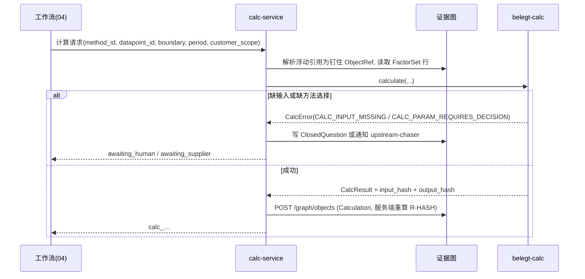
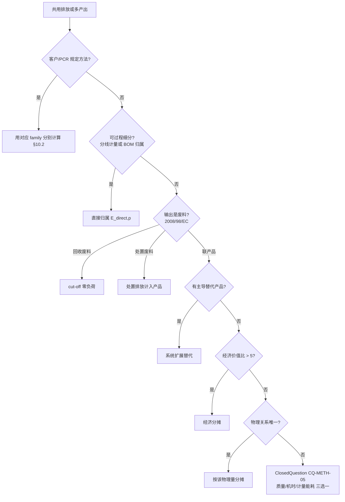
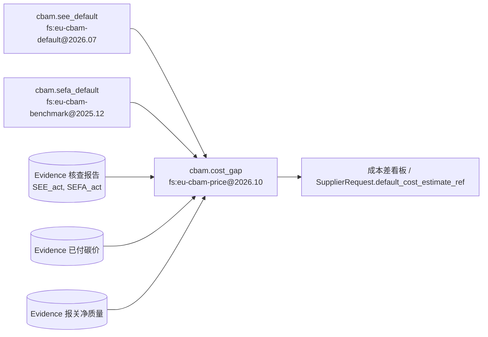
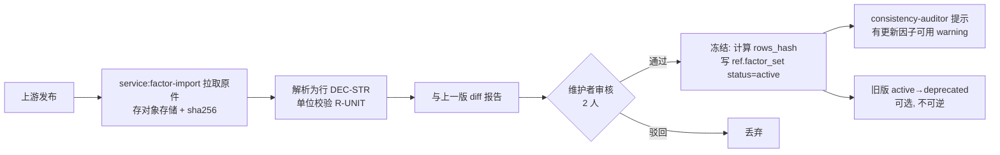

# 05 计算方法论

## 0. 文档信息

| 项目 | 内容 |
|---|---|
| 版本 | v0.1 |
| 日期 | 2026-10-18 |
| 依赖文档 | 00 PRD v2（§3、§4.3、§8、FR-204/205/702、NFR-02）；_baseline（§B、§H、§L）；02 数据点字典（§3 单位/期间/口径、§5 数据点清单）；03 数据模型与证据图（§3.6 Calculation、§3.11 ClosedQuestion、§3.13 FactorSet、§4.4–4.7）；13 风险假设（CBAM 时间线） |
| 被依赖 | 04 编排（`calc-service` Activity）、06 风险审批（排放数字定级）、10 非功能（重放、性能）、11 评测（测试向量入 CI）、`belegt-calc` 仓库 README |
| 读者 | `belegt-calc` 工程师、`calc-service` 维护者、核查机构技术对接人、外部复算者 |
| 定位 | 定义 `belegt-calc` 每个方法的公式、取舍规则、舍入、因子库版本化与测试向量；本文即 `belegt-calc` 的方法论规范（随仓库以 Apache-2.0 发布） |

阅读约定：
- 示例中的活动数据、排放因子、基准值、客户名均为**示例值**（标 `EX-`），除非显式注明来源与核实日期；不得当作真实因子使用。
- 公式中 `×` 为十进制乘法，所有量在进入公式前已换算到 §1.3 的规范单位。
- 法规条款以 13 已核实的时间线为准；本文新核实的条款在文末"来源"列出链接。

## 1. 计算原则

### 1.1 确定性边界

1. **无 LLM**：`belegt-calc` 是纯函数库，不依赖任何模型、网络、系统时钟、随机数或环境变量。`calc-service`（_baseline §C，确定性服务）只做三件事：从证据图读取钉住版本的输入（`ObjectRef`）、调用 `belegt-calc`、把结果写成 `Calculation`。LLM Agent 只能**请求**计算，不能提供数值（NFR-03、R-NUM）。
2. **输入只来自 trusted 且 `verified` 的 `Evidence` 或 `computed` 的 `Calculation`**（03 §3.6 不变量）。缺数据时不估算、不插值，返回 `CALC_INPUT_MISSING` 并由工作流生成 `ClosedQuestion` 或 `SupplierRequest`。
3. **方法选择不由代码猜测**：凡是存在两种以上合规做法且结果不同（GWP 版本、Scope 2 方法、分摊键、实际值/默认值），由 `params` 显式给出；`params` 缺失即 `CALC_PARAM_REQUIRES_DECISION`，进入 §10 的人工节点。
4. **一次计算一个因子库**（R-FS1）：跨库计算拆为子计算链，下游以上游 `result.value` 作为输入。

### 1.2 十进制精度与舍入

| 规则 | 内容 |
|---|---|
| 存储 | 所有输入、因子、结果为 DEC-STR（03 §2.2）：`^-?(0\|[1-9][0-9]*)(\.[0-9]+)?$`，≤18 位有效数字，禁科学计数法 |
| 运算 | Python `decimal`，上下文 `prec=34`、`rounding=ROUND_HALF_EVEN`；捕获 `InvalidOperation`、`DivisionByZero`、`Overflow` |
| 精确性 | 加、减、乘必须精确：若触发 `Inexact` 即报 `CALC_PRECISION_OVERFLOW`；只有除法（分摊比例、每单位强度、证书抵扣换算）允许在 34 位精度处截断 |
| 中间值 | 同一 `Calculation` 内**不做中间舍入**；`breakdown` 各项按 10 位小数 `ROUND_HALF_EVEN` 量化后存储（仅供解释，不参与再计算） |
| 何时舍入 | 只在 `Calculation.result` 写出时舍入**一次**；子计算链中下游必须使用上游**已舍入**的 `result.value`（因为 03 要求 `inputs[].value` 等于被引对象的值），因此链上中间结果的位数要定得宽（见下表） |
| 规范化 | 写出前去掉末尾无意义零（`"2027.200"→"2027.2"`），`"-0"→"0"`；`result.rounding.digits` 记录舍入位数而非显示位数 |
| 导出 | 模板要求的显示位数由 `filler-file` 按 `TemplateMapping.transform.round` 处理（02 §3.2），不回写证据图 |

默认舍入位数（`RND-1`，可由 `params.rounding_digits` 覆盖，覆盖值进入 `input_hash`）：

| 结果量 | 单位 | `digits` | 说明 |
|---|---|---|---|
| Scope 1/2 总量与分项 | tCO2e | 3 | 1 kg 精度 |
| PCF | kgCO2e/声明单位 | 4 | PACT 交换以字符串十进制传输 |
| PDS、DQR | %、1 | 2 | |
| CBAM SEE、SEFA | tCO2e/t | 6 | 作为子计算链中间量，宽于官方默认值的 3 位 |
| CBAM 证书数 | tCO2e | 6 | 成本差链中间量 |
| 金额 | EUR | 2 | |
| 门槛累计质量 | t | 3 | |

03 §5.6.8 示例的 `digits: 1` 是模板参数覆盖，结果 `2027.2` 与默认 3 位规范化后相同。

### 1.3 单位系统

- 规范单位沿用 02 §3.1：能量 `MWh`、质量 `t`、排放 `tCO2e`、强度 `tCO2e/t`、`kgCO2e/kg`、比电耗 `MWh/t`、货币 `EUR`、比例 `%`（0–100）。
- 换算只允许 02 §3.2 中**无外部参数**的线性换算；热值、Hs/Hi 比、密度、汇率一律是因子，必须在 FactorSet 中有行并出现在 `factors_used`。
- **精确换算**：`belegt-calc` 内置换算表以有理数表示。`GJ→MWh` 用 `÷3.6`，不用截断系数 `×0.277778`（后者对 3 600 000 GJ 会多出 0.8 MWh，见 TV-09）。02 §3.2 已于 2026-10-18 统一修订改为 `factor: "1/3.6"`。
- 计算内部还需要以下单位（只出现在 FactorSet 行，不作为 DataPoint 单位）：`tCO2e/MWh`、`tCO2e/GJ`、`kgCO2e/L`、`kg/MWh`（单一气体质量）、`EUR/tCO2e`、`L`、`h`。量纲检查与 R-UNIT 相同，不兼容报 `CALC_UNIT_INCOMPATIBLE`。
- `tCO2` 与 `tCO2e` 不混用：仅含 CO2 的因子（如 UBA 电网因子）入库时 `quality.gas_scope=co2_only`，结果按 CO2e 记账但在 `breakdown` 标注，供审批时提示。

### 1.4 可复现四元组

一个 `Calculation` 的复现键为 `(input_hash, factor_set_version, methodology_version, engine_version)`：

| 字段 | 格式 | 规则 |
|---|---|---|
| `input_hash` | `sha256:<hex>` | 03 §4.5：对 `{method_id, methodology_version, factor_set_version, factor_set_rows_hash, boundary, period, params, inputs}` 做 RFC 8785 JCS 后 SHA-256；本文已用该算法复现 03 §5.6.1 旧名下的 `sha256:1a0cbaa1…`，03 已改用新 family 名并更新为 TV-04 的 `sha256:fa52b131…` |
| `factor_set_version` | `fs:<source>@<version>` | 03 §3.13；`rows_hash` = JCS（按 `source_row_id` 升序的行数组）的 SHA-256 |
| `methodology_version` | `<family>@<semver>` | 本节 §1.5；MAJOR：公式或适用法规变化；MINOR：新增可选参数、取舍规则或舍入位数变化；PATCH：仅文档 |
| `engine_version` | `belegt-calc@<semver>` | 不进入 `input_hash`（03 §4.5-4）；同一 `input_hash` 在新引擎上结果不同即"漂移" |

同一 `input_hash + engine_version` 必须得到同一 `output_hash`（NFR-02）。`methodology_version` 已在 `input_hash` 内，因此方法论升级必然产生新 `input_hash`，旧结果永不被覆盖。

### 1.5 methodology family 与 method_id

| family（首版） | 法源/标准 | `method_id` | 结果 DataPoint |
|---|---|---|---|
| `ghg-scope1@1.0.0` | GHG Protocol Corporate Standard（rev. 2004） | `ghg.scope1.stationary_combustion`、`ghg.scope1.mobile_combustion`、`ghg.scope1.process`、`ghg.scope1.fugitive`、`ghg.scope1.total` | `dp:env.ghg.scope1_total` |
| `ghg-scope2-location@1.0.0` | GHG Protocol Scope 2 Guidance（2015） | `ghg.scope2.location_based` | `dp:env.ghg.scope2_location_based` |
| `ghg-scope2-market@1.0.0` | 同上，market-based 与 8 项 Quality Criteria | `ghg.scope2.market_based` | `dp:env.ghg.scope2_market_based` |
| `pcf-iso14067-pact@1.0.0` | ISO 14067:2018 + PACT Methodology v3.0 + PACT Tech Spec v3.0.3 | `pcf.cradle_to_gate`、`pcf.allocation`、`pcf.data_quality` | `dp:prod.pcf.cradle_to_gate`、`dp:prod.pcf.cradle_to_gate.excluding_biogenic`、`dp:prod.pcf.primary_data_share` |
| `pcf-catenax@0.1.0`（预留，V2） | Catena-X PCF Rulebook v4.0 | 同上 | 同上，按客户口径分开（13 §2.5） |
| `cbam-see@1.0.0` | Reg. (EU) 2023/956 Annex IV（经 2025/2083 修订）；定义期方法 Impl. Reg. (EU) 2025/2547；过渡期数据回溯用 2023/1773 Annex III | `cbam.see_simple`、`cbam.see_complex`、`cbam.see_default`、`cbam.sefa_default` | `dp:prod.cbam.see_direct`、`dp:prod.cbam.see_indirect`、`dp:prod.cbam.specific_electricity_consumption` |
| `cbam-cost-gap@1.0.0` | 2023/956 Art. 9、21、22、31；Impl. Reg. 2025/2620（免费配额调整）；2025/2621 经 2026/1740 更正（默认值与加价） | `cbam.cost_gap` | 无（成本差看板 KPI，不对外作答） |
| `cbam-threshold@1.0.0` | 2023/956 Art. 2a、Annex VII | `cbam.threshold_check` | 13 提议的 `dp:prod.cbam.import_net_mass_annual` |
| `period-align@1.0.0` | 02 §3.4 | `period.aggregate`、`period.time_proration` | 任意数值 DataPoint |

03 §5.6 示例已于 2026-10-18 统一修订改为 `ghg-scope2-market@1.0.0`，`input_hash` 同步为 TV-04 中的值（见 §9）。

### 1.6 calc-service 调用流程



要点：`calc-service` 不缓存数值结果，只以 `input_hash + engine_version` 作幂等键；相同请求重复到达时直接返回已存在的 `Calculation`，不产生新版本。输入证据被更正后，由 outbox 事件触发重算，新 `Calculation` 以 `supersedes` 指向旧版本（03 §4.2-3）。计算请求本身不携带任何数值，避免 Agent 借请求"夹带"数字。

## 2. Scope 1

通用式：`E_s1 = Σ_sources Σ_gas AD × EF_gas × GWP_gas`，结果为 `ghg.scope1.total` 对四类子计算的求和（每类一个 `Calculation`，总量计算用 `fs:belegt-null@1`，见 §7.1）。合并口径由 `params.consolidation`（`operational_control|financial_control|equity_share`）决定，股权比例法时 `AD` 先乘 `Site` 的持股比例（证据来自 `Organization` 主数据）。

### 2.1 固定燃烧

`E = Σ_f [AD_f × EF_CO2,f + AD_f × EF_CH4,f × GWP_CH4 + AD_f × EF_N2O,f × GWP_N2O]`

| 活动数据 | 来源 DataPoint / 证据 | 规则 |
|---|---|---|
| 天然气 | `dp:energy.consumption.natural_gas`（MWh）；燃气账单 Evidence | 德国账单通常按 Hs（Brennwert）计 kWh；因子若以 Hi 为基，需 `fuel.natural_gas.hi_hs_ratio` 因子行（TV-09） |
| 燃油、LPG、煤 | `dp:energy.consumption.fuels_total` 的分项证据；体积或质量 | 体积→能量需热值因子，不是单位换算 |
| 生物质 | 同上 | 生物源 CO2 不计入 Scope 1，单独记 `breakdown.biogenic_co2`；CH4/N2O 照计（GHG Protocol） |

CH4 的 GWP 取值：AR6 区分 fossil 29.8 与 non-fossil 27.0。GHG Protocol（2024-08 GWP 表）指引燃烧源用 non-fossil 值，逸散与工业过程中化石来源的 CH4 用 fossil 值；`belegt-calc` 按 `source_kind` 自动选行，选择写入 `factors_used`。

### 2.2 移动燃烧

- 首选燃料法：`E = Σ_v Fuel_v × EF_v`（L 或 kg；EF 单位 `kgCO2e/L`），证据为加油卡或燃料发票。
- 里程法（`km × EF_km`）只作为回退，结果 `is_estimate=true`，`risk_level ≥ L2`（R-EST）。
- 自有/控制车辆计入 Scope 1；电动车充电电量计入 Scope 2，不在此处。

### 2.3 过程排放

两种方法，由 `params.process_method` 选择：
- 排放因子法：`E = Σ_m AD_m × EF_m × CF_m`（CF 为转化率，默认 1），如碳酸盐分解（石灰石熔剂）。
- 质量平衡法：`E = 44/12 × (Σ C_in − Σ C_out)`，C 为含碳量（t C），适用于电极、增碳剂、碳钢熔炼。`44/12` 为精确有理数常量，不作为因子行。

金属加工二三级供应商的过程排放通常很小或为零；为零时仍需一条 `human_confirmation` 证据（"本期无过程排放源"），否则总量计算报 `CALC_INPUT_MISSING`，以免把"未采集"当成 0（02 §3.6 空值语义）。

### 2.4 逸散（制冷剂）

- 质量平衡法（首选）：`E = (ΔInventory_dec + Purchased − Sold/Returned − ΔCapacity) × GWP_gas`，单位 kg→t。
- 补充量简化法：`E = Recharged × GWP`，适用于没有库存台账但有维保补充记录的场景（TV-01）。
- 筛选法（设备数 × 默认泄漏率）结果 `is_estimate=true`。
- 混合工质 GWP = Σ 组分质量分数 × 组分 GWP；组分分数是因子行（如 R-410A：HFC-32 0.5 + HFC-125 0.5）。

**AR5 vs AR6**：`params.gwp_set ∈ {ar6, ar5}`，必填。

| 场景 | 默认 | 理由 |
|---|---|---|
| GHG Protocol 企业清单、VSME、CDP | `ar6` | GHG Protocol GWP 表（2024-08）建议使用最新值 AR6 |
| PACT PCF | `ar6` | PACT Tech Spec v3.0.3 `ipccCharacterizationFactors` 要求最新版本，即 `["AR6"]` |
| CBAM | `ar5` | CBAM 沿用 EU ETS 监测规则（2018/2066）的 GWP 取值 [未在本文逐条核对] |
| 客户模板明确要求 AR5 | `ar5` | 按客户分别计算（§10.2） |

关键值（GHG Protocol GWP 表，2024-08）：CH4 AR5 28 / AR6 non-fossil 27.0、fossil 29.8；N2O 265 / 273；HFC-32 677 / 771；HFC-125 3 170 / 3 740；HFC-134a 1 300 / 1 530；SF6 23 500 / 24 300。因此 R-410A 为 1 923.5（AR5）/ 2 255.5（AR6）。

### 2.5 活动数据与证据要求

| 子类 | 必需输入 | 典型证据 | 缺失时 |
|---|---|---|---|
| 固定燃烧 | 各燃料消耗量与计量基准（Hs/Hi、体积/质量） | 燃气年度结算单、燃油发票、ERP 月度能耗 | 有月度证据时 `period.aggregate` 重组；否则 `SupplierRequest` 给内部 `contributor` |
| 移动燃烧 | 各燃料加注量 | 加油卡月结单 | 可用里程法估算，标 `is_estimate` |
| 过程排放 | 原料用量与含碳量或排放因子 | 工艺台账、材质证明 | 需"无过程源"的人工确认 |
| 逸散 | 制冷剂种类与补充/回收量 | 冷媒维保记录（德国 F-Gase 台账） | 筛选法估算，标 `is_estimate` |

期间对齐按 02 §3.4：财年数据回答日历年题目时，先尝试月度重组；不能重组时走 `CQ-METH-09`，不得由代码按天数自动折算，除非 DataPoint 的 `validity_rule` 允许且客户方法论认可。

## 3. Scope 2

### 3.1 location-based

`E_loc = Σ_r E_el,r × EF_grid,r + Σ_h Q_h × EF_heat,h`

- `E_el,r`：按电网区域 `Site.grid_region` 分组的外购电（`dp:energy.consumption.electricity_total`）。自发自用的可再生电（`dp:energy.generation.onsite_renewable`）不计外购电。
- `EF_grid`：德国默认 UBA 年度电网因子。最新值（UBA 2026-03-23）：2025 年 344 g CO2/kWh（估算值）、2024 年 353（初步值）、2023 年 379。注意 UBA 2025-04 版曾给出 2024 年外推值 363，次年修订为 353，正是 §7.3 版本冻结要处理的情况；该指标只含 CO2，入库标 `gas_scope=co2_only`。
- 结果写 `dp:env.ghg.scope2_location_based`。

### 3.2 market-based

`E_mkt = Σ_k E_k × EF_k`，约束 `Σ_k E_k = E_el,total`，按以下层级（Scope 2 Guidance Table 6.3）依次扣减电量：

| 层级 | 合同工具 | `EF_k` | 证据要求 |
|---|---|---|---|
| 1 | 能源属性证书（德国 Herkunftsnachweis，经 HKNR 注销） | 证书属性，可再生为 0 | 注销证明，期间与市场边界匹配；电量计 `dp:energy.procurement.eac_volume` |
| 2 | 直接合同（PPA，含属性转移） | 合同电源属性 | 合同 + 属性证明 |
| 3 | 供应商特定排放率（Stromkennzeichnung 产品组合） | 供应商公布的产品排放率 | 账单/标签，需证明未被重复主张 |
| 4 | 残余组合（AIB European Residual Mix） | 残余组合因子 | FactorSet 行 |
| 5 | 无残余组合时回退到电网平均 | `EF_grid` | `breakdown.residual_mix_unavailable=1`，并在答案中披露 |

规则：合同电量不得超过当期消耗；每层工具必须满足 8 项 Scope 2 Quality Criteria，是否满足是**人工判断**（`CQ-METH-04`）而非代码推断；被判不满足的电量落入第 4 层。GHG Protocol 已于 2025-10-20 至 2026-01-31 就 Scope 2 修订公开征求意见（含大型组织按小时匹配的提案），修订定稿后将以 `ghg-scope2-market@2.0.0` 实现，`1.x` 继续可重放。

### 3.3 边界情况

- 外购热、蒸汽、冷：与电力同式，location-based 用供热网络公布的平均因子，market-based 用供热商的合同因子；均无时取燃料法估算并标 `is_estimate`。
- 屋顶光伏自发自用：不计 Scope 2；若出售了对应的绿证，自用电量的属性已被他人主张，market-based 下应按残余组合计（由 `CQ-METH-04` 确认）。
- 租赁厂房：按合并方法决定是否纳入；运营控制下由承租方计入 Scope 2，账单在房东名下时需要分摊证据（面积或子表）。
- 电量证据跨期：电费结算期（如 2024-11-15 至 2025-11-14）与报告期不一致时，按 02 §3.4 重组或确认，不得按日历天自动折算后直接提交。
- 同一电量不得同时出现在 location 与 market 计算之外的第三个口径中；两者是同一活动数据的两个 `Calculation`，引用同一 `Evidence` 版本。

## 4. 产品碳足迹（ISO 14067 / PACT v3）

### 4.1 范围与边界

- 标准：ISO 14067:2018（2024 年复审确认现行，ISO 已启动修订 WD 14067.2）；PACT Methodology v3.0（2025-04-30 发布，v2 已撤回）；交换格式 PACT Tech Spec v3.0.3（13 已核实）。
- 系统边界：**cradle-to-gate**（ISO 14067 的"部分 CFP"），含原材料获取、入厂运输、厂内生产至出厂；不含使用与报废阶段。cradle-to-grave 是另一个 DataPoint，不混用（02 §3.5）。
- 排除规则：PACT v3 允许排除不超过 cradle-to-gate PCF 3% 的排放（v2 为 5%），排除比例写入 `breakdown.exempted_emissions_percent` 并映射到 `exemptedEmissionsPercent`。
- 声明单位：取 `Product.declared_unit`（`kg`、`1`=件等）。PACT 的声明单位 = `declaredUnitAmount × declaredUnitOfMeasurement`，并要求 `productMassPerDeclaredUnit`（kg，不含包装）。
- 参考期与有效期：参考期为活动数据所属期间（`dp:prod.pcf.reference_period`）；PACT 规定 PCF 有效期最长 3 年，过程变化超过 10% 须重算。

### 4.2 公式

对产品 p：

`PCF_p = (E_mat,p + E_inbound,p + E_alloc,p + E_waste,p) / (Q_p / DU)`

- `E_mat,p = Σ_i m_i,p × PCF_i`：物料 i 的消耗量（含加工损耗，即最终成为废料的部分）乘供应商 PCF；无供应商 PCF 时用次级因子，PDS 记 0。
- `E_alloc,p`：工厂 Scope 1 与 Scope 2 中不能直接归属的部分，按 §5 分摊。电力部分默认取 market-based 计算结果（`params.electricity_method=market_based`），以便体现绿证；客户要求 location-based 时按客户分别计算 [PACT v3 §3.3.2.3 细则未逐条核对]。
- `E_waste,p`：送处置废弃物的处理排放；送回收的废料按 cut-off 零负荷（§5.3）。
- `Q_p / DU`：产量折算为声明单位个数。

### 4.3 数据质量：PDS 与 DQR

- `PDS_p = Σ_i (|PCF_i| × PDS_i) / Σ_i |PCF_i| × 100%`，权重用绝对值（PACT v3 为避免负值移除量造成异常而改为绝对值）。
- `DQR_ind,p = Σ_i (|PCF_i| × DQR_ind,i) / Σ_i |PCF_i|`，`ind ∈ {technological, geographical, temporal}`，每项 1（最好）–5。
- 上游 PDS/DQR 未知时按最坏情况：PDS 0%、DQR 5（PACT v3）。
- PDS 现行必须报告；DQR 自 2027 年起必须（Tech Spec 标注 `SHALL-2027`）。
- 厂内直接排放的活动数据与因子均为一手时 PDS 计 100%；使用次级电网因子时，电力部分 PDS 按 PACT 定义判定 [PACT v3 Table 9 的边界案例未逐条核对，首版保守按 0% 计]。

### 4.4 生物源碳

- 同时输出两个值：`dp:prod.pcf.cradle_to_gate`（含生物源，映射 `pcfIncludingBiogenicUptake`）与 `dp:prod.pcf.cradle_to_gate.excluding_biogenic`（映射 `pcfExcludingBiogenicUptake`）。差额来自 `biogenicCO2Uptake`（≤0）。
- 生物源碳含量 `biogenicCarbonContent`（kgC/声明单位）单独报告；iLUC 不计入 PCF。
- PACT v3 规定：生物源碳含量超过 5% 的产品，v2 结果须按 v3 重算。金属件通常为 0，但仍需显式证据（包装纸箱若在边界内需计）。

### 4.5 接收供应商 PCF 时的校验

上游供应商经 `belegt-supplier` 或 PACT 接口提交的 PCF 先作为 `supplier_response` 证据进入隔离区（03 §3.5），晋升前由确定性规则检查：
1. 声明单位与我方 BOM 单位可换算（kg 与件之间需要 `productMassPerDeclaredUnit`）；
2. 参考期结束日距我方参考期结束不超过 3 年（PACT 有效期）；
3. `ipccCharacterizationFactors` 与我方 `gwp_set` 一致，不一致时不混算，转 `CQ-METH-02`；
4. `primaryDataShare` 缺失时按 0% 计入我方 PDS；
5. 数值与同类物料历史值偏离超过阈值时 `plausibility.flag=outlier`，不得自动核验（FR-302）。

校验通过的供应商 PCF 才能作为 `E_mat` 的输入；否则该物料回退到次级因子，PDS 记 0，并由 `upstream-chaser` 发起补数。

### 4.6 PACT v3.0.3 必填字段对应

| PACT 字段 | Belegt 来源 | 备注 |
|---|---|---|
| `pcfExcludingBiogenicUptake` | `dp:prod.pcf.cradle_to_gate.excluding_biogenic` | 字符串十进制 |
| `pcfIncludingBiogenicUptake` | `dp:prod.pcf.cradle_to_gate` | v3 必填 |
| `declaredUnitOfMeasurement`、`declaredUnitAmount` | `dp:prod.pcf.declared_unit` + `Product.declared_unit` | 枚举 `kilogram`、`piece` 等 |
| `productMassPerDeclaredUnit` | `dp:prod.mass.net_per_unit` | kg |
| `referencePeriodStart` / `referencePeriodEnd` | `dp:prod.pcf.reference_period` | PACT 的 End 为**开区间**，导出时 = Belegt 闭区间 `end` + 1 天 |
| `fossilGhgEmissions` | `breakdown.fossil_ghg` | |
| `biogenicCarbonContent`、`biogenicCO2Uptake` | `breakdown.biogenic_*` | |
| `primaryDataShare` | `dp:prod.pcf.primary_data_share` | % |
| `dqi` | `pcf.data_quality` 结果 | 2027 起必填 |
| `exemptedEmissionsPercent` | `breakdown.exempted_emissions_percent` | ≤3 |
| `ipccCharacterizationFactors` | `params.gwp_set` | `["AR6"]` |
| `crossSectoralStandards` | 常量 `["ISO14067"]` 起 | |
| `allocationRulesDescription` | `params.allocation` 的模板化文本 | 文本由模板生成，不含数字 |

02 §4.3.3 中 v3 字段名 `pcfExcludingBiogenicUptake`、`declaredUnitOfMeasurement` 已在 v3.0.3 中核实存在，可去掉"[需核对]"。

## 5. 分摊规则

### 5.1 适用顺序

1. 客户或行业规则（PCR、Catena-X Rulebook）明确规定的分摊方法 → 用对应 family（如 `pcf-catenax`），不与 PACT 结果混在同一 `Calculation`。
2. PACT v3 决策树（ISO 14067/GHG Protocol Product Standard 的落地）：
   - 第 1 步 避免分摊：先做过程细分（分线计量、BOM 直接归属）；只有存在"主导、可识别的替代产品"时才用系统扩展替代。
   - 第 2 步 计算联产品经济价值比（最高价值产品作分子）。
   - 第 3 步 比值 > 5 用经济分摊；≤ 5 用物理分摊，存疑时优先质量。

工厂→产品是多产品工厂的共用排放切分，不是严格意义的联产品，但同样先细分、后分摊。

### 5.2 公式

- 物理分摊：`s_p = k_p / Σ_j k_j`，`k ∈ {mass, machine_hours, energy_metered, volume}`。
- 经济分摊：`s_p = Q_p × price_p / Σ_j Q_j × price_j`，价格取参考期加权平均出厂价（ERP 证据），不用标价。
- 分到产品：`E_alloc,p = s_p × E_shared`，其中 `E_shared = E_s1,site + E_s2,site − Σ_p E_direct,p`。
- 守恒检查：`Σ_p E_alloc,p = E_shared`（逐位相等，除法截断产生的尾差加到份额最大的产品，并记 `breakdown.rounding_residual`），否则 `CALC_ALLOCATION_IMBALANCE`。

### 5.3 多产出、废料与回收（cut-off）

- 废料 vs 联产品：按 EU 废弃物框架指令 2008/98/EC 判定（PACT v3 由"无经济价值即废料"改为此规则）；判定是人工节点 `CQ-METH-06`。
- 回收废料（如冲压边角料售给回收商）：**cut-off**，离开系统边界时负荷为 0，产生它的原料排放全部留在产品上。
- 再生原料输入：只承担收集、分拣、再加工排放，不承担原生生产负荷；再生料占比可答 `dp:mat.recycled_content.steel_share`。
- 送处置废弃物：处置排放计入产品。

### 5.4 决策树



## 6. CBAM

### 6.1 法源与范围

- 基本法：Reg. (EU) 2023/956，经 2025/2083 修订（合并文本 2025-10-20）。
- 定义期计算方法：Impl. Reg. (EU) 2025/2547（自 2026 年起适用）；2023/1773 Annex III 仅用于 2025 年以前过渡期数据回溯与公式对照（Section D 电力、Section F 归属排放、Section G 复杂货物 Eq. 57/58）。
- 默认值：Impl. Reg. (EU) 2025/2621，经 2026/1740 更正（13 已核实）。
- 免费配额调整：Impl. Reg. (EU) 2025/2620；DG TAXUD Guidance No. 4。
- **只计直接排放的货物**（2023/956 Annex II）：钢铁（第 72 章，部分铁合金除外）、铝、氢。水泥与化肥计直接 + 间接。因此钢铝货物的 `dp:prod.cbam.see_indirect` 仍可计算与交换（沟通模板与客户问卷常问），但不进入证书数。

### 6.2 SEE：简单货物与复杂货物

简单货物（仅使用零隐含排放的前体与燃料）：

- `SEE_g,dir = AttrEm_g,dir / AL_g`
- `SEE_g,ind = AttrEm_g,ind / AL_g`，`AttrEm_g,ind = E_el × EF_el`

复杂货物（直接、间接各算一遍）：

- `SEE_g = (AttrEm_g + EE_InpMat) / AL_g`
- `EE_InpMat = Σ_i M_i × SEE_i`

规则：
- `AL_g`：报告期内该生产过程的产量（t）。`AttrEm` 按 2025/2547 的生产过程系统边界归属。
- 前体只计 Annex I 所列、且来自非豁免第三国的前体（Annex III 第 1 点所列国家和地区豁免）；同一生产过程内部消耗的前体不重复计。
- `SEE_i` 优先用前体装置的实际值（经核查）；前体使用默认值的条件与比例限制以 2025/2547 为准 [未逐条核对]。
- 比电耗：`SEC_g = E_el / AL_g`，写 `dp:prod.cbam.specific_electricity_consumption`。
- 电力因子 `EF_el`：默认用委员会公布的原产国电网因子；有 PPA 或直接技术连接且满足条件时可用实际因子 [具体条件以 2025/2547 为准，未逐条核对]。
- 结果写 `dp:prod.cbam.see_direct`、`dp:prod.cbam.see_indirect`，并引用 `dp:prod.cbam.installation_id`、`dp:prod.cbam.production_route`、`dp:prod.identity.cn_code` 的证据。

### 6.3 默认值与加价

- 默认值按原产国 × CN 编码查表；该国未列出或为"–"时用"Other countries and territories"表。
- **证书计算一律取"total emissions"列再加价**；direct/indirect 列仅供参考（2026/1740 鉴于条款 (10) 与 Annex I 前言）。钢铁的 indirect 列为 N/A，total 等于 direct。
- 加价（13 已核实，按进口年度 y）：水泥、钢铁、铝、氢 2026 年 10%、2027 年 20%、2028 年起 30%；化肥 2026 年起 1%。
- `SEE_def,y = DV_total × (1 + μ_y)`。含加价的最终值由 CBAM Registry 计算，`belegt-calc` 复算用于估算与看板，`breakdown` 标注"Registry 舍入规则未公布" [未核实]。
- FactorSet 只存原始默认值 + 加价规则两类行，不存"含加价默认值"（13 §2.1）。

### 6.4 免费配额调整（SEFA）与 CBAM factor

- `FAA_g = SEFA_g,y × M_g`（Guidance 4 Eq. 1）。
- 使用默认值时：`SEFA_def = CBAM_y × CSCF_y × BM_g`（Eq. 6；`BM_g` 为 2025/2620 附件第 5 节 Column B，已含前体）。
- 使用实际值时：`SEFA_act = CBAM_y × CSCF_y × BM*_g + Σ_i m_i,y × SEFA_i,y'`（Eq. 2、4；`BM*_g` 为 Column A 过程基准），通常由装置运营者在核查报告中给出，作为 Evidence 输入。
- 报告期 y：默认为进口年度；**2026 年进口一律 y=2026**，不论生产年度。
- `CSCF_y`：2026–2030 年值见 Implementing Decision (EU) 2026/1862 [具体数值未核实；测试向量用示例值 1]。

CBAM factor（2023/956 Art. 31 与 EU ETS 指令 Art. 10a(1a)；DEHSt 与 DG TAXUD Guidance 4 核实）：

| 年份 | 2026 | 2027 | 2028 | 2029 | 2030 | 2031 | 2032 | 2033 | 2034 起 |
|---|---|---|---|---|---|---|---|---|---|
| CBAM factor | 97.5% | 95% | 90% | 77.5% | 51.5% | 39% | 26.5% | 14% | 0% |

委员会 2026-07-17 提出放缓方案（2028 年 91.5%、2029 年 81%、2030 年 59%，2034–2037 年维持 15%，2038 年归零）仍是提案 [仅见第三方报道，未读原文]；作为情景因子库 `fs:eu-cbam-factor-proposal@2026.07` 单列，默认不用。

### 6.5 原产国已付碳价抵扣

- 仅当隐含排放按**实际值**确定时可申请抵扣（Art. 9(1)）；使用默认值时抵扣为 0。
- 必须是"实际支付"且扣除任何返还或补偿；证明文件需独立第三方认证（Art. 9(2)）。证据缺任一项时由 `CQ-METH-08` 确认，否则不抵扣。
- 输入：`dp:prod.cbam.carbon_price_paid`（EUR，已扣除返还；外币须先经 `calc-service` 汇率计算并记录汇率来源）。
- 折算证书数：`D_cpp = CPP_EUR / P_y`。具体折算与上限以 Art. 9 实施细则为准 [未逐条核对]。

### 6.6 证书数与成本差

对每个 CN 编码与原产国组合（每季度一个 `Calculation`，因 2026 年价格按季度）：

- `N_def = max(0, M × (SEE_def,y − SEFA_def))`
- `N_act = max(0, M × (SEE_act − SEFA_act) − D_cpp)`，钢铝的 `SEE_act` 只取直接排放
- `Cost_route = N_route × P_y`
- `cost_gap = (N_def − N_act) × P_y`

在两个 `max` 都不触发时展开为：

`cost_gap = (DV_total × (1+μ_y) − SEE_act) × M × P_y − (SEFA_def − SEFA_act) × M × P_y + CPP_EUR`

说明：任务书示意式 `(SEE_default×(1+markup) − SEE_actual) × mass × CBAM_price − 已付碳价抵扣` 少了 SEFA 差项，且抵扣项符号相反。抵扣只降低实际值路径的证书数，所以在"默认 − 实际"的差额里是加项；即使把原产国碳价看作供应商转嫁给进口商的成本，它在两条路径上都会发生，仍不改变符号。TV-08 中按示意式会得 74 766.82 €，按本式为 99 315.29 €。当 `SEFA_def ≈ SEFA_act` 且无抵扣时两式一致。

子计算链（R-FS1）：



`cost_gap` 是内部决策量：不对外作答，`risk_level` 按 L2 处理；作为 `SupplierRequest.default_cost_estimate_ref` 驱动上游追数（PRD §8"上游不回复：测算默认值成本"）。

### 6.7 价格口径

- 2026 年进口：按**进口所在季度**的 EU ETS 拍卖价季度均价（Art. 21(1a)）。已公布：Q1 75.36 €、Q2 75.28 €、Q3 82.32 €（DG TAXUD，Q3 于 2026-10-05 公布）；Q4 将于 2027-01-04 公布。
- 2027 年起：周均价（Art. 21(1)）。
- 证书销售自 2027-02-01 开始；首次年度申报与清缴截止 2027-09-30（13）。
- 价格以 FactorSet 版本化：`fs:eu-cbam-price@<YYYY.MM>` 为公布快照，行键 `cbam.price.2026Q3` 等。未来期间没有官方价，看板估算只能从已公布价中选一个（`CQ-METH-10`），结果 `is_estimate=true`，不做预测。

### 6.8 50 t 门槛判定

- 规则（Art. 2a、Annex VII）：每个进口商、每个日历年，所有 CN 编码 CBAM 货物净质量累计**不超过** 50 t 时豁免；一旦当年超过，对当年**全部**进口承担全部义务。电力与氢不适用该门槛，也不计入累计。
- 公式：`m_cum = Σ_lots m_net`（排除 CN 2716、2804 10 00）；`exempt = (m_cum ≤ 50 t)`；恰好 50.000 t 仍豁免（TV-11）。
- 委员会每年 4 月 30 日前评估门槛；2026-09-30 评估维持 50 t（13）。门槛值作为因子行 `cbam.threshold.net_mass` 版本化，不硬编码。
- 结果是提示，不是法律意见：界面表述为"基于您提供的数据，系统提示可能……"，`risk_level ≥ L2`（13 §4）。累计达门槛 80% 时生成逼近预警。

### 6.9 数据来源与流向

- 实际值的来源是第三国装置运营者：通过 `belegt-supplier`（多语言）或官方沟通模板（`tm:cbam_communication@2024`，02 §4.3.4）回传 `SEE_dir`、`SEE_ind`、`SEC`、生产路线、装置标识和核查报告。回传数据先进隔离区，由 `supplier-reply-reviewer` 标注合理性，`guard` 晋升后才能被 `cbam.cost_gap` 引用。
- 进口净质量来自报关单或 ERP 采购入库数据，按 CN 编码与原产国汇总；同一批货物拆分到多个季度时按报关放行日归季度（Art. 21(1a) 以"进口季度"定价）。
- 实际值路径的每个输入都必须有核查报告支撑；未核查的运营者数据只能用于情景估算（`is_estimate=true`），不得进入申报包。
- 成本差按季度、CN 编码、原产国、供应商四个维度汇总给看板；总经理看到的是每家供应商"默认值多付多少"，用于决定是否催办或更换供应商。

## 7. 排放因子库版本化

### 7.1 FactorSet 结构

在 03 §3.13 字段之外，本文增加 `upstream`、`gas_scope` 与行级 `quality`、`deprecation`。示例（UBA，展示一次修订被冻结在两个版本里）：

```yaml
id: fs:uba-strommix@2026.03
source: uba-strommix
license: "[需法务确认]"            # UBA 出版物的再分发条款待确认
published_at: 2026-03-23
valid_from: 2023-01-01
valid_until: 2025-12-31
upstream:
  title: "Entwicklung der spezifischen Treibhausgas-Emissionen des deutschen Strommix 1990–2025 (Climate Change 16/2026)"
  url: https://www.umweltbundesamt.de/publikationen/entwicklung-der-spezifischen-treibhausgas-0
  retrieved_at: 2026-10-18
rows:
  - factor_key: grid.electricity.location.DE
    geography: DE
    year: "2024"
    value: "0.353"
    unit: tCO2e/MWh
    source_row_id: UBA-CC16-2026-DE-2024
    quality: {status: preliminary, gas_scope: co2_only}
  - factor_key: grid.electricity.location.DE
    geography: DE
    year: "2025"
    value: "0.344"
    unit: tCO2e/MWh
    source_row_id: UBA-CC16-2026-DE-2025
    quality: {status: estimated, gas_scope: co2_only}
row_count: 2
rows_hash: sha256:12af011e9ff09a062c0a581a253237c565316de013c42e4c527e91e74afce8d0
status: active
# 前一版 fs:uba-strommix@2025.04 中 2024 年为 0.363（外推值），保持不变、可重放
```

特殊因子库：
- `fs:belegt-null@1`：零行，供纯聚合与期间对齐（`ghg.scope1.total`、`period.aggregate`）使用，满足 `factor_set_version` 必填与 R-FS1。
- 组合库：`belegt` 维护者可发布从多个开放来源拷贝行的组合库（如 `fs:belegt-de-ghg@2026.1`），每行带 `upstream_source` 与原 `source_row_id`，许可取各来源中最严格者。

### 7.2 来源与许可

| 来源 | `source` | 许可 | 内置于 `belegt-calc` |
|---|---|---|---|
| EU CBAM 默认值（2025/2621 + 2026/1740） | `eu-cbam-default` | EUR-Lex 再利用政策 [需法务确认] | 是 |
| CBAM 基准值、CBAM factor、CSCF（2025/2620、2026/1862） | `eu-cbam-benchmark` | 同上 | 是 |
| CBAM 证书季度/周价 | `eu-cbam-price` | 委员会公开数据 [需法务确认] | 是 |
| UBA 电网因子、燃料 CO2 因子 | `uba-strommix`、`uba-fuels` | [需法务确认] | 是（确认后） |
| IPCC GWP（AR5、AR6，经 GHG Protocol 表） | `ipcc-gwp` | 数值事实引用 [需法务确认] | 是 |
| IPCC 2006 指南默认燃烧因子 | `ipcc-2006` | [需法务确认] | 待定 |
| AIB 残余组合 | `aib-residual-mix` | [需法务确认] | 待定 |
| ecoinvent 等商业库 | `ecoinvent` | `proprietary-byol` | **否**，只提供适配器；行存租户 `org_id`，审计包只导出行 ID 与哈希（03 待决 4） |

13 Q-03 的推荐结论（CBAM 默认值 + UBA，加 ecoinvent 适配器）与本表一致。

### 7.3 导入、冻结与弃用



规则：
1. **冻结**：一经发布，ID 与行内容永不改变；上游修订（如 UBA 2024 年值 363→353）只能发新版本。
2. **不自动重算**：新版因子不会改动已批准答案（03 §4.4），由人决定下一期间是否采用。
3. **弃用**：`deprecated` 后新 `Calculation` 不得引用（`CALC_FACTOR_SET_DEPRECATED`），历史可重放；弃用原因写入 `deprecation.reason`，如上游撤回、许可失效或发现错误。错误类弃用时，`GET /graph/impact/{fs}` 列出受影响答案并生成 `Conflict`。
4. **CBAM 冻结期**：2027-05 至 2027-09 不发布 CBAM 相关因子库的破坏性变更（13 Q-12 推荐）。
5. 命名：`source` 只用小写与连字符（03 正则 `^fs:[a-z0-9-]+@…$`）。因此 CBAM 默认值库统一写作 `fs:eu-cbam-default@2026.07`（13 中原下划线写法已于 2026-10-18 统一修订更正）。

### 7.4 因子选择规则

同一 `factor_key` 在一个 FactorSet 内可有多行（不同地理、年份）。`belegt-calc` 按确定性顺序选行，选中的 `source_row_id` 写入 `factors_used`：
1. 地理：精确匹配 `Site.grid_region` 或原产国 → 上级区域（如欧盟）→ `GLO`；CBAM 默认值未列国家按"Other countries and territories"行（法定规则）。
2. 年份：与计算期间同年的行 → 不晚于期间的最近年份；不得使用晚于期间的年份（避免"用未来数据"）。电网因子回退到旧年份时在 `breakdown` 标注年份差。
3. 状态：`quality.status` 为 `final` 优先于 `preliminary`，再优先于 `estimated`；同一 FactorSet 内若同时存在，取最高等级。
4. 无匹配：报 `CALC_FACTOR_MISSING`，不跨 FactorSet 查找，也不使用"相近"因子。

选择规则本身属于方法论：改动选择顺序即 `methodology_version` 的 MINOR 升级。

## 8. `belegt-calc` API

### 8.1 Python

```python
# belegt_calc/__init__.py  (Python 3.12, 无运行期依赖除标准库 decimal/hashlib/json)
from belegt_calc.types import InputValue, Period, FactorSet, CalcResult

def calculate(
    method_id: str,                      # 如 "ghg.scope2.market_based"
    methodology_version: str,            # 如 "ghg-scope2-market@1.0.0"
    factor_set: FactorSet,               # 已冻结的行集合，含 id 与 rows_hash
    inputs: list[InputValue],            # InputValue(name, ref, value: str, unit)
    params: dict[str, str],              # 全部为字符串，进入 input_hash
    boundary: str,                       # "organization" | "site:<id>" | "product:<id>" | "product_per_unit"
    period: Period,                      # Period(start="2025-01-01", end="2025-12-31")
    customer_scope: list[str] | str = "all",
) -> CalcResult: ...                     # Calculation 主体字段（不含 id/version/信封）

def input_hash(m: dict) -> str: ...      # 03 §4.5 参考实现
def output_hash(result: dict, breakdown: list[dict]) -> str: ...
def replay(calculation: dict, factor_set: FactorSet) -> "ReplayReport": ...   # 比较 output_hash
def list_methods() -> list["MethodSpec"]: ...   # method_id、family、必填 inputs/params、默认 digits
```

错误以 `CalcError(code, detail)` 抛出，`code` 见文末新增标识。`calc-service` 把 `CALC_PARAM_REQUIRES_DECISION` 转为 `ClosedQuestion`，其余转为工作流告警。

### 8.2 CLI

```text
belegt-calc run      --method ghg.scope1.total --mv ghg-scope1@1.0.0 \
                     --factors fs/belegt-example@2026.10.yaml --input tv01.json  > calc.json
belegt-calc hash     --input tv01.json --factors fs/belegt-example@2026.10.yaml
belegt-calc replay   calc.json --factors fs/...yaml          # 退出码 0=一致 3=漂移
belegt-calc vectors  verify tests/vectors/                   # FR-209 一致性套件
belegt-calc factors  import|diff|freeze|deprecate <source>   # 供 service:factor-import 调用
belegt-calc verify-pack belegt-auditpack.zip                 # 03 §7 已定义
```

### 8.3 输出示例（TV-01 的 Calculation）

```json
{
  "id": "calc_01JE0TV01C0000000000000001",
  "org_id": "org_01JC0A1B2C3D4E5F6G7H8J9K0M",
  "version": 1,
  "created_at": "2026-11-20T08:00:00Z",
  "created_by": "agent:calc-service",
  "trust_zone": "trusted",
  "provenance": "trc_01JE0TV01T0000000000000001",
  "supersedes": null,
  "schema_version": "belegt.graph/2026-10",
  "method_id": "ghg.scope1.total",
  "methodology_version": "ghg-scope1@1.0.0",
  "factor_set_version": "fs:belegt-example@2026.10",
  "engine_version": "belegt-calc@0.4.0",
  "inputs": [
    {"name": "diesel_volume", "ref": "ev_01JE0TV01DS000000000000001#v1", "value": "18000", "unit": "L"},
    {"name": "natural_gas_hi", "ref": "ev_01JE0TV01NG000000000000001#v1", "value": "2400", "unit": "MWh"},
    {"name": "refrigerant_r_410a_recharged", "ref": "ev_01JE0TV01RF000000000000001#v1", "value": "12.5", "unit": "kg"}
  ],
  "factors_used": [
    {"factor_key": "fuel.natural_gas.co2.per_mwh_hi", "value": "0.2016", "unit": "tCO2e/MWh", "source_row_id": "EX-NG-CO2"},
    {"factor_key": "gwp.ar6.hfc_125", "value": "3740", "unit": "1", "source_row_id": "EX-GWP6-HFC125"}
  ],
  "params": {"consolidation": "operational_control", "gwp_set": "ar6"},
  "result": {"value": "560.563", "unit": "tCO2e", "rounding": {"mode": "half_even", "digits": 3}},
  "breakdown": [
    {"name": "stationary_combustion", "value": "484.309152", "unit": "tCO2e"},
    {"name": "mobile_combustion", "value": "48.06", "unit": "tCO2e"},
    {"name": "fugitive_refrigerant", "value": "28.19375", "unit": "tCO2e"},
    {"name": "process", "value": "0", "unit": "tCO2e"},
    {"name": "total_unrounded", "value": "560.562902", "unit": "tCO2e"}
  ],
  "input_hash": "sha256:0952b50523eb3b8eaef1a5e3f481141494fcad7a8912c19fab4bf9558fa3728c",
  "output_hash": "sha256:0213d8ab27d7beb9bf4aefa17f441eae300471cb0ad96d74ec3a670f777b99bc",
  "boundary": "organization",
  "period": {"start": "2025-01-01", "end": "2025-12-31"},
  "customer_scope": "all",
  "status": "computed"
}
```

`factors_used` 为节选（完整应列出 TV-01 用到的全部 10 行）；`content_hash` 由写入 API 计算，此处省略。为便于展示，示例把四类子计算合并为一个总量计算；生产中按 §2 拆为子计算链。

## 9. 测试向量

所有向量随 `belegt-calc/tests/vectors/*.json` 发布，CI 对每次发版全量重放（FR-209、03 §4.7）。

- 示例因子库 `fs:belegt-example@2026.10`（21 行，`rows_hash = sha256:25cd7633e6907491a142f0c6cf90224f4403b25fb49957bacb67987bb71faaf9`）；CBAM 示例库 `fs:belegt-example-cbam@2026.10`（`sha256:27358e8514ba616585981f7d8e9e3c04f136eb1f2053dd95f6ba92431d2916e5`）；价格库 `fs:belegt-example-cbam-price@2026Q3`（唯一一行取 DG TAXUD 公布的 2026Q3 实价 82.32 €，`sha256:03cd93e50c409df6741575ee3b7a72b2c72553d451baa6b71d88c83a66a90191`）。其余数值均为示例。
- **容差**：`belegt-calc` 对 `result.value` 与 `breakdown` 要求逐位相等（容差 0）。外部用二进制浮点复算时，参考容差为舍入位的半个单位（如 tCO2e 3 位 → ±0.0005），但舍入边界向量（TV-10）必须用十进制。
- 下表的 `input_hash` 均按 03 §4.5 实际计算（参考脚本 `work/05_calc/tv.py`）。

向量文件格式：每个向量一个 JSON，含 `id`、`description`、`request`（即 `calculate` 的参数）、`factor_set_ref`（路径 + `rows_hash`）、`expected`（`result`、`breakdown`、`input_hash`，可选 `error_code`）、`tolerance`（默认 `"0"`）。新增方法必须同时提交至少一个正常向量与一个错误向量（如缺因子、单位不兼容）；修改已有向量的期望值等同于方法论升级，必须同时提升 `methodology_version`。外部实现可只跑 `request → expected.result` 的子集以证明一致性。

### TV-01 Scope 1，AR6

```json
{"method_id":"ghg.scope1.total","methodology_version":"ghg-scope1@1.0.0","factor_set_version":"fs:belegt-example@2026.10",
 "boundary":"organization","period":{"start":"2025-01-01","end":"2025-12-31"},
 "params":{"consolidation":"operational_control","gwp_set":"ar6"},
 "inputs":[{"name":"diesel_volume","ref":"ev_01JE0TV01DS000000000000001#v1","value":"18000","unit":"L"},
           {"name":"natural_gas_hi","ref":"ev_01JE0TV01NG000000000000001#v1","value":"2400","unit":"MWh"},
           {"name":"refrigerant_r_410a_recharged","ref":"ev_01JE0TV01RF000000000000001#v1","value":"12.5","unit":"kg"}]}
```

因子（EX）：天然气 CO2 0.2016 tCO2e/MWh、CH4 0.0036 kg/MWh、N2O 0.00036 kg/MWh；柴油 2.67 kgCO2e/L；GWP AR6 CH4 27、N2O 273、HFC-32 771、HFC-125 3 740；R-410A 组分各 0.5。

| 步骤 | 计算 | 值 |
|---|---|---|
| CO2 | 2400 × 0.2016 | 483.84 |
| CH4 | 2400 × 0.0036 × 27 / 1000 | 0.23328 |
| N2O | 2400 × 0.00036 × 273 / 1000 | 0.235872 |
| 固定燃烧 | 合计 | 484.309152 |
| 移动燃烧 | 18000 × 2.67 / 1000 | 48.06 |
| R-410A GWP | 0.5×771 + 0.5×3740 | 2255.5 |
| 逸散 | 12.5 × 2255.5 / 1000 | 28.19375 |
| **结果** | 560.562902 → 3 位 | **560.563 tCO2e** |

`input_hash = sha256:0952b50523eb3b8eaef1a5e3f481141494fcad7a8912c19fab4bf9558fa3728c`

### TV-02 Scope 1，AR5（同输入，客户口径不同）

`params.gwp_set = "ar5"`，其余同 TV-01。CH4 28 → 0.24192；N2O 265 → 0.22896；固定燃烧 484.31088；R-410A 1 923.5 → 逸散 24.04375；未舍入 556.41463 → **556.415 tCO2e**。`input_hash = sha256:9e7df2a53e0fe14c472e8764d4cc23a8e302b5ba54a171f7ba6b69adb5350f84`。两结果相差 4.148 t，对应 §10.2 的按客户分别计算。

### TV-03 Scope 2 location-based

输入 `electricity_purchased = 4820 MWh`（`ev_01JD8Z1A2B3C4D5E6F7G8H9J0K#v2`，即 03 §5.6 的电费单），`params {"consolidation":"operational_control","grid_region":"DE"}`，因子 `grid.electricity.location.DE = 0.344`（EX，取 UBA 2025 估算值 344 g CO2/kWh，仅 CO2）。4820 × 0.344 = **1658.08 tCO2e**。`input_hash = sha256:75bcf6a8932f70bfaca1053bb3b8a409fa3f80165e51b366d6297425801b3a67`。

### TV-04 Scope 2 market-based（复现 03 §5.6.8）

输入同 03（4820 MWh，绿证 1200 MWh），因子库 `fs:aib-residual-mix@2025.1`（rows_hash 沿用 03 的 `sha256:35f78fd0…b460`），残余组合 0.56（EX）。(4820 − 1200) × 0.56 = **2027.2 tCO2e**，与 03 一致。family 改名为 `ghg-scope2-market@1.0.0` 后 `input_hash = sha256:fa52b131cff377ebdaec89df24a2a00382ad4837e8dc577c3989a7a302ede446`（03 原值 `1a0cbaa1…` 对应旧名，用于验证哈希实现）。

### TV-05 Scope 2 market-based，三层合同工具

输入：外购电 4820 MWh；绿证 1200 MWh（`ev_01JE0TV03G0000000000000001#v1`）；供应商特定产品组合 1000 MWh（`ev_01JE0TV03SP000000000000001#v1`）。因子（EX）：绿证 0、供应商 0.25、残余组合 0.56。

| 层级 | 电量 MWh | 排放 tCO2e |
|---|---|---|
| 1 绿证 | 1200 | 0 |
| 3 供应商特定 | 1000 | 250 |
| 4 残余组合 | 4820 − 1200 − 1000 = 2620 | 1467.2 |
| **合计** | 4820 | **1717.2** |

`input_hash = sha256:a4d9e6946ad1f718452a12076d29d27b44c615a77bcb247f363096a1106e236e`。

### TV-06 PCF 分摊（产品 A，cut-off + 机时分摊）

场景：工厂生产冲压件 A 1200 t、B 300 t；钢卷按 BOM 直接归属（A 消耗 1320 t，产生 120 t 废料；B 消耗 330 t，产生 30 t 废料），废料售予回收商（cut-off）；共用排放 = 工厂 Scope 1 400 t + Scope 2 market 800 t = 1200 tCO2e，按机时分摊（A 6000 h、B 4000 h，`CQ-METH-05` 已选机时）。钢卷供应商 PCF 2.10 kgCO2e/kg，PDS 60%，DQR（技术 2、地理 2、时间 1）；厂内数据 PDS 100%，DQR 均为 1。

```json
{"method_id":"pcf.cradle_to_gate","methodology_version":"pcf-iso14067-pact@1.0.0","factor_set_version":"fs:belegt-example@2026.10",
 "boundary":"product:prod_01JE0TV04PA000000000000001","period":{"start":"2025-01-01","end":"2025-12-31"},
 "params":{"allocation":"physical.machine_hours","declared_unit":"kg","pact_spec":"3.0.3","recycling":"cut_off"},
 "inputs":[{"name":"coil_consumed","ref":"ev_01JE0TV04CA000000000000001#v1","value":"1320","unit":"t"},
           {"name":"coil_pcf","ref":"ev_01JE0TV04CP000000000000001#v1","value":"2.1","unit":"kgCO2e/kg"},
           {"name":"machine_hours_product","ref":"ev_01JE0TV04HA000000000000001#v1","value":"6000","unit":"h"},
           {"name":"machine_hours_site","ref":"ev_01JE0TV04HS000000000000001#v1","value":"10000","unit":"h"},
           {"name":"output_product","ref":"ev_01JE0TV04QA000000000000001#v1","value":"1200","unit":"t"},
           {"name":"site_scope1","ref":"calc_01JE0TV04S1000000000000001#v1","value":"400","unit":"tCO2e"},
           {"name":"site_scope2_market","ref":"calc_01JE0TV04S2000000000000001#v1","value":"800","unit":"tCO2e"}]}
```

| 量 | A | B |
|---|---|---|
| 物料排放 | 1320 × 2.10 = 2772 | 330 × 2.10 = 693 |
| 机时份额 | 0.6 | 0.4 |
| 分摊共用排放 | 720 | 480 |
| PCF（kgCO2e/kg） | (2772+720)/1200 = **2.91** | (693+480)/300 = **3.91** |
| PDS | (2772×60%+720×100%)/3492 = 68.2474… → **68.25%** | 895.8/1173 → **76.37%** |
| DQR 技术/地理/时间 | 6264/3492 → **1.79** / **1.79** / **1** | — |

守恒：2772 + 720 + 693 + 480 = 4665 = 物料 3465 + 共用 1200。废料 150 t 负荷为 0。产品 A 的 `input_hash = sha256:01b59ef8ea044d572b17cc6347510b91b5df742e685ddd42745e4eb9953e0eff`。

### TV-07 CBAM 实际值，复杂货物（冷轧钢）

第三国装置：直接归属排放 5200 tCO2e；耗电 4000 MWh，EF_el 0.581 tCO2/MWh（EX）；前体粗钢 21 000 t，`SEE_dir` 1.85、`SEE_ind` 0.12（前体装置核查值，EX）；产量 `AL` 20 000 t。

| 量 | 计算 | 值 |
|---|---|---|
| `EE_InpMat,dir` | 21000 × 1.85 | 38850 |
| `SEE_dir` | (5200 + 38850)/20000 | **2.2025 tCO2e/t** |
| `AttrEm_ind` | 4000 × 0.581 | 2324 |
| `EE_InpMat,ind` | 21000 × 0.12 | 2520 |
| `SEE_ind` | (2324 + 2520)/20000 | **0.2422 tCO2e/t** |
| 证书计算用 | 钢铁只计直接（Annex II） | 2.2025 |
| `SEC` | 4000/20000 | 0.2 MWh/t |

`digits=6`，规范化后为 `"2.2025"`、`"0.2422"`。

### TV-08 CBAM 默认值 + 成本差（2026Q3）

进口 CN 7208 热轧板 1200 t，原产国 XX。默认值 total 2.590（EX）、2026 年钢铁加价 10%；CBAM factor 0.975（法定）、CSCF 1（EX）、`BM_g` 1.370（EX）；实际值路径：核查 `SEE_act` 1.950、`SEFA_act` 1.300、已付碳价 14 040 €（EX）；价格 82.32 €（2026Q3 实价）。

| 子计算 | 计算 | 结果 |
|---|---|---|
| `cbam.see_default` | 2.590 × 1.10 | 2.849 |
| `cbam.sefa_default` | 0.975 × 1 × 1.370 | 1.33575 |
| `N_def` | 1200 × (2.849 − 1.33575) | 1815.9 |
| `N_act` 毛值 | 1200 × (1.950 − 1.300) | 780 |
| `D_cpp` | 14040 / 82.32 | 170.5539358601 |
| `N_act` | 780 − 170.5539… | 609.446064 |
| 默认路径成本 | 1815.9 × 82.32 | 149 484.89 € |
| 实际路径成本 | 780 × 82.32 − 14040 | 50 169.60 € |
| **`cost_gap`** | 99 315.288 → 2 位 | **99 315.29 €**（每吨 82.76 €） |

`cbam.see_default` 的 `input_hash = sha256:65b9f40586c3c611e89840df278cb779a21bff0a7c6671c9d80b3e424bc63780`；`cbam.cost_gap` 的 `input_hash = sha256:8ee5ebc0ad31181a23af55667021e985ca58cdf18669dcadb094ed77b2985058`（输入 `carbon_price_paid`、`import_mass`、`sefa_actual`、`sefa_default`、`see_actual`、`see_default`，`params {"cn_code":"72081000","quarter":"2026Q3","sector":"iron_steel"}`，期间 2026-07-01 至 2026-09-30）。同一货物若在 2027 年进口，加价 20%，`SEE_def` = **3.108**。

### TV-09 单位换算边界（燃气 Hs 账单）

输入燃气 1 234 567 kWh（Hs），因子以 Hi 为基：0.0561 tCO2e/GJ，Hi/Hs = 0.903（EX）。

| 步骤 | 值 |
|---|---|
| kWh→GJ（×0.0036，精确） | 4444.4412 GJ(Hs) |
| ×0.903（因子，非单位换算） | 4013.3304036 GJ(Hi) |
| ×0.0561 | 225.147835642 → **225.148 tCO2e** |
| 错误做法：漏掉 Hs/Hi | 249.333（偏高 10.7%） |
| 4444.4412 GJ→MWh：÷3.6 | **1234.567**（精确回到原值） |
| 同上用截断系数 ×0.277778（02 修订前的旧表值，反例） | 1234.5679876536（不可逆） |
| 3 600 000 GJ：÷3.6 vs ×0.277778 | 1 000 000 vs 1 000 000.8 |

预期：引擎接受 `kWh` 输入并输出 225.148；若因子库缺 `fuel.natural_gas.hi_hs_ratio` 行，必须报 `CALC_FACTOR_MISSING`，不得默认 1。

### TV-10 舍入边界（ROUND_HALF_EVEN）

用 `ghg.scope2.location_based`，因子 `test.tie_factor = 0.805`（EX）：

| 输入 MWh | 未舍入 | HALF_EVEN 3 位（期望） | HALF_UP（错误实现） |
|---|---|---|---|
| 2.5 | 2.0125 | **2.012** | 2.013 |
| 2.7 | 2.1735 | **2.174** | 2.174 |
| 0 | 0 | **"0"**（不是 "0.000"） | — |
| 负值 -2.0125（期间更正产生的差额计算） | -2.0125 | **-2.012** | -2.013 |

另测"先求和后舍入"：两条 2.0125 的分项在同一计算内相加，结果为 **4.025**；若先各自舍入再相加则为 4.024，属于违反 §1.2 的错误实现。

### TV-11 CBAM 50 t 门槛

2026 年某进口商的报关批次（净质量）：18 t、25 t、6.5 t、0.5 t 钢铝制品，另有氢 3 t。

| 情形 | 累计（不含氢） | `exempt` |
|---|---|---|
| 上述批次 | 50.000 t | **true**（不超过 50 t） |
| 再进口 0.001 t | 50.001 t | **false**，当年全部 50.001 t 及全部隐含排放承担义务 |

氢 3 t 不计入累计（Art. 2a(4)）。门槛值取因子行 `cbam.threshold.net_mass = 50`。

## 10. 方法论选择的人工节点

### 10.1 何时生成 ClosedQuestion

`calc-service` 遇到 `CALC_PARAM_REQUIRES_DECISION` 时生成 `ClosedQuestion`（03 §3.11）：`target_ref` 指向 `Request`（或被替换的上一个 `Calculation`），`kind` 多为 `single_choice`，`assignee_role=compliance_owner`。作答后，选择以 `params.decision_ref = cq_…#vN` 写入下一次计算，从而进入 `input_hash`，可追溯谁在何时做了方法选择。

| 模板 | 触发 | 选项（不含自由输入） |
|---|---|---|
| `CQ-METH-01` | 题目只写"Scope 2" | 仅 location（默认，02 §3.5）/ 同时报 market |
| `CQ-METH-02` | 客户模板指定 GWP 与默认不同，或模板未写 | AR6 / AR5 |
| `CQ-METH-03` | 组织首次计算或客户要求合并方法 | 运营控制 / 财务控制 / 股权比例 |
| `CQ-METH-04` | 合同工具是否满足 8 项 Quality Criteria | 是 / 否（否则落入残余组合） |
| `CQ-METH-05` | 分摊键不唯一（§5.4） | 质量 / 机时 / 计量能耗 |
| `CQ-METH-06` | 输出是废料还是联产品 | 回收废料 / 处置废料 / 联产品 |
| `CQ-METH-07` | 核查报告状态不明，无法判定能否用实际值 | 用实际值（附报告）/ 用默认值 |
| `CQ-METH-08` | 原产国碳价抵扣的证明不全 | 不抵扣 / 已补齐（附证据） |
| `CQ-METH-09` | 期间不对齐（02 §3.4 第 5 步） | 接受财年数据 / 补数据 |
| `CQ-METH-10` | 成本差用于未公布价格的期间 | 最近一季官方价 / 不出估算 |

不生成 ClosedQuestion 的情形：法规已确定的选择（CBAM 钢铝只计直接排放、2026 年报告期 y=2026、无核查报告即用默认值）由代码按法条执行，并在 `breakdown` 记录依据条款。

### 10.2 客户口径不同时分别计算（PRD §8）

- 同一活动数据、不同客户方法论（GWP、Scope 2 方法、合并方法、PACT vs Catena-X）→ 每种口径一个 `Calculation`，`customer_scope` 分别为 `["cp_A"]`、`["cp_B"]`；对应 `Answer.answer_key` 不同，不触发 `CR-001`（03 §4.4）。
- `consistency-auditor` 记一条 `accepted_divergence` 类 `Conflict`，审批界面并排显示两个结果及口径差（如 TV-01 vs TV-02 差 4.148 t）。
- 首次对外提交的排放数字一律 `L3`（_baseline §F），跨客户口径不一亦为 `L3`。
- 可以共享的子计算（如同一 location-based 结果）只算一次，下游各口径引用同一 `calc_` 版本，避免同源不同值。

### 10.3 计算结果的风险与审批提示

- `approval-router` 读取 `Calculation` 的几项特征辅助定级（06 定义最终规则）：是否首次对外提交、是否 `is_estimate`、`breakdown` 中是否有 `gas_scope=co2_only` 的因子、是否回退到旧年份因子、PDS 是否低于客户要求。
- 审批卡片展示：结果、口径（boundary、consolidation、gwp_set、Scope 2 方法）、因子库及年份、与上期同口径结果的变化率，以及由模板生成的计算说明。说明文字由 `answer-drafter` 起草时只能引用 `Calculation` 中已有的数字（`GRAPH_NUM_IN_TEXT` 规则），不能自行改写或推算。
- 与上期同口径结果变化超过 ±30% 且无减排措施证据时，`consistency-auditor` 生成 warning 级 `Conflict`，提醒审批人核对（02 §3.5"同一数据点跨期不一致"）。

## 11. FR 追溯

| FR / NFR | 本文落点 | 验收要点 |
|---|---|---|
| FR-204 PCF 与 Scope 1/2 | §2、§3、§4、§5；family `ghg-*`、`pcf-iso14067-pact` | TV-01…TV-06 全部通过；每个结果带 `factor_set_version` 与 `methodology_version` |
| FR-205 CBAM 隐含排放与成本差 | §6；family `cbam-see`、`cbam-cost-gap`、`cbam-threshold` | TV-07、TV-08、TV-11 通过；加价与 CBAM factor 与 13 一致 |
| FR-702 计算库独立运行+测试向量 | §8、§9 | `pip install belegt-calc` 后离线运行 `belegt-calc vectors verify` 全绿 |
| NFR-02 计算可复现 | §1.2、§1.4、§7.3 | 同 `input_hash` + `engine_version` → 同 `output_hash`；因子库冻结 |
| NFR-03 数字禁止模型生成 | §1.1 | `calc-service` 无 LLM 依赖；`Calculation.created_by` 恒为 `agent:calc-service` |
| FR-401 数字强制引用 | §1.1、§8.3 | 结果 Answer 以 `calculation_ref` 满足 R-NUM、R-VAL |
| FR-206 方法论选择与按客户口径分别计算（新增） | §10 | 每个方法选择可追溯到 `cq_`；不同口径不报 CR-001 |
| FR-207 因子库导入、冻结与弃用（新增） | §7 | 已发布 FactorSet 内容不可变；弃用后新计算被拒 |
| FR-208 CBAM 门槛判定与默认值成本估算（新增） | §6.6–6.8 | 门槛边界 TV-11；成本差可被 `SupplierRequest.default_cost_estimate_ref` 引用 |
| FR-209 计算一致性测试套件与引擎重放（新增） | §8.2、§9 | 每次发版全量重放；漂移阻止发布 |

新增 FR 优先级：FR-206、FR-207、FR-208 为 P1（随 V1），FR-209 为 P0（随 FR-702 的 MVP 计算库）。

## 来源

| 编号 | 来源 | 用途 | 核实日期 |
|---|---|---|---|
| M1 | GHG Protocol Corporate Standard：https://ghgprotocol.org/corporate-standard | Scope 1 框架、合并方法 | 2026-10-18（基于既有知识，未重新下载全文） |
| M2 | GHG Protocol Scope 2 Guidance：https://ghgprotocol.org/scope-2-guidance | 双重报告、Quality Criteria、2025-10-20 至 2026-01-31 公开征求意见 | 2026-10-18 |
| M3 | GHG Protocol GWP 表（2024-08）：https://ghgprotocol.org/sites/default/files/2024-08/Global-Warming-Potential-Values%20%28August%202024%29.pdf | AR5/AR6 数值、CH4 fossil/non-fossil 用法 | 2026-10-18 |
| M4 | ISO 14067:2018：https://www.iso.org/standard/71206.html | 部分 CFP；2024 复审确认；修订中 | 2026-10-18 |
| M5 | PACT Methodology v3.0：https://docs.carbon-transparency.org/ref/methodology/pact-methodology-v3.0.pdf ；发布说明 https://www.carbon-transparency.org/resources/pact-methodology-v3 | 分摊决策树、3% 排除、PDS/DQR 公式、最坏情况、有效期 | 2026-10-18 |
| M6 | PACT Tech Spec v3.0.3：https://wbcsd.github.io/tr/data-exchange-protocol/latest/ | 字段名、`ipccCharacterizationFactors`、`dqi` SHALL-2027、referencePeriodEnd 开区间 | 2026-10-18 |
| M7 | Reg. (EU) 2023/956 合并文本：https://eur-lex.europa.eu/legal-content/EN/TXT/HTML/?uri=CELEX:02023R0956-20251020 | Art. 2a、9、21、31，Annex II、IV、VII | 2026-10-18 |
| M8 | Impl. Reg. (EU) 2023/1773：https://eur-lex.europa.eu/legal-content/EN/TXT/HTML/?uri=CELEX:32023R1773 | Annex III Section D、F、G（Eq. 57/58） | 2026-10-18 |
| M9 | Impl. Reg. (EU) 2025/2547：https://eur-lex.europa.eu/eli/reg_impl/2025/2547/oj | 定义期计算方法（取代 2023/1773） | 2026-10-18（仅核实存在与定位） |
| M10 | Impl. Reg. (EU) 2026/1740（更正 2025/2621）：https://eur-lex.europa.eu/legal-content/EN/TXT/HTML/?uri=OJ:L_202601740 | 加价比例、total 列规则、钢铁 indirect N/A | 2026-10-18 |
| M11 | DG TAXUD Guidance No. 4（免费配额调整）：https://taxation-customs.ec.europa.eu/document/download/3aa2c730-4f1b-4524-8f71-d9cfe4880ac7_en | SEFA Eq. 1–6、CBAM factor、CSCF、报告期规则 | 2026-10-18 |
| M12 | DEHSt CBAM definitive regime：https://www.dehst.de/EN/Topics/CBAM/CBAM-definitive-regime-2026/cbam-definitive-regime-2026_artikel.html | CBAM factor 时间表交叉核对 | 2026-10-18 |
| M13 | DG TAXUD Price of CBAM certificates：https://taxation-customs.ec.europa.eu/carbon-border-adjustment-mechanism/price-cbam-certificates_en | 2026 Q1–Q3 价格 | 2026-10-18 |
| M14 | UBA 2026-03-23：https://www.umweltbundesamt.de/themen/co2-emissionen-pro-kilowattstunde-strom-2025-nur ；UBA 2025-04 报告：https://www.umweltbundesamt.de/sites/default/files/medien/11850/publikationen/13_2025_cc.pdf | 2023–2025 电网因子及 2024 年值修订 | 2026-10-18 |
| M15 | RSM（2026-09-29）：https://www.rsm.global/netherlands/en/insights/cbam-costs-2026-exposure-2028-changes | 2026-07-17 放缓提案（第三方） | 2026-10-18 |

## 本文新增标识

| 类别 | 标识 | 说明 |
|---|---|---|
| methodology family | `ghg-scope1@1.0.0`、`ghg-scope2-location@1.0.0`、`ghg-scope2-market@1.0.0`、`pcf-iso14067-pact@1.0.0`、`pcf-catenax@0.1.0`（预留）、`cbam-see@1.0.0`、`cbam-cost-gap@1.0.0`、`cbam-threshold@1.0.0`、`period-align@1.0.0` | §1.5；落实 _baseline §L 留给 05 的占位 |
| method_id | `ghg.scope1.{stationary_combustion,mobile_combustion,process,fugitive,total}`、`ghg.scope2.location_based`、`ghg.scope2.market_based`、`pcf.cradle_to_gate`、`pcf.allocation`、`pcf.data_quality`、`cbam.see_simple`、`cbam.see_complex`、`cbam.see_default`、`cbam.sefa_default`、`cbam.cost_gap`、`cbam.threshold_check`、`period.aggregate`、`period.time_proration` | 03 标注由"08"定名的占位，本文定名；`period.time_proration` 对应 02 的 `method=time_proration` |
| 舍入策略 | `RND-1` | §1.2 默认位数表 |
| params 键 | `consolidation`、`gwp_set`（`ar5\|ar6`）、`grid_region`、`rounding_digits`、`process_method`、`source_kind`、`electricity_method`、`allocation`（如 `physical.machine_hours`）、`declared_unit`、`recycling`（`cut_off`）、`pact_spec`、`cn_code`、`country`、`sector`、`quarter`、`decision_ref` | 全部为字符串，进入 `input_hash` |
| FactorSet | `fs:belegt-null@1`、`fs:belegt-example@2026.10`、`fs:belegt-example-cbam@2026.10`、`fs:belegt-example-cbam-price@2026Q3`、`fs:uba-strommix@2025.04`、`fs:uba-strommix@2026.03`、`fs:eu-cbam-default@2026.07`、`fs:eu-cbam-benchmark@2025.12`、`fs:eu-cbam-price@2026.10`、`fs:eu-cbam-factor-proposal@2026.07` | `source` 值：`uba-strommix`、`uba-fuels`、`ipcc-gwp`、`ipcc-2006`、`eu-cbam-default`、`eu-cbam-benchmark`、`eu-cbam-price`、`eu-cbam-factor-proposal`、`belegt-null`、`belegt-example` |
| FactorSet 字段 | `upstream.{title,url,retrieved_at}`、行级 `quality.{status,gas_scope}`、`upstream_source`、`deprecation.reason` | 补充 03 §3.13 |
| factor_key 命名 | `fuel.<fuel>.<gas>.per_<unit>`、`gwp.<ar>.<gas>`、`blend.<refrigerant>.<component>`、`grid.electricity.location.<geo>`、`residual_mix.electricity.<geo>`、`supplier.electricity.*`、`contractual.electricity.goo`、`cbam.default.total.<cn>.<country>`、`cbam.markup.<sector>.<year>`、`cbam.factor.<year>`、`cbam.cscf.<year>`、`cbam.bm_default.<cn>.<route>`、`cbam.price.<YYYYQn>`、`cbam.threshold.net_mass` | `residual_mix.electricity.DE`、`contractual.electricity.goo` 沿用 03 |
| 计算内部单位 | `tCO2e/MWh`、`tCO2e/GJ`、`kgCO2e/L`、`kg/MWh`、`EUR/tCO2e`、`L`、`h` | 已收录于 02 §3.1（`L`、`h` 原已有） |
| 错误码 | `CALC_UNKNOWN_METHOD`、`CALC_METHODOLOGY_UNSUPPORTED`、`CALC_INPUT_MISSING`、`CALC_PARAM_REQUIRES_DECISION`、`CALC_FACTOR_MISSING`、`CALC_FACTOR_SET_DEPRECATED`、`CALC_UNIT_INCOMPATIBLE`、`CALC_DEC_INVALID`、`CALC_PRECISION_OVERFLOW`、`CALC_ALLOCATION_IMBALANCE`、`CALC_PERIOD_MISMATCH` | `belegt-calc` 错误前缀 `CALC_*`，与 03 的 `GRAPH_*` 分开 |
| ClosedQuestion 模板 | `CQ-METH-01`…`CQ-METH-10` | §10.1 |
| API / CLI | `belegt_calc.calculate`、`input_hash`、`output_hash`、`replay`、`list_methods`、`CalcError`；`belegt-calc run\|hash\|replay\|vectors verify\|factors import\|diff\|freeze\|deprecate` | §8；`verify-pack` 为 03 已定义 |
| 测试向量 | `TV-01`…`TV-11`，路径 `tests/vectors/` | §9 |
| breakdown 名 | `stationary_combustion`、`mobile_combustion`、`process`、`fugitive_refrigerant`、`total_unrounded`、`biogenic_co2`、`residual_mix_unavailable`、`exempted_emissions_percent`、`fossil_ghg`、`rounding_residual` | |
| FR | FR-206、FR-207、FR-208、FR-209 | §11；在 _baseline §L 分配的号段内 |

## 待决问题

1. 已解决（2026-10-18 统一修订）：成本差统一采用本文 §6.6 `cbam-cost-gap@1.0.0`（含 SEFA 差额，原产国已付碳价按 Art. 9(1) 作加项）；01、08、12 已改为引用 §6.6。00 PRD 中的示意式未改动（00 不在本轮修订范围）。
2. **CSCF 2026–2030 实际值**（Implementing Decision 2026/1862）与 2025/2620 Column A/B 基准值尚未录入；首个 `fs:eu-cbam-benchmark` 发布前需逐行核对。
3. **2025/2547 细则**：前体使用默认值的条件、电力实际因子的条件、生产过程系统边界，本文只核实了法规存在与定位，需在 `cbam-see@1.0.0` 发布前逐条核对。
4. **CBAM Registry 对含加价默认值的舍入**未公布；`belegt-calc` 暂不舍入中间值，若与 Registry 有尾差，需要 `cbam-see` MINOR 升级。
5. **CBAM 的 GWP 取值**：本文默认 AR5（随 EU ETS 监测规则），需对照 2018/2066 现行附件核实。
6. **UBA、AIB、IPCC 数据的再分发许可**（§7.2）：确认前 `belegt-calc` 只内置 EU CBAM 数据，其余以"导入脚本 + 用户自行下载"方式提供。
7. **PACT v3 电力与 PDS 边界案例**（§4.2、§4.3）：首版保守处理，待对照 PACT v3 §3.3.2.3 与 Table 9 定稿。
8. ~~对他文的修改建议~~ 已解决（2026-10-18 统一修订）：03 §5.6 已改为 `ghg-scope2-market@1.0.0` 并更新 `input_hash`；13 已改为 `fs:eu-cbam-default@2026.07`；02 §3.2 已改为 `÷3.6` 并收录计算内部单位；02 §4.3.3 已去掉 "[需核对]"。
9. 委员会 2026-07-17 CBAM factor 放缓提案若通过，需发布新的 `fs:eu-cbam-benchmark` 版本并按进口年份选择，已批准的 2026 年计算不受影响。
