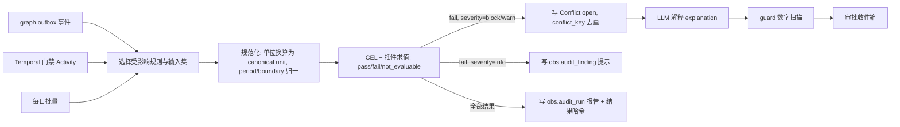
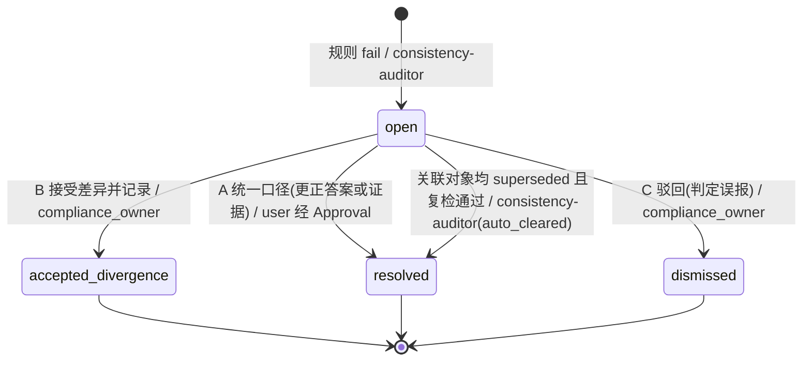
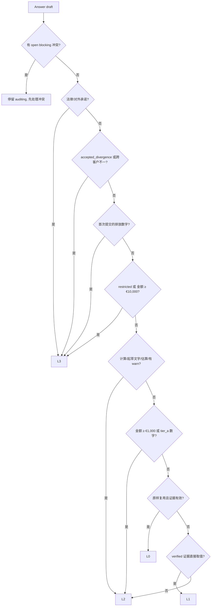
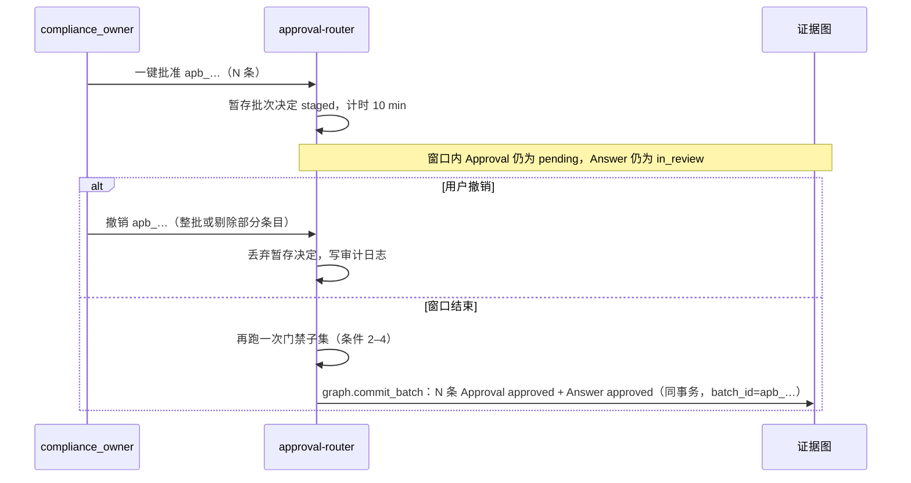

# 06 一致性审计与审批规则

## 0. 文档信息

| 项目 | 内容 |
|---|---|
| 版本 | v0.1 |
| 日期 | 2026-10-18 |
| 依赖文档 | 00 PRD v2（§2、§4.3、§6.4、§8）、_baseline（§B、§F、§G、§H、§L）、02 数据点字典规范（`validity_rule`、`evidence_requirements`、`related_datapoints`、§3 单位/期间/口径）、03 数据模型与证据图（`Conflict`、`Approval`、`Answer`、R-*、CR-001…CR-006、§3.9）、13 风险假设与待决问题（FR-405、法规日期） |
| 被依赖 | 04 编排与工作流（`auditing` 阶段与门禁）、05 Agent 设计（`consistency-auditor`、`approval-router` 提示词与工具）、07 安全与权限（审批角色、二次认证）、11 评测（冲突漏检率、法律条款召回率） |
| 读者 | 后端工程师、规则工程师、合规产品经理、QA、核查机构技术对接人 |
| 定位 | 定义 `consistency-auditor` 的规则引擎与完整冲突规则目录（CR-001…CR-043），以及 `approval-router` 使用的风险分级与审批策略 `approval-policy@1.0.0` |

阅读约定：对象名、字段、状态、角色、Agent ID 均沿用 _baseline 与 03；本文只在 FR-406…FR-409 号段新增 FR，冲突规则从 CR-007 续号。示例数值均为示例值。

## 1. consistency-auditor 架构

### 1.1 定位与边界

`consistency-auditor` 是"确定性规则引擎 + LLM 解释器"的组合，职责只有一个：**发现并登记冲突，不裁决冲突**（PRD §4.5）。它与 03 的写入校验（R-*）分工如下：

| 层 | 执行者 | 时机 | 结果 | 典型规则 |
|---|---|---|---|---|
| 写入校验 | 图写入 API（`graph.commit_version`） | 单对象写入事务内 | 拒绝写入，返回 `GRAPH_*` | R-NUM、R-VAL、R-UNIT、R-PERIOD、R-ONE |
| 一致性审计 | `consistency-auditor` | 写入后、门禁、每日批量 | 生成 `Conflict`（或 info 提示） | CR-001…CR-043 |
| 提交拦截 | 图写入 API | `Answer` 进入 `submitted` | 拒绝迁移，`GRAPH_SUBMIT_BLOCKED` | R-SUBMIT |

写入校验看"单个对象是否合法"，一致性审计看"多个合法对象放在一起是否自洽"。部分 R-* 在审计层做冗余复检（CR-034），属于纵深防御。

### 1.2 规则 DSL 选型

| 方案 | 优点 | 缺点 | 结论 |
|---|---|---|---|
| 纯 Python 函数 | 表达力最强 | 难审查、难让合规人员读懂、易引入副作用 | 只做插件 |
| OPA / Rego | 策略领域成熟 | 不擅长数值与集合聚合，团队学习成本高 | 不选 |
| Drools 类 RETE 引擎 | 增量推理 | JVM 栈，与 Python 3.12 栈不一致 | 不选 |
| **YAML 元数据 + CEL 表达式 + Python 插件** | CEL 非图灵完备、无副作用、可沙箱、求值可终止；YAML 便于评审与版本管理 | CEL 原生只有 double | **选用** |

决策：规则文件为 YAML，判定逻辑写成 CEL（实现用 `cel-python`），复杂聚合（`sum_of` 树、趋势统计、单位换算）由注册的确定性 Python 插件提供，插件只能读入参、不能访问网络与图写入。为满足 NFR-02，CEL 中禁止使用 double 运算，数值一律经自定义函数 `dec()` 转为 Python `Decimal`（DEC-STR 输入），比较用 `dec_eq(a, b, abs_tol, rel_tol)`。

规则集整体版本为 `consistency-rules@<semver>`，存放于 `belegt-core/rules/consistency/`。其中"字典派生规则"（由 02 的 `related_datapoints.relation=sum_of` 和 `validity_rule.plausibility` 编译而来）在每次 `belegt-dictionary` 发版时自动生成，规则 ID 仍归属 CR-003 / CR-033，实例 ID 写作 `CR-003:dp:env.waste.generated`。

```yaml
# belegt-core/rules/consistency/cr-027.yaml
rule_id: CR-027
rule_version: 1.0.0
category: calculation
severity: block
title: { de: "Scope 1+2 Summe inkonsistent", en: "Scope 1+2 total inconsistent" }
scope: request            # answer | request | org
triggers: [answer_write, pre_submit_gate, daily_batch]
inputs:
  total:  { datapoint: dp:env.ghg.scope1_2_total_requested, from: question_hint }
  s1:     { datapoint: dp:env.ghg.scope1_total, same: [period, boundary, consolidation, customer_scope] }
  s2:     { datapoint_by_hint: [dp:env.ghg.scope2_location_based, dp:env.ghg.scope2_market_based], same: [period, boundary, consolidation, customer_scope] }
when: "has(total) && has(s1) && has(s2)"
assert: "dec_eq(dec(total.value), dec(s1.value) + dec(s2.value), dec('0.5'), dec('0.001'))"
tolerance: { abs: "0.5", rel: "0.001", unit: tCO2e }
default_action: open_conflict
explain_template: cr-027
tests: tests/cr-027.yaml
```

说明：`dp:env.ghg.scope1_2_total_requested` 不是字典数据点，而是题目层的"派生请求"（Question 要求合计时由 `question-parser` 标注），规则只把它当作被检对象，不新增 DataPoint。

### 1.3 触发时机

| 触发 | 事件来源 | 范围 | 时延目标 | 结果用途 |
|---|---|---|---|---|
| T1 `answer_write` | `graph.outbox` 中 Answer/Evidence/Calculation 新版本 | 增量：同 `datapoint_id` 的全部有效答案、`related_datapoints` 邻居、同 Request 答案 | p95 ≤ 5 s | 审批前尽早暴露冲突 |
| T2 `pre_submit_gate` | Request 迁移 `auditing→in_review` 与 `approved→filling` 两次 | 全量：本 Request 全部答案 + 每个涉及 DataPoint 的全租户有效答案 | p95 ≤ 60 s（100 题） | 门禁；有 `block` 未关闭则不可迁移 |
| T3 `daily_batch` | 每日 02:00 Europe/Berlin | 全租户全量 + 有效期梯度（§7） | 夜间完成 | 补漏、有效期预警、增量与全量差异比对（§8.2） |
| T4 `context_change` | Evidence `superseded/expired`、新 FactorSet、字典发版、`reg-radar` 更新 | 影响分析（03 §4.7 `/graph/impact`）范围 | p95 ≤ 5 min | 让既有答案重新受检 |

门禁采用 fail-closed：规则引擎超时、插件异常或输入读取失败时，门禁结果为 `unknown`，按 `block` 处理，Request 保持 `auditing` 并告警，绝不"未检即放行"。

### 1.4 执行流程



严重度映射：本文规则目录使用 `info|warn|block` 三级；落图时 `block → Conflict.severity=blocking`，`warn → warning`，`info` 不生成 `Conflict`，只写非图表 `obs.audit_finding`（可由图重建，不作为写入依据，符合 SSOT-7）。每个 `Conflict.detail` 额外写入 `ruleset_version`、`rule_version`、`evaluated_inputs[]`（ObjectRef 列表），保证可复现（03 `detail` 允许扩展字段）。

`not_evaluable` 分两种：输入因业务原因不存在（如未回答 Scope 2 时不检 CR-027）记为通过并留痕；输入应存在却读不到（如引用解析失败）按 fail-closed 处理。

### 1.5 LLM 解释的边界

| 允许 | 禁止 |
|---|---|
| 根据 `Conflict.detail`、规则 `title`、所引对象元数据生成德/英/中三语 `explanation` | 生成、修改或"修正"任何数值；输出 `detail` 中不存在的数字 token |
| 从固定枚举中给出处理建议（`corrected` / `accepted_divergence` / `dismissed`），标注为建议 | 改变 `severity`、`status`、`rule_id`，或自行关闭冲突 |
| 指出可能原因（单位、口径、期间、录入错误）并链接到证据定位 | 读取 quarantine 原文以外的外部内容；调用任何写工具 |

实现：解释调用在 trusted 区运行，输入只含结构化字段；输出经 `guard` 做数字 token 扫描（与 `GRAPH_NUM_IN_TEXT` 同算法），不通过则丢弃并使用 `explain_template` 的确定性模板文本。LLM 不可用时同样回退模板，冲突检测本身不受影响（PRD §4.5"确定性服务不受影响"）。

### 1.6 规则治理

规则本身也是需要审批的"代码"。新增或修改规则必须走以下流程：规则工程师提交 YAML 与测试文件 → CI 运行该规则的正例、反例、边界例以及 §8.2 的变异测试与覆盖矩阵 → 合规产品经理评审描述、严重度与默认处置是否符合业务含义 → 对过去 90 天已提交的 Request 做回溯扫描，评估新增冲突数量与误报率 → 合并并发布新的 `consistency-rules` 版本。严重度从 `warn` 升为 `block` 属于 MINOR 变更，需提前 14 天在租户公告中说明，避免进行中的问卷在临近截止日时突然被阻断；从 `block` 降为 `warn` 属于 MAJOR 变更，必须附带误报统计和变异测试结果，证明不降低召回。

租户不能修改或停用平台规则，只能在 `approval-policy` 覆盖中调整少数阈值（如 CR-002 的变动比例、CR-040 的估算占比），且同样受 `floors` 约束。租户自定义规则（如某 OEM 要求的特殊校验）放在 V1 考虑，规则 ID 将使用独立前缀，不占用 CR 号段。

## 2. 规则目录

### 2.1 通用约定

- 所有数值比较前先按 02 §3.2 换算到 DataPoint `unit`（canonical unit），用 `Decimal`；不可换算即触发 CR-018，不做比较。
- "同口径"指 `answer_key` 中除被比较维度外的分量全部相同（SSOT-5：`datapoint_id + boundary + consolidation + period + customer_scope`）。
- "有效答案"指 `status ∈ {approved, submitted}` 的 head，以及当前 Request 内 `draft/in_review` 的 head。
- 容差写法：`abs` 为 canonical unit 下的绝对值，`rel` 为相对值；两者满足其一即视为相等。
- 严重度 `block` 必须在提交前关闭（`resolved`/`accepted_divergence`/`dismissed`）；`warn` 必须被查看并留下处置记录才可批准 L2/L3，但不阻止 L0/L1 批量批准以外的流转；`info` 仅提示。

### 2.2 规则表

| 规则 ID | 类别 | 描述 | 输入 | 判定逻辑/公式 | 容差 | 严重度 | 默认处置 | 示例 |
|---|---|---|---|---|---|---|---|---|
| CR-001 | 跨客户 | 同口径同期仅 `customer_scope` 不同而数值不同，且无口径说明（03 已定义） | 同 DataPoint 有效数字答案集合 | `key_wo_scope(a)=key_wo_scope(b) ∧ a.value≠b.value ∧ ¬divergence_recorded(a,b)` | 0（全精度比较） | block | 开冲突，建议统一口径 | 给 OEM-A 报 Scope 1 = 1820 t，给 OEM-B 报 1790 t |
| CR-007 | 跨客户 | 非数值答案（`bool/enum/date/text` 结构字段）跨客户不一致 | 同 DataPoint 有效非数值答案 | 同 CR-001，比较规范化值（enum key、ISO 日期、bool） | 0 | block | 开冲突 | 对 A 答"含 SVHC=否"，对 B 答"是" |
| CR-008 | 跨客户 | 同一 Request 内多道题映射到同一 `answer_key` 却引用不同答案或不同值 | Request 内 Answer、`question_refs` | `count(distinct value per answer_key) > 1` | 0 | block | 开冲突，合并为一条答案 | 问卷第 3 题与第 17 题都问员工人数，答 212 与 208 |
| CR-009 | 跨客户 | 同一客户前后两次提交口径变化（`boundary` 或 `consolidation` 或 Scope 2 方法） | 该 `cp_` 历史 `submitted` 答案 | `last.boundary≠cur.boundary ∨ last.consolidation≠cur.consolidation` | — | warn | 提示在答案中说明口径变更 | 去年按运营控制，今年按股权比例报给同一 OEM |
| CR-002 | 跨时间 | 同口径相邻期间变化超阈值（03 已定义） | 当期与上期有效答案 | `|x_t/x_{t-1} − 1| > θ`，θ 默认 0.30，可按 DataPoint 覆盖 | θ | warn | 要求填写变动说明 | Scope 1 由 1200 t 降至 800 t 且无减排措施证据 |
| CR-005 | 跨时间 | 与已 `submitted` 的同期历史答案不一致（03 已定义） | 同 `answer_key`（含客户）历史提交 | `hist.period=cur.period ∧ hist.value≠cur.value ∧ ¬cur.supersedes_hist_with_correction` | 0 | block | 开冲突；若属更正须标注更正并通知客户 | 2025 年电力 4820 MWh 已提交，今年重答 4910 MWh |
| CR-010 | 跨时间 | 趋势断点：≥3 期历史时当期偏离历史中位数过大 | 同口径 ≥3 期序列 | `|x_t − median| > 3 × 1.4826 × MAD ∧ |x_t/median − 1| > 0.15` | 见公式 | warn | 要求说明（产线变化、并购等） | 用水 5 年稳定约 9000 m3，今年 15200 m3 |
| CR-004 | 有效期 | 引用证据在提交日已 `expired` 或 30 天内到期（03 已定义） | Answer `evidence_refs` 的 `valid_until`、提交日 | 过期 → block；`0 < valid_until − submit_date ≤ 30d` → warn | 天数 | block/warn | 过期：换证据；将到期：提示续期 | ISO 14001 证书 2027-03-15 到期，2027-03-01 提交 |
| CR-012 | 有效期 | 证据年龄超过 DataPoint `evidence_requirements.max_age_days` | Evidence `period.end`（无则 `valid_from`）、`max_age_days` | `gate_date − ref_date > max_age_days` | 0 天 | warn | 提示补新证据或说明 | Scope 2 电费证据期末 2025-03-31，`max_age_days=550`，2026-11 引用 |
| CR-013 | 有效期 | 证书类答案在 Request `due_date` 前或客户要求的有效覆盖期内到期 | `dp:cert.*.valid_until` 答案、Request `due_date`、`period_requested` | `valid_until < max(due_date, period_requested.end)` | 0 天 | warn | 通知续证负责人，答案注明续证计划 | 问卷要求覆盖至 2027-12-31，IATF 证书 2027-06-30 到期 |
| CR-014 | 有效期 | 证书日期答案与所附证书文件/证据不一致 | `dp:cert.*.valid_until` 与 `dp:cert.*.certificate_file` 答案及其 Evidence | `answer.value ≠ evidence(certificate).extracted_valid_until ∨ 引用的证书 Evidence 版本不同` | 0 | block | 开冲突，以最新 verified 证书为准 | 答"有效至 2028-05-31"，附件为 2025 年已替换的旧证书 |
| CR-015 | 有效期 | `point_in_time` 值距目标时点超过 `validity_rule.expires_after_days` | Answer.period、题目目标时点 | `target_date − answer.period.end > expires_after_days` | 0 天 | warn | 提示更新 | 员工人数取 2025-12-31，目标时点 2027-03-31，阈值 365 天 |
| CR-016 | 有效期 | 计算使用的 FactorSet 已 `deprecated`，或有更新版本可用（03 §4.4） | Calculation `factor_set_version`、FactorSet 状态 | `deprecated` 且 Answer 未提交 → warn；仅有新版本 → info | — | warn/info | 由人决定下一期是否采用新因子 | `fs:uba-strommix@2025.04` 已被 `fs:uba-strommix@2026.03` 替代 |
| CR-017 | 有效期 | REACH 答案依据的候选清单版本早于 `reg-radar` 记录的最新版本 | `dp:mat.reach.candidate_list_version`、`reg-radar` 最新更新日期 | `answer.value < latest_list_date` | 0 天 | warn | 生成 ClosedQuestion 复核新增物质 | 依据 2025-06 清单，ECHA 已于 2026-07 更新 |
| CR-011 | 单位与量纲 | 数量级异常（疑似 kg/t、kWh/MWh 混用或千分位误读） | 当前值与参照值（上期、他客户同口径、plausibility 期望值） | `r = x/ref ∈ [500, 2000] ∪ [1/2000, 1/500] ∪ [5×10^5, 2×10^6]` | 区间即容差 | block | 开冲突，要求确认原始单位 | 电力上期 4820 MWh，本期 4 820 000（实为 kWh） |
| CR-018 | 单位与量纲 | 跨对象比较或汇总时单位不可换算（跨量纲或不在 `units/conversions.yaml`） | 参与比较的答案/证据单位 | `¬convertible(u1, u2)` | — | block | 开冲突，禁止比较与汇总 | 一方 `tCO2e`，另一方 `tCO2e/t` |
| CR-019 | 单位与量纲 | `tCO2` 与 `tCO2e` 混用 | Evidence 原始单位、Answer DataPoint | `evidence.raw_unit ∈ {tCO2, kgCO2} ∧ dp.unit ∈ {tCO2e, kgCO2e}` | — | warn | 提示补齐非 CO2 气体或注明 | 账单只给 tCO2，题目问 CO2e |
| CR-020 | 单位与量纲 | 百分数/小数歧义：`%` 单位下值 ≤ 1 且参照值 > 1 | `unit=%` 的答案与参照值 | `x ≤ 1 ∧ ref > 1 ∧ x×100 ≈ ref (rel 0.2)` | rel 0.2 | warn | 生成 ClosedQuestion 确认 | 可再生占比上年 35 %，今年 0.36 |
| CR-021 | 单位与量纲 | 每单位强度值的分母与声明单位不一致 | `product_per_unit` 答案单位、`dp:prod.pcf.declared_unit` | `denominator(unit) ≠ declared_unit` | — | block | 开冲突 | PCF 单位 `kgCO2e/kg`，声明单位为"件" |
| CR-022 | 期间与口径 | `period_type=calendar_year` 的数据点使用非日历年期间 | DataPoint `period_type`、Answer.period | `¬(start=YYYY-01-01 ∧ end=YYYY-12-31)` | 0 | block | 退回重算（02 §3.4） | CBAM 相关量填 2025-10-01 至 2026-09-30 |
| CR-023 | 期间与口径 | 同一 Request 内同类答案期间混用（部分财年、部分日历年）且未注明 | Request 内 `reporting_period` 类答案 | `count(distinct period) > 1 ∧ ¬all_annotated` | — | warn | 提示统一或逐条注明 | Scope 1 按财年、Scope 2 按日历年 |
| CR-024 | 期间与口径 | 答案 `boundary` 与题目 `boundary_hint` 不符 | Mapping `boundary_hint`、Answer.boundary | `hint 非空 ∧ hint ≠ boundary` | — | warn | ClosedQuestion 确认（02 §3.5） | 题目问"供货工厂"，答案为 `organization` |
| CR-025 | 期间与口径 | 需要相加或对比的答案 `consolidation` 不同 | 同 Request 内 Scope 1/2/3、能耗答案 | `consolidation(s1) ≠ consolidation(s2)` | — | block | 开冲突，统一合并方法 | Scope 1 运营控制，Scope 2 财务控制 |
| CR-026 | 期间与口径 | 年度量期间不足 12 个月，或月度证据重组存在缺月 | Answer.period、Calculation 输入期间 | `months(period) < 12 ∨ gaps(inputs.period) ≠ ∅` | 0 个月 | warn | 补数据或标 `is_estimate` | 电力按 11 张月度账单累加，缺 8 月 |
| CR-003 | 计算一致性 | 分项之和与总量不符（03 已定义；按 `sum_of` 自动生成实例，关系可为 `eq` 或 `lte`） | 总量与分项答案（同口径同期） | `eq: |Σparts − total| ≤ tol`；`lte: Σparts ≤ total + tol` | abs 0.5 canonical unit 或 rel 0.1 % | block | 开冲突 | 危险 120 t + 非危险 860 t ≠ 废弃物总量 1010 t；女+男员工 > 总人数 |
| CR-027 | 计算一致性 | 题目要求 Scope 1+2 合计时，合计 ≠ Scope 1 + 题目指定方法的 Scope 2 | 合计、Scope 1、Scope 2（location 或 market） | 见 §1.2 YAML | abs 0.5 t 或 rel 0.1 % | block | 开冲突 | 合计 2300 t，S1 1820 + S2(loc) 520 = 2340 t |
| CR-028 | 计算一致性 | Scope 2 location-based 与电力消耗的隐含强度越界 | `scope2_location_based`、`electricity_total` | `0 ≤ s2_loc/elec ≤ 1.2 tCO2e/MWh`（02 plausibility） | 区间 | warn | 提示单位或口径错误 | 电力 4820 MWh，S2 9100 t（1.89） |
| CR-029 | 计算一致性 | 绿证与自发绿电之和超过电力总量，或可再生占比低于其隐含下限 | `eac_volume`、`onsite_renewable`、`electricity_total`、`renewable_share`、`consumption.total` | `eac+onsite ≤ elec`（block）；`share×total/100 ≥ eac+onsite − tol`（warn） | abs 1 MWh | block/warn | 开冲突 | 绿证 5000 MWh，电力 4820 MWh |
| CR-030 | 计算一致性 | PCF 与工厂 Scope 1/2 交叉校验：产品总碳足迹低于其应分摊的自身排放 | `prod.pcf.cradle_to_gate`、产品年产量（ERP 证据）、分配系数、工厂 S1/S2 | `pcf × m_p ≥ 0.9 × α_p × (S1_site + S2_site)`，否则 fail；缺产量证据 → `not_evaluable` 留痕 | 系数 0.9 | warn | 要求核对分配或边界 | PCF 1.1 kgCO2e/kg × 8000 t = 8800 t < 0.9×0.7×16000 t |
| CR-031 | 计算一致性 | CBAM 间接 SEE 与比电耗 × 电力因子不自洽 | `see_indirect`、`specific_electricity_consumption`、所用电力因子 | `|see_ind − sec × ef_el| ≤ rel 2 %` | rel 2 % | warn | 核对因子来源（上游回复常见） | SEC 0.55 MWh/t，因子 0.6，SEE_ind 报 0.52 |
| CR-032 | 计算一致性 | 违反 `validity_rule` 硬约束（`min/max/regex/enum_ref`） | Answer、DataPoint `validity_rule` | `¬hard_rules(value)` | 0 | block | 开冲突（写入期漏网时兜底） | 再生钴占比 112 % |
| CR-033 | 计算一致性 | 违反 `validity_rule.plausibility`（字典派生，严重度取字典声明的 `warn|block`） | DataPoint plausibility 表达式及其引用数据点 | 编译后的 CEL 表达式 | 字典定义 | warn/block | 按字典 | 冶炼厂清单为空但声明有意添加锡 |
| CR-006 | 引用完整性 | 两个来源对同一事实给出不同值（03 已定义） | 同 `fact_key + period + boundary` 的 verified Evidence | `ev1.value ≠ ev2.value`（换算后） | rel 0.5 % | block | 开冲突，人工选定权威来源 | ERP 电量 4820 MWh，账单 4790 MWh |
| CR-034 | 引用完整性 | R-NUM / R-VAL / R-ZONE 复检：数字答案无引用、引用对象 `rejected` 或非 trusted | Answer 与所引对象 | `number ∧ (refs=∅ ∨ ∃ref.status=rejected ∨ ∃ref.trust_zone=quarantine ∨ value≠ref.value)` | 0 | block | 开冲突并告警（说明写入层失守） | 迁移脚本绕过写入函数导入的数字 |
| CR-035 | 引用完整性 | 引用的 Evidence 版本已被 `superseded` | Answer `evidence_refs` 钉住版本与 head | 值变化 → block；值不变（仅元数据更正）→ info | 0 | block/info | 走影响分析重建答案 | 电费单更正后电量 4820→4870 MWh，答案仍引 v2 |
| CR-036 | 引用完整性 | 引用的 Calculation 或其输入链存在 `superseded` 节点 | Answer `calculation_ref` 谱系 | `∃node ∈ lineage: node.status=superseded ∧ head.output_hash ≠ node.output_hash` | 0 | block | 触发重算 | 绿证证据更正后 Scope 2 market-based 未重算 |
| CR-037 | 引用完整性 | 文字答案或附注中的数字 token 无法在所引对象中找到 | `value_type=text` 答案、`drafting_note` | 抽取数字 token，逐个匹配所引 Evidence/Calculation 值（含换算） | 0 | block | 开冲突，删除或补引用 | 文字答案写"减排 18 %"，无任何对象含该值 |
| CR-038 | 估算标识 | `is_estimate=true` 的答案导出时无估算标识且无说明 | Answer、`TemplateMapping` 目标字段 | `is_estimate ∧ ¬template.has_estimate_flag ∧ ¬export_note` | — | block | 要求加注"估算"与 `estimate_method` | 按时间比例折算的能耗填入无备注栏的 Excel |
| CR-039 | 估算标识 | 估算答案所覆盖期间已有可用的实测 verified 证据 | 估算 Answer、同 `fact_key` Evidence | `∃ev.verified ∧ covers(ev.period, ans.period)` | — | warn | 建议改用实测重算 | 用估算电量，但全年账单已入库 |
| CR-040 | 估算标识 | 一份 Request 中数值答案估算占比过高 | Request 内数值答案 | `count(is_estimate)/count(number) > 0.30` | 0.30 | info | 提示合规负责人知悉 | 20 个数字答案中 8 个为估算 |
| CR-041 | 法律承诺 | 题目命中法律承诺识别（§6）而答案 `legal_commitment=false` | Question 法律分类结果、Answer | `question.legal_flag ∧ ¬answer.legal_commitment` | — | block | 强制改为 L3 并标记 | "Der Lieferant sichert zu…"题被当普通是非题 |
| CR-042 | 法律承诺 | 法律承诺题答案来自 L0 复用或进入批量批准 | Answer `reused_from`、Approval `batch_id` | `legal_commitment ∧ (risk_level≠L3 ∨ batch_id≠null)` | — | block | 撤出批次，单条审批 | 去年签过的行为准则确认被一键复用 |
| CR-043 | 价值链上限 | 题目所问数据点超出 Delegated Regulation 2026/1560 Annex II（FR-405） | Mapping、Annex II 数据点清单、客户财年起始日、问卷用途标记 | `fy_start ≥ 2027-01-01 ∧ dp ∉ annex_ii ∧ purpose ∉ {cbam, catenax, cdp, contract}` | — | info | 仅提示可依法拒答；拒答须 `compliance_owner` 批准 | 50 人企业被问 Scope 3 第 4 类明细 |

合计 43 条（CR-001…CR-043）。CR-001…CR-006 的语义与 03 §3.9.1 一致，本文只补充容差与示例；03 中 CR-004 的 "blocking / warning" 由本文的天数条件细化。

## 3. 冲突生命周期与处理选项

### 3.1 状态机



Conflict 为 append-only，终态后若相同 `conflict_key` 再次 fail（例如任一侧出新版本），生成新的 `open` Conflict 并在 `supersedes` 指向旧冲突，旧的差异记录不会自动沿用。

### 3.2 三种处理选项

| 选项 | 适用 | 操作 | 落图 | 后续 |
|---|---|---|---|---|
| A 统一口径 | 一侧或两侧错误、单位错、证据过时 | 选择权威值或更正证据；数字更正先写 `human_confirmation` Evidence（03 §3.7） | 新 Answer 版本 + `resolution.kind=corrected` + `approval_ref` | 若错误答案已 `submitted`，自动生成"向客户更正"任务给 `sales`（对外发送仍需确认） |
| B 接受差异并记录 | 客户方法论、合并方法、期间、产品范围确有不同（PRD §8） | 填写差异记录（§3.3） | `status=accepted_divergence`，`resolution.kind=accepted_divergence`，两侧 Answer 走 L3 | 差异记录随审计包导出 |
| C 驳回 | 规则误报（如两题实际问不同口径而解析错误） | 填写误报理由，可选修正 Mapping | `status=dismissed`，`resolution.kind=dismissed` | 样本进入评测集（FR-004）；同规则 30 天内误报 ≥ 5 次触发规则复审 |

`block` 冲突只有 `compliance_owner` 可选择 B 或 C；A 可由任何具备该 Answer 审批权限的角色发起，但最终仍需对应风险级别的 Approval。

### 3.3 accepted_divergence 记录要求

差异记录 `ADR/1` 写入结构化字段 `Conflict.resolution.divergence`（03 §3.9、§5.5，2026-10-18 统一修订新增；`kind=accepted_divergence` 时必填），`resolution.note` 只保留人读说明。下例为 `divergence` 的 YAML 表示（JSON 中 `format` 字段取值 `"ADR/1"`）：

```yaml
format: ADR/1
reason_code: customer_methodology   # customer_methodology | consolidation | period | product_scope | boundary | timing_correction
customer_requirement_refs: [q_01JC0Y6S4N3H2B7K5M9QW1RT8E]   # 客户要求该口径的题目或说明
sides:
  - { answer: ans_01JB…#v4, customer_scope: [cp_01JA…A], basis: "operational_control" }
  - { answer: ans_01JC…#v2, customer_scope: [cp_01JA…B], basis: "equity_share" }
disclosure_text: { de: "Werte nach unterschiedlicher Konsolidierungsmethode gemäß Kundenvorgabe.", en: "Values follow different consolidation methods as required by each customer." }
include_in_export: true
review_by: 2027-12-31
```

硬性要求：
1. 两侧 `customer_scope` 互斥（03 不变量），且每侧至少引用一个客户要求依据；没有依据的差异只能选 A。
2. 只能由 `compliance_owner` 提交，`approval_ref` 必填（03 schema 已约束 `resolved_by` 为 `user:`）。
3. 涉及的 Answer 一律定级 L3（_baseline F"跨客户口径不一"）。
4. `review_by` 不晚于两侧答案 `period.end` 之后 15 个月；到期或任一侧出新版本即重新开冲突。
5. `include_in_export=true` 时，`filler-file` 把 `disclosure_text` 写入模板备注栏；无备注栏时在审批界面提示人工告知客户。

### 3.4 冲突处理时限与界面

冲突的处理时限跟随所属 Request 的截止日期：`block` 冲突在生成后 2 个工作日内必须有人认领，否则提醒 `compliance_owner`，再超 1 个工作日升级 `executive`；`warn` 冲突在对应答案进入审批时集中展示，不单独催办。审批收件箱中，冲突卡片按"阻断提交的数量 × 距截止日天数"排序，卡片上并排展示两侧的值、单位、期间、口径、客户范围与证据定位缩略图，LLM 解释放在下方并标注"机器生成的解释，仅供参考"。三个处理按钮固定为"统一口径""接受差异并记录""驳回为误报"，点击后进入对应表单，不提供自由的"忽略"选项。一个 Request 的全部 `block` 冲突关闭后，工作流自动从 `awaiting_human` 回到 `auditing` 并重新跑门禁。

## 4. 风险分级

### 4.1 维度

| 维度 | 取值 | 来源 |
|---|---|---|
| D1 答案来源 | `reused`（`reused_from` 非空且值未变）/ `evidence`（verified Evidence 直接取值）/ `calculation` / `drafted_text` | Answer 字段 |
| D2 值类型 | `bool/enum/date/file` / `number` / `text` / `geo` | `value_type` |
| D3 是否首次提交 | 该 `datapoint_id + boundary` 是否从未 `submitted` 给任何客户 | 图查询 |
| D4 是否对外承诺 | `legal_commitment=true`，或 DataPoint 属承诺类（如 `dp:env.ghg_target.*`、SBTi 目标） | §6、DataPoint 标签 `commitment` |
| D5 客户重要度 | `tier_a/tier_b/tier_c`，租户在策略中配置 `cp_` 名单 | `approval-policy` |
| D6 金额影响 | 关联 CBAM 成本差或合同金额估计（€），来自 `calc-service` | Calculation |
| D7 冲突状态 | 无 / 有 `open` warn / 有 `open` block / 有 `accepted_divergence` | Conflict |
| D8 附加 | `is_estimate`、`sensitivity=restricted`、DataPoint 属排放类（`env.ghg.*`、`prod.pcf.*`、`prod.cbam.see_*`、`prod.battery.carbon_footprint_per_kwh`） | Answer / DataPoint |

### 4.2 判定表（自上而下，命中即停；结果取 max）

| 规则 | 条件 | 结果 |
|---|---|---|
| RISK-00 | 存在 `open` 且 `severity=blocking` 的 Conflict | 不定级，不可进入 `in_review`（先处理冲突） |
| RISK-01 | D4 法律承诺或对外承诺 | L3 |
| RISK-02 | D7 存在 `accepted_divergence`，或 CR-001/CR-007 涉及 | L3 |
| RISK-03 | D3 首次提交 ∧ D8 排放类数字 | L3 |
| RISK-04 | D8 `sensitivity=restricted`（冶炼厂清单、坐标等） | L3 |
| RISK-05 | D6 ≥ €10,000（租户可调） | L3 |
| RISK-06 | D1 `calculation` ∨ D1 `drafted_text` ∨ `is_estimate` ∨ D7 有 `open` warn | L2 |
| RISK-07 | D6 ≥ €1,000 ∨（D5 `tier_a` ∧ D2=`number`） | 至少 L2 |
| RISK-08 | D1 `reused` ∧ 原答案同期同口径同客户范围或 `customer_scope=all` ∧ 引用证据仍有效 ∧ 无 warn | L0 |
| RISK-09 | D1 `evidence` ∧ 非估算 | L1 |
| RISK-10 | 其余 | L2 |



### 4.3 各级审批要求

| 级别 | 审批人（`required_role`） | 可批量 | SLA（工作日，且不晚于 Request `due_date` 前 2 天） | 二次确认 |
|---|---|---|---|---|
| L0 | `compliance_owner` | 是，单批 ≤ 200 条 | 1 | 无 |
| L1 | `compliance_owner` | 是，单批 ≤ 100 条，需逐页展开证据缩略 | 2 | 无 |
| L2 | `compliance_owner` | 有条件：同一 Request、单批 ≤ 20 条、每条至少打开一次详情 | 3 | 估算答案勾选"知悉为估算"；有 warn 时须填写处置说明 |
| L3 | `compliance_owner` 或 `executive`；法律承诺且客户为 `tier_a` 时仅 `executive` | 否（R-APR、CR-042） | 3 | 单条确认 + 重新认证（step-up，07 定义）+ 阅读原条款后勾选确认语句 |

SLA 超时：先提醒 assignee，超时 1 个工作日升级给另一个有权角色；永不自动批准。`contributor` 与 `sales` 只能作为"准备人"提交意见，不能作为批准人。

### 4.4 `approval-policy@1.0.0`

```yaml
policy_id: approval-policy
version: 1.0.0
ruleset_ref: consistency-rules@1.0.0
levels:
  L0: { roles: [compliance_owner], batch: { allowed: true, max_items: 200 }, sla_workdays: 1 }
  L1: { roles: [compliance_owner], batch: { allowed: true, max_items: 100 }, sla_workdays: 2 }
  L2: { roles: [compliance_owner], batch: { allowed: true, max_items: 20, same_request: true, require_detail_view: true }, sla_workdays: 3, confirm: [estimate_ack, warn_note] }
  L3: { roles: [compliance_owner, executive], batch: { allowed: false }, sla_workdays: 3, confirm: [step_up_auth, clause_read_ack] }
thresholds:
  amount_l3_eur: "10000"
  amount_l2_eur: "1000"
  yoy_change_ratio: "0.30"
customer_tiers: { tier_a: [], tier_b: [], tier_c: default }
emission_datapoint_patterns: ["dp:env.ghg.*", "dp:prod.pcf.*", "dp:prod.cbam.see_*", "dp:prod.battery.carbon_footprint_per_kwh"]
commitment_datapoint_tags: [commitment, legal]
special:
  - { when: "legal_commitment && customer_tier == 'tier_a'", roles: [executive] }
non_answer_subjects:   # 非 Answer 对象的审批（Approval.subject_ref 指向非 Answer）
  supplier_request_first_send:   # 08 §2.3：Approval(subject_ref=sreq_…#vN)，首次外发确认
    subject_type: SupplierRequest
    default_level: L1
    roles: [compliance_owner, contributor]   # contributor 限租户配置的采购负责人
    batch: { allowed: true, max_items: 50, same_template: true }   # apb_ 批量，同一 stpl 模板 family+版本
    escalate_to_L2_when: ["payload_has_sensitivity_restricted", "supplier_tier == 'A'", "custom_note_present"]
    L2_roles: [compliance_owner]
    sla_hours: 48
    confirm: [rendered_preview_viewed]
    out_of_scope: [reminders_same_template]   # 首次确认后同模板催办不再逐封审批（08 §2.2）
batch_undo_window_minutes: 10
escalation: { after_sla_workdays: 1, to: [executive] }
floors:            # 租户覆盖不得放宽的底线
  - "L3.batch.allowed == false"
  - "legal_commitment => L3"
  - "first_submission && emission => L3"
  - "accepted_divergence => L3"
  - "supplier_request_first_send => approval_required"
```

非 Answer 对象（`non_answer_subjects`）：
- **SupplierRequest 首次发送确认**（08 §2.3 `draft → sent`）：`approval-router` 建 `Approval(subject_ref=sreq_…#vN)`，`risk_level` 默认 L1，审批人 `compliance_owner` 或租户配置的采购负责人（`contributor`）；载荷含 `sensitivity=restricted` 数据点、A 级供应商（08 §4.2）或填写了 `{{custom_note}}` 自由文本时升为 L2，仅 `compliance_owner`。可按同一 `stpl:` 模板（family + 版本）`apb_` 批量，单批 ≤ 50。`egress-gateway` 缺少该已批准 Approval 时返回 `EGRESS_DENIED_APPROVAL_MISSING`（04 §2.15）。首次确认之后同模板的催办不再逐封审批。
- 该类 Approval 不适用 RISK-00…RISK-10（这些规则只对 Answer 定级），也不进入 L3；`floors` 中的 `supplier_request_first_send => approval_required` 不可被租户覆盖取消。
- Conflict 的处理审批（§3.2）沿用所涉 Answer 的级别，不另设条目。

版本化与租户覆盖：
- 策略按 SemVer 发版：PATCH 改文案；MINOR 收紧阈值或新增条件；MAJOR 改变级别语义。发版随 `belegt-core` 发布并记录 changelog。
- 租户覆盖文件 `org-overlay` 只能修改 `thresholds`、`customer_tiers`、`max_items`、`sla_workdays`、`batch_undo_window_minutes`（5–60）、`special` 中的收紧项；加载时逐条校验 `floors`，任何放宽底线的覆盖拒绝生效并告警 `org_admin`。覆盖修改须 `compliance_owner` 与 `org_admin` 双人确认。
- 生效策略写入 `Approval.policy_version`，格式 `approval-policy@1.0.0+ov<N>`（SemVer build metadata，`N` 为租户覆盖版本号；无覆盖时不带后缀）。
- 策略变更不追溯已决审批；`pending` 审批在策略变更后由 `approval-router` 重新定级，级别升高则作废重建（与 03 §3.8 的 stale 机制相同）。

## 5. 批量一键批准

### 5.1 安全条件（全部满足才显示"一键批准"）

1. 批次内每条 Answer 的 `risk_level ∈ {L0, L1, L2}` 且满足所在级别的 `batch` 配置；L3 与 `legal_commitment=true` 永不入批（R-APR）。
2. 批次生成时与提交时各跑一次 T1 增量审计：批内答案无 `open` 冲突（L0/L1 连 warn 也不得有）。
3. 批内所有引用 Evidence 在 Request `due_date` 时仍有效（CR-004、CR-013 无命中）。
4. 批内答案的 head 版本在批次生成后未变化（钉住版本比对），否则整批作废重建。
5. 批准人对批内全部答案具备角色权限，且批次规模不超过上限。
6. 界面展示批次摘要：条数、级别分布、涉及 DataPoint、涉及客户、估算条数；批准按钮需按住 1.5 s 或二次点击确认。

### 5.2 撤销窗口

为了在 append-only 前提下支持撤销，批量批准采用**延迟提交**：



- 窗口默认 10 分钟（租户 5–60 分钟），批次暂存于 `approval-router` 的工作流状态，只存 ObjectRef（SSOT-1）；撤销、提交都写 `AuditEvent`。
- 若 Request 的 `due_date` 剩余时间小于窗口，界面提示并允许批准人选择"立即提交"，此时放弃撤销能力。
- 窗口结束后的"撤回"只能通过新 Answer 版本（`approved→superseded`）并重新审批；若已 `submitted`，同时生成向客户更正的任务。
- `filler` 只读取已落图的 `approved` 答案，因此窗口内任何答案都不会被回填或提交。

## 6. 法律承诺条款识别

### 6.1 条款类型与模式库

| 类型 ID | 类型 | 德语关键词/模式 | 英语关键词/模式 |
|---|---|---|---|
| LC-01 | 保证/担保 | `sichert zu`、`gewährleistet`、`garantiert`、`Zusicherung`、`steht dafür ein` | `warrant`、`guarantee`、`represents and warrants` |
| LC-02 | 赔偿 | `stellt … frei`、`Freistellung`、`schadlos halten`、`Schadensersatz` | `indemnify`、`hold harmless`、`compensate for any damage` |
| LC-03 | 审计权/现场检查 | `Auditrecht`、`berechtigt, … zu prüfen`、`Einsicht in Unterlagen`、`Vor-Ort-Audit` | `right to audit`、`on-site inspection`、`access to records` |
| LC-04 | 行为准则签署/接受 | `Verhaltenskodex … anerkannt`、`Supplier Code of Conduct … akzeptiert`、`verpflichtet sich zur Einhaltung` | `acknowledge and accept the Code of Conduct`、`agree to comply` |
| LC-05 | 目标承诺（SBTi 等） | `verpflichtet sich … zu reduzieren`、`SBTi`、`Netto-Null bis`、`Klimaneutralität bis` | `commit to … reduction`、`science-based target`、`net zero by` |
| LC-06 | 数据真实完整确认 | `bestätigt die Richtigkeit und Vollständigkeit`、`nach bestem Wissen und Gewissen`、`wahrheitsgemäß` | `confirm that the information is true, accurate and complete`、`to the best of our knowledge` |
| LC-07 | 违约责任/处罚 | `Vertragsstrafe`、`Kündigungsrecht bei Verstoß`、`haftet für` | `penalty`、`liquidated damages`、`termination for breach`、`liable for` |
| LC-08 | 通知/持续义务 | `unverzüglich mitzuteilen`、`informiert … umgehend`、`jährlich zu aktualisieren` | `promptly notify`、`undertake to inform`、`keep updated` |

模式库以 YAML 维护于 `belegt-core/rules/legal/`（版本 `legal-patterns@<semver>`），每条模式含正则、语言、类型、示例与反例。正则对德语做词形归一（`sichern … zu` 分离动词、`verpflichten/verpflichtet/Verpflichtung`）。

### 6.2 双通道识别

| 通道 | 执行者 | 位置 | 输出 |
|---|---|---|---|
| 规则通道 | 确定性匹配器（`question-parser` 调用的无副作用函数） | quarantine | 命中的 `LC-xx` 与模式 ID |
| LLM 通道 | `question-parser` 内的分类子步骤 | quarantine（无工具） | 每类概率 `p(LC-xx)` 与原文片段定位 |

融合：**任一通道命中即标记**（OR，召回优先）。LLM 阈值取 `p ≥ 0.30`；规则通道任一模式命中即标记。标记写入 Question 候选的分类标签，经 `guard` 晋升后传给 `answer-drafter` 与 `approval-router`。标记的取消只能由 `compliance_owner` 在审批界面执行，并记录理由；取消样本进入评测集。

质量目标（FR-406）：黄金集上召回率 ≥ 99 %、精确率 ≥ 60 %；任何召回下降的提示词/模型/模式库变更不得合并（FR-004）。

### 6.3 强制处理

- 被标记题目对应的 Answer 一律 `legal_commitment=true`、`risk_level=L3`（R-EST、CR-041、CR-042）；不可 L0 复用，即使去年已签过同一条款，也必须重新单条确认。
- `answer-drafter` 对法律题只生成"建议立场 + 风险摘要"，不生成默认"同意/ja"。
- 审批界面置顶显示原条款（高亮命中片段）、类型、风险提示，以及确认语句。

提示文案：
- de：„Diese Frage enthält eine rechtlich bindende Erklärung (Typ: Freistellung). Bitte lesen Sie den Originaltext und bestätigen Sie die Freigabe einzeln."
- en："This question contains a legally binding statement (type: indemnity). Please read the original text and approve it individually."
- zh："此题包含具有法律约束力的声明（类型：赔偿）。请阅读原文并单条确认。"

### 6.4 常见德语例句

| 例句 | 类型 |
|---|---|
| Der Lieferant sichert zu, dass die übermittelten Daten richtig und vollständig sind. | LC-01 / LC-06 |
| Der Lieferant stellt den Auftraggeber von sämtlichen Ansprüchen Dritter frei, die aus fehlerhaften Angaben entstehen. | LC-02 |
| Der Auftraggeber ist berechtigt, die Einhaltung durch Audits vor Ort zu überprüfen. | LC-03 |
| Hiermit erkennen wir den Verhaltenskodex für Lieferanten der XY AG als verbindlich an. | LC-04 |
| Wir verpflichten uns, unsere Scope-1- und Scope-2-Emissionen bis 2030 um 42 % zu reduzieren (SBTi). | LC-05 |
| Wir bestätigen nach bestem Wissen und Gewissen die Richtigkeit der oben gemachten Angaben. | LC-06 |
| Bei Verstoß gegen diese Verpflichtungen ist der Auftraggeber zur fristlosen Kündigung berechtigt. | LC-07 |
| Änderungen der Zertifizierung sind dem Auftraggeber unverzüglich schriftlich mitzuteilen. | LC-08 |

## 7. 有效期预警（FR-404）

`consistency-auditor` 在 T3 每日批量中扫描所有 verified Evidence 的 `valid_until`、证书类答案值以及 `validity_rule.expires_by`，按梯度生成提醒（`info` 提示或 CR-004 冲突）：

| 距到期 | 级别 | 通知对象 | 动作 |
|---|---|---|---|
| 90 天 | info | `compliance_owner`、证据上传人/数据域 `contributor` | 列入"即将到期"看板 |
| 60 天 | info | 同上 + 若来自上游，`upstream-chaser` 起草续期 `SupplierRequest`（首次发送仍需人工确认） | 发起续证/补数 |
| 30 天 | warn（CR-004） | 同上 + `sales`（若有引用该证据的进行中 Request） | 进行中 Request 的相关答案标 warn |
| 14 天 | warn | 同上 + `executive`（证据被 `tier_a` 客户答案引用时） | 升级提醒 |
| 7 天 | warn | 同上，每日重复 | 每日摘要 |
| 0 天（到期） | block | 全部上述角色 | Evidence → `expired`；阻止新引用与提交（R-REF、R-SUBMIT）；列出已提交给哪些客户，由 `sales-assistant` 起草更新通知（外发需确认） |

另外两条触发：CR-013（证书在 Request 截止日或覆盖期内到期）在收件解析后立即评估；CR-012（证据超 `max_age_days`）在 T1/T2 评估。通知渠道为站内审批收件箱 + 每日邮件摘要，界面语言按用户偏好（de/en）。

## 8. 规则测试与漏检保障

### 8.1 测试用例

每条规则在 `tests/cr-xxx.yaml` 中至少有 1 个正例、1 个反例、1 个边界例。示例：

| # | Given | When | Then |
|---|---|---|---|
| T-01 | OEM-A 已 `submitted` Scope 1 = "1820" tCO2e（2025 日历年、organization、operational_control）；新答案给 OEM-B 同口径 "1790" | T1 | 生成 CR-001 blocking，`detail.delta="30"`；Answer 定级被 RISK-00 阻止 |
| T-02 | 同 T-01，但已有 `accepted_divergence`（ADR/1，两侧 consolidation 不同、各有客户依据） | T2 门禁 | CR-001 不再开冲突；两侧 Answer 定级 L3 |
| T-03 | 电力上期 "4820" MWh；本期 Evidence 值 "4820000"，单位误标 MWh | T1 | CR-011 blocking（r=1000）；CR-002 同时 warn；冲突 `explanation` 中只出现 4820、4820000 两个数 |
| T-04 | 废弃物：危险 "120" t、非危险 "860" t、总量 "1010" t | T2 | CR-003 blocking，差值 30 t > 容差 |
| T-05 | 同 T-04，总量改为 "980.4" t | T2 | 差值 0.4 t ≤ 0.5 t，通过 |
| T-06 | ISO 14001 证据 `valid_until=2027-03-15`；提交日 2027-03-01 | T2 | CR-004 warning；提交日改为 2027-03-16 → blocking 且 R-SUBMIT 拒绝 |
| T-07 | `period_type=calendar_year` 的 CBAM 数据点答案 period 为 2025-10-01 至 2026-09-30 | T1 | CR-022 blocking |
| T-08 | 题目 "Wir bestätigen nach bestem Wissen die Richtigkeit…"，LLM 通道 p=0.22，规则通道命中 LC-06 | 解析 + 定级 | 标记法律承诺；Answer `legal_commitment=true`、L3；试图加入批次 → CR-042 blocking |
| T-09 | 题目无关键词，LLM 通道 p(LC-02)=0.41 | 解析 | 标记（OR 融合）；`compliance_owner` 取消标记须填理由，样本进评测集 |
| T-10 | Scope 2 market-based 答案引用 Calculation v1，其输入绿证 Evidence 被更正为 v3 且值变化 | T4 | CR-036 blocking；`calc-service` 收到重算事件 |
| T-11 | 批量批准 30 条 L1，窗口内其中 1 条 Answer 出新版本 | 窗口结束 | 整批不提交，作废重建，通知批准人 |
| T-12 | 文字答案 "Wir haben unsere Emissionen um 18 % gesenkt"，所引对象无 18 | T1 | CR-037 blocking |
| T-13 | 规则插件抛异常 | T2 门禁 | 门禁结果 `unknown`，Request 保持 `auditing`，告警，不放行 |
| T-14 | 客户财年起始 2027-01-01，题目映射到非 Annex II 数据点，用途为 VSME 问卷 | 映射后 | CR-043 info；无 Conflict；拒答需 `compliance_owner` 的 Approval |

### 8.2 冲突漏检率 0 的保障手段

漏检定义：某冲突在提交前已可由现有规则判定，却在提交后才被发现（客户退回、夜间批量、人工发现）。目标为 0，手段如下：

1. **门禁全量，不依赖增量**：T2 对 Request 涉及的每个 DataPoint 做全租户全量求值，T1 只为提前暴露；R-SUBMIT 在数据库写入层再拦一次 blocking 冲突。
2. **fail-closed**：任何异常、超时、读不到输入都按 block 处理（T-13）。
3. **增量与全量双跑比对**：每晚 T3 全量结果与白天 T1/T2 结果比对，凡全量发现而门禁未发现者记为 P1 缺陷并阻止相关 Request 继续提交，直至修复。
4. **变异测试**：在黄金集（11 定义）上自动注入合成冲突：×1000、单位互换、单客户改值、期间错配、分项篡改、证据过期、法律条款改写；规则集每次变更 CI 必须 100 % 检出，否则不得合并（FR-409）。
5. **覆盖矩阵 CI**：每个 `value_type=number` 的 `active` DataPoint 必须至少被 CR-001、CR-002、CR-005、CR-011 覆盖；每个 `sum_of` 关系必须编译出 CR-003 实例；缺失即 CI 失败。
6. **属性测试**：用 Hypothesis 生成随机答案集，验证不变量（如"同口径不同值必有 CR-001/CR-007"、"单位换算前后判定结果一致"）。
7. **规则版本可回放**：`Conflict.detail.ruleset_version` + `evaluated_inputs` 允许用历史规则版本重放，新规则发布前对过去 90 天已提交 Request 做回溯扫描，新发现的冲突逐条通知。
8. **误报治理不牺牲召回**：误报（`dismissed`）只能通过收窄规则条件解决，且必须同时通过第 4 条变异测试。

## 9. FR 追溯

| FR | 本文落点 | 验收要点 |
|---|---|---|
| FR-401 证据链+数字强制引用 | CR-034、CR-035、CR-036、CR-037；§1.1 分工 | 审计层复检无引用数字 100 % 拦截；文字中无出处数字被拦截 |
| FR-402 一致性审计 | §1 架构、§2 规则目录 CR-001…CR-043、§3 生命周期、§8 | blocking 冲突提交前 100 % 拦截；变异测试检出率 100 %；漏检率 0 |
| FR-403 风险分级审批+批量 | §4 判定表与 `approval-policy@1.0.0`、§5 批量与撤销窗口 | L3 无法批量；L0/L1 一键批准且有 10 分钟撤销窗口；SLA 超时只升级不自动批准 |
| FR-404 有效期预警 | CR-004、CR-012、CR-013、CR-015、§7 梯度 | 90/60/30/14/7/0 天提醒按时触发；到期证据不能被新答案引用 |
| FR-405 价值链上限检测（13） | CR-043 | 仅 info 提示；拒答须 `compliance_owner` 批准 |
| FR-406（新增） | §6 | 法律条款召回率 ≥ 99 %，命中即 L3 |
| FR-407（新增） | §1.5、§3 | LLM 解释不含新数字；三种处理选项与 ADR/1 记录完整 |
| FR-408（新增） | §4.4 | 策略版本写入每条 Approval；租户覆盖不能放宽底线 |
| FR-409（新增） | §8.2 | 变异测试、覆盖矩阵、双跑比对进入 CI 与夜间任务 |

## 本文新增标识

| 类别 | 标识 | 说明 |
|---|---|---|
| FR | FR-406（P0）法律承诺条款双通道识别与强制 L3 | §6 |
| FR | FR-407（P0）冲突解释与处理：LLM 只解释、三种处理选项、`accepted_divergence` 差异记录 | §1.5、§3 |
| FR | FR-408（P0）审批策略版本化与租户覆盖 | §4.4 |
| FR | FR-409（P0）规则集回归与冲突漏检率 0 保障（变异测试、覆盖矩阵、增量/全量双跑、fail-closed） | §8.2 |
| 冲突规则 | CR-007…CR-043 | §2.2（CR-001…CR-006 沿用 03） |
| 规则集/版本 | `consistency-rules@<semver>`、`rule_version`、规则实例 ID `CR-003:<dp_id>`、`legal-patterns@<semver>` | §1.2、§6.1 |
| 审批策略 | `approval-policy@1.0.0`（定义 03 占位）、覆盖后缀 `+ov<N>`、`org-overlay`、`floors`、`non_answer_subjects.supplier_request_first_send` | §4.4 |
| 风险判定 | RISK-00…RISK-10；维度 D1…D8；客户分级 `tier_a/tier_b/tier_c` | §4 |
| 触发 | `answer_write`、`pre_submit_gate`、`daily_batch`、`context_change`（T1–T4） | §1.3 |
| 严重度 | 规则目录 `info|warn|block` 及到 `Conflict.severity` 的映射 | §1.4 |
| 求值结果 | `pass|fail|not_evaluable`；门禁 `unknown`（fail-closed） | §1.3、§1.4 |
| Conflict.detail 扩展字段 | `ruleset_version`、`rule_version`、`evaluated_inputs[]` | §1.4 |
| 差异记录 | `ADR/1` 格式及 `reason_code` 枚举（存于 03 `Conflict.resolution.divergence`） | §3.3 |
| 法律条款类型 | LC-01…LC-08 | §6.1 |
| 非图表 | `obs.audit_run`、`obs.audit_finding` | §1.4 |
| DataPoint 标签 | `commitment`、`legal`（`tags`，不参与语义） | §4.1 |
| 题目层派生请求 | `dp:env.ghg.scope1_2_total_requested`（仅规则输入占位，非字典数据点） | §1.2 |
| 测试用例 | T-01…T-14 | §8.1 |

## 待决问题

1. 已解决（2026-10-18 统一修订）：03 已在 `Conflict.resolution` 中新增结构化字段 `divergence`（ADR/1），本文 §3.3 改为使用 `resolution.divergence`。
2. `dp:env.ghg.scope1_2_total_requested` 是否应作为正式 DataPoint 进入字典（02 RFC），还是保持题目层派生请求？倾向后者，避免与 Scope 1、Scope 2 重复采集。
3. 客户分级 `tier_*` 目前在策略中按 `cp_` 名单配置；是否应成为 `Counterparty` 字段，与 07 共同决定。
4. CR-043 需要 Annex II 数据点清单的机器可读版本，由 02 在 `belegt-dictionary` 中以标签方式维护（如 `vsme_annex_ii`）[需法务确认适用边界]。
5. 法律条款 LLM 阈值 0.30 为初始值，需在试点黄金集上校准；若精确率低于 60 % 导致审批疲劳，优先扩充反例模式而不是提高阈值。
6. 金额阈值 €10,000 / €1,000 为占位，需在试点访谈后按客户规模确定 [待验证]。
