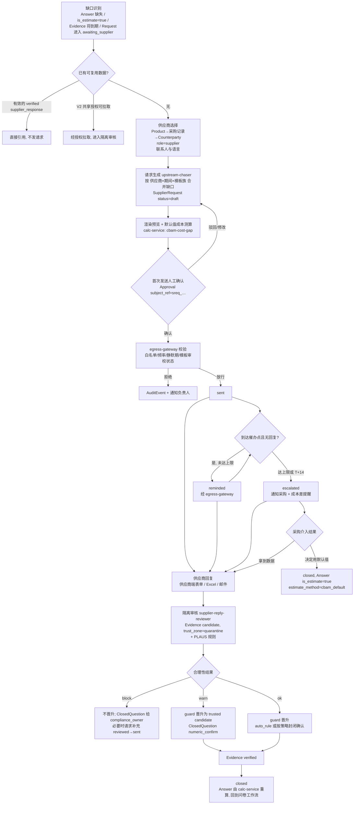
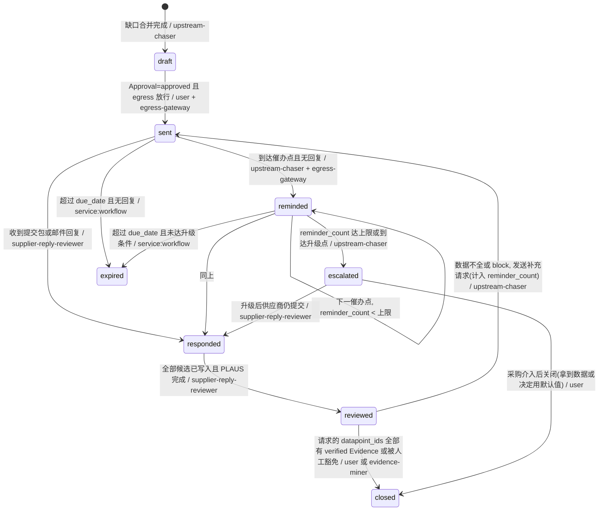
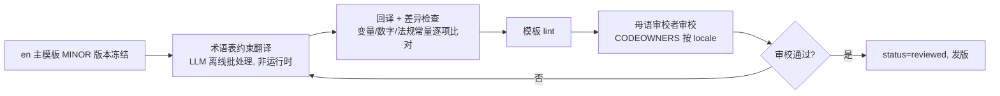
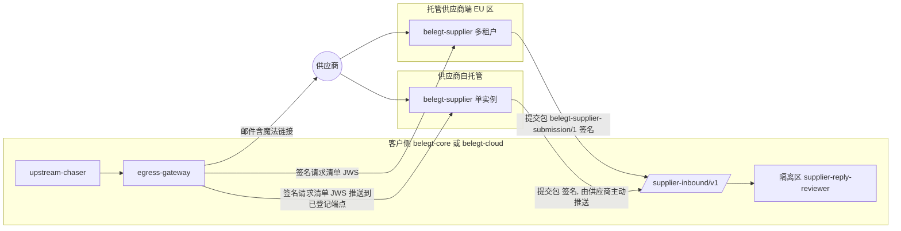

# 08 上游追数与供应商端

## 0. 文档信息

| 项目 | 内容 |
|---|---|
| 版本 | v0.1 |
| 日期 | 2026-10-18 |
| 依赖文档 | 00 PRD v2（§4.3、§6.3、§8、§10）、_baseline（统一基准，含 §L）、02 数据点字典（CBAM/EUDR/PCF 数据点与 `tm:cbam_communication@2024`）、03 数据模型与证据图（§3.5 Evidence、§3.10 SupplierRequest、§3.11 ClosedQuestion、R-PROMO）、09 开源策略（`belegt-supplier` 仓库边界）、13 风险与法规日期 |
| 被依赖 | 04 编排（`awaiting_supplier` 侧路）、05 Agent 设计（`upstream-chaser`、`supplier-reply-reviewer` 提示词与评测）、06 风险与审批、07 安全、10 非功能、11 评测 |
| 读者 | 产品经理、Agent 工程师、前端工程师（供应商端）、合规研究员、本地化审校者、试点客户采购 |
| 范围 | FR-301、FR-302、FR-303、FR-703 的完整设计；在 FR-304…FR-309 号段新增需求 |

阅读约定：对象、字段、状态、Agent ID 全部沿用 _baseline 与 03；DataPoint 一律使用 02 的 `dp:` ID；法规日期与 13 保持一致（CBAM 首次年度申报及清缴 2027-09-30；默认值加价钢铝 2026 年 10%、2027 年 20%、2028 年起 30%；EUDR 大中型经营者 2026-12-30、微小 2027-06-30）。示例中的数值、公司名均为示例。

---

## 1. 目标与设计原则

上游追数解决一个具体问题：客户（我方租户，通常是 CBAM 进口商或 OEM 的二三级供应商）手里缺一批只能由上游提供的数字，最典型的是第三国钢铝装置的比隐含排放（SEE）。13 的 R-04 已经指出，若供应商回复率低于 30%，客户只能用加价默认值，成本逐年上升。因此本模块的目标不是"多发邮件"，而是**用最少的打扰拿到可核验的数据**。

| 原则 | 落地方式 |
|---|---|
| 供应商零学习成本 | 母语邮件 + 免注册魔法链接 + 按数据点的引导表单；已有 CBAM 沟通模板 Excel 的直接上传 |
| 外发受控 | `upstream-chaser` 只能选模板、填变量；所有外发经 `egress-gateway`，有白名单、频率上限、静默期；首次发送必须人工确认 |
| 回复不可信 | 一切回复（表单、Excel、邮件、PDF）先进隔离区，由 `supplier-reply-reviewer` 产出 `Evidence` 候选，经确定性合理性校验（§5）后才可能晋升 |
| 数字不由模型生成 | 表单与 Excel 的数字走确定性映射；邮件正文里的数字由 LLM 定位、由解析器取值，必须带原文定位（R-NUM、R-LOC 精神） |
| 不回复也要有出路 | 升级到采购，并用 `calc-service` 给出"使用默认值要多付多少钱"的测算 |
| 供应商端是网络入口 | `belegt-supplier` 开源可自托管；一次提交可授权给多个客户（V2） |

---

## 2. 上游追数流程

### 2.1 端到端流程



### 2.2 各步骤职责

| 步骤 | 执行者 | 输入 | 输出 | 关键规则 |
|---|---|---|---|---|
| 缺口识别 | `service:workflow` 规则 + `upstream-chaser` 解释 | `Answer`、`Question`、`Product.cbam_relevant`、FR-404 到期扫描 | 缺口清单（`trigger_ref`） | 只对 `evidence_requirements.accepted_source_types` 含 `supplier_response` 的数据点发起 |
| 可复用检查 | 确定性 | 历史 `Evidence(source_type=supplier_response)` | 引用或继续 | 证据 `period` 覆盖目标期间且未 `expired`（R-PERIOD/R-REF） |
| 供应商选择 | `upstream-chaser` | ERP 采购记录（FR-203）、`Counterparty` | 供应商 + 联系人 + `language` | 联系人地址域名必须属于 `Counterparty.domains`；多个联系人时取最近一次成功回复者 |
| 请求生成 | `upstream-chaser` | 合并后的缺口 | `SupplierRequest` v1 `draft` | 一家供应商同一期间同一模板族只开一个请求；`datapoint_ids` 合并去重 |
| 成本测算 | `calc-service` | 进口净质量、默认值 `fs:eu-cbam-default@2026.07`、加价规则、SEFA、原产国已付碳价 | `Calculation`（`cbam-cost-gap@1.0.0`，公式见 05 §6.6） | 写入 `default_cost_estimate_ref`；无进口量数据时跳过并注明 |
| 首次发送确认 | 人（按 06 §4.4 `non_answer_subjects.supplier_request_first_send`：默认 L1，`compliance_owner` 或被授权的 `contributor`；升 L2 时仅 `compliance_owner`） | 渲染后的邮件全文、收件人、截止日期、成本测算 | `Approval(subject_ref=sreq_…#vN)` | 可按同一模板版本批量确认（`apb_` 批次），但每个 `sreq_` 单独留 `Approval` |
| 外发 | `egress-gateway` | 已确认请求 | `AuditEvent(action=egress.send)`；被拒为 `egress.block` | §4.3 频率上限；模板必须 `reviewed`；错误码见 04 §2.15 |
| 催办 | `upstream-chaser` + `egress-gateway` | 催办日程 `chase-policy@1.0.0` | `reminded` 新版本 | 首次确认后，催办无需逐封确认（模板固定、内容不变） |
| 回复审核 | `supplier-reply-reviewer`（quarantine） | 回复原文/提交包 | `Evidence` 候选 + `plausibility` | 无工具；PLAUS 规则作为确定性后处理节点运行 |
| 晋升与核验 | `guard`；人 | 候选 | trusted `Evidence`、`verified` | R-PROMO；`plausibility.flag≠ok` 不得 `auto_rule` |
| 闭环/升级 | `upstream-chaser`、人 | 核验结果或超时 | `closed` / `escalated` | CBAM SEE 首次使用即 L3（_baseline §F），由 06 审批 |

### 2.3 SupplierRequest 状态机

沿用 03 §3.10 的状态集合与转移，下图把每条转移的触发条件写到可实现粒度。末尾两条（`reminded → expired`、`escalated → responded`）原为本文建议补充，已于 2026-10-18 统一修订并入 03 §3.10。



状态与问卷工作流的耦合：任一 `Request` 的缺口挂在 `open` 的 `SupplierRequest` 上时，`Request.status` 进入 `awaiting_supplier`；`SupplierRequest` 到 `closed`/`expired`/`escalated` 时 04 的工作流恢复，`expired` 与 `escalated` 下答案按 PRD §8 标注"估算"或"暂无"。`reviewed → sent` 的补充请求复用同一 `sreq_` 与同一链接，计入 `reminder_count`（03 不变量：只增不减）。

### 2.4 回复进入隔离区的路径

| 回复渠道 | 识别 | 解析 | LLM 参与 |
|---|---|---|---|
| 供应商端结构化表单 | 链接 token → `sreq_` | 字段即 `dp:`，确定性写入 | 否（仅对自由文本备注做注入扫描） |
| 供应商端上传 CBAM 沟通模板 Excel | 同上 | `belegt-io` + `tm:cbam_communication@2024`，`locator` 记 `sheet/cell` | 否；版本不匹配时由 reviewer 提出列映射候选，需人确认 |
| 邮件回复（含附件） | 回复地址 `sreq+<短码>@reply.<租户>.belegt.app`（SaaS；私有化部署用租户自有域）与 `In-Reply-To` | reviewer 定位字段与原文位置，数字由解析器从定位处取值 | 是，隔离区内无工具 |
| 核查报告 PDF | 作为附件 | `belegt-io` PDF 提取，页码 + bbox | 是，仅定位 |

---

## 3. 多语言请求模板

### 3.1 模板标识与版本化

消息模板 ID：`stpl:<family>.<locale>@<semver>`，例如 `stpl:cbam_see_request.de@1.0.0`。03 §3.10 中 `SupplierRequest.template_id` 存放的就是这个 ID（03 已于 2026-10-18 统一修订注明由本文 `stpl:` 定义；消息模板属上游追数领域，05 只引用）。注意与 02 的问卷 `template_id`（如 `cbam_communication`）不是同一概念。

| family | 用途 | 对外 | 首批语言 |
|---|---|---|---|
| `cbam_see_request` | CBAM 排放数据首次请求 | 是 | de、en、tr、zh |
| `cbam_see_reminder` | 催办（三档语气：`r1` 友好、`r2` 提供帮助、`r3` 截止临近） | 是 | 同上 |
| `supplier_followup_incomplete` | 数据不全/需更正的补充请求 | 是 | 同上 |
| `eudr_geo_request` | EUDR 地块坐标与声明 | 是 | en（其他语言按 §3.4 流程） |
| `pcf_request` | 产品碳足迹（PACT 兼容） | 是 | en、de |
| `chase_escalation_internal` | 升级到采购（内部） | 否 | de、en |

版本规则：MAJOR = 变量集合变化或法律含义变化（如加价比例措辞）；MINOR = 措辞调整；PATCH = 错别字。每次外发在 `AuditEvent` 中记录模板 ID、渲染后正文的 `sha256` 和变量快照的哈希。模板源文件放在 `belegt-supplier/templates/<family>/<locale>.md`（Apache-2.0），每个文件头部带 `status: draft|reviewed|deprecated`、`reviewed_by`、`glossary_version`。

### 3.2 模板变量规范

| 变量 | 类型 | 必填 | 来源 | 格式/约束 |
|---|---|---|---|---|
| `{{supplier_name}}` | text | 是 | `Counterparty` 法定名称 | 原样，HTML 转义 |
| `{{contact_name}}` | text | 否 | 联系人 | 缺失时模板使用无姓名称呼分支 |
| `{{customer_name}}` | text | 是 | `Organization` 法定名称 | 即请求方（我方租户） |
| `{{product_list}}` | list | 是 | `product_ids` → 名称 + CN 编码 + 本期进口净质量（可选） | 渲染为项目符号列表，≤20 行，超出折叠为"共 N 项，详见链接" |
| `{{product_summary}}` | text | 是 | 派生 | ≤60 字符，用于主题 |
| `{{datapoint_list}}` | list | 是 | `datapoint_ids` → 02 中该语言的 `label` | 缺译时回退 en 并加标记 |
| `{{period_label}}` | text | 是 | `period` | 按 locale 格式化（如 de "Kalenderjahr 2026"） |
| `{{due_date}}` | date | 是 | `due_date` | `|date_long` 本地化 |
| `{{portal_link}}` | url | 是 | 供应商端签发 | 只在渲染时注入，明文不入库（03 仅存 `portal_token_hash`） |
| `{{link_expires_at}}` | date | 是 | 链接时效（§7.1） | `|date_long` |
| `{{reg.cbam.declaration_deadline}}` | date | 是 | 法规常量表 | 当前 2027-09-30（13），由 `reg-radar` 维护 |
| `{{reg.cbam.markup_2026}}` / `{{reg.cbam.markup_2027}}` | percent | 是 | 法规常量表 | 10 % / 20 %（13） |
| `{{sender_name}}`、`{{sender_role}}` | text | 是 | 确认发送的用户 | 以真实人名发出，提升回复率 |
| `{{request_ref}}` | text | 是 | `sreq_` 短码（后 8 位） | 供应商回复时引用 |
| `{{privacy_note_link}}` | url | 是 | 租户隐私说明 | |
| `{{custom_note}}` | text | 否 | 人工填写 | ≤500 字符；禁止含数字以外的链接；每次使用都需人工确认，`upstream-chaser` 不得自行生成 |

模板 lint（CI 与 `egress-gateway` 双重执行）：所有占位符在每个 locale 中出现且只出现在允许位置；无未声明变量；法规常量不得硬编码；渲染后长度 ≤ 6000 字符；链接域名属于白名单。

### 3.3 CBAM 排放数据请求：四种语言完整模板

#### 3.3.1 德语 `stpl:cbam_see_request.de@1.0.0`

```text
Betreff: Bitte bis {{due_date}}: CBAM-Emissionsdaten für {{product_summary}} – {{customer_name}}

Guten Tag {{contact_name}},

{{customer_name}} importiert folgende Waren von {{supplier_name}} in die Europäische Union:
{{product_list}}

Nach dem EU-CO2-Grenzausgleichssystem (CBAM, Verordnung (EU) 2023/956) müssen wir für Einfuhren im Zeitraum {{period_label}} die grauen Emissionen dieser Waren erklären. Die erste jährliche CBAM-Erklärung ist bis zum {{reg.cbam.declaration_deadline}} abzugeben. Liegen uns keine anlagenspezifischen (tatsächlichen) Werte vor, müssen wir die EU-Standardwerte verwenden. Diese enthalten einen Aufschlag ({{reg.cbam.markup_2026}} für 2026, {{reg.cbam.markup_2027}} für 2027). Dadurch werden Ihre Produkte für uns teurer als die von Lieferanten, die tatsächliche Werte liefern.

Was wir je Anlage und Produkt benötigen:
{{datapoint_list}}

Tatsächliche Werte müssen in der endgültigen Phase von einer akkreditierten Prüfstelle verifiziert sein. Bitte laden Sie den Prüfbericht mit hoch oder teilen Sie uns mit, wann er vorliegt.

So geht es (ca. 15–30 Minuten):
1. Öffnen Sie Ihren persönlichen, sicheren Link: {{portal_link}}
   (keine Registrierung nötig, gültig bis {{link_expires_at}}).
2. Füllen Sie das geführte Formular aus – oder laden Sie die EU-CBAM-Kommunikationsvorlage (Excel) hoch, falls Sie diese bereits für andere Kunden ausgefüllt haben.
3. Fügen Sie, falls vorhanden, Ihren Emissions- bzw. Prüfbericht bei.

Bitte übermitteln Sie die Daten bis zum {{due_date}}. Wenn Sie den Termin nicht halten können oder Fragen haben, antworten Sie einfach auf diese E-Mail.

Ihre Daten werden ausschließlich {{customer_name}} zugänglich gemacht und nur für die CBAM-Berichterstattung und CO2-Datenanfragen unserer Kunden verwendet. Details: {{privacy_note_link}}

Mit freundlichen Grüßen
{{sender_name}}
{{sender_role}}, {{customer_name}}
Referenz: {{request_ref}}
```

#### 3.3.2 英语 `stpl:cbam_see_request.en@1.0.0`

```text
Subject: Action needed by {{due_date}}: CBAM embedded emissions data for {{product_summary}} – {{customer_name}}

Dear {{contact_name}},

{{customer_name}} imports the following goods from {{supplier_name}} into the European Union:
{{product_list}}

Under the EU Carbon Border Adjustment Mechanism (CBAM, Regulation (EU) 2023/956), we must declare the embedded emissions of these goods for imports in {{period_label}}. The first annual CBAM declaration is due on {{reg.cbam.declaration_deadline}}. If we do not receive installation-specific (actual) values, we are required to use EU default values, which carry a mark-up ({{reg.cbam.markup_2026}} for 2026, {{reg.cbam.markup_2027}} for 2027). This makes your products more expensive for us than those of suppliers who provide actual data.

What we need from you, per installation and product:
{{datapoint_list}}

In the definitive period, actual values must be verified by an accredited verifier. Please upload the verification report as well, or tell us when it will be available.

How to provide it (about 15–30 minutes):
1. Open your personal secure link: {{portal_link}}
   (no registration needed, valid until {{link_expires_at}}).
2. Fill in the guided form – or upload the EU CBAM communication template (Excel) if you have already completed it for other customers.
3. Attach your emissions or verification report, if available.

Please submit by {{due_date}}. If you cannot meet this date or have any questions, simply reply to this email.

Your data is shared only with {{customer_name}} and used only for CBAM reporting and our customers' carbon data requests. Details: {{privacy_note_link}}

Kind regards,
{{sender_name}}
{{sender_role}}, {{customer_name}}
Reference: {{request_ref}}
```

#### 3.3.3 土耳其语 `stpl:cbam_see_request.tr@1.0.0`

```text
Konu: {{due_date}} tarihine kadar: {{product_summary}} için SKDM (CBAM) gömülü emisyon verileri – {{customer_name}}

Sayın {{contact_name}},

{{customer_name}}, {{supplier_name}} firmasından aşağıdaki ürünleri Avrupa Birliği'ne ithal etmektedir:
{{product_list}}

AB Sınırda Karbon Düzenleme Mekanizması (SKDM / CBAM, Tüzük (AB) 2023/956) kapsamında, {{period_label}} dönemindeki ithalatlar için bu ürünlerin gömülü emisyonlarını beyan etmekle yükümlüyüz. İlk yıllık SKDM beyanının son tarihi {{reg.cbam.declaration_deadline}}'dir. Tesise özgü (gerçek) değerler almazsak AB varsayılan değerlerini kullanmak zorundayız; bu değerlere 2026 için {{reg.cbam.markup_2026}}, 2027 için {{reg.cbam.markup_2027}} oranında ek bir artış uygulanır. Bu durum, gerçek veri sağlayan tedarikçilere kıyasla ürünlerinizin bizim için maliyetini artırır.

Tesis ve ürün bazında sizden ihtiyaç duyduğumuz bilgiler:
{{datapoint_list}}

Kesin dönemde gerçek değerlerin akredite bir doğrulayıcı tarafından doğrulanmış olması gerekmektedir. Lütfen doğrulama raporunu da yükleyiniz veya ne zaman hazır olacağını bize bildiriniz.

Nasıl iletebilirsiniz (yaklaşık 15–30 dakika):
1. Size özel güvenli bağlantıyı açın: {{portal_link}}
   (kayıt gerekmez, {{link_expires_at}} tarihine kadar geçerlidir).
2. Yönlendirmeli formu doldurun ya da başka müşterileriniz için zaten doldurduğunuz AB SKDM iletişim şablonunu (Excel) yükleyin.
3. Varsa emisyon raporunuzu veya doğrulama raporunuzu ekleyin.

Lütfen verileri {{due_date}} tarihine kadar iletiniz. Bu tarihe yetişemeyecekseniz veya sorunuz varsa bu e-postayı yanıtlamanız yeterlidir.

Verileriniz yalnızca {{customer_name}} ile paylaşılır ve yalnızca SKDM raporlaması ile müşterilerimizin karbon verisi talepleri için kullanılır. Ayrıntılar: {{privacy_note_link}}

Saygılarımızla,
{{sender_name}}
{{sender_role}}, {{customer_name}}
Referans: {{request_ref}}
```

#### 3.3.4 简体中文 `stpl:cbam_see_request.zh@1.0.0`

```text
主题：请于 {{due_date}} 前提供：{{product_summary}} 的 CBAM 隐含排放数据 – {{customer_name}}

{{contact_name}} 您好：

{{customer_name}} 从贵司（{{supplier_name}}）向欧盟进口以下产品：
{{product_list}}

根据欧盟碳边境调节机制（CBAM，法规 (EU) 2023/956），我们须就 {{period_label}} 的进口申报上述产品的隐含排放。首次 CBAM 年度申报截止日为 {{reg.cbam.declaration_deadline}}。如果拿不到贵司生产装置的实际排放值，我们只能使用欧盟默认值，而默认值带有加价（2026 年 {{reg.cbam.markup_2026}}，2027 年 {{reg.cbam.markup_2027}}）。这会使贵司产品对我们的进口成本高于提供实际数据的供应商。

我们需要贵司按生产装置和产品提供：
{{datapoint_list}}

正式期内，实际排放值须经具备资质的核查机构核查。请一并上传核查报告；如尚未完成，请告知预计完成时间。

提交方式（约 15–30 分钟）：
1. 打开贵司专属的安全链接：{{portal_link}}
  （无需注册，有效期至 {{link_expires_at}}）。
2. 按引导表单逐项填写；如已为其他客户填好欧盟 CBAM 沟通模板（Excel），直接上传即可。
3. 如有排放报告或核查报告，请作为附件上传。

请于 {{due_date}} 前提交。若无法按期提供或有任何疑问，直接回复本邮件即可。

贵司数据仅向 {{customer_name}} 开放，仅用于 CBAM 申报及我方客户的碳数据请求。详情：{{privacy_note_link}}

此致
{{sender_name}}
{{sender_role}}，{{customer_name}}
参考编号：{{request_ref}}
```

### 3.4 意大利语、波兰语、印地语、越南语的模板策略

这四种语言不在首批人工撰写之列，但必须在首次对外使用前达到 `reviewed`。流程如下：



| 语言 | 主要场景 | 审校者来源 | 术语要点 | 未审校时的回退 |
|---|---|---|---|---|
| it 意大利语 | 意大利钢铝贸易商、铸造厂 | 签约译员 + 意大利行业协会贡献者 | CBAM 用 "Meccanismo di adeguamento del carbonio alle frontiere (CBAM)"；隐含排放 "emissioni incorporate" | 发 en 模板，附一行意大利语说明"英文邮件，可用意大利语回复" |
| pl 波兰语 | 波兰加工厂（多为欧盟内部，主要是 PCF 请求） | 签约译员 | "graniczny podatek węglowy (CBAM)"、"emisje wbudowane" [需审校确认] | 同上 |
| hi 印地语 | 印度钢铁、铝供应商 | 签约译员；默认仍以 en 为主邮件 | 印度 B2B 习惯英文；hi 作为供应商端 UI 与邮件附段 | 默认 en |
| vi 越南语 | 越南钢材、橡胶件（EUDR） | 签约译员 | "Cơ chế điều chỉnh biên giới carbon (CBAM)" [需审校确认] | 发 en + 越南语附段（仅限已审校的固定附段） |

规则：
1. 运行时禁止 LLM 现场翻译对外邮件；所有对外文本必须来自 `reviewed` 模板（`egress-gateway` 校验，拒绝码 `EGRESS_DENIED_TEMPLATE_UNREVIEWED`，见 04 §2.15）。
2. 术语表 `glossary/<locale>.yaml` 与 02 的 `label` 同源；术语变更是模板的 MINOR 升级。
3. 每个 locale 至少一名审校者；en 主模板 MAJOR 升级时，所有 locale 自动降为 `draft`，直至重新审校。
4. 供应商端 UI 文案走同一流程（§6.3），但允许以 `beta` 标记先上线，界面显示"翻译审校中"。

### 3.5 EUDR 地理坐标请求模板（英文）`stpl:eudr_geo_request.en@1.0.0`

```text
Subject: EUDR due diligence: plot geolocation for {{product_summary}} by {{due_date}} – {{customer_name}}

Dear {{contact_name}},

{{customer_name}} purchases the following products from {{supplier_name}} that contain relevant commodities under the EU Deforestation Regulation (EUDR, Regulation (EU) 2023/1115 as amended by Regulation (EU) 2025/2650):
{{product_list}}

From {{reg.eudr.application_date}} our customers must be able to show that these commodities are deforestation-free and legally produced. For this we need, for each batch delivered in {{period_label}}:
{{datapoint_list}}

Geolocation requirements:
- Coordinates in WGS 84 (GeoJSON), with at least six decimal digits.
- Plots larger than 4 hectares: a polygon of the plot boundary. Plots up to 4 hectares: a single point is sufficient.
- If you or your supplier have already submitted a due diligence statement in the EU Information System, the reference number and verification number are enough for those batches.

How to provide it:
1. Open your secure link: {{portal_link}} (no registration needed, valid until {{link_expires_at}}).
2. Upload a GeoJSON, KML or Shapefile, or draw/enter the plots on the map; or enter the DDS reference numbers.
3. Confirm the country and the date or period of production for each plot.

Please submit by {{due_date}}. If some plots belong to sub-suppliers or smallholders, reply to this email and we will agree on a practical approach.

Your data is shared only with {{customer_name}} and used only for EUDR compliance. Details: {{privacy_note_link}}

Kind regards,
{{sender_name}}
{{sender_role}}, {{customer_name}}
Reference: {{request_ref}}
```

`{{reg.eudr.application_date}}` 按供应商规模取 2026-12-30 或 2027-06-30（13）。默认 `datapoint_ids`：`dp:supply.eudr.geolocation`、`dp:supply.eudr.production_date`、`dp:supply.eudr.country_of_production`、`dp:supply.eudr.commodity_quantity`、`dp:supply.eudr.dds_reference`、`dp:supply.eudr.dds_verification_number`。

### 3.6 PCF 请求模板（英文）`stpl:pcf_request.en@1.0.0`

```text
Subject: Product carbon footprint (PCF) for {{product_summary}} by {{due_date}} – {{customer_name}}

Dear {{contact_name}},

Our customers in the automotive industry ask us for the carbon footprint of our products. A large share of it comes from the materials and parts we buy from {{supplier_name}}:
{{product_list}}

We would therefore like to ask for a cradle-to-gate product carbon footprint for each product, for the reference period {{period_label}}:
{{datapoint_list}}

Format: we accept data in line with the PACT Technical Specification (v3.0.3) or the Catena-X PCF Rulebook (v4.0). If you already exchange PCFs via a PACT-conformant API or Catena-X, tell us your endpoint and we will connect. Otherwise, the guided form will walk you through it. Primary data are preferred; if you use secondary data or estimates, please mark them – estimates are welcome as long as they are labelled.

How to provide it:
1. Open your secure link: {{portal_link}} (no registration needed, valid until {{link_expires_at}}).
2. Enter the values per product, or upload your existing PCF report or PACT JSON file.

Please submit by {{due_date}}. Questions? Just reply to this email.

Your data is shared only with {{customer_name}} and used only to answer carbon data requests from our customers. Details: {{privacy_note_link}}

Kind regards,
{{sender_name}}
{{sender_role}}, {{customer_name}}
Reference: {{request_ref}}
```

默认 `datapoint_ids`：`dp:prod.pcf.cradle_to_gate`、`dp:prod.pcf.cradle_to_gate.excluding_biogenic`、`dp:prod.pcf.declared_unit`、`dp:prod.pcf.primary_data_share`、`dp:prod.pcf.reference_period`。PACT/Catena-X 版本号与 13 一致。

### 3.7 CBAM 请求的数据点与沟通模板映射

| 请求项（供应商看到的名称） | DataPoint | `tm:cbam_communication@2024` entry | 单位 |
|---|---|---|---|
| 生产装置标识 | `dp:prod.cbam.installation_id` | `inst_id` | — |
| CN 编码 | `dp:prod.identity.cn_code` | `cn_code` | — |
| 生产路线 | `dp:prod.cbam.production_route` | `production_route`（`bf_bof`/`eaf`/`dri_eaf`） | — |
| 直接比隐含排放 | `dp:prod.cbam.see_direct` | `see_direct` | tCO2e/t |
| 间接比隐含排放 | `dp:prod.cbam.see_indirect` | `see_indirect` | tCO2e/t |
| 比电耗 | `dp:prod.cbam.specific_electricity_consumption` | 02 未列 entry [需核对模板单元格] | MWh/t |
| 原产国已付碳价 | `dp:prod.cbam.carbon_price_paid` | 02 未列 entry [需核对] | EUR |
| 核查报告 | Evidence 附件（`value_type=file`） | — | — |

---

## 4. 催办节奏

### 4.1 默认时间表 `chase-policy@1.0.0`

本节 T+n 均为**供应商时区的工作日**（与 04 §2.9"间隔 ≥ 5 个工作日"一致）。默认 `due_date` = 发送日 + 21 天，但不得晚于触发它的 `Request.due_date` 前 10 个工作日；CBAM 年度数据的内部收集目标为 2027-06-30（为核查留出时间，见 13 A-05）。

| 时点 | 动作 | 模板 | 状态 | 说明 |
|---|---|---|---|---|
| T+0 | 首次发送（人工确认后） | `cbam_see_request` | `sent` | 供应商时区工作日 09:00–16:00 内发出 |
| T+5 | 催办 1：友好提醒 + 链接 | `cbam_see_reminder` `r1` | `reminded`（1） | 若链接已被打开但未提交，改用"继续填写"文案 |
| T+10 | 催办 2：提供帮助（可回复母语提问、可先交部分数据） | `r2` | `reminded`（2） | 同时内部通知负责人 |
| T+14（= 标准窗口的 due−7） | 催办 3：截止临近 + 升级采购 | `r3` + `chase_escalation_internal` | `escalated` | 内部附 `cbam-cost-gap` 测算 |
| due−7（长窗口） | 截止前提醒 | `r3` | `reminded` | 窗口 ≥ 42 天时启用，替代 T+14 的对外部分 |
| due | 到期 | — | `expired` 或保持 `escalated` | 答案按"估算/暂无"处理 |

长窗口（≥ 42 天，如年度 CBAM 数据）：T+0、T+7、T+21、due−7，升级点为 due−7；中间每 14 天检查一次链接是否被打开，打开未提交只发一次"继续填写"提醒（计入上限）。

### 4.2 按供应商分级调整

分级是派生属性（每次生成请求时计算，不写入证据图），依据为 `cbam-cost-gap` 测算值和历史响应。

| 级别 | 判定（默认，可按租户调） | 节奏调整 | 升级对象 |
|---|---|---|---|
| A 关键 | 成本差测算 ≥ €10,000/年，或该供应商覆盖 ≥ 20% CBAM 进口净质量 | 催办间隔不变，T+10 起同步通知采购；允许上限 1+5 | 采购负责人 + `executive` 摘要 |
| B 常规 | 其余有 CBAM 进口的供应商 | 默认表 | 采购负责人 |
| C 低影响 | 成本差 < €1,000/年或年进口净质量 < 5 t | 只发 T+0、T+10，T+21 直接按默认值关闭的建议（需人确认） | 无，仅周报 |
| 响应良好 | 过去 2 个周期都在 T+7 内回复 | 首次请求后只发 1 次催办 | — |
| 曾投诉/要求减少联系 | 退订或明确回复 | 只发首次请求，催办改为内部提醒采购当面沟通 | 采购 |

### 4.3 频率上限（由 `egress-gateway` 强制）

| 规则 | 内容 | 违反时 |
|---|---|---|
| UPC-LIM-01 | 每个 `SupplierRequest` 外发总数 ≤ 1+3（租户可调至 1+5，即 03 的"租户上限"） | 拒绝，状态转 `escalated` |
| UPC-LIM-02 | 同一联系人地址 72 小时内最多 1 封，跨请求合并 | 延后到窗口外 |
| UPC-LIM-03 | 同一供应商组织 7 天内最多 3 封 | 延后 |
| UPC-LIM-04 | 只在供应商时区工作日 09:00–16:00 发送，避开静默期（§4.4） | 延后到下一可发时段 |
| UPC-LIM-05 | 租户每日外发 ≤ 300 封；新租户首周 ≤ 50 封（发信域名信誉预热） | 排队 |
| UPC-LIM-06 | 收件人域名属于 `Counterparty.domains` 且地址经人工确认过一次 | `EGRESS_DENIED_RECIPIENT_NOT_ALLOWED` |
| UPC-LIM-07 | 硬退信立即停发该地址；"暂停提醒"链接生效后停止催办并通知租户 | 生成 ClosedQuestion：换联系人？ |

每次放行或拒绝都写 `AuditEvent`（放行 `egress.send`、拒绝 `egress.block`，含规则 ID）。"延后"由网关返回 `EGRESS_DENIED_RATE_LIMITED`（UPC-LIM-02/03/05）或 `EGRESS_DENIED_QUIET_PERIOD`（UPC-LIM-04）并附 `retry_after`，`SupplierChaseWorkflow` 在该时间后重新提交；UPC-LIM-01 的 `EGRESS_DENIED_RATE_LIMITED` 则转 `escalated`。错误码以 04 §2.15 为准。延后不是失败，`last_sent_at` 只在真正发出时更新。

### 4.4 静默期与节假日

日历来源：开源 `holidays` 库（按国家和地区）+ Belegt 维护的商务静默期覆盖表 + 租户自定义。规则：催办点落在静默期内则顺延到静默期结束后的第一个工作日；静默期与 `due_date` 重叠时，`due_date` 自动顺延同等工作日数并在内部通知（对外在下一封邮件中说明）。

| 国家/地区 | 静默期 | 2026–2027 示例 | 备注 |
|---|---|---|---|
| 中国 | 春节：除夕前 3 天至初十 | 2027 年春节为 2027-02-06，静默 2027-02-02 至 2027-02-15 [需按国务院放假安排核对] | 春节前两周发首次请求的，`due_date` 不早于节后 10 个工作日 |
| 中国 | 国庆：10-01 至 10-07 | 2027-10-01 至 2027-10-07 | |
| 土耳其 | 开斋节（Ramazan Bayramı）、宰牲节（Kurban Bayramı）全程 + 前后各 1 天 | 2027 年约 3 月上旬、5 月中旬 [需按官方公告核对] | 节日日期随伊斯兰历每年前移约 11 天，必须用年度数据 |
| 越南 | 春节（Tết）前 3 天至后 7 天 | 与中国春节同日起算 | |
| 印度 | Diwali 前后各 2 天 | 2027 年约 10 月下旬至 11 月初 [需核对] | |
| 意大利 | 8 月 10 日至 8 月 24 日（Ferragosto 前后） | 每年 | 只顺延催办，不顺延首次请求 |
| 德国/波兰/欧盟内 | 12-23 至 01-02 | 2026-12-23 至 2027-01-02 | |

### 4.5 升级路径与默认值成本提醒

升级不是"再发一封更凶的邮件"，而是把决定交给有商业杠杆的人。

1. `escalated` 时生成内部通知（`chase_escalation_internal`），收件人为采购负责人（`contributor`，按租户配置），A 级同时进 `executive` 的成本差看板。
2. 通知附带 `default_cost_estimate_ref` 指向的 `Calculation`（05 §6.6 `cbam-cost-gap@1.0.0`；输入为该供应商在期间内的进口净质量、`fs:eu-cbam-default@2026.07` 中对应 CN 编码的默认值、当年加价比例、SEFA（默认/实际）、原产国已付碳价（按 Art. 9(1) 作加项）、证书价格假设）。通知只展示 Calculation 的结果和区间，数字不由 LLM 生成（R-NUM）。示例文案："若 {{supplier_name}} 不提供实际值，按默认值（含 {{reg.cbam.markup_2026}} 加价）测算，2026 年进口约多支付 €{{calc.result}}（区间见附件）。"
3. 采购可选：①"我来联系"（暂停自动催办 14 天，到期询问结果）；②"换联系人"（生成新 `draft`，需重新首次确认）；③"使用默认值"（`escalated → closed`，相关 `Answer.is_estimate=true`、`estimate_method=cbam_default`，按 06 走 L3 审批）。
4. 每月第一个工作日，向 `executive` 汇总所有 `escalated` 与 `expired` 请求的默认值成本合计，按供应商排序。

---

## 5. 合理性校验规则

### 5.1 执行方式与结果映射

PLAUS 规则是确定性函数，放在 `belegt-calc` 的 `plausibility` 模块（Apache-2.0，可被核查机构复用），在 `supplier-reply-reviewer` 的图内作为后处理节点运行，LLM 无法跳过或修改结果。结果写入 `Evidence.plausibility`：`flag` 取 03 已定义的枚举 `ok|outlier|unit_suspect`，`basis` 记录命中的规则 ID 与参数（如 `PLAUS-001:ratio=0.18;PLAUS-020`）。

| 严重度 | 含义 | `plausibility.flag` | 后续 |
|---|---|---|---|
| `block` | 数据不可用或内容可疑 | `outlier` 或 `unit_suspect`（注入类见 §5.3，不生成 Evidence） | 不晋升；ClosedQuestion 给 `compliance_owner`；可触发 `reviewed → sent` 补充请求 |
| `warn` | 可能有误，需人看 | `outlier` 或 `unit_suspect` | 可晋升为 trusted `candidate`，必须 ClosedQuestion `numeric_confirm` 核验 |
| `info` | 提示 | `ok` | 不影响 `auto_rule`；在审批界面展示 |

此外，无论 PLAUS 结果如何，`dp:prod.cbam.see_direct`/`see_indirect` 的首次供应商值一律经 ClosedQuestion 核验（L3 前置），其余数据点 `flag=ok` 且来自结构化提交时可 `auto_rule`。

### 5.2 规则目录

| 规则 ID | 适用数据点 | 逻辑 | 默认阈值 | 严重度 |
|---|---|---|---|---|
| PLAUS-001 | `dp:prod.cbam.see_direct` | 与 `fs:eu-cbam-default@2026.07` 同 CN 编码默认值（不含加价）之比过低 | 比值 < 0.30 | warn |
| PLAUS-002 | `dp:prod.cbam.see_direct` | 同上，比值过高 | 比值 > 1.50 | warn |
| PLAUS-003 | `dp:prod.cbam.see_direct`、`see_indirect` | 单位数量级错误：值约为合理区间的 1000 倍或 1/1000（kgCO2e/t 误填为 tCO2e/t 等） | 与默认值比值落在 [500, 2000] 或 [0.0005, 0.002] | block（`unit_suspect`） |
| PLAUS-004 | `dp:prod.cbam.see_direct` + `production_route` | 生产路线与强度不匹配：`bf_bof` 但直接强度过低 | `bf_bof` 且 < 1.2 tCO2e/t [需核对行业区间] | warn |
| PLAUS-005 | 同上 | `eaf` 但直接强度过高（疑为长流程或含上游前体） | `eaf` 且 > 0.8 tCO2e/t [需核对] | warn |
| PLAUS-006 | `see_indirect`、`specific_electricity_consumption` | 隐含电力因子 = `see_indirect` ÷ 比电耗，与装置所在国电网因子比较 | 偏差 > ±35%（国家因子取 CBAM 默认电力因子或 IEA/JRC 公开值，版本记录在 `basis`） | warn |
| PLAUS-007 | `specific_electricity_consumption` + `production_route` | 比电耗与路线不符：`eaf` 过低或 `bf_bof` 过高 | `eaf` < 0.3 MWh/t 或 `bf_bof` > 0.5 MWh/t [需核对] | warn |
| PLAUS-008 | 全部数字 | 负值、零或非 DEC-STR | 任一 | block |
| PLAUS-009 | `see_direct`、`see_indirect` | 与同一装置上一期已核验值比较的年度变化 | 变化 > ±40% | warn |
| PLAUS-010 | `see_*` | 同一装置、同一 CN 编码在同一期间对不同客户（V2 共享）或不同渠道给出不同值 | 差异 > 1% | warn（交 06 冲突目录） |
| PLAUS-011 | `dp:prod.cbam.installation_id` | 格式校验（CBAM 注册表装置标识格式）及与上一期是否一致 | 格式不符；或同一供应商装置 ID 变化 | warn |
| PLAUS-012 | `dp:prod.identity.cn_code` | 必须 8 位且属于 CBAM 附件 I 清单，且与请求的 `product_ids` 一致 | 不符 | block |
| PLAUS-013 | `dp:prod.cbam.carbon_price_paid` | 原产国无已知碳定价机制却填非零；或币种/单位缺失 | 由 `reg-radar` 维护的国家清单判定 | warn |
| PLAUS-014 | 核查报告附件 | CBAM SEE 已填但无核查报告且未说明预计时间 | 缺失 | info（L3 审批界面高亮） |
| PLAUS-015 | `dp:supply.eudr.geolocation` | 坐标合法：WGS 84 范围、至少 6 位小数、GeoJSON RFC 7946 有效（闭合、不自交） | 任一不符 | block |
| PLAUS-016 | `dp:supply.eudr.geolocation` | 点或多边形质心落在陆地（Natural Earth 1:10m 陆地面） | 落在海洋 | block |
| PLAUS-017 | `geolocation` + `country_of_production` | 位于声明国家境内（行政边界 + 1 km 缓冲） | 不在境内 | block |
| PLAUS-018 | `geolocation` | 面积 > 4 ha 的地块必须是 Polygon；以 Point 提交但附带面积字段 > 4 ha 亦拦截 | 椭球面积 > 40,000 m² 且为 Point | block |
| PLAUS-019 | `geolocation` | 多边形面积异常（< 0.01 ha 或 > 10,000 ha）或与 `commodity_quantity` 推算的产量不匹配 | 超出区间 | warn |
| PLAUS-020 | `dp:supply.eudr.production_date` | 日期逻辑：不晚于提交日；区间起止有序；早于 2020-12-31（毁林截止日）的说明需人工确认 | 任一 | warn（未来日期为 block） |
| PLAUS-021 | `dp:supply.eudr.dds_reference`、`dds_verification_number` | 两者须成对出现，格式符合信息系统规则 | 缺一或格式错 | block |
| PLAUS-022 | `dp:prod.pcf.cradle_to_gate` | 与同材料的公开行业基准（如钢 kgCO2e/kg 量级）比值过高/过低；或未提供 `declared_unit` | 比值 < 0.2 或 > 5；缺声明单位为 block | warn / block |
| PLAUS-023 | `dp:prod.pcf.cradle_to_gate` vs `.excluding_biogenic` | 金属制品两者应接近；含生物源值不应显著低于不含值 | 差 > 10% | warn |
| PLAUS-024 | `dp:prod.pcf.primary_data_share` | 0–100 之间 | 超界 | block |
| PLAUS-025 | `dp:prod.pcf.reference_period` | 参考期不晚于提交日，且距请求期间不超过 3 年 | 超出 | warn |
| PLAUS-026 | 全部 | 期间不覆盖 `SupplierRequest.period`（R-PERIOD 前置） | 不覆盖 | warn |
| PLAUS-027 | 全部数字 | 疑似复制粘贴：同一提交中多个不同数据点完全相同，或值恰为默认值本身 | 命中 | info（等于默认值时 warn：可能供应商直接抄了默认值） |

### 5.3 注入与异常内容检测

这些检查在任何 LLM 读取内容之前执行，命中 `block` 时 reviewer 只看到占位说明而不是原文。

| 规则 ID | 检测 | 处理 |
|---|---|---|
| PLAUS-030 | 文本字段或邮件正文含指令型语句（"ignore previous"、"系统提示"、要求改变收件人/付款信息等）的分类器 + 规则命中 | block，`guard` 记录，人工查看原文；不阻断该提交中的结构化数字字段 |
| PLAUS-031 | Excel 隐藏工作表、隐藏行列、白字/极小字号、单元格注释中的长文本 | 隐藏内容不进入 LLM 上下文；与可见值冲突时 block |
| PLAUS-032 | 宏文件（xlsm/xlsb）、外部链接公式、DDE、OLE 对象 | 拒收宏；公式只取缓存值并标注；外部链接 block |
| PLAUS-033 | 文件 MIME 与扩展名不符、压缩炸弹（解压比 > 100）、单文件 > 25 MB、PDF 含 JavaScript | 拒收，返回供应商端友好提示 |
| PLAUS-034 | 字段中出现 URL、电子邮件地址、Unicode 双向控制字符、零宽字符 | 去除控制字符；URL 不可点击；转人工 |
| PLAUS-035 | 回复来源与请求不符（发件域名不在 `Counterparty.domains`、token 被他人使用的迹象） | block，冻结链接，通知租户 |

---

## 6. 供应商端 `belegt-supplier` 功能规格

### 6.1 定位

`belegt-supplier`（Apache-2.0，09 §1.2）是独立应用：与 `belegt-core` 只有 HTTP 契约（OpenAPI 位于 `belegt-dictionary/schema/supplier-api/`），供应商自托管时不接触 AGPL 代码。托管版永久免费。技术栈 TypeScript + React，PWA，移动优先。

### 6.2 功能清单

| 功能 | 说明 | 阶段 | FR |
|---|---|---|---|
| 魔法链接免注册 | 点击邮件链接直达本请求；无需密码 | V1 | FR-301 |
| 可选账户 | 邮箱 + 一次性验证码或通行密钥（passkey）；用于复用历史、管理多个客户的请求 | V1 | FR-306 |
| 多语言 UI | de、en、tr、zh、it、pl 首批；hi、vi 随 §3.4 流程上线；语言按浏览器设置，可切换 | V1 | FR-703 |
| 移动优先 | 最小宽度 360 px；单列；大按钮；弱网可用 | V1 | FR-703 |
| 按数据点的引导表单 | 每个 `dp:` 一张卡片：说明、单位、示例、"不知道怎么算"帮助；单位下拉只允许 02 的 `allowed_units` | V1 | FR-301 |
| CBAM 沟通模板 Excel 自动解析 | 上传后按 `tm:cbam_communication@2024` 解析，展示"读到了什么、在哪个单元格"，供应商确认 | V1 | FR-305 |
| 复用历史提交 | 账户内保留历次提交，新请求可"沿用上次值"，逐字段确认并提示期间差异 | V1 | FR-306 |
| 向多个客户授权共享 | 一份数据集（如"装置 X 2026 年 CBAM 数据"）授权给多个客户，可撤销 | V2 | FR-307 |
| 离线草稿 | 本地 IndexedDB 自动保存；断网可填；联网后同步；可导出草稿 JSON | V1 | FR-703 |
| 证据上传 | 核查报告、排放报告、GeoJSON/KML/Shapefile、PACT JSON | V1 | FR-301、FR-303 |
| 提问通道 | 供应商对某个数据点提问，进入租户收件箱（内容进隔离区） | V1 | FR-302 |
| 地图绘制 | EUDR 地块点/多边形绘制，实时显示面积与 4 ha 提示 | V2 | FR-303 |
| 自托管 | 单容器 `ghcr.io/belegt/supplier` 或 Helm `belegt-supplier` | V1 | FR-703 |

### 6.3 信息架构

```text
供应商端
├── 入口
│   ├── 魔法链接落地页（/r/{token}）
│   └── 登录（可选账户：邮箱验证码 / passkey）
├── 请求（单个 SupplierRequest）
│   ├── 概览：谁在要、要什么、为何要、截止日
│   ├── 填写方式选择：引导表单 | 上传 CBAM Excel | 沿用上次
│   ├── 按装置/产品分组的数据点卡片
│   ├── 证据上传
│   ├── 检查与提交（含即时校验提示）
│   └── 提问 / 无法提供（说明原因）
├── 我的（仅账户）
│   ├── 全部请求（按客户、状态）
│   ├── 我的数据集（历次提交、有效期）
│   ├── 共享授权（V2）
│   └── 团队成员（同一供应商多人协作）
└── 设置：语言、通知偏好、隐私与数据导出/删除
```

### 6.4 关键界面线框

落地页（移动端）：

```text
┌──────────────────────────────────┐
│ belegt supplier        [DE ▾]    │
├──────────────────────────────────┤
│ Müller Stanztechnik GmbH bittet  │
│ um CBAM-Emissionsdaten           │
│                                  │
│ Zeitraum:  Kalenderjahr 2026     │
│ Frist:     2027-03-15 (noch 21 T)│
│ Produkte:  3 (CN 7208…, 7219…)   │
│                                  │
│ Warum? Ohne Ihre Werte gelten    │
│ EU-Standardwerte mit Aufschlag.  │
│ [Mehr erfahren]                  │
├──────────────────────────────────┤
│ Wie möchten Sie antworten?       │
│ ┌──────────────────────────────┐ │
│ │ ✎  Schritt für Schritt       │ │
│ │    ca. 20 Min.               │ │
│ └──────────────────────────────┘ │
│ ┌──────────────────────────────┐ │
│ │ ⇪  CBAM-Excel hochladen      │ │
│ └──────────────────────────────┘ │
│ ┌──────────────────────────────┐ │
│ │ ↺  Werte vom letzten Mal     │ │
│ │    (Anmeldung nötig)         │ │
│ └──────────────────────────────┘ │
│ Frage stellen · Nicht verfügbar  │
└──────────────────────────────────┘
```

数据点卡片：

```text
┌──────────────────────────────────┐
│ ← Anlage 1 · Produkt 2/3   ●●○   │
├──────────────────────────────────┤
│ Direkte spezifische graue        │
│ Emissionen (SEE direct)          │
│ dp:prod.cbam.see_direct          │
│                                  │
│ ┌──────────────┐ ┌────────────┐  │
│ │ 1.85         │ │ tCO2e/t ▾  │  │
│ └──────────────┘ └────────────┘  │
│ Produktionsroute: [BF-BOF ▾]     │
│ Zeitraum: 2026-01-01–2026-12-31  │
│                                  │
│ ⚠ Wert liegt 62 % unter dem      │
│   EU-Standardwert. Bitte prüfen  │
│   oder Begründung angeben.       │
│ ┌──────────────────────────────┐ │
│ │ Begründung (optional)        │ │
│ └──────────────────────────────┘ │
│ ? Wie berechne ich das?          │
├──────────────────────────────────┤
│ [Zurück]   Entwurf gespeichert ✓ │
│                       [Weiter →] │
└──────────────────────────────────┘
```

供应商端的即时提示只运行不依赖客户私有数据的 PLAUS 子集（001–008、012、015–018、020–024），提示不阻止提交；最终判定仍在客户侧隔离区重新执行。

Excel 解析结果：

```text
┌──────────────────────────────────┐
│ CBAM_Communication_2026.xlsx  ✓  │
│ Vorlage erkannt: cbam_comm 2024  │
├──────────────────────────────────┤
│ Gefunden            Zelle        │
│ Anlage   TR-XXXX…   A_InstData!C5│
│ CN 72083900          Summary!B4  │
│   SEE dir. 1.92 t/t  Summary!F4  │
│   SEE ind. 0.21 t/t  Summary!G4  │
│   Route   BF-BOF     D_Proc!D7   │
│ CN 72193400          Summary!B5  │
│   SEE dir. —        ⚠ leer       │
├──────────────────────────────────┤
│ 1 Produkt im Antrag fehlt in der │
│ Datei. [Ergänzen]                │
│ [Alles korrekt – übernehmen]     │
└──────────────────────────────────┘
```

提交确认与共享（V2）：

```text
┌──────────────────────────────────┐
│ Prüfen & senden                  │
├──────────────────────────────────┤
│ 3 Produkte · 9 Werte · 1 Bericht │
│ ⚠ 1 Hinweis (siehe Produkt 2)    │
│                                  │
│ Empfänger: Müller Stanztechnik   │
│ ☐ Auch freigeben für (V2):       │
│   ☐ Weber Automotive AG          │
│   ☐ Schmidt Umformtechnik        │
│                                  │
│ ☑ Ich bestätige, dass die Werte  │
│   nach bestem Wissen korrekt sind│
│ [Senden]                         │
└──────────────────────────────────┘
```

### 6.5 自托管模式与 SaaS 模式的数据流



| 方面 | SaaS 模式 | 自托管模式 |
|---|---|---|
| 请求如何到达 | 客户侧把签名请求清单推送到托管实例，邮件链接指向托管域名 | 供应商在托管版或邮件中登记自己的端点并完成域名验证；之后清单推送到其实例，链接指向其域名 |
| 草稿存放 | 托管实例（EU 区）+ 浏览器本地 | 只在供应商实例与浏览器本地 |
| 提交 | 托管实例转发签名提交包到客户 `/supplier-inbound/v1/submissions` | 供应商实例直接推送；客户侧从不主动拉取供应商实例 |
| 历史与复用 | 托管账户内 | 供应商本地 |
| 共享给多个客户（V2） | 托管版按授权分别推送 | 本地按授权分别推送 |
| 运维 | Belegt | 供应商；单容器 + SQLite 或 PostgreSQL |

提交包 `belegt-supplier-submission/1`：`{request_manifest_hash, sreq_ref, submitted_at, locale, values[{datapoint_id, value, unit, period, boundary, source:{kind: form|excel|reuse, sheet?, cell?}, note?}], blobs[{sha256, mime, filename}], attestation:{by, statement_version}, signature}`。客户侧收到后原样落入对象存储，`Evidence.locator.blob_sha256` 指向提交包，`cell` 或字段路径作为定位。

### 6.6 API（`supplier-api` v1）

| 方法与路径 | 用途 | 鉴权 |
|---|---|---|
| `GET /supplier-api/v1/requests/{token}` | 获取请求清单（客户名、数据点、产品、期间、截止日、locale） | 魔法链接 token |
| `PUT /supplier-api/v1/requests/{token}/draft` | 保存草稿（乐观锁 `draft_version`） | token |
| `POST /supplier-api/v1/requests/{token}/uploads` | 上传文件，返回 `sha256` 与扫描结果 | token |
| `POST /supplier-api/v1/requests/{token}/parse/cbam-communication` | 解析已上传的 CBAM Excel，返回字段与单元格 | token |
| `POST /supplier-api/v1/requests/{token}/questions` | 供应商提问 | token |
| `POST /supplier-api/v1/requests/{token}/decline` | 声明无法提供及原因（枚举 + 文本） | token |
| `POST /supplier-api/v1/requests/{token}/submit` | 提交，返回提交包哈希 | token + 提交声明勾选 |
| `POST /supplier-api/v1/auth/magic-link` | 链接过期时凭邮箱重新签发 | 邮箱须为原收件人 |
| `GET /supplier-api/v1/me/submissions` | 账户内历次提交 | 账户会话 |
| `POST /supplier-api/v1/me/shares` / `DELETE …/{share_id}` | 共享授权与撤销（V2） | 账户会话 + 二次验证 |
| `POST /supplier-inbound/v1/submissions` | （客户侧）接收提交包 | 实例签名密钥（JWS）+ mTLS 可选 |
| `POST /supplier-inbound/v1/questions` | （客户侧）接收供应商提问 | 同上 |
| `POST /supplier-api/v1/manifests` | （供应商端）接收客户推送的签名请求清单 | 客户侧签名 |

---

## 7. 供应商端安全

### 7.1 链接与范围

| 项目 | 规则 |
|---|---|
| token | 256 位随机，URL-safe；只存 `portal_token_hash`（03）；不出现在日志与 Trace 中 |
| 时效 | 默认 `due_date` + 14 天，最长 90 天；`closed`/`expired` 后 7 天只读，然后失效 |
| 范围 | 一个 token 只对应一个 `SupplierRequest`：只能看到该请求的数据点、产品与客户名，看不到其他请求、其他供应商或客户内部数据 |
| 设备绑定 | 首次打开后签发 HttpOnly 会话 cookie；从新设备打开同一链接时要求向原收件邮箱发送 6 位验证码 |
| 转发 | 允许供应商内部转发（常见于把请求转给工厂环保人员）；新设备需验证码，验证码只发原收件人，原收件人可在页面上"邀请同事"添加地址（同域名） |
| 吊销 | 租户可随时吊销；疑似泄露（PLAUS-035）自动冻结 |
| 补发 | 过期后经 `/auth/magic-link` 重新签发，旧 token 立即失效 |

### 7.2 速率限制

| 对象 | 限制 |
|---|---|
| 同一 token | 每分钟 60 次请求，每天 20 次上传，提交 ≤ 10 次（每次提交生成新版本，最后一次生效前的都保留） |
| 同一 IP 对 `/requests/{token}` 的未知 token 访问 | 10 次/分钟，超出后指数退避，防止 token 枚举 |
| 魔法链接重发 | 同一邮箱 3 次/小时 |
| 验证码 | 5 次错误锁定 15 分钟 |
| 上传 | 单文件 ≤ 25 MB，单请求 ≤ 200 MB；病毒扫描（ClamAV）后才可解析 |

### 7.3 隐私

- 数据最小化：供应商端只收集联系人姓名、邮箱和请求所需数据点；不收集员工个人数据（PRD 非目标）。
- 托管版数据存放在欧盟区（NFR-01）；每个客户只能看到发给自己的提交；共享（V2）必须由供应商逐个客户显式授权，可撤销，撤销后不再推送新版本（已交付的版本按客户与供应商的合同留存）。
- 页面设置 `noindex`、严格 CSP、无第三方追踪脚本；分析指标只用自托管、无 cookie 的聚合统计。
- 供应商可导出与删除其账户数据（GDPR 第 15、17 条）；删除不影响客户已收到并入证据图的提交包（客户为独立控制者），删除请求会通知相关客户。
- 每封邮件提供"暂停提醒"链接（UPC-LIM-07），不需要登录。

---

## 8. 指标

| 指标 ID | 指标 | 定义 | 目标（V1 试点 / 12 个月） |
|---|---|---|---|
| UPM-01 | 响应率 | `due_date` 前进入 `responded` 的请求 ÷ 已 `sent` 请求 | ≥ 40% / ≥ 60%（13 R-04 预警线 30%） |
| UPM-02 | 首响时间 | `sent` 到首次 `responded` 的中位天数 | ≤ 10 天 / ≤ 7 天 |
| UPM-03 | 数据可用率 | 进入 `verified` 的 Evidence 数 ÷ 请求的 `datapoint_ids` 总数 | ≥ 50% / ≥ 70% |
| UPM-04 | 默认值比例 | CBAM 进口净质量中使用默认值的部分 ÷ 总进口净质量，按租户以首个周期为基线 | 12 个月下降 50%（PRD §2） |
| UPM-05 | 链接打开未提交率 | 打开过链接但未提交的请求 ÷ 打开过的请求 | ≤ 30%（高于此值说明表单难用） |
| UPM-06 | 升级转化 | `escalated` 后最终拿到数据的比例 | ≥ 30% |
| UPM-07 | PLAUS 误报率 | `warn`/`block` 中被人确认为正确值的比例 | ≤ 25% |
| UPM-08 | 打扰度 | 每个关闭请求的平均外发封数；"暂停提醒"点击率 | ≤ 2.5 封；≤ 3% |
| UPM-09 | 供应商端网络 | 托管注册组织数、自托管实例数（自愿上报）、多客户共享的数据集数（V2） | [待定]（PRD） |

UPM-04 的计算由 `calc-service` 基于 `Answer.is_estimate` 与 `estimate_method=cbam_default` 汇总进口净质量得到，在成本差看板展示，与 `cbam-cost-gap` 合计金额并列。

---

## 9. FR 追溯

| FR | 本文对应 | 验收要点 |
|---|---|---|
| FR-301 多语言请求模板，附供应商端链接 | §3（模板 ID、变量、四语 CBAM 模板、EUDR/PCF 模板、翻译审校）、§6.2 魔法链接 | 首批 de/en/tr/zh 模板 `reviewed`；每封外发记录模板版本与渲染哈希；对外文本 100% 来自模板 |
| FR-302 自动催办+合理性审核（隔离区） | §2.3 状态机、§4 催办节奏与频率上限、§5 PLAUS 规则、§2.4 隔离路径 | 催办全部经 `egress-gateway`；PLAUS-001…035 有测试向量；回复 100% 先进 quarantine |
| FR-303 EUDR 坐标与声明 | §3.5 模板、PLAUS-015…021、§6.2 地图绘制 | >4 ha Point 被拦截；坐标不在声明国被拦截；DDS 参考号成对校验 |
| FR-703 供应商端自托管多语言 | §6 全部、§7 安全 | 单容器部署；6 种 UI 语言；离线草稿；与 core 仅 HTTP 契约 |
| FR-304（新增） | §4.1–4.4 | 催办策略版本化、分级、静默期日历生效 |
| FR-305（新增） | §6.2、§6.4 Excel 解析 | 官方模板解析带单元格定位，版本不符时转人工 |
| FR-306（新增） | §6.2 可选账户与复用 | 沿用上次值需逐字段确认且提示期间差异 |
| FR-307（新增） | §6.2、§6.5 共享 | 授权可撤销，逐客户推送 |
| FR-308（新增） | §4.5 | 升级通知附 `cbam-cost-gap` Calculation；月度汇总 |
| FR-309（新增） | §3.1、§3.4 | 模板版本化与翻译审校流水线；未审校模板不能外发 |

---

## 本文新增标识

| 类别 | 标识 | 说明 |
|---|---|---|
| FR | FR-304（P1）催办策略：默认节奏、供应商分级、静默期与节假日日历 | §4 |
| FR | FR-305（P1）供应商端 CBAM 沟通模板 Excel 自动解析（单元格定位） | §6 |
| FR | FR-306（P1）供应商可选账户与历史提交复用 | §6 |
| FR | FR-307（P2）供应商向多个客户授权共享数据集（V2 网络入口） | §6 |
| FR | FR-308（P1）升级到采购与默认值成本提醒（引用 05 §6.6 `cbam-cost-gap@1.0.0`） | §4.5 |
| FR | FR-309（P1）消息模板版本化、术语表与翻译人工审校流水线 | §3 |
| 消息模板 ID | `stpl:<family>.<locale>@<semver>`；family：`cbam_see_request`、`cbam_see_reminder`（`r1/r2/r3`）、`supplier_followup_incomplete`、`eudr_geo_request`、`pcf_request`、`chase_escalation_internal` | 存于 `SupplierRequest.template_id` |
| 模板元数据 | `status: draft|reviewed|deprecated`、`reviewed_by`、`glossary_version`；术语表 `glossary/<locale>.yaml` | §3.1 |
| 模板变量 | `{{supplier_name}}`、`{{contact_name}}`、`{{customer_name}}`、`{{product_list}}`、`{{product_summary}}`、`{{datapoint_list}}`、`{{period_label}}`、`{{due_date}}`、`{{portal_link}}`、`{{link_expires_at}}`、`{{sender_name}}`、`{{sender_role}}`、`{{request_ref}}`、`{{privacy_note_link}}`、`{{custom_note}}`；法规常量 `{{reg.cbam.declaration_deadline}}`、`{{reg.cbam.markup_2026}}`、`{{reg.cbam.markup_2027}}`、`{{reg.eudr.application_date}}` | §3.2 |
| 策略 | `chase-policy@1.0.0`；供应商分级 A/B/C（派生属性，不入图） | §4 |
| 外发规则 | UPC-LIM-01…07 | §4.3 |
| 外发错误码 | 引用 04 §2.15 唯一一套：本文用到 `EGRESS_DENIED_TEMPLATE_UNREVIEWED`、`EGRESS_DENIED_RECIPIENT_NOT_ALLOWED`、`EGRESS_DENIED_RATE_LIMITED`、`EGRESS_DENIED_QUIET_PERIOD`、`EGRESS_DENIED_APPROVAL_MISSING`（原建议名已于 2026-10-18 统一修订合并，本文不再新增） | §3.4、§4.3 |
| 合理性规则 | PLAUS-001…027（数据）、PLAUS-030…035（注入与异常内容）；严重度 `block|warn|info`；结果写入 03 已有的 `Evidence.plausibility.{flag,basis}`，不新增枚举 | §5 |
| 估算方法值 | `Answer.estimate_method=cbam_default` | §4.5 |
| 状态转移 | `reminded → expired`、`escalated → responded` | §2.3，已并入 03 §3.10（2026-10-18 统一修订） |
| 回复地址 | `sreq+<短码>@reply.<租户>.belegt.app`（与 01 收件地址同域；私有化用租户自有域） | §2.4 |
| 提交包格式 | `belegt-supplier-submission/1` | §6.5 |
| API | `/supplier-api/v1/requests/{token}`（`draft`、`uploads`、`parse/cbam-communication`、`questions`、`decline`、`submit`）、`/supplier-api/v1/auth/magic-link`、`/supplier-api/v1/me/submissions`、`/supplier-api/v1/me/shares`、`/supplier-api/v1/manifests`、`/supplier-inbound/v1/submissions`、`/supplier-inbound/v1/questions` | §6.6 |
| 指标 | UPM-01…09 | §8 |

## 待决问题

1. 已解决（2026-10-18 统一修订）：03 §3.10 已补 `reminded → expired` 与 `escalated → responded`。
2. 已解决（2026-10-18 统一修订）：03 §3.10 `SupplierRequest.template_id` 改为本文 §3.1 的 `stpl:` 消息模板 ID；03 `Calculation.method_id` 改为"由 05 定义"（05 §1.5）。
3. 已解决（2026-10-18 统一修订）：06 §4.4 `approval-policy@1.0.0` 新增 `non_answer_subjects.supplier_request_first_send`（默认 L1、可升 L2，允许同模板 `apb_` 批量），04 §2.9/§2.16 同步改用 `Approval`。
4. PLAUS-004/005/007 的行业区间、PLAUS-006 的国家电网因子来源（CBAM 默认电力因子 vs IEA，后者许可受限）需合规研究员核对并写入测试向量。
5. 2027 年土耳其宗教节日、春节放假安排、Diwali 日期需在 2026-12 前按官方公告录入覆盖表。
6. CBAM 沟通模板定义期新版本的单元格位置（02 已标 [需核对]）直接影响 FR-305，需在 V1 开始前用官方最新模板做解析测试。
7. 自托管供应商端的端点登记与域名验证流程是否需要 Belegt 托管的目录服务（会形成对托管的依赖），还是由客户侧逐个登记。
8. 供应商分级阈值（€10,000、€1,000、5 t）需在试点中校准。
