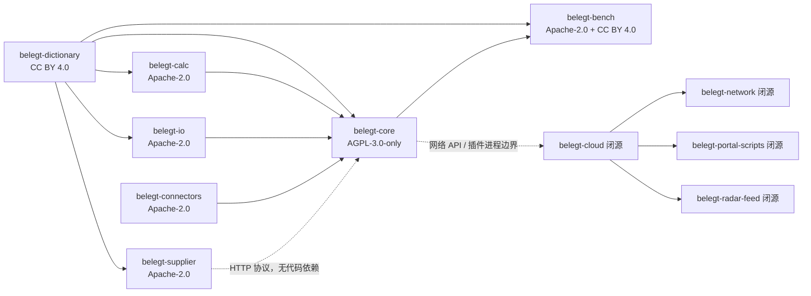
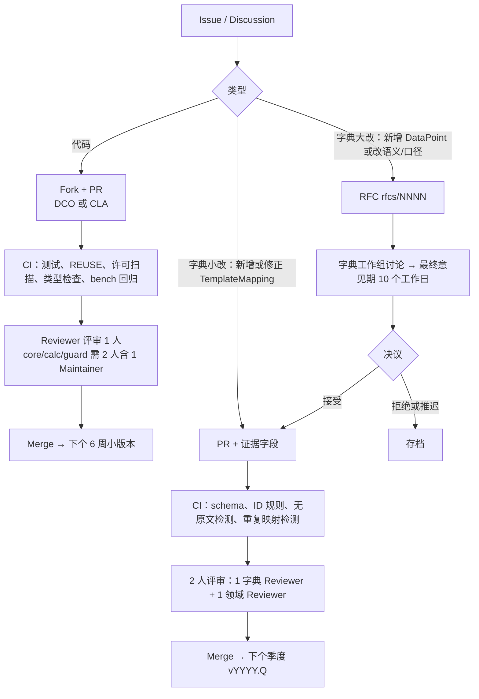
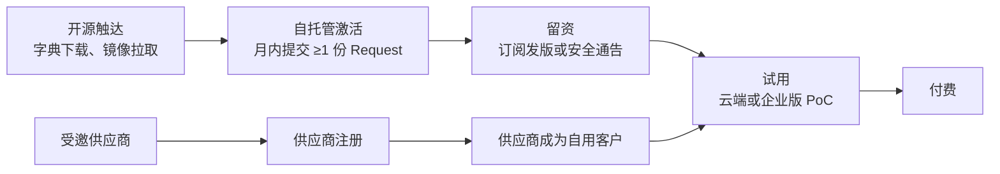

# 09 开源策略与治理

## 0. 文档信息

| 项目 | 内容 |
|---|---|
| 版本 | v0.1 |
| 日期 | 2026-10-18 |
| 依赖文档 | 00-prd-v2（§5 开源策略、§10 商业模式、§12 风险、§13 待决问题 2/3）、_baseline（§I 仓库名、§H FR 编号）、02 字典（`DataPoint`/`TemplateMapping`）、10 部署与非功能 |
| 读者 | 创始团队、法务顾问、工程负责人、社区与生态负责人、潜在贡献方（行业协会、核查机构、咨询公司） |
| 结论摘要 | `belegt-core` 采用 **AGPL-3.0-only**（拒绝 BSL）；字典与基准数据 CC BY 4.0；其余库 Apache-2.0；`belegt-core` 用轻量 CLA（授权而非转让，附"永不转为非 OSI 许可"承诺），其他仓库用 DCO |

本文回答 PRD §13 待决问题 2（`belegt-core` 许可），并部分回答待决问题 3（首批排放因子来源的许可）。所有案例事实均附来源链接；标 [需核实] 的条目须在 MVP 结束前由法务确认。

## 1. 仓库划分

### 1.1 设计原则

1. **按"谁会单独使用它"切仓库**：核查机构只想复算 → `belegt-calc` 必须能脱离其余部分运行（FR-702）；非欧盟供应商只想填数 → `belegt-supplier` 不依赖 `belegt-core`（FR-703）。
2. **许可沿依赖方向只能"变严"不能"变松"**：Apache-2.0 库可被 AGPL 库依赖，反之禁止。开源仓库任何时候不得依赖闭源仓库。
3. **标准层（字典、计算、IO、连接器 SDK）宽松许可，产品层（编排、证据图、守卫）著佐权（copyleft）**，这与 Grafana"核心 AGPL、插件/agent/库保持 Apache"的切法一致（[Grafana 2021 公告](https://grafana.com/blog/2021/04/20/grafana-loki-tempo-relicensing-to-agplv3)）。

### 1.2 仓库清单

| 仓库 | 许可 | 职责 | 主要发布产物 | 首发阶段 |
|---|---|---|---|---|
| `belegt-dictionary` | CC BY 4.0（数据）+ Apache-2.0（校验脚本） | `DataPoint` 定义、`TemplateMapping`、口径枚举、单位表、RFC 存档 | PyPI `belegt-dictionary`、npm `@belegt/dictionary`（JSON 数据包）、GitHub Release（签名 tarball）、JSON Schema | MVP（v0.1 / 包 0.1.0） |
| `belegt-calc` | Apache-2.0 | PCF、Scope 1/2、CBAM 隐含排放的确定性计算；方法论文档；测试向量；开放因子集与商业因子适配器 | PyPI `belegt-calc`、CLI `belegt-calc`、容器 `ghcr.io/belegt/calc`（可选 HTTP 服务） | MVP |
| `belegt-io` | Apache-2.0 | Excel/PDF/Word/CMRT 解析、原格式回填（FR-501 的开源部分） | PyPI `belegt-io` | MVP |
| `belegt-connectors` | Apache-2.0 | MCP 连接器 SDK、参考连接器（文件夹、IMAP、通用 SQL、CSV ERP 导出）、Tractus-X EDC 适配器（V2） | PyPI `belegt-connectors`、npm `@belegt/connectors-sdk`、容器 `ghcr.io/belegt/connector-*` | V1 |
| `belegt-supplier` | Apache-2.0 | 上游供应商端：多语言表单、回复上传、离线导出；可自托管 | 容器 `ghcr.io/belegt/supplier`、Helm chart `belegt-supplier`、npm `@belegt/supplier-ui` | V1 |
| `belegt-core` | AGPL-3.0-only | 持久化工作流、证据图、数据契约、守卫、审批、7 个 LLM Agent 的开源实现、Web UI、私有化部署清单 | 容器 `ghcr.io/belegt/core-api`、`core-worker`、`core-web`；Helm chart `belegt`；docker compose 包 | MVP |
| `belegt-bench` | Apache-2.0（代码）+ CC BY 4.0（数据） | 公开模板 + 合成数据的 Agent 评测基准；"Belegt Compatible"一致性测试 | PyPI `belegt-bench`、数据集 Release（带 DOI，[需核实] Zenodo） | MVP（与字典 v0.1 同发） |
| `belegt-community` | CC BY 4.0 | 治理章程、TSC 纪要、商标政策、CLA 文本、贡献方计划 | 静态站点 | MVP |
| `belegt-cloud`（闭源） | 专有 | 多租户、SSO/SCIM、计费、托管运维、租户隔离 | 内部镜像 | MVP |
| `belegt-portal-scripts`（闭源） | 专有 | 客户门户自动化脚本库（FR-103/502 的维护内容） | 内部 | V1 |
| `belegt-radar-feed`（闭源） | 专有 | 法规雷达订阅源与人工审核后的变更清单 | 订阅 API | V1 |
| `belegt-dictionary-verified`（闭源） | 专有 | 经核验的字典更新通道（SLA）、模板原文对照（客户自有授权范围内） | 订阅 | V1 |
| `belegt-network`（闭源） | 专有 | 客户订阅网络、A2A 网关、一次核查多方复用（FR-601/602） | SaaS | V2 |

### 1.3 目录结构（关键仓库）

```text
belegt-dictionary/
  datapoints/<domain>/<topic>.yaml      # dp:env.ghg.scope1_total 等，SemVer 写在条目内
  templates/<template_id>/<version>/mapping.yaml   # TemplateMapping：题号→DataPoint，不含问卷原文
  units/ boundaries/ enums/
  rfcs/NNNN-<slug>.md                   # 字典 RFC
  schema/                               # JSON Schema，CI 校验
  CHANGELOG.md  MIGRATION/vYYYY.Q.md  LICENSES/  REUSE.toml

belegt-calc/
  src/belegt_calc/{pcf,scope12,cbam}/
  factors/<source>/<version>/           # 仅开放许可因子；每目录一个 LICENSE + SOURCE.yaml
  adapters/ecoinvent/                   # 只有适配器代码，无数据，用户自带许可
  methodology/                          # 方法论文档（CC BY 4.0）
  test-vectors/                         # 输入/期望输出/容差，NFR-02 可复现

belegt-core/
  services/{api,worker,guard,approval}/
  agents/<agent_id>/                    # intake-triage、question-parser…
  graph/                                # 证据图 schema 与迁移
  web/  deploy/{compose,helm}/  docs/
```

### 1.4 依赖关系



关键约束：`belegt-supplier` 与 `belegt-core` 之间只有 HTTP 协议契约（OpenAPI 文档放在 `belegt-dictionary/schema/supplier-api/`），所以供应商自托管时完全不接触 AGPL 代码。闭源 `belegt-cloud` 以独立进程经 API 调用 `belegt-core`；由于 Belegt 公司通过 CLA 持有 `belegt-core` 的完整再许可权，企业版可以按商业许可分发（见 §3）。

## 2. 许可证选择

### 2.1 对比表

评分：●强 ◐中 ○弱。

| 许可 | OSI 认可 | 云厂商托管防护 | 企业法务接受度 | 社区贡献意愿 | 与 Apache 依赖兼容 | 对私有化客户影响 | 转换成本 |
|---|---|---|---|---|---|---|---|
| AGPL-3.0 | 是 | ◐ 修改后对外提供服务须公开源码，不禁止托管 | ◐ 部分大企业内部禁用，需 FAQ + 商业许可兜底 | ◐ 可接受，Grafana/Elastic/Redis 先例 | 单向兼容（Apache-2.0 可并入 GPLv3 系） | 内部自用、不修改：无额外义务 | 低→更宽松（有 CLA 即可）；降级到非 OSI 声誉代价大 |
| BSL 1.1 | 否 | ● 可禁止竞争性托管 | ○ 采购清单常标"非开源"，需逐条审 Additional Use Grant | ○ 外部贡献明显下降，易引发分叉 | 是（依赖方向无冲突） | 取决于授权条款，需个案解释 | 中：Change Date 后自动转开源（最长 4 年） |
| FSL-1.1 | 否 | ● 禁止 Competing Use 两年 | ◐ 条款短、固定，较 BSL 易读 | ◐ | 是 | 非竞争用途可自由使用 | 每个版本 2 年后转 Apache-2.0/MIT |
| ELv2 | 否 | ● 禁止作为托管服务提供 | ◐ | ○ | 是 | 内部使用可，禁止绕过 license key | 高 |
| SSPL | 否 | ● 要求公开整个服务栈 | ○ 多数企业与发行版拒绝 | ○ | 是 | 托管方义务过宽，法务难评估 | 高，且 OSI 明确不认可 |
| Apache-2.0 | 是 | ○ 无防护 | ● 最高 | ● 最高 | 是 | 无影响 | 低（后续收紧需全部贡献者授权或 CLA） |
| MPL-2.0 | 是 | ○ 文件级 copyleft，SaaS 无义务 | ● | ● | 是（MPL-2.0 §3.3 兼容 GPL） | 修改的 MPL 文件需公开 | 低 |
| CC BY 4.0（数据） | 不适用（OSI 不评数据许可） | — | ● 欧盟机构默认许可 | ● | 是 | 仅署名 | 低 |
| CDLA-Permissive-2.0（数据） | 不适用 | — | ● | ● | 是 | 仅保留许可文本 | 低 |

### 2.2 真实案例（均已核实）

| 案例 | 事实 | 对 Belegt 的启示 |
|---|---|---|
| HashiCorp → BSL，OpenTofu 分叉 | 2023-08-10 Terraform 从 MPL 改为 BSL v1.1；社区 2023-08-25 公开分叉，2023-09-20 Linux Foundation 宣布 OpenTofu，2024-01-10 GA（[OpenTofu Manifesto](https://opentofu.org/manifesto/)、[LF 公告](https://www.linuxfoundation.org/press/announcing-opentofu)、[GA 公告](https://www.linuxfoundation.org/press/opentofu-announces-general-availability)） | 社区先行的项目改 BSL，会在数周内出现由中立基金会托管的分叉；分叉方拿走了"中立性"叙事 |
| Elastic：Apache → SSPL/ELv2 → 加回 AGPL | 2021 年改为 SSPL + ELv2；2024-08-29 宣布为 Elasticsearch/Kibana 增加 AGPLv3 选项（[Elastic 新闻稿](https://ir.elastic.co/News--Events/news/news-details/2024/Elastic-Announces-Open-Source-License-for-Elasticsearch-and-Kibana-Source-Code/default.aspx)、[Shay Banon 博客](https://www.elastic.co/blog/elasticsearch-is-open-source-again/)） | 走了一圈非 OSI 许可，最终回到 AGPL；说明 AGPL 是"有防护的开源"的稳定落点 |
| Grafana：Apache → AGPL | 2021-04-20 将 Grafana、Loki、Tempo 改为 AGPLv3，插件、agent 和部分库保留 Apache；CEO 称 AGPL 防护不如 SSPL，但"取得了正确平衡"（[公告](https://grafana.com/blog/2021/04/20/grafana-loki-tempo-relicensing-to-agplv3)、[SD Times](https://sdtimes.com/grafana/grafana-loki-and-tempo-switches-to-agplv3)） | 与 Belegt"核心 AGPL + 外围 Apache"结构几乎一致，且有托管 SaaS 商业成功先例 |
| Sentry：BSL → FSL | 2023-11 将 Sentry、Codecov 改为 FSL；每个版本 2 年后转为 Apache-2.0 或 MIT，非 OSI 许可（[Sentry 博客](https://blog.sentry.io/introducing-the-functional-source-license-freedom-without-free-riding/)、[fsl.software](https://fsl.software/)） | FSL 是比 BSL 更可预期的"迟开源"，是 Belegt 的备选方案（见 §2.4） |
| Redis：BSD → RSAL/SSPL → 加回 AGPL | 2024-03 改为 RSALv2/SSPLv1，Linux Foundation 支持的 Valkey 从 7.2.4 分叉；2025-05-01 Redis 8 起增加 AGPLv3（[Redis 博客](https://redis.io/blog/agplv3)、[LWN](https://lwn.net/Articles/1019686/)） | 第二个"非 OSI → AGPL"回归案例；分叉一旦有基金会和云厂商背书便不可逆 |
| MongoDB SSPL | 2019-03 MongoDB 撤回 SSPL 的 OSI 审批申请；其官方 FAQ 承认 SSPL 未获 OSI 认可（[OSI 邮件列表纪要](http://lists.opensource.org/pipermail/license-review_lists.opensource.org/2019-April/004023.html)、[MongoDB FAQ](https://www.mongodb.com/legal/licensing/server-side-public-license/faq)） | SSPL 排除 |

### 2.3 belegt-core 的推荐：AGPL-3.0-only（回答 PRD 待决问题 2）

**推荐：`belegt-core` 采用 AGPL-3.0-only，不采用 BSL。** 理由按重要性排序：

1. **目标客户的采购现实**：PRD §5.1 第 5 条的私有化动机是"IT 部门可以审查代码"。德语区中型制造企业的法务和 IT 通常用"OSI 认可"作为第一道筛子，BSL/FSL 都会被标为"非开源"而进入人工审查；AGPL 虽也会被问，但它是已知量，可以用一页 FAQ 结案：**内部自用、不修改，没有额外义务；修改后只给本公司员工用，也只需向这些用户提供源码**。
2. **贡献方计划依赖中立性**：行业协会、核查机构不会向"可能限制自己使用"的仓库投入人力。HashiCorp 与 Redis 的案例表明，非 OSI 许可会把"中立"让给分叉方。
3. **威胁模型不匹配**：BSL 防的是超大规模云厂商把产品做成托管服务。一个面向德语区二三级供应商的合规工具，被 AWS 直接托管的概率很低；真正的竞争者是 ESG 平台和咨询公司，他们若复用 AGPL 代码做服务，就必须公开修改，这已经足够。护城河在网络、已核验数据和托管运营（PRD §12），而不在源码。
4. **生态对齐**：Eclipse Tractus-X 用 Apache-2.0（代码）+ CC BY 4.0（非代码）（[projects.eclipse.org](https://projects.eclipse.org/projects/automotive.tractusx)）。主流基金会都不接收 BSL 项目，选 BSL 等于提前关闭 §5.4 的基金会路径。
5. **兼容性**：`belegt-calc`/`io`/`connectors` 是 Apache-2.0，可以单向并入 GPLv3 系作品，因此 AGPL 核心依赖它们没有法律障碍。Temporal SDK、LangGraph（MIT）、PostgreSQL License 也兼容。
6. **可逆性**：有 CLA 时，从 AGPL 放宽到 Apache 只需公司决定；从 BSL 回到开源则要承受信誉成本（Elastic、Redis 都付出了几年代价）。

**配套措施**：
- 写 "-only" 而不是 "-or-later"，避免未来许可版本带来不确定性。
- 提供**商业许可例外**（企业版），覆盖禁止 AGPL 的企业：这依赖 CLA（见 §3.1）。
- 在 `belegt-core/LICENSING.md` 列明"AGPL 义务触发场景"FAQ，并明确：供应商端、连接器、计算库都是 Apache，第三方连接器以 MCP 进程边界接入，不受 AGPL 传染。
- **开源承诺**：在 CLA 和 `belegt-community` 章程中写明"`belegt-core` 已发布版本的出站许可永远是 OSI 认可许可"，以此换取贡献者对 CLA 的信任。

### 2.4 备选与触发条件

如果出现以下任一情况，TSC 可以把**新版本**改为 FSL-1.1-ALv2（不追溯已发布版本）：(a) 有竞争者以 `belegt-core` 为基础提供托管服务，且有证据表明其修改未回馈；(b) 投资方尽调把 AGPL 列为阻断项。改许可须走 §5.3 的特别多数表决，并提前 90 天公告。不考虑 SSPL 和 ELv2。

### 2.5 数据许可：字典与基准

- `belegt-dictionary` 与 `belegt-bench` 数据保持 **CC BY 4.0**（遵守 baseline §I）。CC BY 4.0 明确覆盖欧盟数据库特殊权利（sui generis），且与 Tractus-X 非代码、欧盟委员会默认许可一致。CDLA-Permissive-2.0 署名负担更轻，但在欧盟公共部门的认知度较低，暂不采用。
- **不得发布问卷原文**：字典只存题号、模板版本、`DataPoint` 映射和我们自写的中性描述。CDP 等问卷文本的版权，以及"题号 + 结构"是否构成受保护的数据库，都要由法务确认 [需核实]。
- 每个数据文件带 SPDX 头，署名方式写在 `NOTICE`："Belegt Dictionary contributors, CC BY 4.0"。

### 2.6 排放因子数据许可（回答 PRD 待决问题 3 的许可部分）

`belegt-calc/factors/<source>/<version>/SOURCE.yaml` 必须包含 `license`、`source_url`、`retrieved_at`、`legal_basis`、`redistribution: allowed|adapter_only`，CI 拒绝缺字段的因子集。`FactorSet` ID 沿用 `fs:<source>@<version>`。

| 来源 | 许可现状 | 处理 |
|---|---|---|
| EU CBAM 默认值（最终期） | 具法律约束力的数值在 Commission Implementing Regulation (EU) 2025/2621，并经 (EU) 2026/1740 更正；委员会另提供"仅供参考"的 Excel（[CBAM legislation and guidance](https://taxation-customs.ec.europa.eu/carbon-border-adjustment-mechanism/cbam-legislation-and-guidance_en)、[EUR-Lex 2025/2621](https://eur-lex.europa.eu/eli/reg_impl/2025/2621/oj/eng)）。委员会文件按 Decision 2011/833/EU 默认允许商业再利用，2019 年起默认 CC BY 4.0（[EC 再利用规则](http://digital-strategy.ec.europa.eu/en/node/10320/printable/pdf)） | **内置**，`fs:eu-cbam-default@2026.07`；以条例文本为准，Excel 只做交叉校验；署名并声明"非委员会背书" |
| UBA（德国联邦环境署） | 各数据集许可不统一：部分开放数据集标为 Datenlizenz Deutschland – Namensnennung 2.0（[gis.uba.de](https://gis.uba.de/daten/)）；UBA Data Cube 声明 UBA 自产文本和图表默认是 CC BY-NC-ND 4.0，数据则按 §12a EGovG 可商用（[Data Cube 版权说明](https://datacube.uba.de/impressum)） | **逐数据集核实** [需核实]。例如德国电力结构排放因子（[UBA 页面](https://www.umweltbundesamt.de/themen/luft/emissionen-von-luftschadstoffen/spezifische-emissionsfaktoren-fuer-den-deutschen)）：只抽取数值，不复制出版物文本或图表；有 NC 标记的不内置 |
| ecoinvent | EULA 只授权"为可持续性评估使用"Licensed Data，许可终止后须销毁；用 ecoinvent 算出的 Calculated Data 可以静态分享给第三方（[ecoinvent EULA 说明](https://support.ecoinvent.org/eula)、[EULA PDF](https://ecoinvent.org/app/uploads/2024/07/EULA_new_branding_08_11_2023.pdf)） | **只提供适配器**（`adapter_only`），用户自带许可；测试向量禁止出现 ecoinvent 原值；`Calculation` 结果可以对外提交，但证据图里不对外暴露原始因子 |
| 英国 DESNZ 换算因子、IPCC EFDB、AIB 残余组合、GLEC | 各自条款不同 [需核实] | 先列入 V1 评估清单，法务确认前不内置 |
| IEA 排放因子 | 商业授权数据 | 只提供适配器 |

## 3. CLA、DCO 与商标

### 3.1 CLA vs DCO

| 维度 | DCO | CLA（授权型） |
|---|---|---|
| 贡献摩擦 | 低，`git commit -s` | 中，首次签署一次（CLA Assistant 机器人） |
| 公司再许可（商业例外、未来放宽许可） | 不可以 | 可以 |
| 社区观感 | 好，Linux Foundation 项目常用 | 需附开源承诺，否则会被视为"为日后闭源做准备" |
| 基金会兼容 | LF 系常用；Eclipse 使用自己的 ECA（[Eclipse ECA](https://www.eclipse.org/legal/eca/)） | 捐赠时可一并转移 |

**推荐**：
- `belegt-core`：**授权型 CLA**（基于 Apache ICLA/CCLA 改写；贡献者保留版权，授予 Belegt 再许可权）。必须包含两条承诺：(1) 每个版本都会以 OSI 认可许可发布；(2) 若公司停止维护满 12 个月，最后一个版本以 Apache-2.0 再发布（"日落条款"）。
- 其他所有仓库（含字典）：**DCO**，CI 用 DCO 检查机器人拦截未签名提交。字典贡献者多为咨询顾问、协会员工，摩擦必须最低。
- 企业贡献者（协会、核查机构）签 CCLA，由法人一次性覆盖其员工。

### 3.2 商标政策

- "belegt" 是常用德语词，文字商标的显著性可能不足：建议在 EUIPO 申请**文字 + 图形组合商标**，第 9、42 类，必要时加第 35 类 [需核实，法务评估]。
- **允许**：如实描述性使用（"兼容 Belegt 字典 v2027.1"、"Belegt 连接器 for SAP B1"）；未修改的再分发保留名称；社区活动、教程。
- **需许可**：产品或服务名中包含 Belegt；"Belegt Compatible / Belegt Certified"标识——须通过 `belegt-bench` 一致性测试套件，并签署商标许可，免费。
- **禁止**：修改后的分叉继续使用 Belegt 名称和 logo（必须改名，同 OpenTofu 做法）；暗示获得 Belegt 或核查机构背书。
- 商标属于 Belegt 公司；捐给基金会时一并转让或独家授权（见 §5.4）。

## 4. 贡献流程

### 4.1 两条路径



- **"无原文检测"**：CI 对 `mapping.yaml` 的描述字段做相似度检查，与贡献者上传到私有比对服务的模板文本对比（不入库），相似度超过阈值即阻断，防止问卷原文混入。
- **重大字典变更**（`DataPoint` 进入 `deprecated`、单位或口径改变）一律走 RFC，并在 `MIGRATION/vYYYY.Q.md` 写迁移说明（FR-701）。

### 4.2 PR 模板（要点）

代码 PR：变更摘要、关联 Issue、是否破坏兼容、测试说明、是否影响 `Calculation.engine_version`（影响时必须更新测试向量并在 CHANGELOG 标注）、安全影响自评、DCO/CLA 勾选。

字典 PR：模板名与版本、题号、目标 `dp:` ID（含版本）、`method`（`exact_template|human`）、依据链接（公开模板页面）、单位与期间提示、"我确认未复制问卷原文"勾选、利益冲突声明（贡献方必填）。

### 4.3 评审 SLA

| 事项 | 首次响应 | 结论 |
|---|---|---|
| 代码 PR | 3 个工作日 | 10 个工作日内合并、要求修改或关闭 |
| 字典小改 PR | 5 个工作日 | 下个季度冻结前 |
| RFC | 5 个工作日分配牧羊人 | 30 天内进入最终意见期 |
| 安全报告 | 见 §7.1 | — |

SLA 达成率每季度在 TSC 纪要中公开。

### 4.4 贡献者阶梯

| 级别 | 条件 | 权限 |
|---|---|---|
| Contributor | 合并 1 个 PR | 列入 CONTRIBUTORS |
| Reviewer | 6 个月内合并 ≥ 10 个 PR 或 ≥ 30 条映射，且有评审参与；由 1 名 Maintainer 提名、无异议 | 可批准 PR（计入所需评审数），triage 权限 |
| Maintainer | 担任 Reviewer ≥ 6 个月，持续投入，获现有 Maintainer 2/3 同意 | 合并权、发版权、参加维护者会议、可被选入 TSC |
| Emeritus | 12 个月不活跃自动转入 | 荣誉 |

字典和代码各自维护一套 Reviewer/Maintainer 名单。字典 Reviewer 还分"领域标签"（CBAM、PCF、REACH、CMRT、EUDR、VSME）。

### 4.5 贡献方（Contributing Partner）计划

| 类型 | 典型成员 | 贡献 | 获得 |
|---|---|---|---|
| Mapping Partner | 行业协会（如金属加工、汽车零部件协会）、咨询公司 | 每年 ≥ 1 个模板的完整映射或维护 | 字典工作组席位、RFC 提前审阅、发布说明致谢、免费商标许可 |
| Methodology Partner | 核查机构、研究机构 | 评审 `belegt-calc` 方法论与测试向量 | 方法论评审组席位、复算工具包优先支持 |
| Integration Partner | ERP 实施商 | 维护 `belegt-connectors` 中的连接器 | "Belegt Compatible" 标识、列入连接器目录 |

规则：(1) **不能付费买合并**，所有贡献走同一评审流程；(2) 核查机构的评审意见是"方法论评审"，不构成核查结论（PRD 非目标"不出具第三方核查结论"）；(3) 每次贡献须声明利益冲突；(4) 单一组织在字典工作组占比不超过 1/3。目标：12 个月内外部映射贡献占比 ≥ 30%（PRD §2 开源目标）。

## 5. 治理模型

### 5.1 分阶段

| 阶段 | 时间 | 模型 |
|---|---|---|
| 阶段 0 | MVP–V1（2026-11 至 2027-05） | 公司主导：公开维护者名单与路线图，字典工作组先成立 |
| 阶段 1 | V2（2027-05 至 2027-11） | 成立 TSC，章程发布在 `belegt-community` |
| 阶段 2 | V2 之后 | 评估捐给基金会（§5.4） |

### 5.2 维护者名单与 TSC

- `MAINTAINERS.md` 按仓库列出姓名、组织、领域、时区。每个仓库至少 2 名 Maintainer，且到 V2 时至少 1 个仓库要有非 Belegt 公司的 Maintainer。
- **TSC 共 7 席**：Belegt 公司 ≤ 3 席；社区 Maintainer 选举 2 席；贡献方选举 2 席（至少 1 席来自核查机构或行业协会）。任期 1 年，可连任。主席由 TSC 互选。
- **字典工作组（DWG）**：由字典 Maintainer 和 Mapping/Methodology Partner 代表组成，负责 RFC 决议，向 TSC 汇报。

### 5.3 决策规则

| 事项 | 规则 |
|---|---|
| 日常 PR、小版本 | 懒惰共识：达到评审数且 72 小时无反对 |
| 字典 RFC | DWG 共识；无法达成共识时，DWG 简单多数投票 |
| 破坏性 API/字典大版本、LTS 指定 | TSC 简单多数 |
| 许可变更、章程修改、商标政策、捐赠基金会 | TSC 2/3 特别多数，且至少 1 名非 Belegt 委员赞成；提前 90 天公告 |
| 安全事件 | 安全响应小组（Maintainer 子集）直接决定，事后向 TSC 报告 |

### 5.4 与 PACT、Eclipse Tractus-X 对齐

- **PACT**：`belegt-dictionary` 为 PACT 数据模型（ProductFootprint）的字段建立 `TemplateMapping`，跟随 PACT 技术规范版本；`belegt-calc` 的 PCF 输出可以导出为 PACT 数据结构（FR-503）。V2 目标是参加 PACT 一致性测试 [需核实流程与许可]。字典不重新定义 PACT 已定义的字段语义，只做映射。
- **Eclipse Tractus-X**：(1) 许可分层与其保持一致（代码 Apache-2.0、非代码 CC BY 4.0）；(2) 映射 Tractus-X 的语义模型（SAMM aspect models，PCF 等）；(3) `belegt-connectors` 复用 Tractus-X EDC 接入 Catena-X，不另写数据空间连接器；(4) 字典季度发版与 Tractus-X 季度发版节奏错开约 4 周，以便吸收其语义模型变更（Tractus-X 近期发版为 25.12、26.03、26.06，见 [projects.eclipse.org](https://projects.eclipse.org/projects/automotive.tractusx)）。
- **原则**：发现 PACT/Tractus-X 缺字段时，先向上游提 issue，Belegt 只在 `dp:` 命名空间里放过渡定义，并标为 `x_pending_upstream`。

### 5.5 基金会评估

| 维度 | LF Energy | Eclipse Foundation（Automotive / Dataspace） | 不捐 |
|---|---|---|---|
| 与目标生态贴近度 | ◐ 能源和碳核算 | ● Catena-X/Tractus-X 所在地 | — |
| 贡献者协议 | 通常 DCO | ECA | 自定 |
| 接收 AGPL 核心的可能 | 低 [需核实] | 低（需 IP 审查例外）[需核实] | — |
| 成本 | 会员费 + 治理开销 | 会员费 + IP 流程 | 0 |
| 中立性信号 | 强 | 强（对德国汽车 OEM 尤其强） | 弱 |

**建议**：不捐整个项目，只考虑把**标准层**（`belegt-dictionary` + `belegt-calc` 的方法论与测试向量）捐出，首选 Eclipse（贴近 Tractus-X），`belegt-core` 留在公司。触发条件（同时满足）：≥ 3 家非 Belegt 组织有 Maintainer；外部映射占比 ≥ 30%；至少 1 家 OEM 或协会以"中立性"为前提要求加入。最早在 V2 结束时（约 2027-11）评估，在此之前不发起。

## 6. 发版节奏

| 对象 | 规则 |
|---|---|
| 字典 | 季度发版 `vYYYY.Q`，与包 SemVer 并行（baseline §D）。MVP 发 v0.1（包 0.1.0），首个日历版本 v2027.1。每季度最后一个月 15 日冻结并出 RC，季度末前最后一个工作日 GA。紧急勘误发 `vYYYY.Q.N`（只修错，不加 `DataPoint`） |
| `DataPoint` | 每条独立 SemVer；改单位或口径 = major；生命周期 `draft→active→deprecated→retired`，`deprecated` 至少保留 2 个季度版本才能 `retired` |
| 代码库 | SemVer；每 6 周一个 minor；patch 按需；1.0 之前 minor 可含破坏性变更，但必须写迁移说明 |
| LTS | 1.0 之后每年指定一个 minor 为 LTS，安全修复支持 18 个月，覆盖一个完整的 CBAM 年度申报周期；申报季前 4 周冻结 LTS 功能变更（申报日期见 PRD §11 [需核实]） |
| 弃用政策 | 公开 API 和 CLI 先标记弃用，至少经过 2 个 minor（约 12 周）才能删除；LTS 内不删除；`Calculation` 方法论变更必须提升 `methodology_version`，旧版本仍可复算（NFR-02） |
| 安全补丁 | 当前 minor + 所有在支持期内的 LTS；严重漏洞补丁不等 6 周窗口 |
| Python/Node | 支持仍在上游支持期内的 Python 3.12+、Node LTS |

## 7. 安全与供应链

### 7.1 漏洞披露

- 每个仓库都放 `SECURITY.md`：通过 GitHub Private Vulnerability Reporting 或 `security@<belegt 域名>`（PGP）报告；写明支持的版本矩阵和安全港声明。
- **响应时限**：2 个工作日内确认收到；5 个工作日内完成定级（CVSS 4.0）；修复期限——严重 14 天、高危 30 天、中危 90 天、低危随下个版本。默认禁运期 90 天，可协商。
- **CVE**：通过 GitHub（CNA）为开源仓库申请 CVE，发布 GitHub Security Advisory 并同步 OSV。
- **EU CRA**：报告义务自 2026-09-11 起适用于制造商，2027-12-11 全面适用；开源软件管理者（steward）的报告义务自 2027-12-11 起适用（[EC CRA 报告义务](https://digital-strategy.ec.europa.eu/en/policies/cra-reporting)）。Belegt 公司对 `belegt-cloud` 和企业版是制造商：被积极利用的漏洞须经 ENISA 单一报告平台在 24 小时内预警、72 小时内通报、修复措施可用后 14 天内提交终报。对开源仓库，公司按 steward 角色准备 [需核实具体义务范围]。

### 7.2 依赖许可审查

- **SBOM**：每次发版生成 CycloneDX 和 SPDX 两种 SBOM，附在 GitHub Release，并作为 OCI attestation 挂到镜像上。
- **REUSE**：所有仓库通过 `reuse lint`，每个文件带 SPDX 版权和许可头；数据文件通过 `REUSE.toml` 批量声明。
- **许可白名单（CI 阻断）**：

| 仓库类别 | 允许 | 需人工审查 | 禁止 |
|---|---|---|---|
| Apache 系仓库 | MIT、BSD-2/3-Clause、Apache-2.0、ISC、PSF-2.0、Zlib、PostgreSQL、Unicode | MPL-2.0（不修改的依赖）、LGPL（仅动态链接） | GPL/AGPL 全系、SSPL、BSL、ELv2、FSL、任何 NC/ND 许可 |
| `belegt-core` | 上述 + GPL-3.0 兼容许可 | LGPL、MPL-2.0 | SSPL、BSL、ELv2、FSL、GPL-2.0-only、NC/ND |
| 数据（字典/bench/factors） | CC BY 4.0、CC0、CDLA-Permissive-2.0、DL-DE-BY-2.0、DL-DE-Zero-2.0 | ODbL（相同方式共享）、OGL | 任何 NC/ND、"仅供参考"且无许可说明的来源 |

### 7.3 供应链安全

- **签名**：容器镜像和 Helm chart 用 Sigstore cosign 无密钥签名；PyPI 用 Trusted Publishing 并生成 attestation；npm 发布带 provenance；字典 tarball 用 `cosign sign-blob` 签名。由于字典版本会被写进计算结果，签名直接关系到 `Calculation` 可复现性。
- **SLSA**：MVP 达到 Build L2（托管构建 + 签名 provenance）；V1 达到 Build L3（隔离的可复用构建工作流，provenance 不可伪造）。
- **基线**：OpenSSF Scorecard ≥ 7；GitHub Actions 固定到 commit SHA；Renovate 自动更新依赖；Maintainer 必须开启 2FA；`main` 分支保护。私有化包同时提供离线镜像包和校验清单（FR-704）。

## 8. 商业边界

### 8.1 "开源不阉割"原则

凡是影响**正确性、安全、可审计性、数据可携带性**的功能都开源，自托管版要能在单租户生产环境完整使用：证据图、R-NUM 强制、守卫、风险分级审批、一致性审计、审计包导出、全部 7 个 LLM Agent、本地模型、原格式回填。付费部分只卖**运维、规模、网络、持续维护的内容和 SLA**。基本 OIDC 单点登录放进开源版（安全不应收费）；多 IdP、SAML、SCIM 放进企业版。这一点是对 PRD §5.2"SSO 闭源"的细化。

### 8.2 功能清单

| 功能 | 开源（自托管） | 商业 |
|---|---|---|
| 收件、解析、映射、证据挖掘、起草 | ● | 托管 |
| 计算服务 + 开放因子 | ● | 商业因子适配托管（用户自带许可） |
| 一致性审计、风险分级审批、批量批准 | ● | — |
| 审计包导出、全链路追踪 | ● | 长期留存与合规归档 |
| 原格式回填（文件） | ● | — |
| 门户自动化（FR-502） | 浏览器 Agent 框架 ● | 持续维护的门户脚本库 |
| 供应商端 | ● 永久免费 | 托管版免费；CBAM 追数按供应商数计费 |
| 字典 | ● 季度公开版 | 核验更新通道（SLA，新模板 10 个工作日内上线） |
| 法规雷达 | Agent 代码 ● | 人工审核的订阅源 |
| 登录 | OIDC 单 IdP ● | SAML、多 IdP、SCIM、细粒度审计角色 |
| 多租户、计费、欧盟托管 | — | ● |
| 客户订阅网络 / A2A / 核查复用 | 协议规范开源 | ● 网络运营 |
| 私有化支持 | Helm/compose ● | 企业版：SLA、LTS 补丁通道、商业许可例外 |

### 8.3 转化漏斗与指标



| 指标 | 定义 | 目标 |
|---|---|---|
| 外部映射贡献占比 | 非 Belegt 作者的已合并映射数 ÷ 总映射数 | ≥ 30%（12 个月，PRD） |
| 自托管激活数 | 开启了可选遥测，且月内有 ≥ 1 份 `Request` 进入 `submitted` 的实例 | [待定] |
| 供应商端注册数 | 托管供应商端的注册组织数 | [待定]（PRD） |
| 供应商→客户转化率 | 注册供应商中成为付费租户的比例 | [待定] |
| 开源→付费转化率 | 90 天内由 C 到 E 的比例 | [待定]（PRD §9） |
| 社区健康 | 首次响应 SLA 达成率、活跃 Maintainer 数、非 Belegt Maintainer 数 | SLA ≥ 90% |

遥测默认关闭，只收集匿名计数，符合 GDPR，不收集任何 `Answer`、`Evidence` 内容。

### 8.4 防止被直接复用的护城河

1. **网络效应**：客户订阅和供应商图谱（`belegt-network`）无法通过复制代码获得。
2. **已核验内容**：核验字典通道、门户脚本、法规雷达订阅源需要持续人工维护，代码复制后很快过时。
3. **AGPL**：竞争者若基于核心做服务，修改必须公开。
4. **商标与认证**："Belegt Compatible" 标识与一致性测试由 Belegt 控制。
5. **运营与信任**：欧盟驻留托管、审计包、SLA，以及计划中的安全认证 [待定]。
6. **私有黄金集**：试点客户脱敏黄金集不公开，只开源公共基准。

## 9. FR 追溯

| FR | 本文落点 | 验收要点 |
|---|---|---|
| FR-701 字典仓库 + RFC | §1.2–1.3、§2.5、§4.1–4.5、§5.2–5.4、§6 | 公开仓库、CONTRIBUTING、RFC 模板、DCO 机器人、季度发版与迁移说明、无原文检测 |
| FR-702 计算库独立运行 + 测试向量 | §1.1、§1.4、§2.6、§6 | `pip install belegt-calc` 无需 core；测试向量 CI；因子 `SOURCE.yaml` 许可校验 |
| FR-703 供应商端自托管多语言 | §1.2、§1.4、§8.2 | 独立镜像和 Helm chart；与 core 只有 HTTP 契约；Apache-2.0 |
| FR-704 一键私有化 + 本地模型 | §1.2、§7.3、§8.1 | Helm/compose 签名发布；离线包；商业许可例外可选 |
| FR-705（新增）安全披露与供应链签名 | §7.1、§7.3 | SECURITY.md、CVE 流程、cosign 签名、SLSA Build L2（MVP）/L3（V1） |
| FR-706（新增）依赖许可审查与 SBOM | §7.2 | CI 许可白名单阻断、REUSE 通过、每次发版附 SBOM |
| NFR-01/02 | §2.6、§6、§7.3 | 因子版本可追溯、字典签名、方法论版本可复算 |

## 本文新增标识

- 功能需求：FR-705（P1）安全漏洞披露、CVE 流程与供应链签名；FR-706（P0）依赖许可审查、REUSE 与 SBOM。
- 开源仓库：`belegt-community`（CC BY 4.0，治理文档）。
- 闭源仓库：`belegt-cloud`、`belegt-portal-scripts`、`belegt-radar-feed`、`belegt-dictionary-verified`、`belegt-network`。
- 文件约定：`LICENSING.md`、`SECURITY.md`、`MAINTAINERS.md`、`MIGRATION/vYYYY.Q.md`、`rfcs/NNNN-<slug>.md`、`factors/<source>/<version>/SOURCE.yaml`（字段 `license`、`source_url`、`retrieved_at`、`legal_basis`、`redistribution: allowed|adapter_only`）。
- `FactorSet` 实例：`fs:eu-cbam-default@2026.07`。
- 字典过渡标记：`x_pending_upstream`；紧急勘误版本号 `vYYYY.Q.N`。
- 治理实体：TSC、字典工作组（DWG）、安全响应小组；贡献方类型 Mapping Partner / Methodology Partner / Integration Partner。
- 商标标识："Belegt Compatible"。
- 发布产物名：PyPI `belegt-dictionary`、`belegt-calc`、`belegt-io`、`belegt-connectors`、`belegt-bench`；npm `@belegt/dictionary`、`@belegt/connectors-sdk`、`@belegt/supplier-ui`；镜像 `ghcr.io/belegt/{core-api,core-worker,core-web,supplier,calc,connector-*}`；Helm chart `belegt`、`belegt-supplier`。

## 待决问题

1. CDP 等问卷的"题号 + 结构"发布是否需要授权（法务）。
2. UBA 各因子数据集的具体许可；DESNZ、IPCC EFDB、AIB、GLEC 是否可以内置。
3. "Belegt" 商标的可注册性与类别。
4. CLA 日落条款与开源承诺的法律措辞；企业版商业许可例外的定价。
5. Belegt 公司作为 CRA steward 对开源仓库的具体义务范围。
6. PACT 一致性测试的参加流程和规范许可。
