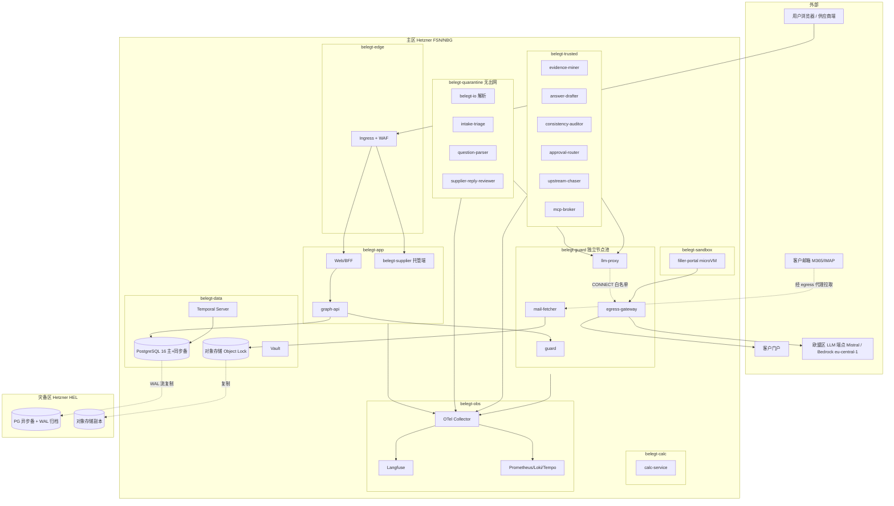

# 10 非功能与运维

## 0. 文档信息

| 项 | 内容 |
|---|---|
| 版本 | v0.1 |
| 日期 | 2026-10-18 |
| 依赖文档 | 00-prd-v2、_baseline（§K 技术栈、§L 约定）、03 §6–§7（物理设计、审计包）、04 §1.3、§5、§7（部署、守卫、模型路由与成本）、06 §T2、07 §2、§4.5、§5–§7、§9（隔离、密钥、驻留、审计、事件响应）、11（黄金集）、12 §1.1（阶段指标）、13 Q-05/A-09 |
| 读者 | 平台/SRE、后端、安全、产品负责人、售前（私有化与 SLA） |
| 本文回答 | PRD §2"单份问卷 LLM 成本 ≤ €[待定]"、13 Q-05 的成本侧输入、07 待决 4（`Trace.payload_blob` 保留期）、07 §9.1 的 RPO/RTO 最终值、03 待决 5/6（向量维度、`obs.trace_span` 存放） |

价格与云资源报价均为 **2026-10 查询，以官网为准**；美元按 ECB 2026-10-16 参考汇率 1 EUR = 1.1253 USD 换算。所有容量、吞吐、GPU 显存数字若未注明来源，均为工程估算，须在 MVP 基准测试中校准（§3.6）。

## 1. 原则与范围

1. **SLO 先于 SLA**：对外承诺（§7）必须比内部目标（§5.3）宽松一档，用错误预算驱动发布节奏。
2. **确定性部分不可降级**：`calc-service`、`consistency-auditor` 判定、`approval-router`、`guard`、证据图写入属于"必须可用"层；LLM 能力属于"可降级"层（04 §5.5），可用性计算据此分层（§7.2）。
3. **`trc_` 是事实，APM 是视图**：03 §3.15 的 `Trace` 对象 100% 落库，不受采样影响；OpenTelemetry 后端（Tempo、Langfuse）可以采样、可以丢，不承担审计职责。
4. **一套代码、五种形态**：SaaS 与私有化同一镜像、同一 Helm chart，差异只在 `deploy-profile` 与 `model-routing@<semver>`（§6）。
5. **成本是质量指标**：每次换模型、改提示词，CI 同时报告准确率和单份成本（FR-004 + NFR-11）。

## 2. NFR 总表

### 2.1 NFR-01…NFR-06 的可度量化

| ID | 指标 | 测量方法 | MVP | V1 | V2 |
|---|---|---|---|---|---|
| NFR-01 欧盟驻留/私有化/按客户授权 | ①EEA 外存储或处理的租户数据字节；②跨客户越权读取次数；③私有化离线模式外联次数 | ①子处理者清单 + `egress-gateway` 出站 FQDN 审计；②RLS 负向测试套件（07 T-18）+ 生产 `authz.deny` 计数；③airgap 网络抓包测试 | ①=0 ②=0（负向用例 100% 通过） | 同左；私有化 ③=0（FR-704） | 同左；`data_sharing_grant` 撤回后 ≤ 5 min 停止推送 |
| NFR-02 计算可复现 | 同输入 + 同 `factor_set_version` + 同 `methodology_version` 重算 `output_hash` 一致率 | `belegt-calc` 测试向量 CI；生产每日抽 1% `Calculation` 重放；`verify-pack` 重算 | 100% | 100%，x86_64 与 arm64 镜像结果一致 | 100%，至少 1 家外部核查机构独立复算通过 |
| NFR-03 数字禁止模型生成 | `value_type=number` 的 `Answer` 中无引用写入成功数；`GRAPH_NUM_IN_TEXT` 拦截后漏出数 | 写入函数拒绝日志 + 审计包 R-NUM 校验 + 每周 2% 人工抽检 | 0 | 0 | 0 |
| NFR-04 可观测 + 审计包 | ①LLM/工具调用 `Trace` 覆盖率；②`cost_eur` 记录率；③100 题审计包生成时长；④`verify-pack` 通过率 | ①②Trace 与 llm-proxy 计费日志对账（每日）；③作业计时；④CI + 每次导出自校验 | ①②100% ③P95 ≤ 120 s ④100% | 同左 + SIEM 导出（OTLP/syslog） | 同左 + `auditor_readonly` 自助导出 |
| NFR-05 模型无关 | ①换模型需改业务代码行数；②主备切换耗时；③每档位合格 provider 数 | ①`model-routing` 变更 PR 静态检查；②故障注入演练；③黄金集达标的模型清单 | ①0 ②≤ 60 s ③每档 ≥ 2（含 1 个 EU 端点） | ③每档 ≥ 2 + 本地 1（`tier-L` 本地允许有书面差距） | ③每档 ≥ 3，本地全部达标 |
| NFR-06 德英界面 + 多语言上游 | ①界面字符串翻译覆盖率；②伪本地化缺失数；③上游语言数 | 构建期 i18n 抽取与伪本地化检查（01 AC-703-2） | ①de/en 100% ②0 ③2（de、en） | ③4（+tr、zh-Hans） | ③8（+pl、cs、it、es，与 01 §5 一致） |

### 2.2 新增 NFR-07…NFR-20

| ID | 类别 | 指标 | 测量方法 | MVP | V1 | V2 |
|---|---|---|---|---|---|---|
| NFR-07 | 性能 | 首稿时长：`Request` 从 `parsed` 到 `in_review` 的机器时间（扣除 `awaiting_human`、`awaiting_supplier` 停留，与 12 §1.1 同口径），100 题 | Trace 中状态迁移时间戳；`belegt-bench` 合成问卷每日回归 | P95 ≤ 60 min | P95 ≤ 30 min，P50 ≤ 15 min | P95 ≤ 20 min |
| NFR-08 | 可扩展性 | 平台同时处于机器阶段的 Request 数，且 NFR-07 不劣化；单租户并发 | k6 + Temporal 负载脚本，按 §3.2 场景 | 平台 10、租户 3 | 平台 50、租户 5 | 平台 200、租户 10 |
| NFR-09 | 性能 | 交互响应：API 读/写 P95；页面 LCP P75；批量批准 100 条耗时 | OTel HTTP 指标；RUM（自托管，不用第三方）；Playwright 合成 | 读 ≤ 500 ms，写 ≤ 1 s | 读 ≤ 300 ms，写 ≤ 800 ms，LCP ≤ 2.5 s，批量 ≤ 3 s | 同 V1，数据量 3 倍时不劣化 |
| NFR-10 | 性能 | 证据图查询延迟（§3.5 各类） | `belegt_graph_query_duration_seconds` | 谱系 P95 ≤ 300 ms | §3.5 全表达标 | 同 V1，单租户 5 000 万版本行 |
| NFR-11 | 成本 | 100 题问卷 LLM 成本（首稿 + 审批返工，不含门户提交与上游追数） | `guard` 成本记账（`Trace.cost_eur` 汇总），按 Request 出 P50/P95 | 测出 P50/P95（12 MS-10）；硬上限 €5 | P95 ≤ €3 且 ≤ 定价 10%（A-09） | P95 ≤ €2.5 且 ≤ 定价 8% |
| NFR-12 | 可用性 | 月度可用性（§7.2 定义） | 两个欧盟探测点每分钟合成探测 + 服务端 SLI | 试点 99.5%（无赔偿） | 标准版 99.5%，企业版 99.9% | 同 V1；专属 SaaS 99.9% |
| NFR-13 | 可靠性 | RPO/RTO（§6.6 场景表） | 季度恢复演练 + 年度区域切换演练（07 §9.1） | RPO ≤ 1 h，RTO ≤ 8 h | 区内 RPO ≤ 5 min / RTO ≤ 4 h；区域 RPO ≤ 15 min / RTO ≤ 8 h | 企业版区域 RTO ≤ 4 h |
| NFR-14 | 可维护性 | DORA 四指标；在途工作流兼容率 | CI/CD 数据；每次发布用近 30 天 Temporal 历史做重放测试（FR-008） | 部署每周，变更失败率 ≤ 20%，MTTR ≤ 8 h，兼容 100% | 每日，≤ 15%，≤ 4 h，100% | 按需，≤ 10%，≤ 1 h，100% |
| NFR-15 | 可移植性 | 私有化安装时长；平台依赖 | 干净主机计时（`belegtctl doctor` 通过即止）；依赖清单审查 | — | compose ≤ 30 min，Helm ≤ 2 h；x86_64 + arm64；任意 S3 兼容存储；K8s N-2 | 同左 + PostgreSQL 16/17 双版本 |
| NFR-16 | 可移植性 | 离线/本地模型全流程：外联数、黄金集指标、首稿时长 | airgap 抓包；11 黄金集用本地 `model-routing` 跑 | — | 外联 0；映射 Top-1 ≥ 85%；`gpu-l` 档首稿 P95 ≤ 45 min | Top-1 ≥ 90%（与云端同门槛）；P95 ≤ 30 min |
| NFR-17 | 无障碍 | WCAG 2.2 AA 符合度 | CI 中 axe-core（serious/critical = 0）；每个大版本 NVDA + VoiceOver 人工审查 | 自动化 0 严重问题 | + 人工审查报告 | + EN 301 549 符合性声明 |
| NFR-18 | 国际化 | 格式本地化、时区、文案膨胀 | 单元测试（de/en 数字日期往返解析）；伪本地化 +30% 长度截图比对 | 存储 UTC + DEC-STR，显示按用户 locale 与时区（默认 Europe/Berlin） | 同左 + 供应商端 4 语 | 同左 + 8 语；评估 RTL |
| NFR-19 | 数据生命周期 | 保留期作业执行率；合同终止后删除时限 | 每日保留期作业报告；`crypto.erase` AuditEvent | 作业成功 100% | 同左；终止后 ≤ 30 天完成删除并出证明（07 §6.2） | 同左 |
| NFR-20 | 资源效率 | SaaS 每活跃租户月基础设施成本；共享 GPU 利用率 | FinOps 月报（云账单 ÷ 活跃租户） | ≤ €150（≈ 20 试点） | ≤ €60（≈ 50 租户） | ≤ €40（≈ 100 租户）；GPU 利用率 ≥ 40% |

## 3. 性能

### 3.1 首稿 ≤ 30 分钟的时间预算拆解（V1，100 题）

起点为收件，比 12 口径（`parsed` 起）多算分拣与解析约 3 min，作为余量。各阶段 P95 之和 ≤ 30 min，因此即使阶段之间不重叠也能达标；实际上证据预取与人工答题重叠（04 §3.3），端到端更短。

| # | 阶段 | 执行者 | 并行度 | P50 | P95 | 主要风险与对策 |
|---|---|---|---|---|---|---|
| 1 | 收件落 blob + 分拣 + 晋升 | `mail-fetcher`、`intake-triage`、`guard` | 1 | 0.4 min | 1.0 min | 大附件：`belegt-io` 页数上限，超限转人工 |
| 2 | 版面解析 + `build_hints`（嵌入检索） | `belegt-io`、`tier-E` | 按 sheet | 1.0 min | 2.0 min | 扫描 PDF 走 OCR，见 §3.3 |
| 3 | 题目映射（4 个 `QuestionBatchWorkflow` × 25 题，批内每 10 题一次调用） | `question-parser` | 10 路 | 3.5 min | 7.0 min | `tier-L` 级联复判只针对低置信批次 |
| 4 | 晋升 + 生成 `ClosedQuestion` | `guard` | — | 0.2 min | 0.5 min | — |
| 5 | 证据挖掘 + 计算（按 DataPoint 去重后扇出） | `evidence-miner`、`calc-service` | 12 路 | 6.0 min | 12.0 min | 跨 Request 锁等待；ERP 连接器慢则降级为文档（04 §5.5） |
| 6 | 文字类答案起草 | `answer-drafter` | 8 路 | 2.5 min | 5.0 min | `GRAPH_NUM_IN_TEXT` 修正 1 次 |
| 7 | 审计 T2 + 审批路由 | `consistency-auditor`、`approval-router` | 1 | 0.5 min | 1.2 min | 06 规定 T2 P95 ≤ 60 s |
| 8 | 编排开销（调度、排队、重试退避） | Temporal | — | 0.4 min | 1.3 min | schedule-to-start 告警（ALR-07） |
| | **合计** | | | **14.5 min** | **30.0 min** | |

MVP 阶段允许 P95 ≤ 60 min（12），主要差距来自阶段 3、5 未开并行与缓存 C1/C2 未建满。V2 的 20 min 靠三点：C2 历史匹配命中率 ≥ 60%、阶段 5 预取覆盖率 ≥ 90%、vLLM 前缀缓存（C4）。

### 3.2 并发与吞吐

- **工作负载模型**：试点期每租户每年 20–40 份问卷，集中在 3–5 月（CDP、OEM 年度问卷）与 8–9 月（CBAM 申报冲刺）。按峰值月 = 年均 3 倍、峰值小时 = 日均 4 倍设计。
- **LLM 速率**：1 份 P50 问卷约 0.9M token，在 15 min 内消耗，平均约 60k TPM；V1 平台 50 并发 ≈ 3M TPM。各 provider 账号的 TPM 配额须 ≥ 峰值 1.5 倍，`llm-proxy` 按租户做令牌桶（公平分配），超额请求排队而非失败。
- **Temporal**：每 Request 约 3 000–6 000 事件（04 §3.5）；V1 目标每秒 200 个 Activity 调度，history shard 数初始 512（Temporal Server 部署后不可更改，须一次定够）。
- **数据库写入**：每份问卷约 2 000–3 000 个对象版本行 + 同量级边，峰值写入 ≤ 300 行/s，单主库足够；瓶颈在 `graph.commit_batch` 的 R-ONE 检查，按 `(org_id, answer_key)` 索引保证 O(log n)。

### 3.3 文档解析吞吐（`belegt-io`）

| 输入 | 指标 | 目标（每 4 vCPU worker） | 说明 |
|---|---|---|---|
| xlsx/docx 问卷（100 题） | 切分 + 定位回读 | P95 ≤ 10 s | 确定性，不调用 LLM |
| 文本层 PDF | 每页解析 + 分块 + bbox | P95 ≤ 0.5 s/页；≥ 2 000 页/h | — |
| 扫描 PDF/图片 | OCR + 版面 | P95 ≤ 3 s/页；≥ 600 页/h | 复杂表格路由 `tier-V`，按页计入 LLM 预算 |
| 单文件上限 | 页数 / 大小 | 300 页 / 50 MB | 超限拆分或转人工（07 T-07） |

解析 worker 水平扩展，HPA 按队列积压（Temporal task queue backlog）而不是 CPU 伸缩。

### 3.4 UI 与 API 响应（P95）

| 操作 | 目标 | 备注 |
|---|---|---|
| 列表/详情读 API | ≤ 300 ms | `object_head` 索引 |
| 单对象写（新版本） | ≤ 800 ms | 含 schema 校验、guard 检查点、AuditEvent |
| 批量批准 100 条（L0/L1） | ≤ 3 s | `graph.commit_batch`，一个事务 |
| 导出预览（变更单元格列表） | ≤ 5 s | 与 01 AC-501-2 一致 |
| 页面 LCP（P75，内部端） | ≤ 2.5 s | 供应商端总包体 ≤ 300 KB（01） |
| 全文/语义搜索（销售助手首屏） | ≤ 1.5 s（不含 LLM 生成） | 生成部分流式输出，首 token ≤ 2 s |

### 3.5 证据图查询延迟（P95）

| 查询 | 规模假设 | 目标 |
|---|---|---|
| 答案谱系 `belegt.lineage.get`（depth ≤ 4） | 单答案 ≤ 200 个上游对象 | ≤ 200 ms |
| as-of 时间旅行查询（03 §4.6） | 单 Request 子图 | ≤ 500 ms |
| 向量检索 top-20（带 `org_id`、`space_id`、`trust_zone` 过滤） | 单租户分区 ≤ 500 万向量，HNSW | ≤ 100 ms |
| 向下影响分析（因子库或 Evidence 更新触发重算传播） | ≤ 10 000 条边 | ≤ 2 s |
| 历史答案复用候选（L0） | 单 DataPoint ≤ 50 个历史版本 | ≤ 150 ms |
| T2 `pre_submit_gate` 全量审计 | 100 题 + 全租户有效答案 | ≤ 60 s（06） |

关于 03 待决 5：默认保持 `vector(1024)`，私有化首选的多语种嵌入模型输出维度同为 1024；单租户向量超过 500 万或内存吃紧时改 `halfvec(1024)`，按 `space_id` 并行重建、切读指针，不改接口。

### 3.6 性能测试方法

- **基准集**：`belegt-bench` 的合成问卷（100 题 xlsx、60 页扫描 PDF 证据包、5 份历史答卷），分"冷启动"（无 C1/C2 缓存）与"稳态"两档；结果写入每次发布的性能报告。
- **门禁**：NFR-07 P95 回退 > 10%、NFR-11 P95 回退 > 15% 阻断发布，与 FR-004 准确率门禁并列。
- **LLM 外部依赖**：基准测试使用固定 `model-routing` 版本与 provider，记录 provider 当期延迟作为协变量，避免把 provider 抖动误判为回归。

## 4. 成本预算

### 4.1 价格基准（2026-10 查询，以官网为准）

| Provider / 模型 | 输入 $/M token | 输出 $/M token | 备注 |
|---|---|---|---|
| Anthropic Claude Sonnet 5.5 | 2.00 | 10.00 | 缓存命中为输入价 5%；Batch 5 折；Bedrock/Vertex 区域端点在全球端点基础上加价 10% |
| Anthropic Claude Haiku 5.5 | 0.10（提示 ≤ 100k） | 0.50 | 提示 > 100k 为 0.50/2.50 |
| Anthropic Claude Opus 5.5 | 4.00 | 20.00 | — |
| OpenAI gpt-6.1-sol | 2.00 | 10.00 | 数据驻留（区域处理）端点加价 10% |
| OpenAI gpt-6-luna | 0.10 | 0.50 | 同上 |
| Mistral Medium 3.5 | 1.50 | 7.50 | 缓存输入 0.15 |
| Mistral Large 3 | 0.50 | 1.50 | 开放权重（Apache 2.0） |
| Mistral Small 4 | 0.15 | 0.60 | 119B MoE、6.5B 激活，开放权重（Apache 2.0） |
| Mistral OCR 4.1 | $4 / 1 000 页 | — | 扫描件可选 |

来源见文末参考来源 [R1]–[R4]。**合同口径**：托管默认只用欧盟内处理且 ZDR 的端点（07 §5.3），因此 Anthropic 按 Bedrock eu-central-1 区域端点计 +10%（$2.20/$11.00），OpenAI 同样 +10%；Mistral 为欧盟公司原生端点，按列表价。

### 4.2 单份 100 题问卷 token 估算（按 Agent，P50 稳态）

假设：C1/C2 命中 50%（04 §7.3）；100 题去重为约 60 个 DataPoint，其中约 25 个走 L0 历史复用、35 个需要文档取证；文字类题 34 道，其中 10 道为枚举/布尔；5 页扫描件；8 条冲突需要解释。单价列含 10% 重试余量（结构化输出校验失败重试、修正 1 次）。

| Agent / 用途 | 档位 | 调用次数 | 每次入/出（k token） | 合计入/出（k token） | 方案 A € | 方案 B € |
|---|---|---|---|---|---|---|
| `intake-triage` | `tier-S` | 1 | 8 / 0.5 | 8 / 0.5 | 0.023 | 0.001 |
| `guard` GP-04 注入分类 | `tier-S` | 30 | 2 / 0.05 | 60 / 1.5 | 0.145 | 0.010 |
| `question-parser` 映射 | `tier-M` | 6 | 14 / 2.5 | 84 / 15 | 0.342 | 0.063 |
| `question-parser` 级联复判 | `tier-L` | 3 | 14 / 2.5 | 42 / 7.5 | 0.171 | 0.171 |
| `evidence-miner` 检索规划 | `tier-S` | 35 | 2.5 / 0.2 | 87.5 / 7 | 0.263 | 0.017 |
| `evidence-miner` 字段抽取 | `tier-M` | 49 | 5.5 / 0.4 | 269.5 / 19.6 | 0.790 | 0.160 |
| `evidence-miner` 扫描件 | `tier-V` | 5 | 3 / 0.5 | 15 / 2.5 | 0.059 | 0.059 |
| `answer-drafter` 文字题 | `tier-L` | 24 | 6 / 0.8 | 144 / 19.2 | 0.516 | 0.516 |
| `answer-drafter` 枚举/布尔 | `tier-S` | 10 | 3 / 0.2 | 30 / 2 | 0.086 | 0.006 |
| `consistency-auditor` 解释 | `tier-S` | 8 | 0.8 / 0.2 | 6.4 / 1.6 | 0.031 | 0.002 |
| **合计（含 10% 重试 ≈ 0.91M token）** | | 171 | | 746 / 76 | **2.43** | **1.01** |

`calc-service`、`approval-router`、`filler-file` 不消耗 token；`tier-E` 嵌入约 0.3M token，本地 CPU 推理或云端 ≤ €0.05，不单列。

**P95（冷启动：新模板、无缓存、10 页扫描件、30 条冲突解释）**按各 Agent 的 04 级预算封顶：`question-parser` 231k（上限 250k）、`evidence-miner` 398k（上限 400k）、`answer-drafter` 297k（上限 300k）、其他 150k（分拣、注入分类、冲突解释），含重试合计 **1.18M token**，在 04 的 1.5M Request 预算内；再加可选的 `filler-portal`（≤ 200k）为 1.40M，仍有余量。

### 4.3 三种方案成本对比

| 场景 | A 全云端中档大模型（全部档位用 Sonnet 5.5 级，EU 端点） | B 小模型分流（S=Mistral Small 4，M=Mistral Large 3，L/V=Sonnet 5.5 级 EU） | C 本地模型（vLLM，`gpu-l`） |
|---|---|---|---|
| P50 首稿 | €2.43 | €1.01 | 边际 ≈ €0；摊销见下 |
| P95 首稿 | €3.24 | €1.48 | 同上 |
| P95 + 门户提交 | €3.85 | €2.08 | 同上 |
| 上游追数（5 封请求 + 5 份回复审核） | +€0.35 | +€0.06 | 同上 |
| 审批驳回返工（约 +20% 起草） | +€0.10 | +€0.10 | 同上 |

**方案 C 摊销**：Hetzner GEX131-1（1 × RTX PRO 6000 Blackwell 96 GB）€1 197.30/月 + 一次性安装费 €599 [R5]。每月 50 / 200 / 800 份问卷时，GPU 摊销分别为每份 €23.95 / €5.99 / €1.50。单卡容量估算：P50 问卷约 0.83M 输入 token（以 prefill 为主）+ 0.08M 输出，按 prefill ≈ 10k tok/s、批处理解码 ≈ 1.5k tok/s、实际效率系数 0.25 估算，约 10 GPU-min/份，即单卡 ≈ 6 份/h、月 ≥ 1 000 份（待 §3.6 实测）。结论：**本地模型在月量 ≥ 600 份时才在成本上优于方案 B**，它的主要价值是隔离与驻留（敏感租户、私有化、离线），不是省钱。

**缓存上行空间**：系统提示与 DataPoint 定义块占输入的 30–40%，启用 C4（provider prompt caching 或 vLLM 前缀缓存）后方案 B 的 `tier-L` 输入成本预计再降 20–30%；本文基线未计入，作为余量。

### 4.4 建议取值（回答 PRD §2 与 13 Q-05 的成本侧）

**建议 PRD 写为："单份问卷（100 题）LLM 成本 P95 ≤ €3；守卫硬熔断 €5/份。"**

论证：

1. **与 04 对齐**：04 §5.2 的 €5 是熔断值，不是目标值。若目标也定 €5，熔断在 P95 就会频繁触发 `halted:budget_cost`，人工追加预算变成常态。目标值应在熔断值的 60% 左右。
2. **方案 B 有充足余量**：P95 首稿 €1.48，加上门户、追数和返工约 €2.3，低于 €3；方案 A 的 P95 为 €3.24–3.85，超过目标。这是有意为之：目标值迫使托管默认走级联路由（FR-007），全量大模型只能作为单租户付费选项。
3. **与定价约束对齐**：12 与 13 A-09 要求 LLM 成本 ≤ 定价 10%，€3 意味着每份问卷的等效售价不应低于 €30（年 20 份即 €600/年），与 SaaS 中小企业订阅档位相容；最终定价由 12 MS-10（2027-02-01）用试点 P50/P95 实测确认。
4. **token 预算不变**：1.5M token/份、60 min 机器时间维持 04 原值；P95 冷启动 1.18M（含门户 1.40M）在预算内。
5. **按租户可调但只可收紧**：租户可下调熔断值（如 €3），上调需 `org_admin` 确认并在 Trace 中留痕，与 04 §2.1 的"只收紧"原则一致。

### 4.5 基础设施月成本

**SaaS 多租户（Hetzner，主区 Falkenstein/Nürnberg，灾备区 Helsinki；价格不含增值税 [R5][R6]）**

| 组件 | 规格 | 数量 | 月成本 € |
|---|---|---|---|
| K8s 控制面 | CPX22 | 3 | 58.47 |
| 应用与可信区节点池 | CCX33（8 专用 vCPU） | 4 | 553.96 |
| 隔离区 + guard/egress 独立节点池（07 §2.2） | CCX23 | 2 | 171.98 |
| `filler-portal` microVM 宿主（需 KVM，用独立服务器） | AX42-1 | 1 | 97.30 |
| PostgreSQL 16（证据图 + Temporal，主 + 同步备） | AX102-1 | 2 | 514.60 |
| 可观测（ClickHouse/Langfuse、Prometheus、Loki、Tempo） | CCX43 | 1 | 275.99 |
| Vault HA（Raft） | CPX22 | 3 | 58.47 |
| 对象存储（基础 1 TB + 增量约 1 TB） | Object Storage | 1 | ≈ 10 |
| 负载均衡、IPv4、超额流量 | — | — | ≈ 30（估） |
| 灾备区温备（PG 异步备库 + 最小 K8s + 存储副本） | AX102-1 + 2 × CCX23 | — | 439.28 |
| **合计（不含 GPU）** | | | **≈ 2 210** |
| 可选：敏感租户共享 GPU 池 | GEX131-1 | 1 | 1 197.30 |

每活跃租户基础设施成本：20 租户 ≈ €110，50 租户 ≈ €44；扩到 100 租户需加 4 个 CCX33 并把主备与灾备 PG 升级到 AX162-1，总额 ≈ €3 830，即 ≈ €38/租户，满足 NFR-20。LLM 变动成本另计：租户每月 5 份问卷 × €1.0–1.5 ≈ €5–8；`reg-radar` 每周 2M token 走 Batch，平台总额约 €11/月，可忽略。人力与支持成本不在此表。

**注意事项**：①Hetzner 对象存储是否支持 Object Lock compliance 模式（03 §6.7 的 WORM 要求）须在采购前核实，否则审计包与 blob 桶改放 AWS S3 eu-central-1 或 STACKIT 对象存储；②Hetzner 没有托管 KMS/HSM，密钥层（07 §4.5）需采用外部欧盟 KMS 或 Vault Transit + HSM，列入待决问题；③第三方比价称 Hetzner 稳态负载比美国超大规模云便宜 3–5 倍 [R7]，选择 AWS eu-central-1 时须重新测算。

**专属 SaaS（单租户独立栈）**：3 × CCX33 + 2 × AX42-1（PG 主备）+ CCX23（可观测）+ AX42-1（沙箱）+ AX42-1（灾备）+ 存储 ≈ **€900/月**，GPU 另计。

**私有化最低配置**：见 §6.3。参考云价：同等单机（16 vCPU/64 GB）约 €140–260/月；离线模式另加 GPU：AWS eu-central-1 g6.xlarge（1 × L4 24 GB）$1.0064/h ≈ €650/月 [R8]；OVHcloud L40S 48 GB ≈ €1.40/h [R9]；STACKIT H100 ≈ €8.04/GPU-h [R9][R10]；Hetzner GEX44-1（RTX 4000 SFF Ada 20 GB）€232.30/月 [R5]。

## 5. 可观测性

### 5.1 信号规范

**Trace**

- 传播：W3C `traceparent`；`trc_` ↔ trace_id 一一映射（03 §3.15）；Temporal Python SDK 的 OTel 拦截器把 workflow/activity 串成一条链，LangGraph 节点、`llm-proxy`、`mcp-broker`、`egress-gateway`、`graph-api` 都输出子 span。
- 属性：资源属性 `service.name`、`deployment.environment`（§8.1）、`belegt.deploy_profile`；业务属性统一前缀 `belegt.`：`belegt.org_tier`、`belegt.request_id`、`belegt.actor`、`belegt.trust_zone`、`belegt.activity`、`belegt.attempt`、`belegt.budget.used_ratio`、`belegt.cache.layer`、`belegt.policy_check`。LLM span 额外遵循 OTel GenAI 语义约定（`gen_ai.request.model`、`gen_ai.usage.input_tokens`、`gen_ai.usage.output_tokens` 等；GenAI 约定已迁到独立仓库，字段以当期版本为准 [R11]），并附 `belegt.cost_eur`、`belegt.prompt_version`。
- 沿用 04 §5.4 字段：`workflow_run_id`、`activity`、`attempt`、`policy_checks[]`、`budget`、`loop_sig`、`cache`、`flags[]`。Trace 对象（`obs.trace_span`）由 `guard` 同步写入、100% 保留；OTel 导出是异步旁路。
- 禁止：span 属性中出现业务值（数值、题干、证据原文）、联系人邮箱、提示正文。提示与输出只进加密的 `Trace.payload_blob`。
- 采样：OTel Collector 尾部采样——错误、`halted`、成本 > €0.10 的单次调用、P95 以上慢链路 100% 保留；其他基础设施 span 10%；LLM span 100% 送 Langfuse。

**Metric**（Prometheus 命名；标签禁止使用 `org_id`，只用 `org_tier`，按租户的成本明细从 Trace 表聚合，以避免高基数）

| 指标 | 类型 | 主要标签 |
|---|---|---|
| `belegt_request_stage_duration_seconds` | histogram | `stage`、`template_id` |
| `belegt_request_first_draft_seconds` | histogram | `deploy_profile` |
| `belegt_llm_tokens_total` | counter | `agent`、`tier`、`model`、`direction` |
| `belegt_llm_cost_eur_total` | counter | `agent`、`tier`、`model` |
| `belegt_llm_request_duration_seconds` | histogram | `provider`、`model`、`outcome` |
| `belegt_guard_decisions_total` | counter | `check`（GP-01…GP-11）、`result` |
| `belegt_promotion_total` | counter | `rule`（PROMO-*、EV-AUTO-*、PC-*）、`result` |
| `belegt_graph_write_duration_seconds` | histogram | `type`、`result` |
| `belegt_graph_query_duration_seconds` | histogram | `query` |
| `belegt_egress_messages_total` | counter | `channel`、`result` |
| `belegt_docparse_pages_total` | counter | `mime`、`ocr` |

**Log**：JSON 结构化，必含 `ts`、`level`、`service`、`env`、`trace_id`、`span_id`、`request_id`、`actor`、`event`、`error_code`（如 `GRAPH_*`、`EGRESS_DENIED_*`）；同样不含业务值与提示正文。应用日志热存 30 天；安全相关日志 12 个月（07 §6.5），pgaudit 送独立账户。

### 5.2 仪表盘

| ID | 名称 | 内容 |
|---|---|---|
| DSH-01 | 平台健康 | 各服务 RED/USE、K8s 节点、PG 复制延迟、Temporal 积压 |
| DSH-02 | 问卷流水线 | 各 `Request.status` 计数、阶段 P50/P95（§3.1）、"最慢关口"分布、`awaiting_*` 停留 |
| DSH-03 | LLM 成本与 token | 按 Request/Agent/模型/档位/租户的 `cost_eur`、P50/P95 单份成本、预算 80% 预警次数、缓存命中率 |
| DSH-04 | Agent 质量 | 晋升率、`ClosedQuestion` 生成率、`unmapped` 率、PC-04 失败（疑似幻觉）、影子评测对比（FR-004） |
| DSH-05 | 守卫与安全 | GP 拒绝、`halted` 原因、`egress.block`、注入标记、审计链校验 |
| DSH-06 | 容量与 FinOps | DB/对象存储增长、provider TPM 余量、GPU 利用率、每租户基础设施成本（NFR-20） |

### 5.3 SLO 与 burn-rate 告警

内部 SLO（30 天滚动窗口）：

| ID | SLI | 目标 |
|---|---|---|
| SLO-01 | API 请求成功（非 5xx 且 < 2 s）比例 | 99.9% |
| SLO-02 | 读 API 延迟 ≤ 300 ms 比例 | 99% |
| SLO-03 | Request 首稿在 NFR-07 阶段目标内完成比例 | 95% |
| SLO-04 | `llm-proxy` 调用成功率（含切换备用模型） | 99.5% |
| SLO-05 | 外发在 15 min 内投递成功比例（不含收件方拒收） | 99.5% |
| SLO-06 | 证据图写入成功（非 5xx）比例 | 99.95% |
| SLO-07 | 审计哈希链每小时校验连续 | 100%（不变量，不设错误预算） |
| SLO-08 | 备份作业成功且最新可恢复点 ≤ RPO | 100%（不变量） |

告警按 Google SRE 多窗口多燃烧率做法 [R12]：

| ID | 条件 | 级别 |
|---|---|---|
| ALR-01 | SLO-01/06 燃烧率 ≥ 14.4×（1 h 窗口且 5 min 窗口同时满足，即 1 h 内耗掉 2% 月预算） | 呼叫值班 |
| ALR-02 | 燃烧率 ≥ 6×（6 h + 30 min） | 呼叫值班 |
| ALR-03 | 燃烧率 ≥ 1×（3 d + 6 h） | 工单 |
| ALR-04 | 任意 `halted:policy`；或 `halted:budget_*` 日比例 > 5% | 前者呼叫，后者工单 |
| ALR-05 | 单份成本 24 h P95 > €3；或单租户日 LLM 支出 > 7 日均值 3× | 工单 / 呼叫 |
| ALR-06 | 审计链不连续（SLO-07） | P1 安全事件（07 §9.4） |
| ALR-07 | Temporal schedule-to-start P95 > 30 s 持续 10 min | 呼叫 |
| ALR-08 | PG 复制延迟 > 60 s 或 WAL 归档失败 | 呼叫 |
| ALR-09 | 备份作业连续 2 次失败（SLO-08） | 呼叫 |
| ALR-10 | PC-04 失败率 > 2% 或影子评测 Top-1 下降 > 2 个百分点 | 工单（Agent 组） |
| ALR-11 | `egress.block` 或 GP-07 拒绝突增（> 基线 5×） | 呼叫（安全值班） |
| ALR-12 | 证书、令牌、密钥 14 天内到期 | 工单 |

每条告警必须链接运行手册（runbook），无运行手册的告警不得上线。

### 5.4 LLM 可观测工具选型

| 候选 | 许可与部署 | 优点 | 缺点 | 结论 |
|---|---|---|---|---|
| Langfuse 自托管 | 核心 MIT（`ee/` 目录除外）；Docker Compose / Helm；依赖 PostgreSQL、ClickHouse、Redis、S3 [R13] | 提示版本、成本、评分、数据集；支持 OTel 接入；可放欧盟机房 | 组件多（ClickHouse 较重）；LICENSE 显示版权方为 ClickHouse, Inc.，需关注路线变化 | **SaaS 与 Helm 私有化采用** |
| 纯 OTel + Grafana（Tempo/Loki/Mimir） | Apache-2.0/AGPL 组件 | 与基础设施监控统一、轻量 | 无提示管理与评测 UI | **compose 私有化默认**；SaaS 作为基础设施底座 |
| LangSmith | 商业，自托管需企业版 | LangGraph 原生 | 闭源、数据出境与许可风险 | 不采用 |

使用约束：Langfuse 只是视图，不是事实源（SSOT-7）；送入 Langfuse 的输入输出先经 `llm-proxy` 脱敏（07 §5.3 占位符），保留 90 天；若保留期策略属企业版功能，则用 ClickHouse TTL 自行实现 [需核实]。

### 5.5 保留期（回答 07 待决 4、03 待决 6）

| 数据 | 存放 | 保留 |
|---|---|---|
| `Trace` 元数据（哈希、模型、token、成本） | `obs.trace_span`：PostgreSQL 热存 13 个月（按月分区），之后 detach 成 Parquet 放对象存储 | 10 年（07 §6.5） |
| `Trace.payload_blob`（完整提示与输出，加密） | 对象存储 `traces/` | **确认 90 天**。模型漂移排查靠 11 的黄金集与影子运行，不依赖生产提示回溯；确需长期样本时，经租户书面同意，脱敏后进入评测难例集（LD-05） |
| Langfuse/Tempo span | ClickHouse/对象存储 | 90 天 / 14 天 |
| 指标 | Prometheus/Mimir | 原始 15 天，降采样 13 个月 |
| 应用日志 / 安全日志 | Loki / 独立账户 | 30 天 / 12 个月 |

结论（03 待决 6）：MVP 不引入独立的 trace 数据库作为事实源；PG 保留全部 `trc_` 索引行，大体量 span 进 ClickHouse 只作分析。

### 5.6 审计包导出（NFR-04）

沿用 03 §7 的 `belegt-auditpack/1`，运维侧要求：生成走后台 Activity（不占用请求线程），100 题 P95 ≤ 120 s（不含 > 500 MB 原件，可选 `--excerpt-only`）；生成后自动执行 `belegt-calc verify-pack`，失败则不发布并触发 ALR-06 同级排查；对外共享经 `egress-gateway` 生成限时链接（默认 7 天）；`traces.jsonl` 只含 03 §3.15 元数据，不含 `payload_blob`。

## 6. 部署形态

### 6.1 形态对比

| `deploy-profile` | 说明 | 租户隔离 | 模型 | 运维方 | SLA |
|---|---|---|---|---|---|
| `saas-multi` | 多租户 SaaS，欧盟区 | RLS + 哈希分区 + 每租户 DEK（03 §6.4、07 §4.5） | 默认方案 B；敏感租户共享 GPU 池 | Belegt | 标准版/企业版 |
| `saas-dedicated` | 专属 SaaS（独立命名空间或独立集群 + 独立数据库） | 物理隔离；可选 BYOK | 可指定 provider 或专属 GPU | Belegt | 企业版 |
| `private-k8s` | 客户自有 K8s，Helm 安装 | 单租户（`MODULUS 1`） | 客户自选：云端（客户自己的 DPA）或本地 | 客户（可买支持） | 仅支持 SLA |
| `private-compose` | 单机 docker compose，试点/小厂 | 单租户 | 同上 | 客户 | 仅支持 SLA |
| `private-airgap` | 离线，`data_residency=private`，只允许本地模型（GP-11） | 单租户 | vLLM（生产）/ Ollama（演示） | 客户 | 仅支持 SLA |

### 6.2 部署拓扑（`saas-multi`）

说明：07 规定 `egress-gateway` 是唯一能访问公网的工作负载。本文据此规定 `llm-proxy`、`mail-fetcher`、`mcp-broker` 访问外部 LLM 端点、邮箱和远程 MCP server 时，一律经 `egress-gateway` 的转发代理（CONNECT，FQDN 白名单），不单独开出网策略。

### 6.3 私有化最低配置

| 配置 | `private-compose` 最低 | `private-compose` 推荐 | `private-k8s` 生产 |
|---|---|---|---|
| 计算 | 8 vCPU / 32 GB RAM | 16 vCPU / 64 GB | 3 个工作节点 × 8 vCPU/32 GB + 隔离区节点池 2 × 4 vCPU/16 GB |
| 存储 | 500 GB NVMe | 1 TB NVMe + 外部 S3 兼容存储（MinIO/Ceph） | PG 独立主备（或客户托管 PG 16），S3 兼容存储支持 Object Lock |
| 编排 | Temporal 单进程（与证据图共用 PG 实例，不同 database） | 同左 | Temporal Helm（frontend/history/matching/worker 分离） |
| 可观测 | OTel + Grafana 精简栈 | 同左 | + Langfuse（可选） |
| 沙箱 | 不启用 `filler-portal`（只导出文件） | gVisor | Kata/Firecracker 节点 |
| 适用量 | ≤ 20 份/月，≤ 2 并发 | ≤ 60 份/月，≤ 5 并发 | ≥ 60 份/月 |

隔离等效（07 §2.2）：compose 中隔离区服务放在 `internal: true` 网络，只能访问 `llm-proxy` 与 `graph-api`；`egress-gateway` 是唯一挂外网网络的容器。随包提供 `belegtctl doctor`，检查网络隔离、RLS、时钟、磁盘与备份配置。

### 6.4 离线/本地模型 GPU 规格

| `gpu-profile` | GPU | 可承载档位与示例模型 | 权重显存估算 | 参考价 |
|---|---|---|---|---|
| `gpu-s` | 1 × 20–24 GB（RTX 4000 Ada、L4） | `tier-S`：Qwen3-8B FP8 或 Ministral 3 8B；`tier-E` 多语种嵌入 | 约 9 GB + KV 缓存 | GEX44-1 €232.30/月；g6.xlarge $1.0064/h |
| `gpu-m` | 1 × 48 GB（L40S） | + `tier-M`：Qwen3-32B AWQ-INT4（Q4 级约 24 GB @8k 上下文 [R14]） | 约 33 GB + KV | OVH L40S ≈ €1.40/h |
| `gpu-l`（私有化推荐） | 1 × 96 GB（RTX PRO 6000 Blackwell） | 全档：Qwen3-32B FP8 作 M/L + 8B + 嵌入；或 Mistral Small 4 NVFP4（权重约 72 GB，原生多模态可兼 `tier-V`）[R15] | 55–80 GB | GEX131-1 €1 197.30/月 |
| `gpu-xl` | 2 × H100 80 GB 或 1 × H200 | `tier-L` 高质量：Mistral Small 4 FP8（119B MoE）或 Llama 3.3 70B FP8 | 约 70–120 GB | OVH H100 PCIe $2.99/h/卡；STACKIT H100 ≈ €8.04/GPU-h |

- **推理引擎**：生产用 vLLM（连续批处理、guided decoding 满足 04 的结构化输出约束、前缀缓存即 C4、FP8/AWQ 量化 [R16]）；Ollama 只用于笔记本演示与开发，不进生产 SLA。FP8 W8A8 需要 Ada/Hopper 及以上，Ampere 只能跑 W8A16。
- **质量门槛**：本地 `model-routing` 必须单独过 11 的黄金集；V1 允许 `tier-L` 本地 Top-1 在 85–90% 之间，但阈值只能收紧，低于 90% 时 `PROMO-MAP-0.85` 自动收紧为 0.90，宁可多出封闭式问题（NFR-16）。
- **许可**：Mistral Small 4、Large 3 与 Qwen 系列为 Apache-2.0 开放权重；Llama 使用 Meta 社区许可，其多模态版本对欧盟实体有限制，选用前须法务确认（09）。
- **离线包**：镜像、模型权重、字典发版包与因子库以签名 OCI artifact 交付（cosign，07 §9.1），`belegtctl` 导入时验签。

### 6.5 升级与迁移

- **版本节奏**：`belegt-core` SemVer；每月 minor、按需 patch；每年 1 个 LTS（与 09 一致），LTS 支持 12 个月安全补丁。私有化支持 N → N+1 minor 直接升级，跨多个 minor 需依次升级。
- **升级步骤**（Helm `pre-upgrade` hook / `belegtctl upgrade`）：①预检（版本矩阵、磁盘 ≥ 30% 空闲、最近备份 ≤ 24 h、无 `halted` 以外的卡死工作流）；②以 `belegt_owner` 执行 expand 阶段迁移；③滚动发布新 worker（Temporal Worker Versioning，旧 build 保留到在途工作流排空或已 `patched()`，FR-008）；④冒烟（合成问卷端到端）；⑤下一版本执行 contract 阶段。
- **回滚**：只在 expand 阶段允许应用回滚；contract 之后的回滚一律走 PITR 恢复（§6.6）。
- **非代码升级**：字典 `belegt-dictionary vYYYY.Q`、因子库 `FactorSet`、`model-routing` 各自独立发版，不随应用升级强制变更；模型切换必须过 FR-004 黄金集 + 1 周影子运行（04 §7.1）。
- **冻结期**：遵守 12 的 CBAM 变更冻结（2027-05-03 至 2027-09-30 冻结 CBAM 相关模块的破坏性变更；2027-09-02 起 LTS 功能冻结，只发 patch）。

### 6.6 备份、恢复与灾备

| 对象 | 方式 | 频率 / 保留 |
|---|---|---|
| PostgreSQL（证据图 + Temporal） | pgBackRest 或 WAL-G：连续 WAL 归档到异地对象存储 + 每日全量 | PITR 窗口 35 天；备份桶 Object Lock 35 天 |
| 对象存储（blob、审计包） | 版本化 + 跨区复制；`blobs/`、`audit-packs/` 本身为 WORM | 随 Object Lock 10 年 |
| Vault | Raft 快照 | 每小时，保留 30 天 |
| ClickHouse / Langfuse | 每日快照（非事实源） | 7 天 |
| 配置与基础设施 | GitOps 仓库（Argo CD）+ Terraform state（加密） | 永久（Git 历史） |

| 场景 | RPO | RTO |
|---|---|---|
| Pod/节点故障 | 0 | ≤ 5 min（自动） |
| PG 主库故障（切同步备） | 0 | ≤ 15 min |
| 逻辑误删 / 数据损坏（PITR） | ≤ 5 min | ≤ 4 h |
| 区域灾难（切 Helsinki） | ≤ 15 min | 标准版 ≤ 8 h；企业版 ≤ 4 h（V2） |
| `private-compose`（默认每晚备份） | ≤ 24 h；开启 WAL 归档后 ≤ 15 min | 客户自负，参考 ≤ 8 h |

本表收紧了 07 §9.1 的建议值（RPO ≤ 1 h、RTO ≤ 8 h）：区域级 RPO 改为 15 min，是因为 WAL 流复制成本很低，而审批记录丢失 1 小时意味着要重做 L3 人工批准。

恢复一致性：Temporal 与证据图同库恢复，恢复点一致；在途工作流从最后持久化事件继续，写入幂等键防重复（04 §3.4）；`egress-gateway` 以 `sreq_…#vN` 去重防重复发信；门户提交先查询门户状态。恢复后的验收：审计哈希链校验 + 抽样 `verify-pack` + 合成问卷端到端。

GDPR 交互：备份在 35 天内到期；`crypto.erase` 销毁 DEK 后，备份中的对应字段同样不可读，与 07 §6.2 第 7 条"备份在轮转周期内到期"一致。

演练：每季度自动恢复到 staging 并跑验收；每年 1 次区域切换实战演练（07 §9.1），结果写入 ISMS 记录。

## 7. SLA 与内部 SLO

### 7.1 对外 SLA

| 项 | 标准版 | 企业版 / 专属 SaaS |
|---|---|---|
| 月可用性 | 99.5%（≈ 每月停机 ≤ 3 h 39 min） | 99.9%（≈ 每月 ≤ 43.8 min） |
| RPO / RTO（区域灾难） | 15 min / 8 h | 15 min / 8 h（V2：4 h） |
| 计划维护窗口 | 周日 02:00–06:00 Europe/Berlin，每月 ≤ 4 h，提前 5 个工作日通知；窗口内停机不计入 | 同左，提前 10 个工作日，可协商；每年 9 月（CBAM 申报冲刺）不做计划维护 |
| 支持时间与语言 | 周一至周五 08:00–18:00 Europe/Berlin，德语/英语 | 同左 + SEV-1 7×24 |
| 首次响应 SEV-1（生产不可用 / 截止日受威胁） | 4 个工作小时 | 1 h |
| SEV-2（核心功能降级） | 1 个工作日 | 4 个工作小时 |
| SEV-3（一般问题） | 3 个工作日 | 1 个工作日 |
| SEV-4（咨询 / 需求） | 尽力 | 3 个工作日 |
| 服务赔偿（月费百分比，抵扣下月） | < 99.5%：10%；< 99.0%：25%；< 95.0%：50% | < 99.9%：10%；< 99.5%：25%；< 99.0%：50% |
| 赔偿规则 | 上限为当月费用 50%；客户须在 30 天内申请；赔偿为唯一补救 | 同左；合同可约定更高上限 |

私有化（`private-*`）不承诺可用性，只提供企业支持订阅的响应时效（同企业版）。安全事件通知时限以 07 §9.4 与 DPA 为准（个人数据泄露 24 h 内通知控制者），不受本表约束。

### 7.2 可用性定义

- **可用**：两个欧盟探测点每分钟执行合成事务（登录、读工作台、创建并读取一个测试对象），且服务端 SLO-01 达标；连续 2 次探测失败计为 1 分钟不可用。
- **降级不算宕机，但须公示**：LLM provider 主备都不可用时，确定性功能（审批、回填导出、审计包、证据查看）仍可用，状态页标"降级"；这种情况不计入不可用分钟，但同一月内累计 > 8 h 时按 SEV-2 处理并书面说明。
- **排除项**：客户侧原因、客户门户或邮箱服务商故障、不可抗力、客户未执行的已通知升级；客户自有 provider 密钥失效。

### 7.3 内部 SLO 与错误预算政策

内部 SLO 见 §5.3。错误预算政策：SLO-01/06 月预算耗尽 50% 时冻结非紧急功能发布，只合并可靠性修复；耗尽 100% 时由平台负责人批准每个发布；CBAM 冲刺月（2027-09）预算按 50% 计。

## 8. 运维流程

### 8.1 环境

| `deployment.environment` | 用途 | 数据 | 模型 |
|---|---|---|---|
| `dev` | 本地 compose / 开发命名空间 | 合成数据 | Ollama 或云端开发密钥 |
| `ci` | 每次 PR 临时环境 | `belegt-bench` 公开集 | 固定 `model-routing`，录制/回放（VCR）减少成本 |
| `eval` | 黄金集与影子评测（11） | 脱敏试点黄金集，只在欧盟自托管 runner | 待评测路由 |
| `staging` | 发布前验证、恢复演练目标 | 合成 + 恢复副本（演练后销毁） | 生产同款路由 |
| `prod-eu1` | 生产主区 | 租户数据 | 生产路由 |
| `dr-eu2` | 灾备区 | 复制数据 | 同上 |

### 8.2 CI/CD

1. **PR 阶段**：lint/类型检查 → 单元测试 → 契约测试（R-SCHEMA、R-ZONE、R-PROMO、RLS 负向）→ 07 SDLC 扫描（Semgrep/CodeQL、Secret、依赖、IaC、Trivy）→ 字典仓库 DC-01…DC-12 → 涉及提示词或路由时触发 `eval` 环境的黄金集与红队集（FR-004、07 RT-PI）。
2. **构建**：可复现构建，多架构镜像（x86_64/arm64），cosign 签名，SBOM，SLSA provenance（09）。
3. **发布**：GitOps（Argo CD）推到 `staging` → 合成问卷端到端 + 性能门禁（§3.6）→ `prod-eu1` 金丝雀（5% → 25% → 100%，每步观察 30 min，燃烧率触发 ALR-01/02 自动回滚）→ Temporal 新 build 先接新工作流，旧 build 处理在途工作流。
4. **重放门禁**：每次发布用近 30 天匿名化 Temporal 历史跑确定性重放，有一条不兼容即阻断（NFR-14、FR-008）。

### 8.3 特性开关

- 采用 OpenFeature 接口 + 自托管 flagd（开源版内置），命名 `ff.<area>.<name>`，如 `ff.portal.submit_beta`、`ff.routing.cascade_v2`。
- 开关只控制"是否启用某路径"，不得改变安全不变量：R-NUM、隔离区、GP-01…GP-11、审批规则不能被开关关闭。
- 开关的评估结果写入 Trace `flags[]`（04 §5.4），使同一 Request 的行为可解释、可重放；开关存续超过 90 天必须清理或转为配置。

### 8.4 数据库迁移

- 工具：Alembic（Python 主栈），迁移脚本与应用同仓库、同版本号；只能由迁移流水线以 `belegt_owner` 执行（03 §6.1）。
- 规则：expand/contract 两段式；索引一律 `CREATE INDEX CONCURRENTLY`；append-only 版本表禁止 `UPDATE` 回填，需要派生列时新增可空列，由后台作业按分区补算；分区由 pg_partman 提前 3 个月预建（`obs.trace_span` 月分区、哈希分区固定 `MODULUS 32`）。
- 大租户迁出专属分区（03 §6.4）走在线逻辑复制，切换窗口 ≤ 5 min。
- 每个迁移附带：预计锁时长、回滚方式、在 `staging` 上对生产规模快照的实测耗时。

### 8.5 密钥轮换

| 密钥 | 机制 | 周期 | 验证 |
|---|---|---|---|
| 数据库凭据 | Vault database secrets engine 动态凭据 | TTL 24 h | 连接池热切换测试 |
| 工作负载身份（SPIFFE SVID，07 §4.4） | SPIRE 自动签发 | TTL 1 h | 过期即拒绝（GP-01） |
| LLM provider API 密钥 | Vault，仅 `llm-proxy` 可读（07） | 90 天，双密钥重叠 7 天 | 轮换后金丝雀调用 |
| 租户 KEK / 审计包签名 / 锚定签名 | KMS（07 §4.5） | 每年；旧公钥保留用于验证 | `key.rotate` AuditEvent + `verify-pack` 回归 |
| Webhook、魔法链接签名密钥 | Vault | 180 天 | 新旧并行校验 |
| TLS 证书 | cert-manager（ACME） | 自动，到期前 30 天续签 | ALR-12 |

轮换全部脚本化，每季度做一次"无预告轮换"演练。

### 8.6 容量规划

- **增长模型（估算）**：每份问卷约 2 000–3 000 个对象版本行 + 同量级边，约 10–20 MB；blob 50–200 MB；span 3 000–6 000 条。年 30 份的租户：PG 约 0.5 GB/年，对象存储 3–6 GB/年。
- **扩容触发**：节点 CPU 7 日 P95 > 60%；PG 存储 > 70% 或复制延迟 P95 > 5 s；provider TPM 峰值 > 配额 60%；Temporal schedule-to-start P95 > 5 s；GPU 利用率持续 > 70%（扩卡）或 < 20%（缩卡）。
- **季度评审**：对照 12 的租户与问卷量预测和 9 月申报冲刺，提前 6 周锁定峰值配额（provider 配额申请、GPU 预留）；容量报告进入 DSH-06。

### 8.7 On-call 与事件管理

- **轮值**：MVP 工作时间值班 + 非工作时间尽力；V1 起为企业版提供 7×24 SEV-1，主/副两级轮值，每周交接；排班遵守德国《工作时间法》（ArbZG）休息时间要求，夜间呼叫后次日补休。
- **分级**：SEV-1…SEV-4（§7.1）用于可用性与功能；安全事件按 07 §9.4 的 P1–P4 另行处理，两者可同时成立，以更严者为准。
- **流程**：告警 → 确认（SEV-1 5 min 内）→ 指挥官 + 通讯员（SEV-1/2）→ 状态页更新（每 30 min）→ 恢复 → 5 个工作日内无责复盘，改进项进入积压并跟踪到关闭。
- **冲刺期**：2027-09 全组轮值（12 M11），值班人数加倍，变更只发 patch。

## 9. FR 追溯

| FR / NFR | 本文落点 | 验收要点 |
|---|---|---|
| FR-001 持久化工作流 | §3.2 Temporal 容量、§6.6 恢复一致性、§8.2 重放门禁 | 区域切换后在途工作流继续且无重复写 |
| FR-003 守卫 | §4.4 熔断 €5、§5.3 ALR-04/05/11、§6.2 出网经 `egress-gateway` | 超预算进入 `halted`；隔离区无出网（抓包验证） |
| FR-004 评测与 CI | §3.6 性能/成本门禁、§6.4 本地模型门槛、§8.2 | 准确率、首稿时长、单份成本三项同时门禁 |
| FR-005 MCP 连接器 / 模型可配置 | §4.1–4.3 三方案、§6.4 `gpu-profile`、`mcp-broker` 经 egress | 只改 `model-routing` 即可在 A/B/C 方案间切换 |
| FR-006 预算熔断 | §4.4 | 熔断值可下调，上调留痕 |
| FR-007 模型路由与级联 | §4.3 方案 B、§4.4 第 2 点 | 托管默认级联；方案 A 只作付费选项 |
| FR-008 工作流版本迁移 | §6.5、§8.2 第 4 点 | 30 天历史重放 100% 通过 |
| FR-016 欧盟驻留 | §4.1 合同口径、§4.5、§6.1–6.2 | 全部组件位于 EEA；LLM 只走欧盟端点 |
| FR-018 审计外部锚定 | §5.3 SLO-07、§6.6 恢复验收 | 恢复后哈希链连续 |
| FR-704 一键私有化 + 本地模型 | §6.1、§6.3、§6.4、§6.5、NFR-15/16 | compose ≤ 30 min 可用；airgap 外联 0；本地黄金集达标 |
| NFR-01…NFR-06 | §2.1 | 各项按表度量 |
| NFR-07…NFR-10 | §2.2、§3 | §3.1、§3.4、§3.5 预算表 |
| NFR-11、NFR-20 | §2.2、§4 | 单份 P95 ≤ €3；每租户成本台阶 |
| NFR-12、NFR-13 | §2.2、§6.6、§7 | 合成探测与演练记录 |
| NFR-14、NFR-15 | §2.2、§6.5、§8 | DORA 指标与安装计时 |
| NFR-16 | §2.2、§6.4 | 离线全流程 + 黄金集 |
| NFR-17、NFR-18 | §2.2（与 01 §5 一致） | axe-core 0 严重问题；伪本地化 0 缺失 |
| NFR-19 | §2.2、§5.5、§6.6 | 保留期作业 100%；备份 35 天到期 |

## 本文新增标识

| 类别 | 标识 | 说明 |
|---|---|---|
| NFR | NFR-07 首稿时长、NFR-08 并发与吞吐、NFR-09 交互响应、NFR-10 证据图查询延迟、NFR-11 单份问卷 LLM 成本、NFR-12 可用性、NFR-13 RPO/RTO、NFR-14 可维护性、NFR-15 可移植性、NFR-16 离线与本地模型、NFR-17 无障碍、NFR-18 国际化、NFR-19 数据生命周期、NFR-20 资源效率 | §2.2 |
| 部署形态 | `deploy-profile`：`saas-multi`、`saas-dedicated`、`private-k8s`、`private-compose`、`private-airgap` | §6.1 |
| GPU 规格 | `gpu-profile`：`gpu-s`、`gpu-m`、`gpu-l`、`gpu-xl` | §6.4 |
| 命名空间 | `belegt-edge`、`belegt-app`、`belegt-trusted`、`belegt-calc`、`belegt-guard`、`belegt-sandbox`、`belegt-data`、`belegt-obs`（`belegt-quarantine` 沿用 07） | §6.2 |
| 环境 | `dev`、`ci`、`eval`、`staging`、`prod-eu1`、`dr-eu2` | §8.1 |
| SLO / 告警 / 仪表盘 | `SLO-01…SLO-08`、`ALR-01…ALR-12`、`DSH-01…DSH-06` | §5.2–5.3 |
| 支持分级 | `SEV-1…SEV-4` | §7.1 |
| 指标名 | `belegt_request_stage_duration_seconds`、`belegt_request_first_draft_seconds`、`belegt_llm_tokens_total`、`belegt_llm_cost_eur_total`、`belegt_llm_request_duration_seconds`、`belegt_guard_decisions_total`、`belegt_promotion_total`、`belegt_graph_write_duration_seconds`、`belegt_graph_query_duration_seconds`、`belegt_egress_messages_total`、`belegt_docparse_pages_total` | §5.1 |
| OTel 属性前缀 | `belegt.*`（如 `belegt.org_tier`、`belegt.cost_eur`、`belegt.deploy_profile`） | §5.1 |
| 特性开关命名 | `ff.<area>.<name>` | §8.3 |
| 运维 CLI | `belegtctl`（`doctor`、`upgrade`、`backup`、`restore`、离线包导入） | §6.3、§6.5 |

## 待决问题

1. **Object Lock 与 KMS 供给**：Hetzner 对象存储是否支持 Object Lock compliance 模式、Hetzner 无托管 KMS/HSM——托管主区是"Hetzner 计算 + 外部欧盟 KMS/WORM 存储"，还是整体选 AWS eu-central-1 或 STACKIT？影响 §4.5 成本约 2–4 倍，需在 2026-11 底前定（07 待决 2 同步）。
2. **定价联动**：€3 P95 目标隐含每份问卷等效售价 ≥ €30；若 12 MS-10 定价更低，需要提高方案 B 中 `tier-L` 本地化比例或收紧 `tier-L` 使用范围。
3. **本地 `tier-L` 质量**：开放权重模型在德语问卷映射上能否达到 Top-1 ≥ 90%，取决于 11 的首轮评测；未达标时 V1 私有化是否接受"阈值收紧 + 更多封闭式问题"的折中。
4. **`llm-proxy` 经 `egress-gateway` 转发**：会增加约 5–20 ms 延迟与单点风险；若 07 同意，`llm-proxy` 可获得只到 provider FQDN 的独立出网策略。
5. **Langfuse 路线风险**：上游版权方变更后企业版功能范围可能调整；需保留"纯 OTel + Grafana"作为可替换路径（已是 compose 默认）。
6. **企业版区域 RTO 4 h**：需要灾备区常驻温备 K8s（成本 +€300–500/月），是否进入企业版标准报价还是作为附加项。

## 参考来源（2026-10 查询，以官网为准）

- [R1] Anthropic Pricing：https://docs.anthropic.com/en/docs/about-claude/pricing
- [R2] OpenAI API Pricing：https://developers.openai.com/api/docs/pricing
- [R3] Mistral API pricing：https://docs.mistral.ai/inference/pricing ；Mistral Small 4 模型卡：https://docs.mistral.ai/models/model-cards/mistral-small-4-0-26-03
- [R4] ECB 欧元参考汇率（2026-10-16，1 EUR = 1.1253 USD）：https://www.ecb.europa.eu/stats/policy_and_exchange_rates/euro_reference_exchange_rates/html/index.en.html
- [R5] Hetzner 2026-06-15 价格调整（专用服务器与云服务器）：https://docs.hetzner.com/general/infrastructure-and-availability/price-adjustment/ ；GEX44：https://www.hetzner.com/dedicated-rootserver/gex44
- [R6] Hetzner Object Storage：https://www.hetzner.com/storage/object-storage/
- [R7] cloudprice Hetzner 概览（第三方比价）：https://cloudprice.app/providers/hetzner
- [R8] AWS g6.xlarge eu-central-1 价格（DoiT 汇总）：https://www.doit.com/compute/compute/aws/eu-central-1/g6.xlarge
- [R9] 欧洲 GPU 价格汇总（OVHcloud、STACKIT 等）：https://kontinent.ai/en/blog/gpu-prices-europe ；https://computeprices.com/providers/ovhcloud
- [R10] STACKIT 价格表：https://stackit.com/en/products/compute-engine/stackit-compute-engine-gpu
- [R11] OpenTelemetry GenAI 语义约定（已迁移到独立仓库）：https://opentelemetry.io/docs/specs/semconv/gen-ai/gen-ai-spans/ → https://github.com/open-telemetry/semantic-conventions-genai
- [R12] Google SRE Workbook, Alerting on SLOs：https://sre.google/workbook/alerting-on-slos/
- [R13] Langfuse 自托管与许可：https://langfuse.com/self-hosting ；https://github.com/langfuse/langfuse/blob/main/LICENSE
- [R14] Qwen3-32B 与 Llama 3.3 70B 显存对比（第三方）：https://canitrun.dev/models/compare/qwen3-32b-vs-llama-3.3-70b
- [R15] vLLM Recipes：Mistral-Small-4-119B-2603：https://recipes.vllm.ai/mistralai/Mistral-Small-4-119B-2603
- [R16] vLLM 量化支持矩阵：https://docs.vllm.ai/en/latest/features/quantization/ ；Qwen vLLM 部署：https://qwen.readthedocs.io/en/latest/deployment/vllm.html
