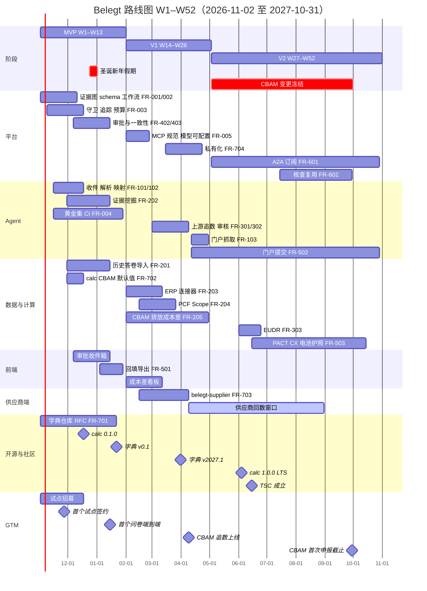
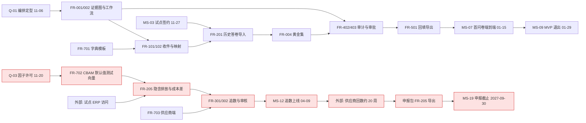

# 12 路线图与里程碑

## 0. 文档信息

| 项目 | 内容 |
|---|---|
| 版本 | v0.1 |
| 日期 | 2026-10-18 |
| 依赖文档 | 00-prd-v2（§2、§6、§11）、_baseline（§H FR 编号、§J 阶段、§L 法规日期与号段）、13（法规时间线、风险 R-xx、假设 A-xx、待决问题 Q-xx）、09（§5 治理分阶段、§6 发版节奏、FR-705/706）、02（字典与模板）、03（证据图） |
| 读者 | 创始团队、技术负责人、各小组负责人、商务负责人、开源维护者、投资人 |
| 时间基准 | W1 = 2026-11-02（周一）。MVP = W1–W13（2026-11-02 至 2027-01-31），V1 = W14–W26（2027-02-01 至 2027-05-02），V2 = W27–W52（2027-05-03 至 2027-10-31）。所有日期为欧洲中部时间（CET/CEST）工作日 |
| 结论先行 | 本路线图采纳 13 §2.6 的全部调整建议：FR-205、FR-301/302 与"CBAM 申报包导出"是 V1 的硬退出标准，CBAM 追数于 2027-04-09 上线，给供应商留出约 20 周回数时间；2027-05-03 至 2027-09-30 对 CBAM 相关模块冻结破坏性变更；FR-502 门户提交在 V1 仅做 beta，GA 放到 V2 |

本文不新增 FR 编号（12 无号段），只为里程碑和决策门新增标识 `MS-xx`、`G-xx`，见文末。

---

## 1. 阶段总览

### 1.1 三阶段目标与退出标准

PRD §2 的指标是 12 个月目标，本文把它拆成阶段性台阶。所有指标在试点客户的真实问卷上度量，基线来自试点签约时记录的"人工填一份问卷的工时"（由 `compliance_owner` 自报，并用 2 份问卷现场计时校准）。

| 指标（PRD §2） | MVP 退出（2027-01-29） | V1 退出（2027-04-30） | V2 退出（2027-10-29） | 度量方式 |
|---|---|---|---|---|
| 单份问卷人工时长下降 | ≥ 40% | ≥ 60% | ≥ 70% | 试点基线 vs `Trace` 记录的人工操作时长 |
| 有证据字段自动预填率 | ≥ 60%（对应 A-07） | ≥ 75% | ≥ 80% | 有 `evidence_refs`/`calculation_ref` 的 `Answer` ÷ 可证据化题目 |
| 跨客户口径冲突提交前拦截 | 黄金集 100%，漏检 0 | 试点生产 100% | 100%（含多客户订阅） | `consistency-auditor` 回放 + 人工抽检 |
| CBAM 默认值使用比例下降 | 建立基线 | 试点追数已覆盖 ≥ 60% 的 CBAM 进口量 | 下降 ≥ 50%（以 2026 年进口的 2027-09-30 申报为准） | 申报包中实际值吨数 ÷ 总吨数 |
| 映射 Top-1 准确率 | ≥ 85%；低置信度 100% 转人工 | ≥ 90%（A-08） | ≥ 92% | FR-004 黄金集 CI |
| 数字由模型生成比例 | = 0（R-NUM 强制，CI 断言） | = 0 | = 0 | 写入拒绝日志 + 审计包抽查 |
| 首稿生成时间（100 题） | ≤ 60 分钟 | ≤ 30 分钟 | ≤ 20 分钟 | `Request` 从 `parsed` 到 `in_review` 的时长 |
| 单份问卷 LLM 成本 | 测出 P50/P90 并定价（Q-05） | ≤ 定价的 10%（A-09） | ≤ 定价的 8% | `guard` 成本记账 |
| 字典模板覆盖 | 4 个：`vsme`、`cdp_climate`、`cbam_communication`、`eudr_dds`（最小字段） | 6 个：+ `pact_pcf`、`cmrt` | ≥ 8 个：+ `catenax_pcf`、`reach_scip`、`eu_battery_passport` | 字典仓库 `TemplateMapping` 计数 |
| 外部贡献映射占比 | 不设目标，开放仓库 | ≥ 10% | ≥ 30% | 09 §8.3 定义 |
| 北极星：月度提交问卷数 | ≥ 5 份（累计） | ≥ 25 份/月 | ≥ 80 份/月 | `Request.status=submitted` |

### 1.2 各阶段目标

- **MVP：证明"零教学"闭环可用。** 一份真实问卷从邮箱收件到原格式回填导出，全程在证据图里留痕，人只做封闭式确认和审批。同时开源字典 v0.1 与 `belegt-calc` 0.1.0，让核查机构和顾问可以复算。
- **V1：赶上 CBAM 首次年度申报。** 让试点客户在 2027-05 前就能向第三国供应商追要经核查的实际排放，并能导出申报包；补齐 ERP 连接器、PCF/Scope 计算、供应商端与私有化部署。
- **V2：从工具变成网络。** 客户订阅（A2A/API）、核查复用、Catena-X/PACT 交换、电池护照字段、EUDR 模块，并成立 TSC。同时守住 2027-09-30 申报冲刺期的稳定性。

三个阶段的排序逻辑是"先信任、再数字、后网络"。MVP 不碰 ERP、不做 PCF 计算，是因为试点客户最先感受到的痛点是"同一个问题被不同客户反复问"，历史答卷复用加文档提取就能解决大半；同时，证据图、R-NUM 和审批是后面所有数字类功能的地基，地基不稳就上计算，等于把错误数字更快地送出去。V1 的全部优先级都服从一个外部日期：2027-09-30 首次 CBAM 年度申报。第三国装置提供经核查的实际排放需要数月，因此 V1 的价值不在功能数量，而在于让试点在 2027-04 就把请求发出去。V2 才做网络化，是因为订阅和核查复用都依赖足够多已批准、可复用的 `Answer`，这要等试点跑满两个季度才有。

### 1.3 FR 阶段分配

全部 PRD FR（_baseline §H）与已登记的新增 FR（13 的 FR-405，09 的 FR-705/706）都有唯一的"交付阶段"。P0 全部在 MVP。

| 阶段 | FR | 说明 |
|---|---|---|
| MVP（P0） | FR-001、FR-002、FR-003、FR-004、FR-101、FR-102、FR-201、FR-202、FR-401、FR-402、FR-403、FR-404、FR-501、FR-701、FR-702、FR-706 | FR-702 在 MVP 先覆盖 CBAM 默认值 + 加价规则与 Scope 2 location-based 的测试向量（13 §2.6） |
| V1（P1） | FR-005、FR-103、FR-203、FR-204、FR-205、FR-301、FR-302、FR-405、FR-703、FR-704、FR-705 | FR-405 按 Q-10 推荐 B 放 V1；FR-705 中 `SECURITY.md` 与 SLSA Build L2 在 MVP 先行，SLSA L3 与 CVE 流程在 V1 完成 |
| V2 | FR-303、FR-502（GA）、FR-503、FR-601、FR-602 | FR-502 为 P1，但按 13 §2.6 降级：V1 只做 1 个门户的 beta，GA 计入 V2 |

**各文档新增 FR 的阶段分配**（统一修订补登，2026-10-19；按各文档标注的优先级，P0 → MVP、P1 → V1、P2 → V2）

| 阶段 | 新增 FR | 来源 |
|---|---|---|
| MVP（P0） | FR-006、FR-008、FR-010、FR-011、FR-012、FR-013、FR-016、FR-018、FR-020、FR-021、FR-022、FR-104、FR-107、FR-209、FR-406、FR-407、FR-408、FR-409、FR-507 | 04、07、11、01、05、06 |
| V1（P1） | FR-007、FR-014、FR-015、FR-017、FR-019、FR-023、FR-024、FR-105、FR-106、FR-206、FR-207、FR-208、FR-304、FR-305、FR-306、FR-308、FR-309、FR-504、FR-505、FR-506 | 04、07、11、01、05、08 |
| V2（P2） | FR-009、FR-307 | 04、08 |

说明：FR-020…022 是 FR-004（P0）的拆分，必须随 MVP；FR-023/024（线上监控与反馈闭环）在 V1 有真实流量后启用。FR-208（CBAM 50 t 门槛与默认值成本估算）的测试向量随 MVP 的 FR-702 提前准备。

NFR 不单独分阶段：NFR-02、NFR-03、NFR-04、NFR-05 从 MVP 第一天起就是 CI 约束；NFR-01 的私有化部分随 FR-704 在 V1 完成；NFR-06 在 MVP 做德英界面，多语言上游随 FR-301 在 V1 完成。

有三处分配需要说明。第一，FR-205 是 P1，但它其实是全年最硬的交付，所以它的前置工作（CBAM 默认值与加价规则的测试向量）被拆进 MVP 的 FR-702 里提前做，避免 V1 一开局就从零起步。第二，EUDR 在 2026-12-30 就对下游经营者适用，早于 V2 的 FR-303；本文不把 FR-303 提前，而是按 Q-08 推荐 A，在字典 v0.1 里放入 `dp:supply.eudr.dds_reference` 与 `dp:supply.eudr.geolocation`，让 MVP 能识别 EUDR 题目并回答"不涉及"或"参考号为 X"。第三，电池护照虽然 2027-02-18 适用，但目标客户不是护照责任方，碳足迹字段又以授权法案为触发（13 §2.4），因此 FR-503 留在 V2，只把 `eu_battery_passport` 模板映射放进字典 v2027.2。

---

## 2. Sprint 计划

### 2.1 节奏与产能假设

- MVP 与 V1 用双周 Sprint，周一开始、第二周周五演示。MVP 13 周排 6 个 Sprint，其中 S4 跨圣诞/新年（W7–W9，三个日历周）；V1 13 周排 7 个 Sprint，S13 是 1 周的发布与加固 Sprint。
- **假期折减**：2026-12-24 至 2027-01-01 视为全员休假。W8 只有 12-21 至 12-23 三个工作日，按 50% 计；W9 按 0% 计。S4 名义 3 周，实际产能约 1.5 个周当量，约等于正常 Sprint 的 75%，因此 S4 只安排收尾与内部集成，不安排对外发布，所有对外发布在 2026-12-18 前完成或推到 1 月。
- 其他已知折减：2027-01-06（巴伐利亚、巴登-符腾堡 Epiphany）、2027-03-26 与 03-29（复活节），按团队所在州折减 5–10%；V2 中 7–8 月暑假按 20% 折减。
- 代码库按 09 §6 的 6 周 minor 火车发版：2026-12-18、2027-01-29、2027-03-12、2027-04-23、2027-06-04、2027-07-16、2027-08-27、2027-10-08。字典按季度：v0.1 在 MVP，v2027.1 RC 03-15、GA 03-31；v2027.2 RC 06-15、GA 06-30；v2027.3 RC 09-15、GA 09-30。

### 2.2 MVP（S1–S6）

| Sprint | 日期 | 交付物 | FR | 负责小组 | 验收演示 |
|---|---|---|---|---|---|
| S1 | 2026-11-02 至 11-13 | Q-01 编排定型（11-06）；证据图对象表/边表与 schema 校验骨架；Temporal 问卷工作流 `received→triaged`；`guard` 追踪与预算钩子；字典仓库初始化与 DCO 机器人；VSME 以 2026/1560 为准（Q-09，11-13） | FR-001、FR-002、FR-003、FR-701 | 平台、开源与社区 | 写入一个无引用的数字 `Answer` 被 `GRAPH_*` 错误拒绝；Temporal 工作流杀进程后续跑 |
| S2 | 11-16 至 11-27 | `intake-triage` 隔离区接入 IMAP/Graph 邮箱；`question-parser` 解析 Excel/Word；Mapping 置信度阈值与 `ClosedQuestion`；黄金集 v0（首个试点脱敏历史问卷）；Q-03/Q-06/Q-08 决策（11-20） | FR-101、FR-102、FR-003、FR-004 | Agent、平台、GTM | 一封真实转发的 OEM 邮件生成 `Request`，带截止日期；低于 0.60 的题目进入 `unmapped` |
| S3 | 11-30 至 12-11 | `belegt-io` 历史答卷导入并写入答案库；`evidence-miner` 提取账单、证书、材质证明、SDS 并带原文定位；`belegt-calc` CBAM 默认值 + 加价规则（`fs:eu-cbam-default@2026.07`）与 Scope 2 location-based 测试向量；字典加入 `dp:supply.eudr.dds_reference`、`dp:prod.cbam.import_net_mass_annual` | FR-201、FR-202、FR-702、FR-701 | 数据与计算、Agent | 导入 3 年历史答卷后新问卷复用率实测；点击任一证据跳到 PDF 页内 bbox |
| S4 | 12-14 至 2027-01-01（含假期） | `consistency-auditor` CR-001…CR-006；`approval-router` 风险分级 L0–L3；审批收件箱 UI 第一版；12-18 发 `belegt-calc` 0.1.0 与 core 0.1.0；SLSA Build L2、SBOM 与许可 CI（FR-706） | FR-402、FR-403、FR-702、FR-706 | 平台、前端、数据与计算 | 12-18 演示：同一 Scope 1 数字对两家客户口径不同，被拦截为 `Conflict`；L0 批量一键批准 |
| S5 | 2027-01-04 至 01-15 | `filler-file` 原格式回填（Excel/Word/PDF 表单）；有效期预警（证书、`Evidence.valid_until`）；`answer-drafter` 文字类答案；审计包 `belegt-auditpack/1` 导出；德英界面 | FR-501、FR-404、FR-401、FR-201 | Agent、前端、平台 | **MS-07 首个试点问卷端到端**（01-15）：从收件到导出原格式文件，全部字段可回溯 |
| S6 | 01-18 至 01-29 | 黄金集 CI 门禁（指标下降不得合并）；成本与首稿时长看板；字典 v0.1（包 0.1.0）开源发布；R-03 检查点：CBAM 测试向量覆盖率；MVP 加固与 0.2.0 发版 | FR-004、FR-701、FR-702、全部 P0 回归 | 全组 | MVP 退出评审（G-02）：按 §1.1 逐项出示数据 |

MVP 的顺序有两点刻意安排。其一，S2 就引入黄金集 v0，而不是等功能做完再评测：首个试点的脱敏历史问卷一到手，映射准确率就成为每天可见的数字，后续每次换模型、改提示词都要过它（FR-004）。这也意味着首个试点必须在 2026-11-27 前签约，否则 S2 只能用公开模板加合成数据顶替，黄金集的代表性会打折。其二，S4 跨假期，团队实际上只有 12-14 至 12-23 八个工作日，所以 S4 的"对外"部分只有 12-18 一次发版和一次演示，其余都是内部集成；1 月第一周回来直接进入 S5 的回填与端到端，避免假期前后两头不靠。

### 2.3 V1（S7–S13）

| Sprint | 日期 | 交付物 | FR | 负责小组 | 验收演示 |
|---|---|---|---|---|---|
| S7 | 2027-02-01 至 02-12 | MCP 连接器规范与 SDK（`belegt-connectors`）；模型提供方可配置；首个 ERP 连接器（按 Q-04 结果）只读接入；成本差看板切换为证书实际购买价（2027-02-01 起销售） | FR-005、FR-203、FR-205 | 平台、数据与计算 | 同一 Agent 在云端模型与本地 vLLM 之间切换，黄金集指标不降 |
| S8 | 02-15 至 02-26 | `calc-service` PCF（PACT v3、CX-PCF v4 两个 `methodology_version`）与 Scope 1/2；CBAM 隐含排放（SEE 直接/间接）计算与成本差（公式按 05 §6.6 `cbam-cost-gap@1.0.0`）；ERP 活动数据进入 `Evidence` | FR-204、FR-205、FR-203 | 数据与计算 | 同一输入两次计算 `input_hash` 与结果逐位一致（NFR-02） |
| S9 | 03-01 至 03-12 | 季度 50% 证书持有提醒（首个季度末 03-31 前上线）；`upstream-chaser` 多语言请求模板；`egress-gateway` 白名单与频率上限；FR-705 SLSA L3；0.3.0 发版 | FR-205、FR-301、FR-705 | Agent、平台 | 为一家土耳其钢材供应商生成土/英/德三语请求，首次发送需确认 |
| S10 | 03-15 至 03-26 | `belegt-supplier` 供应商端（自托管镜像 + 托管版）；`supplier-reply-reviewer` 隔离区合理性审核；字典 v2027.1 RC（03-15）；私有化 docker compose beta | FR-703、FR-302、FR-701、FR-704 | 供应商端、Agent、开源与社区 | 供应商在中文/土耳其语界面上传核查报告，异常值被标记 |
| S11 | 03-29 至 04-09 | 自动催办与升级；CBAM 追数端到端；FR-405 价值链上限检测（仅提示）；字典 v2027.1 GA（03-31）；Helm chart | FR-302、FR-301、FR-405、FR-704 | Agent、供应商端、前端 | **MS-12 CBAM 追数上线**（04-09）：试点向真实第三国供应商发出请求 |
| S12 | 04-12 至 04-23 | CBAM 申报包导出（Q-11 选 A）；门户任务抓取（Top-3 门户，FR-103）；FR-502 单门户 beta；本地模型离线包；0.4.0 发版 | FR-205、FR-103、FR-502（beta）、FR-704 | 数据与计算、Agent、平台 | **MS-13 首个私有化交付**（04-16）；申报包可被合规负责人逐行核对 |
| S13 | 04-26 至 04-30 | V1 加固；CBAM 模块打冻结标签；V1 退出评审 | 全部 V1 回归 | 全组 | G-05：V1 退出，进入 CBAM 变更冻结 |

V1 的节奏围绕 CBAM 倒排。2027-02-01 证书开始销售，S7 就把成本差看板从估算价切到实际购买价；2027-03-31 是 Art. 22(2) 下第一个季度末持有义务，季度提醒必须在 S9（03-12）上线；追数上线定在 S11 末的 04-09，给供应商留出到 08-31 约 20 周的回数时间，再留 9 月给合规负责人核对和申报。ERP 连接器只做一个，选择以 Q-04 的访谈结果为准，第二个连接器是第一个可砍项。门户自动化在 V1 只抓取任务、只对一个门户做提交 beta，原因是 R-20：门户条款与反自动化风险没摸清之前，不把它放进退出标准。

### 2.4 V2（按月）

| 月 | 日期 | 交付物 | FR | 负责小组 |
|---|---|---|---|---|
| M7 | 2027-05-03 至 05-31 | CBAM 冻结期运维；A2A/API 订阅协议规范开源草案；门户提交 FR-502 扩到 3 个门户；TSC 章程草案 | FR-601、FR-502 | 平台、开源与社区 |
| M8 | 06-01 至 06-30 | `belegt-calc` 1.0.0 LTS（06-04）；EUDR 坐标与声明管理（06-25，赶微小企业 06-30 适用）；字典 v2027.2（含 `eu_battery_passport`）；TSC 首次会议（06-15） | FR-303、FR-702、FR-701 | 数据与计算、供应商端、开源与社区 |
| M9 | 07-01 至 07-31 | PACT v3.0.3 数据交换 beta（07-30）；Tractus-X EDC 接入；电池护照字段输出（不含碳足迹，以授权法案为触发） | FR-503 | 数据与计算、平台 |
| M10 | 08-01 至 08-31 | 一次核查多方复用：`auditor_readonly` 核查视图与核查结论复用；客户订阅 beta；申报冲刺支持（供应商回数截止 08-31） | FR-602、FR-601 | 平台、前端、GTM |
| M11 | 09-01 至 09-30 | 申报冲刺：LTS 功能冻结（09-02 起）；只发 patch；字典 v2027.3 GA（09-30，不改 CBAM 数据点语义） | 运维 | 全组 |
| M12 | 10-01 至 10-29 | 客户订阅 GA；FR-503 GA（10-15）；FR-502 GA；冻结解除后的积压合并；基金会评估（09 §5.5）；V2 退出 | FR-601、FR-503、FR-502 | 全组 |

V2 的前五个月与 CBAM 冻结期重叠，因此新功能都放在与 CBAM 无耦合的模块里：A2A 订阅、PACT/Catena-X、EUDR 和核查复用分别在独立的服务或适配层中开发，合并到主干时不得修改 `calc-service` 中 CBAM 相关的 `methodology_version`，也不得变更 `dp:prod.cbam.*` 数据点的单位与口径。9 月只发 patch，全组轮值支持试点申报；10 月冻结解除后先合并积压，再做 V2 收尾。治理方面，按 09 §5.1，V2 进入阶段 1，TSC 在 2027-06-15 首次开会，到 V2 结束时至少一个仓库要有非 Belegt 公司的 Maintainer。

---

## 3. 关键里程碑

| ID | 日期 | 里程碑 | 判定标准 | 关联 |
|---|---|---|---|---|
| MS-01 | 2026-11-06 | 编排选型定稿 | Temporal + LangGraph 组合写入 04 | Q-01 |
| MS-02 | 2026-11-20 | 范围锁定 | Q-03、Q-06、Q-08 已决，Q-09 已于 11-13 决 | G-00 |
| MS-03 | 2026-11-27 | 首个试点客户签约 | 签署试点协议 + DPA，交付 ≥ 2 年历史问卷 | R-22 |
| MS-04 | 2026-12-11 | 法务许可确认 | CDP 等"题号 + 结构"发布可行性书面意见；UBA 因子许可清单 | R-14、R-18 |
| MS-05 | 2026-12-18 | `belegt-calc` 0.1.0 发布（PyPI，Apache-2.0） | `pip install belegt-calc` 独立运行；CBAM 默认值与 Scope 2 测试向量通过 | FR-702 |
| MS-06 | 2026-12-18 | 3 家试点签约 | ≥ 3 份试点协议，其中 ≥ 2 家年 CBAM 进口 > 50 t | G-01、A-01 |
| MS-07 | 2027-01-15 | 首个试点问卷端到端 | 真实问卷 `received→submitted`，导出原格式，审计包完整 | FR-101…FR-501 |
| MS-08 | 2027-01-22 | 字典 v0.1 开源（包 0.1.0，CC BY 4.0） | 4 个模板、无原文检测通过、RFC 流程上线 | FR-701、MS-04 |
| MS-09 | 2027-01-29 | MVP 退出 | §1.1 MVP 列全部达标 | G-02 |
| MS-10 | 2027-02-01 | 定价与成本上限确认 | 用真实成本定价 | Q-05、A-09 |
| MS-11 | 2027-03-31 | 字典 v2027.1 GA（首个日历版本） | 6 个模板，迁移说明 `MIGRATION/v2027.1.md` | 09 §6 |
| MS-12 | 2027-04-09 | CBAM 追数上线 | 供应商端可用，试点向 ≥ 20 家第三国装置发出请求 | FR-205/301/302/703、R-03 |
| MS-13 | 2027-04-16 | 首个私有化交付 | 试点 IT 用 Helm 或 compose 在本地装好，并接本地模型 | FR-704 |
| MS-14 | 2027-04-30 | V1 退出 + CBAM 申报包导出可用 | §1.1 V1 列达标；冻结开始 | G-05、Q-11 |
| MS-15 | 2027-06-04 | `belegt-calc` 1.0.0 LTS | 支持 18 个月，覆盖 2027 申报周期 | 09 §6 |
| MS-16 | 2027-06-25 | EUDR 模块上线 | 下游经营者参考号收集与保存 5 年 | FR-303 |
| MS-17 | 2027-07-30 | PACT v3 交换 beta / 电池护照字段 | 通过 PACT v3.0.3 接口自测 | FR-503、Q-13 |
| MS-18 | 2027-08-31 | 试点供应商回数截止（建议） | 实际值覆盖 CBAM 进口量 ≥ 50% | A-05 |
| MS-19 | 2027-09-30 | 首次年度 CBAM 申报与清缴截止（法定） | 试点全部按时提交，Belegt 无 P1 事故 | 13 §1 |
| MS-20 | 2027-10-29 | V2 退出 | §1.1 V2 列达标 | G-08 |

外部法规锚点（不由我们控制，均引自 13）：EUDR 大中型与下游经营者 2026-12-30；VSME 价值链上限自 2027-01-01 起的财年；CBAM 证书销售 2027-02-01；电池护照 2027-02-18；EUDR 微小经营者 2027-06-30；CBAM 首次申报 2027-09-30。

里程碑之间有三组强绑定。MS-04 法务许可确认是 MS-08 字典开源的前置条件：若法务意见未到，字典 v0.1 只发布公共法规模板，CDP 等商业问卷映射延后到 v2027.1。MS-05 与 MS-08 分开发布是有意为之：计算库不依赖问卷版权问题，可以先发，让核查机构和顾问在假期前就能拿到可复算的 CBAM 默认值实现。MS-12、MS-18、MS-19 构成一条倒排链，任何一环推迟都直接压缩后一环，所以 MS-12 被设为 G-04 的检查对象，而不是等到 V1 退出才看。

---

## 4. 甘特图

---

## 5. 依赖关系与关键路径

### 5.1 关键路径

本项目有两条关键路径。第一条决定 MVP 能否按期退出，第二条决定试点能否赶上 2027-09-30。第二条的终点不可移动，而且其中约 20 周（供应商回数）不在我们控制之内，因此它才是全年真正的关键路径。

第一条路径上最脆弱的一环是"试点签约 → 历史答卷导入 → 黄金集"。它把一个商务事件放在了工程关键路径上：没有真实历史问卷，映射准确率、历史覆盖率和首稿时长三个 MVP 退出指标都无法度量。第二条路径上最脆弱的一环是"追数上线 → 供应商回数"，它完全依赖第三方，因此我们能做的只有两件事：尽量早上线，以及用成本差看板把默认值的代价量化给客户采购，让采购去施压。

### 5.2 外部依赖

| 依赖 | 影响的 FR | 需要到位日期 | 负责人 | 未到位的降级方案 |
|---|---|---|---|---|
| 试点历史问卷与文档（脱敏授权） | FR-201、FR-202、FR-004 | 2026-12-04 | 商务负责人 | 用公开模板 + 合成数据（`belegt-bench`）先跑，黄金集推迟 |
| 试点 ERP 只读访问（SAP B1、abas、proALPHA 等，以 Q-04 为准） | FR-203、FR-204、FR-205 | 2027-01-29 | 商务负责人 + 集成工程师 | 降级为文档与 CSV 导出提取（PRD §4.5），标数据新鲜度 |
| 客户门户账号与条款审查 | FR-103、FR-502 | 2027-03-26 | 产品负责人 | 只做文件回填（FR-501），R-20 |
| 法务：问卷题号/结构发布许可、AGPL/CLA、DPA | FR-701、Q-02 | 2026-12-11 | 法务顾问 | 字典 v0.1 先只发 VSME、CBAM、EUDR 等公共模板，CDP 映射延后 |
| 因子库许可（EU CBAM 默认值、UBA；ecoinvent 仅适配器） | FR-702、FR-204 | 2026-11-20 | 合规研究员 | 仅内置 CBAM 默认值，UBA 改为适配器 |
| EU ETS 价格数据（季度/周均价） | FR-205 | 2027-02-01 | 数据与计算组 | 手工录入并以 `Evidence` 留痕 |
| CBAM Registry 申报格式 | FR-205（申报包） | 2027-03-12 | 合规研究员 | 生成通用 XLSX/XML，由客户人工上传 |
| PACT 一致性测试流程、Tractus-X EDC 版本 | FR-503 | 2027-06-01 | 技术负责人 | 只做 PACT v3 自测，Catena-X 推迟 |
| 第三国装置的核查报告 | FR-205 的效果指标 | 2027-08-31 | 试点采购 + 产品负责人 | 成本差看板量化默认值代价，驱动采购施压（R-04） |

---

## 6. 团队配置与预算

### 6.1 MVP 最小团队（约 8 FTE）

| 角色 | 人数 | 关键技能 | 所属小组 |
|---|---|---|---|
| 产品负责人（兼 CEO） | 1 | 德语区制造业 B2B、问卷与合规流程 | GTM |
| 技术负责人 | 1 | 分布式工作流（Temporal）、PostgreSQL、安全架构 | 平台 |
| 后端/平台工程师 | 1 | Python 3.12、证据图、审计日志、CI | 平台 |
| Agent 工程师 | 2 | LLM 应用、LangGraph、评测、提示词注入防护、文档解析 | Agent |
| 数据与计算工程师 | 1 | GHG Protocol、CBAM 方法学、确定性数值计算、测试向量 | 数据与计算 |
| 前端工程师 | 1 | React/TypeScript、表格类复杂交互、i18n | 前端 |
| 合规研究员（兼开源维护者） | 1 | CBAM/VSME/EUDR 法规、字典建模、社区运营 | 开源与社区 |

DevOps 与安全由技术负责人兼任，另配 0.5 FTE 外包 SRE。

这个配置的前提是"确定性优先"：一半以上的工作量在证据图、计算和审计这些普通软件工程上，而不是 LLM 调优，所以 Agent 工程师只配 2 人。最难招的是数据与计算工程师，需要同时懂 GHG Protocol、CBAM 方法学和工程化测试；如果 2026-11 内招不到，就用外部 CBAM 方法学顾问加一名通用 Python 工程师组合替代，但 G-03 的风险会上升。合规研究员兼开源维护者在 MVP 阶段是合理的，因为字典的主要工作是法规建模；到 V2 社区活跃起来后，由专职开发者关系接手社区运营。

### 6.2 V1 与 V2 扩张

| 阶段 | 新增 | 合计 FTE |
|---|---|---|
| V1（2027-02 起） | 集成工程师（ERP/MCP）1、供应商端全栈工程师 1、评测/QA 工程师 1、客户成功（德语母语）1 | 约 12 |
| V2（2027-05 起） | 数据空间工程师（Catena-X/PACT/A2A）1、平台工程师 1、开发者关系/社区经理 1、销售 1 | 约 16 |

### 6.3 外部顾问

| 顾问 | 用途 | 投入假设 |
|---|---|---|
| CBAM 方法学顾问（DEHSt 经验或核查机构背景） | 审核 `belegt-calc` CBAM 方法论与测试向量、申报包格式 | MVP 8 天、V1 10 天、V2 6 天 |
| 法务（开源许可 + 数据保护） | CDP 等版权、AGPL/CLA、商标、DPA 模板、免责条款 | 约 80 小时 |
| 核查机构顾问 | FR-602 核查复用的可接受性 | V2 约 5 天 |

### 6.4 预算粗估

假设：内部员工按德国（柏林/慕尼黑）全成本计，每人月 €8,000–12,000（年薪 €75k–110k × 约 1.25 雇主成本）；外包与顾问按欧洲市场日费率。不含办公、差旅与股权激励。

| 项目 | 计算 | 低 | 高 |
|---|---|---|---|
| MVP 人力 | 8.5 FTE × 3 月 = 25.5 人月 | €204k | €306k |
| V1 人力 | 12.5 FTE × 3 月 = 37.5 人月 | €300k | €450k |
| V2 人力 | 16.5 FTE × 6 月 = 99 人月 | €792k | €1,188k |
| CBAM 方法学顾问 | 24 天 × €1,200–1,800/天 | €29k | €43k |
| 法务 | 80 小时 × €300–450/小时 | €24k | €36k |
| 核查机构顾问 | 5 天 × €1,200–1,600/天 | €6k | €8k |
| 云与 LLM（欧盟区） | 12 月 × €3k–8k | €36k | €96k |
| 合计 | 约 162 人月 | 约 €1.39m | 约 €2.13m |

---

## 7. 试点计划

### 7.1 选择标准

| 标准 | 要求 | 依据 |
|---|---|---|
| 画像 | 德语区 50–1000 人金属加工或汽车零部件二三级供应商，无专职 ESG 团队 | PRD §1 |
| 问卷量 | 年收问卷 ≥ 20 份，可提供 ≥ 2 年历史答卷 | A-02、A-07 |
| CBAM 分层 | 访谈时采集 `dp:prod.cbam.import_net_mass_annual`。按 Q-06 推荐 B 分层而非一刀切：> 50 t（超过门槛，承担义务；恰好 50 t 仍豁免，13 §2.1、05 §6.8）的进 CBAM 包，≤ 50 t 的进问卷包；30–50 t 的"逼近门槛"企业优先，因为一笔大单就会使全年纳入 | 13 §2.1、R-01 |
| 进口方式与授权 | 记录是否自行进口或通过间接海关代理，以及授权申报人状态 | 13 §2.1 |
| 上游 | CBAM 包客户至少有 5 家可联系的第三国供应商 | A-05 |
| ERP | 至少 2 家使用同一 ERP，便于首个连接器复用 | Q-04 |
| IT | 至少 1 家有私有化部署诉求 | FR-704、A-10 |

### 7.2 数量与节奏

- 目标签约 5 家（3 家 CBAM 包 + 2 家问卷包），候补 2 家，另签 1 家咨询公司作为设计伙伴（也是首个字典贡献方候选，A-11）。
- 首家 2026-11-27，3 家 2026-12-18，5 家 2027-01-29。试点免费至 2027-04-30，之后按 Q-05 的定价转付费。
- 选 5 家而不是更多，是因为 MVP 团队只有 1 名客户成功能力（由产品负责人兼任），每家试点前两个月每周需要约半天的陪跑；少于 3 家则黄金集样本不足，R-22 会触发。
- 入驻流程：签协议与 DPA → 采集画像与 CBAM 分层字段 → 导入历史答卷与文档 → 转发近期问卷到专用邮箱 → 每周一次封闭式问题集中确认。全程不要求客户学习系统，与 PRD"零教学"原则一致。

### 7.3 成功标准

| 维度 | 标准 |
|---|---|
| 效率 | 每家试点在 V1 退出前提交 ≥ 5 份问卷，人工时长下降 ≥ 60% |
| 质量 | 提交后被 OEM 退回比例 ≤ 5%；零起"数字无出处"事件 |
| CBAM | CBAM 包客户 2027-09-30 前用 Belegt 生成的申报包完成申报，实际值覆盖 ≥ 50% 进口量 |
| 商业 | ≥ 3 家在 2027-05-31 前签付费合同；≥ 1 家同意作为公开案例 |
| 开源 | ≥ 1 家试点或其顾问提交字典 PR |

### 7.4 反馈节奏

每周 30 分钟试点例会（客户成功主持）；每个 Sprint 末邀请试点参加演示；每月一次指导委员会（总经理参加，看成本差看板）；每阶段末做一次结构化访谈与 NPS；所有缺陷和需求进同一看板，标注试点来源。试点问卷经脱敏后进入私有黄金集，不公开（09 §8.4）。

---

## 8. 风险缓冲与 go/no-go 决策点

### 8.1 缓冲

- MVP：S6 后半周与 S4 假期周不排新功能，约 1.5 周缓冲。V1：S13 整周为加固缓冲；CBAM 追数上线（04-09）比 13 建议的"2027-05 前"早 3 周，这 3 周就是 R-03 的缓冲。
- 范围缓冲：每个 Sprint 只承诺 80% 产能，其余留给试点缺陷。可砍顺序已预先排好：FR-502 beta → FR-103 → FR-405 → 第二个 ERP 连接器。FR-205、FR-301、FR-302、FR-703 和申报包导出不可砍。
- 冻结：按 Q-12 推荐 A，2027-05-03 至 2027-09-30 冻结 CBAM 相关模块的破坏性变更；2027-09-02 起 LTS 功能冻结（09 §6 申报前 4 周）。

缓冲的设计原则是"时间缓冲留给外部依赖，范围缓冲留给内部延误"。外部依赖（试点签约、ERP 访问、供应商回数）不会因为我们加人而变快，所以在日期上提前；内部开发延误则通过可砍清单消化，不推迟 MS-12 与 MS-14 两个对 CBAM 申报有直接影响的日期。

### 8.2 决策门

| 门 | 日期 | 决策 | 通过条件 | 未通过的动作 | 关联 |
|---|---|---|---|---|---|
| G-00 | 2026-11-20 | 范围锁定 | Q-01、Q-03、Q-06、Q-08、Q-09 已决 | 未决项按推荐选项默认执行，记录在案 | Q-01/03/06/08/09 |
| G-01 | 2026-12-18 | 试点与市场 | ≥ 3 家签约；≥ 50% 访谈企业年进口 > 50 t；ERP 分布已知 | <3 家触发 R-22：与咨询顾问联合获客；A-01 不成立则 CBAM 降为附加模块，V1 主线改为 PCF | A-01、Q-04、R-22 |
| G-02 | 2027-01-29 | MVP 退出 | §1.1 MVP 列全达标；历史覆盖率 ≥ 60%；Top-1 ≥ 85% | 延长 MVP 至多 2 周，从 V1 砍 FR-502 beta 与 FR-103；A-07 不成立则加大 `ClosedQuestion` 比重 | A-07、A-08、A-10、Q-02 |
| G-03 | 2027-01-22 | CBAM 计算就绪 | FR-205 相关测试向量覆盖 ≥ 80%（13 R-03 在 W12 的触发线） | 数据与计算组加 1 名外包，方法学顾问加 5 天 | R-03 |
| G-04 | 2027-03-12 | CBAM 追数可上线 | 供应商端多语言可用；Q-11 已选申报包；冻结已批（Q-12） | 追数上线不晚于 04-23；FR-405 移到 V2 | Q-11、Q-12、Q-07 |
| G-05 | 2027-04-30 | V1 退出 | §1.1 V1 列达标；申报包可导出 | 不进入 V2 新功能，先补 CBAM；A-05 不成立则看板以默认值为基线、强调 2027 年后 | A-05、A-03、R-03、R-04 |
| G-06 | 2027-06-30 | V2 范围复核 | 按 A-06、A-12 判断 FR-405 与电池护照投入 | 电池问卷量大则 FR-503 提前；A-06 不成立则 FR-405 停止投入 | A-06、A-12、Q-13、R-07 |
| G-07 | 2027-10-08 | 申报复盘 | 试点按时申报、无 P1 事故 | 冻结解除推迟 2 周，先修申报缺陷 | R-13、R-24 |
| G-08 | 2027-10-29 | V2 退出与基金会评估 | §1.1 V2 列达标；09 §5.5 三个触发条件 | 标准层暂不捐赠，延至下一年 | R-19、09 §5.5 |

另有两条持续监测线：CBAM 下游扩展（Q-07、R-02）若在 2027-03-31 前有最终文本，G-04 增加"CN 清单扩展"评估，但路线图不预先承诺；EUDR 若再调整（R-06），FR-303 的 06-25 日期随之顺延，不提前投入。

---

## 本文新增标识

| 标识 | 类型 | 说明 |
|---|---|---|
| `MS-01`…`MS-20` | 里程碑 ID | 见 §3 |
| `G-00`…`G-08` | 决策门 ID | 见 §8.2 |
| S1…S13、M7…M12 | Sprint 与月度编号 | 见 §2 |

## 待决问题

1. FR-502 在 V1 降级为 beta、V2 才 GA，需 PRD 维护者确认（PRD §11 原列在 V1）。
2. 试点免费期截止 2027-04-30 与 V1 退出同日，是否需要给 CBAM 包客户延到 2027-09-30 申报后再转付费，由商务负责人在 G-02 前决定。
3. `belegt-calc` 1.0.0 LTS 定在 2027-06-04（冻结期内），需确认 0.4 → 1.0 无破坏性变更，否则改为 0.4.x LTS 例外。
4. 预算中的费率区间为假设，需在 2026-11-20 前按实际招聘与外包报价校准。
