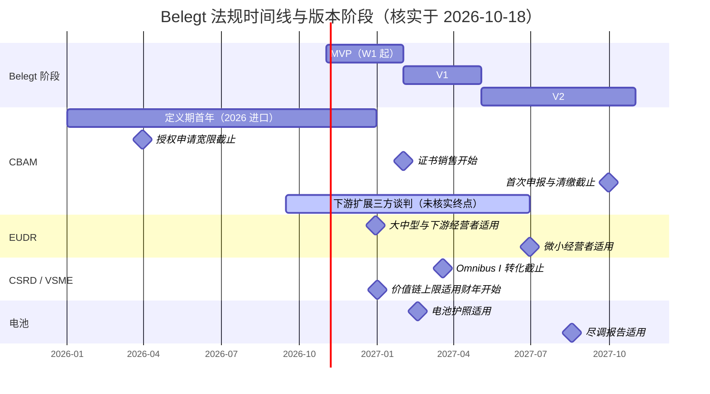

# 13 风险、假设与待决问题

## 0. 文档信息

| 项目 | 内容 |
|---|---|
| 版本 | v0.1 |
| 日期 | 2026-10-18 |
| 依赖文档 | 00-prd-v2（§1、§3、§6、§11、§12、§13）、_baseline（命名、FR 编号、阶段）；涉及 02（字典）、06（风险分级）、09（开源）、12（路线图） |
| 读者 | 产品负责人、技术负责人、合规研究员、法务顾问、开源维护者、商务负责人 |
| 核实方法 | 法规日期均以 EUR-Lex 法规正文、European Commission / Council / Parliament / EFRAG 官网为准，逐条打开原文后记录；核实日期统一为 2026-10-18。仅有第三方或搜索摘要支撑的事项标"未核实"。 |
| 结论先行 | PRD §11、§12 中五处"[需核实]"均已落定：CBAM 50 t 门槛自 2026-01-01 适用；首次年度申报与证书清缴截止 2027-09-30；证书销售自 2027-02-01；VSME 价值链上限已以授权条例形式立法，自 2027-01-01 起的财年适用；EUDR 第二次推迟至 2026-12-30（微小企业 2027-06-30），2026 年复审未再推迟。新增一项高影响变量：CBAM 向紧固件、线材、弹簧等下游产品扩展的立法正在三方谈判中。 |

---

## 1. 法规时间线总表

状态枚举：`已生效`（已适用）、`已立法`（日期写入已公布法规，尚未到期）、`立法中`（提案/谈判阶段）、`未核实`。

| 事项 | 关键日期 | 状态 | 对 Belegt 影响 | 来源 | 核实日期 |
|---|---|---|---|---|---|
| CBAM 简化条例 Regulation (EU) 2025/2083 通过 / 公布 | 2025-10-08 通过；2025-10-17 公布于 OJ | 已生效 | 所有 CBAM 功能（FR-205、FR-301/302）以修订后的 2023/956 为准 | [EUR-Lex 2023/956 合并文本](https://eur-lex.europa.eu/legal-content/EN/TXT/HTML/?uri=CELEX:02023R0956-20251020)；[DG TAXUD 公告](https://taxation-customs.ec.europa.eu/news/officially-published-simplifications-carbon-border-adjustment-mechanism-cbam-2025-10-20_en) | 2026-10-18 |
| CBAM 过渡期 | 2023-10-01 至 2025-12-31（Art. 32） | 已生效（已结束） | 过渡期季度报告不再是产品重点 | [EUR-Lex 合并文本](https://eur-lex.europa.eu/legal-content/EN/TXT/HTML/?uri=CELEX:02023R0956-20251020) | 2026-10-18 |
| CBAM 定义期 + 50 t 年度净质量门槛（Art. 2a、Annex VII） | 2026-01-01 起 | 已生效 | 目标客户筛选的首个硬条件；超过门槛则当年全部进口承担全部义务 | [EUR-Lex 合并文本 Art. 2a、Art. 36](https://eur-lex.europa.eu/legal-content/EN/TXT/HTML/?uri=CELEX:02023R0956-20251020)；[DG TAXUD 公告](https://taxation-customs.ec.europa.eu/news/officially-published-simplifications-carbon-border-adjustment-mechanism-cbam-2025-10-20_en) | 2026-10-18 |
| 50 t 门槛年度评估 | 2026-09-30 公布：门槛覆盖 0.87% 隐含排放，低于 1% 上限，维持 50 t | 已生效 | 2027 年门槛不变；每年 4 月需复查 | [DG TAXUD CBAM 新闻页](https://taxation-customs.ec.europa.eu/carbon-border-adjustment-mechanism/cbam-communication-and-news_en) | 2026-10-18 |
| 授权申报人申请（Art. 5、Art. 17(7a)） | 进口前须申请；2026-03-31 前已申请者可在审批期内继续进口 | 已生效 | 客户若未取得授权将面临处罚，属销售线索与"准入检查"字段 | [EUR-Lex 合并文本](https://eur-lex.europa.eu/legal-content/EN/TXT/HTML/?uri=CELEX:02023R0956-20251020) | 2026-10-18 |
| CBAM 证书销售开始（Art. 20(1)） | 2027-02-01 | 已立法 | 成本差看板需从"估算价"切换到"实际购买价" | [EUR-Lex 合并文本 Art. 20、Art. 36](https://eur-lex.europa.eu/legal-content/EN/TXT/HTML/?uri=CELEX:02023R0956-20251020) | 2026-10-18 |
| 2026 年进口的证书价格 | 按进口所在季度的 EU ETS 季度均价（Art. 21(1a)）；2027 起按周均价 | 已生效 | `calc-service` 需按季度取价，并保存 `factor_set_version` 式的价格版本 | [EUR-Lex 合并文本 Art. 21](https://eur-lex.europa.eu/legal-content/EN/TXT/HTML/?uri=CELEX:02023R0956-20251020) | 2026-10-18 |
| 季度持有 50% 证书义务（Art. 22(2)） | 2027-01-01 起 | 已立法 | 2027 年起每季度末现金流压力，需季度提醒 | [EUR-Lex 合并文本](https://eur-lex.europa.eu/legal-content/EN/TXT/HTML/?uri=CELEX:02023R0956-20251020) | 2026-10-18 |
| 首次年度 CBAM 申报 + 证书清缴（Art. 6(1)、22(1)） | 2027-09-30（覆盖 2026 年进口） | 已立法 | V1 的硬截止；见 §2.1 | [EUR-Lex 合并文本](https://eur-lex.europa.eu/legal-content/EN/TXT/HTML/?uri=CELEX:02023R0956-20251020)；[DG TAXUD CBAM 新闻页](https://taxation-customs.ec.europa.eu/carbon-border-adjustment-mechanism/cbam-communication-and-news_en) | 2026-10-18 |
| 定义期默认值与加价 | 实施条例 2025/2621，经 2026/1740（2026-07-20 通过，2026-07-31 公布）更正；钢、铝、水泥、氢加价 2026 年 10%、2027 年 20%、2028 年起 30%；化肥 1% | 已生效 | 默认值逐年变贵，"实际值 vs 默认值成本差"（FR-205）价值逐年放大 | [EUR-Lex 2026/1740](https://eur-lex.europa.eu/legal-content/EN/TXT/HTML/?uri=OJ:L_202601740) | 2026-10-18 |
| CBAM 下游扩展与反规避提案 COM(2025)989 | 2025-12 提出；Parliament 2026-09-15 通过谈判立场（464:50:159），覆盖紧固件、线材、弹簧等 | 立法中 | 可能把目标客户从"进口原材料方"扩展为"进口零部件方"；见 §2.1 | [EP 新闻稿](https://www.europarl.europa.eu/news/en/press-room/20260911IPR47450/strengthening-the-eu-carbon-border-adjustment-mechanism-and-closing-loopholes)；[EPRS 简报](https://www.europarl.europa.eu/thinktank/en/document/EPRS_ATA(2026)791461) | 2026-10-18 |
| 下游扩展：Council 立场日期、拟适用日期（第三方称 2028-01-01） | — | 未核实 | 不得作为路线图承诺 | 仅第三方来源 | 2026-10-18 |
| EUDR 第一次推迟 Regulation (EU) 2024/3234 | 2024-12-19 通过，2024-12-23 公布；适用推迟一年 | 已生效 | 历史背景 | [EUR-Lex 2025/2650 正文引注](https://eur-lex.europa.eu/legal-content/EN/TXT/HTML/?uri=OJ:L_202502650) | 2026-10-18 |
| EUDR 第二次推迟并简化 Regulation (EU) 2025/2650 | 2025-12-19 通过，2025-12-23 公布 | 已生效 | 新增 downstream operator 类别；下游无需提交尽调声明，只需收集并保存参考号 | [EUR-Lex 2025/2650](https://eur-lex.europa.eu/legal-content/EN/TXT/HTML/?uri=OJ:L_202502650)；[Access2Markets](https://trade.ec.europa.eu/access-to-markets/en/news/delay-until-december-2026-and-other-developments-implementation-eudr-regulation) | 2026-10-18 |
| EUDR 适用：大中型经营者、所有规模的下游经营者与贸易商 | 2026-12-30 | 已立法 | 早于 V2 中的 FR-303；见 §2.2 | [EUR-Lex 2025/2650 Art. 38](https://eur-lex.europa.eu/legal-content/EN/TXT/HTML/?uri=OJ:L_202502650)；[Access2Markets](https://trade.ec.europa.eu/access-to-markets/en/news/delay-until-december-2026-and-other-developments-implementation-eudr-regulation) | 2026-10-18 |
| EUDR 适用：2024-12-31 前已成立的微型/小型经营者（EUTR 木材产品除外） | 2027-06-30 | 已立法 | 影响上游小供应商的供应商端（FR-703）多语言提示 | [EUR-Lex 2025/2650 Art. 38(3)](https://eur-lex.europa.eu/legal-content/EN/TXT/HTML/?uri=OJ:L_202502650) | 2026-10-18 |
| EUDR 简化复审报告 COM(2026)191 + 产品范围授权法案草案 | 2026-05-04 发布；未提出再推迟；草案拟豁免部分包装材料、二手品等 | 已发布（草案待通过） | 维持 2026-12-30；范围草案最终通过日期未核实 | [Commission 新闻稿 IP/26/941](https://ec.europa.eu/commission/presscorner/api/files/document/print/en/ip_26_941/IP_26_941_EN.pdf) | 2026-10-18 |
| EFRAG 向 Commission 交付 VSME | 2024-12-17 | 已完成 | 字典首个模板来源 | [EFRAG 新闻](https://www.efrag.org/en/news-and-calendar/news/efrag-releases-the-voluntary-sustainability-reporting-standard-for-nonlisted-smes) | 2026-10-18 |
| Commission Recommendation (EU) 2025/1710（VSME） | 2025-07-30 通过 | 已被取代 | 自 2026/1560 生效起不再产生法律效力 | [DG FISMA 页面](http://finance.ec.europa.eu/publications/commission-presents-voluntary-sustainability-reporting-standard-ease-burden-smes_en)；[EUR-Lex 2026/1560 序言 (5)](https://eur-lex.europa.eu/legal-content/EN/TXT/HTML/?uri=OJ:L_202601560) | 2026-10-18 |
| 自愿标准授权条例 Delegated Regulation (EU) 2026/1560（含价值链上限） | 2026-07-03 通过；2026-09-21 公布；价值链上限（Art. 3）自 2027-01-01 起开始的财年适用 | 已立法 | 对 1000 人及以下企业，CSRD 企业不得为 CSRD 报告目的索要超出上限的数据 | [EUR-Lex 2026/1560](https://eur-lex.europa.eu/legal-content/EN/TXT/HTML/?uri=OJ:L_202601560) | 2026-10-18 |
| "Stop-the-clock" 指令 Directive (EU) 2025/794 | 2025-04-14 通过，2025-04-16 公布；CSRD 第二、三批推迟两年 | 已生效 | 客户方报告需求推后 | [EUR-Lex 2025/794](https://eur-lex.europa.eu/legal-content/EN/TXT/HTML/?uri=CELEX:32025L0794) | 2026-10-18 |
| Omnibus I 内容指令 Directive (EU) 2026/470 | 2026-02-24 通过；2026-02-26 公布；2026-03-18 生效；CSRD 部分转化截止 2027-03-19 | 已生效 | CSRD 范围：员工 >1000 且营业额 >€450m；CSDDD：>5000 且 >€15 亿，转化截止 2028-07-26 | [EUR-Lex 2026/470](https://eur-lex.europa.eu/legal-content/EN/TXT/HTML/?uri=OJ:L_202600470)；[Council 新闻稿](https://www.consilium.europa.eu/en/press/press-releases/2026/02/24/council-signs-off-simplification-of-sustainability-reporting-and-due-diligence-requirements-to-boost-eu-competitiveness/)；[EP Legislative Train](https://www.europarl.europa.eu/legislative-train/package-simplification-business/file-first-omnibus-package-on-sustainability-proposal-amending-csrd-and-csddd) | 2026-10-18 |
| 修订版 ESRS 授权条例 | 2026-07-03 Commission 通过（适用日期未核实） | 未核实 | 影响客户方数据点需求 | 仅搜索摘要 | 2026-10-18 |
| 电池护照（Regulation (EU) 2023/1542 Art. 77） | 2027-02-18 | 已立法 | FR-503 字段需求来源；见 §2.4 | [EUR-Lex 2023/1542](https://eur-lex.europa.eu/legal-content/EN/TXT/HTML/?uri=CELEX:32023R1542)；[DG GROW 电池护照 FAQ](https://single-market-economy.ec.europa.eu/single-market/digital-product-passport/eu-digital-product-passport-faq-batteries_en) | 2026-10-18 |
| 电动车电池碳足迹声明（Art. 7） | 法定为"2025-02-18 或相关授权/实施法案生效后 12 个月，取较晚者"；官方 FAQ 确认 2027-02 护照不要求碳足迹，格式待实施法案 | 已立法（实际延后） | 碳足迹字段不进 V1；授权法案是否已通过未核实 | [EUR-Lex 2023/1542 Art. 7](https://eur-lex.europa.eu/legal-content/EN/TXT/HTML/?uri=CELEX:32023R1542)；[DG GROW FAQ 7.2/7.3](https://single-market-economy.ec.europa.eu/single-market/digital-product-passport/eu-digital-product-passport-faq-batteries_en) | 2026-10-18 |
| 电池供应链尽调报告 | 2027-08（经 Regulation (EU) 2025/1561 推迟） | 已立法 | 与 CMRT（`dp:mat.conflict_minerals.smelter_list`）字段复用 | [DG GROW FAQ 7.3](https://single-market-economy.ec.europa.eu/single-market/digital-product-passport/eu-digital-product-passport-faq-batteries_en) | 2026-10-18 |
| PACT Technical Specifications | 现行 v3.0.3（2025-11-18）；v2.x 于 2026-04-01 弃用 | 已生效 | FR-503 只实现 v3 | [PACT Tech Spec](https://wbcsd.github.io/tr/data-exchange-protocol/latest/)；[PACT 弃用公告](https://www.carbon-transparency.org/news/pact-technical-specifications-version-2-deprecation) | 2026-10-18 |
| Catena-X PCF Rulebook | v4.0（2025-09-01） | 已生效 | `belegt-calc` 方法论版本需标注 CX-PCF v4 | [PACT 资源页](https://www.carbon-transparency.org/resources/catena-x-product-carbon-footprint-rulebook) | 2026-10-18 |

说明：甘特图中"下游扩展三方谈判"的结束日期仅为占位，不代表任何官方日程。电池尽调报告的具体日为 2027-08-18，依据 PRD 外的第三方及 EP 立法列车摘要，官方 FAQ 仅写"August 2027"，日精度标"未核实"。

---

## 2. 各项法规详细说明与产品影响

### 2.1 CBAM

**门槛的法律含义。** Art. 2a 规定：每个进口商在一个日历年内，所有 CBAM 货物（按全部 CN 编码汇总）的净质量累计不超过 50 t 时豁免全部义务，并在报关单中声明豁免；一旦当年超过，则对当年**全部**进口货物承担全部义务，而不是只对超出部分。Commission 估计约 18.2 万进口商因此豁免，仍覆盖 99% 以上排放（DG TAXUD 公告）。2026-09-30 的年度评估显示门槛只豁免 0.87% 的隐含排放，因此 2027 年仍为 50 t。

**对目标客户筛选的影响。** PRD §1 的画像是"进口钢、铝，涉及 CBAM"的 50–1000 人金属加工、汽车零部件二三级供应商。直接后果：
1. 销售资格判定要新增一个硬字段：上一年度及当年预计 CBAM 货物净进口质量（t）。建议在字典中用 `dp:prod.cbam.import_net_mass_annual`（本文新增）承载，并在 CRM 与 `sales-assistant` 中作为过滤条件。
2. 50 t 以下但接近门槛（如 30–50 t）的企业风险最高：任何一笔大单都会使全年追溯纳入，且必须事先申请授权（Art. 5(1b)）。产品应提供"门槛逼近预警"，复用 FR-404 的有效期预警框架。
3. 50 t 以下的企业仍是有效客户，因为 OEM 依旧通过问卷索要 PCF 和 Scope 1/2 数据。此时价值主张从"CBAM 申报"转向"PCF 与问卷"，与 PRD §12 的应对一致，现已可确认。
4. 通过间接海关代理进口的客户，义务可能落在代理身上（Art. 5(1a)、(2a)），客户访谈需问清进口方式。

**授权申报人。** 进口商须在进口前申请授权；在 2026-03-31 前已提交申请的，可在主管机关决定前继续进口；被拒的，主管机关将按默认值确定 2026-01-01 起已进口货物的排放并据此处罚（Art. 17(7a)）。产品应在 Onboarding 中询问授权状态，未授权且超门槛者标记为 L3 风险提示（法律后果），见 06。

**申报与清缴时间对 V1 的影响。** 第一次年度申报和证书清缴都在 2027-09-30（Art. 6(1)、22(1)），证书 2027-02-01 才开始销售（Art. 20(1)），2026 年进口按季度均价计价。按 _baseline J，V1 结束于约 2027-05-03，V2 中段才到 2027-09-30。推论：
- FR-205（CBAM 隐含排放与成本差）与 FR-301/302（上游追数）必须在 V1 内完成并经过一个完整试点周期，因为实际值需要第三国装置提供**经核查**的排放数据（DG TAXUD "Actual vs default values" 资料），核查本身需要数月。
- 2027-05 至 2027-09 是客户"冲刺期"，V2 不应在此期间引入破坏性变更；建议 12 在该窗口设置变更冻结。
- 自 2027-01-01 起每季度末需持有当年已进口货物隐含排放 50% 的证书（Art. 22(2)），季度提醒功能应在 V1 内上线。

**默认值加价。** 钢、铝默认值在 2026 年加价 10%、2027 年 20%、2028 年起 30%（实施条例 2025/2621 经 2026/1740 更正；更正同时删除了"含加价"列，改为按公式计算）。因此 `belegt-calc` 不应直接内置"含加价默认值"，而应内置原始默认值 + 加价规则，并以 `fs:eu-cbam-default@2026.07` 形式记录版本（版本号格式见 02、10）。

**下游扩展（立法中）。** Parliament 已同意把紧固件、线材、弹簧等钢铝制品纳入 CBAM 并比 Commission 提案更宽。若最终通过，大量德语区零部件企业将从"购买 CBAM 原材料的下游"变成"直接进口 CBAM 货物的申报人"，目标市场扩大，但 50 t 门槛同样适用。产品策略：字典按 CN 编码设计（`Product` 已含 CN 编码），由 `reg-radar` 跟踪最终 CN 清单；路线图不作承诺。

### 2.2 EUDR

Regulation (EU) 2023/1115 原定 2024-12-30 适用，先经 2024/3234 推迟一年，再经 2025/2650 推迟一年并简化。2026-05-04 的简化复审没有提出新的推迟，Commission 明确以 2026-12-30 为目标。

关键变化：新增"downstream operator"。加工者若使用已做过尽调的相关产品制造其他相关产品，属于下游经营者，不再提交尽调声明，但须收集并保存上游声明参考号及上下游信息 5 年；非中小企业的下游经营者和贸易商须在信息系统注册。

**对 Belegt 的影响。** 金属加工企业大多不直接涉及七类商品，但汽车零部件中的橡胶件（密封件、减振件）、木质包装、皮革件会触发问卷。PRD 将 FR-303 放在 V2（约 2027-05 起），而 OEM 从 2026-12-30 起就会索要参考号。建议：
- FR-303 整体保留在 V2（PRD §12 的判断仍成立）；
- 但在 `belegt-dictionary` v0.1 中加入 `dp:supply.eudr.dds_reference`（本文新增）与既有 `dp:supply.eudr.geolocation`，让 MVP 的问卷解析、历史答案复用能识别 EUDR 题目，至少能回答"不涉及/参考号为 X"。
- 范围授权法案草案拟豁免部分包装材料，若通过将减少木质包装类问题；最终通过与否未核实，由 `reg-radar` 跟踪。

### 2.3 VSME、CSRD 与 CSDDD（Omnibus I）

**时间线。** EFRAG 于 2024-12-17 交付 VSME；Commission 于 2025-07-30 以 Recommendation 2025/1710 推荐；Directive 2025/794 将 CSRD 第二、三批推迟两年；Directive 2026/470 于 2026-03-18 生效，CSRD 仅适用于员工 >1000 且营业额 >€450m 的企业；Delegated Regulation 2026/1560 于 2026-09-21 公布，确立基于 VSME 的自愿标准及价值链上限，上限自 2027-01-01 起开始的财年适用，Recommendation 自其生效起失效。

**价值链上限的边界。** Directive 2026/470 序言写明：上限只约束"为 CSRD 报告目的"的信息收集，不影响尽职调查、合同义务或其他欧盟法律下的信息要求；EUR-Lex 2026/1560 Art. 3(2) 将上限限定为 Annex II 所列数据点。也就是说，CBAM 数据、Catena-X PCF、CDP 供应链问卷不受上限保护。

**对产品的影响。**
1. PRD §12 的"利好"判断成立：目标客户（50–1000 人）全部落在上限保护范围内。字典 v0.1 的第一优先模板应是 2026/1560 Annex I/II（而不是 2024 年的 EFRAG 原版），并标注两者差异。
2. 新功能机会：在 `question-parser` 产出 `Mapping` 后，`consistency-auditor` 可标记"超出价值链上限的题目"，提示客户可依法拒答，但须由 `compliance_owner` 确认用途是否属于 CSRD 报告目的。建议作为 FR-405（本文新增，待 PRD 维护者确认编号）。
3. 需求端风险：CSRD 范围缩小约 85%（Commission 工作文件数据，未逐字核实），OEM 的"CSRD 驱动问卷"会减少，但 Catena-X、CBAM、客户自有脱碳目标驱动的问卷不受影响。CSDDD 2029 年才对企业适用，短期不是需求驱动。

### 2.4 电池护照（Regulation (EU) 2023/1542）

电池护照自 2027-02-18 适用于电动车电池、LMT 电池和 >2 kWh 工业电池（Art. 77(1)）。DPP 注册系统已于 2026-07-20 上线测试，注册实施条例为 2026/1778。碳足迹声明法定日期与授权法案挂钩（电动车电池为 2025-02-18 或法案生效后 12 个月，取较晚者）；官方 FAQ 明确 2027-02 护照**不要求**碳足迹、再生料含量和尽调信息，碳足迹格式仍待实施法案。尽调报告推迟到 2027-08。

**影响。** Belegt 目标客户多为电池上游的金属件供应商，不是护照责任方，但会收到电池制造商索要材料成分、再生料含量、PCF 的问卷。FR-503 保留在 V2 合理；碳足迹字段需求时间不确定，应以 `reg-radar` 跟踪授权法案为触发条件，而不是以日历日期排期。

### 2.5 PACT 与 Catena-X

PACT Technical Specifications 现行 v3.0.3，v2.x 已于 2026-04-01 弃用，不再被视为 PACT 一致性方案。Catena-X PCF Rulebook 现行 v4.0；PACT 资源页标注其与 PACT 方法论在分配、生物碳、有效期等方面"部分一致"。Catena-X 数据模型正从 v7 迁移到 v9（仅第三方页面，未核实）。`belegt-calc` 应把"PACT v3"和"CX-PCF v4"作为两个 `methodology_version`，同一 `Calculation` 不混用（NFR-02）。

### 2.6 对路线图的综合调整建议（供 12 采纳）

| 阶段 | 原 PRD 范围 | 法规驱动的调整 | 理由 |
|---|---|---|---|
| MVP（2026-11-02 至 2027-02-01） | 编排、证据图、收件解析、历史答案库、回填、审批、字典 v0.1 | 字典 v0.1 增加 CBAM 门槛字段、EUDR 参考号字段，VSME 模板以 2026/1560 为准；`belegt-calc` 先交付 CBAM 默认值与加价规则的测试向量 | EUDR 2026-12-30 生效早于 V2；CBAM 计算需提前验证 |
| V1（2027-02-01 至 2027-05-03） | ERP 连接器、PCF/Scope、CBAM 追数、供应商端、门户自动化、私有化 | 把 FR-205 季度持有提醒、申报包导出列为 V1 退出标准；门户自动化（FR-502）可降级为 V2 | 2027-09-30 首次申报是全年最强的购买动机，V1 必须让试点客户能用真实数据跑完一次 |
| V2（2027-05-03 至 2027-11-01） | 订阅网络、Catena-X/PACT、电池护照、EUDR 模块、社区治理 | 2027-05 至 2027-09 对 CBAM 模块冻结破坏性变更；电池碳足迹字段以授权法案为触发 | 避免冲刺期引入回归；碳足迹法定日期仍未确定 |

上述调整不改变任何 FR 编号与优先级定义，只调整同一阶段内的退出标准与顺序。若 12 不采纳，应至少保留"申报包导出在 2027-05 前可用"这一条，否则 R-03 的概率应上调为"高"。

另需注意两条贯穿性的工作约束。第一，所有法规规则在证据图中都应带来源与核实日期：`Calculation` 记录 `methodology_version` 时，CBAM 相关方法论版本须能追溯到具体条款（如 Art. 21(1a) 的季度均价规则），这样当法规修订时，`reg-radar` 可以定位受影响的 `Answer` 并生成 `Conflict` 供人工复核，而不是静默改值。第二，Belegt 只做"准备"，不对客户是否负有申报义务给出法律意见；门槛判定、授权状态、价值链上限适用与否，在界面上一律表述为"基于您提供的数据，系统提示可能……，请合规负责人确认"，对应风险等级至少为 `L2`，涉及法律后果时为 `L3`（06 细化）。

---

## 3. 风险登记册

概率与影响取 高/中/低；等级 = 高×高、高×中、中×高 为"高"，低×低、低×中、中×低 为"低"，其余为"中"。R-01 至 R-14 覆盖 PRD §12 全部十条（括号注明）。

| ID | 类别 | 描述 | 概率 | 影响 | 等级 | 触发信号 | 应对 | 责任人角色 |
|---|---|---|---|---|---|---|---|---|
| R-01 | 法律/市场 | 50 t 门槛使部分目标客户无 CBAM 申报义务（PRD §12-1） | 高 | 中 | 高 | 访谈中 >40% 企业年进口 ≤50 t | 资格问卷前置 `dp:prod.cbam.import_net_mass_annual`；豁免客户主打 PCF/问卷；门槛逼近预警 | 商务负责人 |
| R-02 | 法律/市场 | CBAM 下游扩展改变客户角色与 CN 范围 | 中 | 高 | 高 | 三方协议文本公布 | 字典按 CN 设计；`reg-radar` 跟踪；不做路线图承诺 | 合规研究员 |
| R-03 | 运营 | V1 未能在 2027-05 前交付 FR-205/301/302，错过 2027-09-30 首次申报 | 中 | 高 | 高 | W12 时 FR-205 测试向量覆盖 <80% | MVP 即启动计算库测试向量；2027-05 至 09 变更冻结；最低可行"申报包导出" | 技术负责人 |
| R-04 | 市场 | 上游第三国装置无法及时提供经核查实际排放，客户被迫用加价默认值 | 高 | 中 | 高 | 供应商回复率 <30% | 供应商端多语言模板；成本差看板量化默认值代价，驱动采购施压 | 产品负责人 |
| R-05 | 法律 | VSME 上限被误读：客户以为可拒答全部数据，或 OEM 以"非 CSRD 目的"绕开（PRD §12-2） | 中 | 中 | 中 | 客户拒答后被 OEM 投诉 | FR-405 仅提示、不自动拒答；拒答须 `compliance_owner` 确认并记录 `Approval` | 合规研究员 |
| R-06 | 法律 | EUDR 再度调整或范围法案改变（PRD §12-3） | 低 | 中 | 低 | OJ 出现新修订 | FR-303 留在 V2；字典仅加最小字段 | 合规研究员 |
| R-07 | 法律 | 电池碳足迹授权法案继续延后或方法与 PACT 不一致 | 高 | 低 | 中 | Commission 发布草案或再次延期 | 以法案触发而非日期排期 | 合规研究员 |
| R-08 | 市场 | ESG 大平台向下延伸（PRD §12-4） | 中 | 高 | 高 | 大平台推出供应商免费层 | 开源字典成为标准、免费供应商端、双边网络 | 产品负责人 |
| R-09 | 开源 | 开源被竞争对手直接复用（PRD §12-5） | 高 | 中 | 高 | 发现未回馈的托管分支 | 护城河在网络、已核验数据、托管；`belegt-core` AGPL（见 Q-02） | 开源维护者 |
| R-10 | 技术 | 多 Agent 成本和延迟失控（PRD §12-6） | 中 | 中 | 中 | 单份问卷成本超预算 20% | 确定性优先、按 Agent 设预算（FR-003）、缓存、小模型分流 | 技术负责人 |
| R-11 | 技术 | 模型漂移导致质量下降（PRD §12-7） | 中 | 高 | 高 | 黄金集指标下降 | FR-004 CI 回归；模型版本固定 | 技术负责人 |
| R-12 | 技术 | ERP 数据质量差（PRD §12-8） | 高 | 中 | 高 | 连接器抽取冲突率高 | 先文档和历史答卷，ERP 为增强（FR-203 P1） | 技术负责人 |
| R-13 | 法律 | 数据准确性的责任（PRD §12-9） | 中 | 高 | 高 | 客户因错误数据被罚或被退回 | 证据链（FR-401）、L3 人工批准、"只准备、不担保"条款、开源免责 | 法务顾问 |
| R-14 | 法律/开源 | 问卷原文版权（PRD §12-10） | 中 | 中 | 中 | 版权方函件 | 字典只发布题号与映射；CDP 等需法务确认 | 法务顾问 |
| R-15 | 技术 | 提示词注入或隔离区外泄 | 中 | 高 | 高 | 红队测试发现越权调用 | 隔离区无工具、`guard` 白名单、`egress-gateway` 频率上限 | 技术负责人 |
| R-16 | 法律 | GDPR、数据驻留或客户 NDA 违约 | 低 | 高 | 中 | 客户 IT 审查提出异议 | 欧盟驻留、私有化（NFR-01）、按客户授权 | 法务顾问 |
| R-17 | 开源 | AGPL 阻碍中型企业采用或外部贡献 | 中 | 中 | 中 | 法务审查拒绝 AGPL | 仅 `belegt-core` 用 AGPL，其余 Apache-2.0；提供商业许可 | 开源维护者 |
| R-18 | 开源/法律 | 误将商业因子库（如 ecoinvent）数据打包进 `belegt-calc` | 低 | 高 | 中 | 依赖许可扫描告警 | 只内置开放许可因子；CI 许可检查 | 开源维护者 |
| R-19 | 开源 | 字典外部贡献不足，未达 ≥30% 目标 | 高 | 中 | 高 | 季度外部 PR 占比 <10% | 与行业协会、核查机构共建；RFC 流程轻量化 | 开源维护者 |
| R-20 | 技术/法律 | 客户门户反自动化或条款禁止浏览器 Agent（FR-502） | 中 | 中 | 中 | 账号被封或门户条款更新 | 先文件回填（FR-501）；门户提交仅在客户授权下执行 | 产品负责人 |
| R-21 | 技术 | PACT/Catena-X 版本迭代带来适配成本 | 高 | 低 | 中 | 新版本发布 | `belegt-io` 版本化适配层；跟踪弃用公告 | 技术负责人 |
| R-22 | 市场 | 试点客户获取慢，黄金集样本不足 | 中 | 高 | 高 | M2 末签约试点 <3 家 | 以 CBAM 2027-09 截止为销售抓手；与咨询顾问合作 | 商务负责人 |
| R-23 | 运营 | 小团队带宽不足，法规跟踪中断 | 中 | 中 | 中 | `reg-radar` 清单逾期未审 | 法规源订阅自动化；月度合规审阅 | 产品负责人 |
| R-24 | 法律/运营 | 法规解释错误导致客户误申报 | 低 | 高 | 中 | 客户或核查机构指出错误 | 所有法规规则附来源和核实日期；不出具核查结论 | 合规研究员 |
| R-25 | 市场 | CSRD 范围缩小使 OEM 问卷量下降 | 中 | 中 | 中 | 试点客户年问卷数 <20 | 价值主张转向 CBAM、PCF、Catena-X；重新验证画像 | 商务负责人 |

---

## 4. 关键假设清单

| ID | 假设 | 验证方法 | 验证时间点 | 若不成立的影响 |
|---|---|---|---|---|
| A-01 | 至少 50% 目标客户年 CBAM 货物进口 >50 t | 前 20 家访谈记录 `dp:prod.cbam.import_net_mass_annual` | 2026-12-18 | CBAM 模块降为附加项，主线改为 PCF/问卷 |
| A-02 | 目标客户每年收到 ≥20 份问卷（PRD §1） | 访谈 + 历史邮件统计（FR-101 试运行） | 2027-01-15 | 北极星指标需改为"数据点复用次数" |
| A-03 | 50 t 门槛在 2027 年保持不变 | 跟踪 Commission 每年 4 月评估 | 2027-04-30 | 资格判定逻辑参数化即可，影响小 |
| A-04 | CBAM 下游扩展在 2028 年前不适用 | 跟踪三方谈判与 OJ | 2027-03-31 | 若提前，需加速 CN 编码扩展与追数 |
| A-05 | 第三国供应商能在 2027-06 前提供经核查实际排放 | 试点追数回复率与核查报告到位率 | 2027-04-30 | 成本差看板以默认值为基线，强调未来年份 |
| A-06 | 价值链上限能减少客户收到的"非必要"问题 | 对比 2027 年前后问卷题目与 Annex II 重合度 | 2027-06-30 | FR-405 价值下降，不进一步投入 |
| A-07 | 历史答卷可覆盖 ≥60% 新问卷题目 | 试点黄金集映射测试（FR-201/102） | 2027-01-31 | "零教学"承诺需弱化，增加 `ClosedQuestion` |
| A-08 | 映射 Top-1 准确率可达 90% | FR-004 评测 | 2027-02-01 | 提高人工兜底比例，影响 70% 降时目标 |
| A-09 | 单份问卷 LLM 成本可控在定价的 10% 以内 | 成本追踪（NFR-04） | 2027-02-01 | 小模型分流或调价 |
| A-10 | 中型制造企业 IT 接受 AGPL 自部署 | 5 家 IT 负责人访谈 | 2027-01-31 | 考虑 BSL 或双许可（Q-02） |
| A-11 | 行业协会/咨询顾问愿意贡献映射 | 签署 2 个贡献伙伴 | 2027-05-03 | 字典维护成本自担 |
| A-12 | 电池护照相关问卷在 2027 年对目标客户量小 | 试点问卷分类统计 | 2027-06-30 | FR-503 提前至 V1 末 |

---

## 5. 待决问题

Q-01 至 Q-05 来自 PRD §13，Q-06 起为本文新增。

| ID | 问题 | 选项 | 推荐 | 决策人 | 截止时间 |
|---|---|---|---|---|---|
| Q-01 | 编排选型：Temporal、LangGraph，还是组合 | A Temporal；B LangGraph checkpoint；C 组合 | C：Temporal 管问卷级持久工作流，LangGraph 管单 Agent 内部图（与 _baseline K 一致，04 最终论证） | 技术负责人 | 2026-11-06 |
| Q-02 | `belegt-core` 用 AGPL 还是 BSL | A AGPL-3.0；B BSL；C AGPL + 商业许可双许可 | C：保持开源定义，又给企业版留出路 | 产品负责人 + 法务顾问 | 2026-12-04 |
| Q-03 | 首批开放排放因子来源与许可 | A 仅 EU CBAM 默认值；B CBAM 默认值 + UBA；C 再加 ecoinvent 适配器 | B + C 中的适配器（不含数据） | 合规研究员 + 开源维护者 | 2026-11-20 |
| Q-04 | 试点客户 ERP 与门户分布 | A 先调研再定连接器；B 直接做 SAP | A：访谈中同步采集 | 商务负责人 | 2026-12-18 |
| Q-05 | 单份问卷成本上限与定价是否匹配 | A 先定价后控本；B 先测成本后定价 | B：MVP 结束前用真实成本定价 | 产品负责人 | 2027-02-01 |
| Q-06 | 50 t 是否作为销售硬门槛 | A 硬门槛；B 仅作分层（>50 t 为 CBAM 包，≤50 t 为问卷包；与 Art. 2a "不超过 50 t 豁免"一致，2026-10-18 统一修订） | B | 商务负责人 | 2026-11-20 |
| Q-07 | 如何应对 CBAM 下游扩展 | A 现在就按 EP 立场建 CN 清单；B 等最终文本 | B，但字典结构预留 | 合规研究员 | 2027-03-31 |
| Q-08 | EUDR 最小字段是否进入字典 v0.1 | A 进入（`dp:supply.eudr.dds_reference`）；B 全部留到 V2 | A | 产品负责人 | 2026-11-20 |
| Q-09 | 字典 v0.1 的 VSME 模板以哪个版本为准 | A EFRAG 2024 原版；B 2026/1560 Annex I/II | B，附与原版差异表 | 合规研究员 | 2026-11-13 |
| Q-10 | 是否做价值链上限检测（FR-405） | A MVP；B V1；C 不做 | B：先积累映射数据 | 产品负责人 | 2027-01-15 |
| Q-11 | CBAM 交付形态：直接对接 CBAM Registry 还是生成申报包 | A 生成申报包供客户上传；B 通过门户自动化提交（FR-502） | A：V1 只做申报包，B 视 Registry 接口另议 | 技术负责人 + 合规研究员 | 2027-01-15 |
| Q-12 | 2027-05 至 2027-09 是否设变更冻结 | A 冻结 CBAM 相关模块；B 不冻结 | A | 技术负责人 | 2027-03-01 |
| Q-13 | FR-503 支持的数据模型版本 | A 只做 PACT v3；B PACT v3 + Catena-X 现行模型 | B，Catena-X 版本以届时官方为准 | 技术负责人 | 2027-04-01 |

---

## 6. 来源列表

全部于 2026-10-18 打开核实。

| # | 来源 | URL |
|---|---|---|
| S1 | EUR-Lex：Regulation (EU) 2023/956 合并文本（含 2025/2083 修订，2025-10-20 版） | https://eur-lex.europa.eu/legal-content/EN/TXT/HTML/?uri=CELEX:02023R0956-20251020 |
| S2 | DG TAXUD：CBAM 简化条例正式公布 | https://taxation-customs.ec.europa.eu/news/officially-published-simplifications-carbon-border-adjustment-mechanism-cbam-2025-10-20_en |
| S3 | DG TAXUD：CBAM communication and news（门槛评估、2027-09-30 截止） | https://taxation-customs.ec.europa.eu/carbon-border-adjustment-mechanism/cbam-communication-and-news_en |
| S4 | EUR-Lex：Implementing Regulation (EU) 2026/1740（默认值更正与加价） | https://eur-lex.europa.eu/legal-content/EN/TXT/HTML/?uri=OJ:L_202601740 |
| S5 | European Parliament 新闻稿：CBAM 下游扩展立场（2026-09-15） | https://www.europarl.europa.eu/news/en/press-room/20260911IPR47450/strengthening-the-eu-carbon-border-adjustment-mechanism-and-closing-loopholes |
| S6 | EPRS At a Glance：CBAM 下游扩展 | https://www.europarl.europa.eu/thinktank/en/document/EPRS_ATA(2026)791461 |
| S7 | EUR-Lex：Regulation (EU) 2025/2650（EUDR 修订） | https://eur-lex.europa.eu/legal-content/EN/TXT/HTML/?uri=OJ:L_202502650 |
| S8 | Access2Markets：EUDR 推迟至 2026-12 | https://trade.ec.europa.eu/access-to-markets/en/news/delay-until-december-2026-and-other-developments-implementation-eudr-regulation |
| S9 | Commission 新闻稿 IP/26/941：EUDR 简化复审 | https://ec.europa.eu/commission/presscorner/api/files/document/print/en/ip_26_941/IP_26_941_EN.pdf |
| S10 | EFRAG：VSME 发布（2024-12-17） | https://www.efrag.org/en/news-and-calendar/news/efrag-releases-the-voluntary-sustainability-reporting-standard-for-nonlisted-smes |
| S11 | DG FISMA：VSME Recommendation（2025-07-30） | http://finance.ec.europa.eu/publications/commission-presents-voluntary-sustainability-reporting-standard-ease-burden-smes_en |
| S12 | EUR-Lex：Delegated Regulation (EU) 2026/1560（自愿标准与价值链上限） | https://eur-lex.europa.eu/legal-content/EN/TXT/HTML/?uri=OJ:L_202601560 |
| S13 | EUR-Lex：Directive (EU) 2026/470（Omnibus I） | https://eur-lex.europa.eu/legal-content/EN/TXT/HTML/?uri=OJ:L_202600470 |
| S14 | Council 新闻稿：Omnibus I 最终通过（2026-02-24） | https://www.consilium.europa.eu/en/press/press-releases/2026/02/24/council-signs-off-simplification-of-sustainability-reporting-and-due-diligence-requirements-to-boost-eu-competitiveness/ |
| S15 | EP Legislative Train：Omnibus I | https://www.europarl.europa.eu/legislative-train/package-simplification-business/file-first-omnibus-package-on-sustainability-proposal-amending-csrd-and-csddd |
| S16 | EUR-Lex：Directive (EU) 2025/794（stop-the-clock） | https://eur-lex.europa.eu/legal-content/EN/TXT/HTML/?uri=CELEX:32025L0794 |
| S17 | EUR-Lex：Regulation (EU) 2023/1542（电池，原始文本） | https://eur-lex.europa.eu/legal-content/EN/TXT/HTML/?uri=CELEX:32023R1542 |
| S18 | DG GROW：EU Digital Product Passport FAQ for Batteries（2026-09） | https://single-market-economy.ec.europa.eu/single-market/digital-product-passport/eu-digital-product-passport-faq-batteries_en |
| S19 | WBCSD/PACT：Technical Specifications v3.0.3 | https://wbcsd.github.io/tr/data-exchange-protocol/latest/ |
| S20 | PACT：v2 弃用公告 | https://www.carbon-transparency.org/news/pact-technical-specifications-version-2-deprecation |
| S21 | PACT 资源页：Catena-X PCF Rulebook v4.0 | https://www.carbon-transparency.org/resources/catena-x-product-carbon-footprint-rulebook |

未核实事项汇总：CBAM 下游扩展的 Council 立场日期与拟适用日期；修订版 ESRS 适用日期；电动车电池碳足迹授权法案是否已通过；电池尽调报告的具体日（官方仅写"August 2027"）；EUDR 范围授权法案最终通过情况；Catena-X 数据模型 v9 状态；CSRD 范围缩小 85% 的数字。

---

## 本文新增标识

| 标识 | 类型 | 说明 |
|---|---|---|
| `dp:prod.cbam.import_net_mass_annual` | DataPoint | 年度 CBAM 货物净进口质量（t），用于 50 t 门槛判定与门槛逼近预警 |
| `dp:supply.eudr.dds_reference` | DataPoint | EUDR 尽调声明参考号（下游经营者需收集保存） |
| FR-405（建议编号，待 PRD 维护者确认） | 功能需求 | 价值链上限检测：标记超出 Delegated Regulation 2026/1560 Annex II 的题目，仅提示，拒答须人工批准 |
| `fs:eu-cbam-default@2026.07` | FactorSet 示例 | CBAM 定义期默认值（按 2026/1740 更正），加价规则单独存储 |

## 待决问题

见 §5（Q-01 至 Q-13）。
