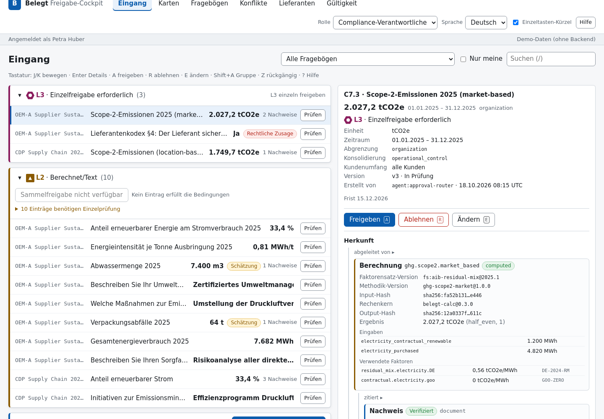

# belegt-web：Belegt 审批台

React 18 + TypeScript + Vite 实现的 Belegt 内部审批台（规格：`docs/01-产品与用户.md` UI-01…UI-04、UI-08 及供应商追数/有效期视图；审批规则：`docs/06` §3、§4.3、§5；数据形状：`docs/03` §3、§6.8）。许可：**AGPL-3.0-only**（见 `LICENSE`）。



## 快速开始

```bash
npm install
npm run dev        # http://localhost:5173 ，默认使用内置 mock 数据
npm run build      # tsc --noEmit + vite build → dist/
npm test           # vitest
npm run preview    # 预览 dist/（端口 4173）
```

- **无后端**：不设 `VITE_API_BASE` 时使用内存 mock（`src/api/mock/`），模拟一份 100 题 OEM 问卷全流程（L0 61 / L1 26 / L2 8 / L3 2 + 1 道待映射卡片 + 2 道被阻断冲突挡住的草稿），外加 CDP 问卷、供应商追数、证书到期等演示数据。日期相对"今天"生成，演示效果不随时间失效。
- **连接 belegt-core**：`VITE_API_BASE=http://localhost:8000 npm run dev`（构建时同理）。
- URL 参数：`?role=executive` 预设角色；`?undoMinutes=5` 演示租户覆盖撤销窗口（夹紧到 5–60 分钟）。

## 页面

| 导航 | 规格 | 要点 |
|---|---|---|
| Eingang / 收件箱 | 01 UI-01，06 §4.3/§5 | 按 `risk_level` L3→L0 分组（L3 置顶展开、L0 折叠）；"一键批准"仅在 06 §5.1 条件全部满足时出现，不合格条目列出原因；上限 L0 200 / L1 100 / L2 20；L2 须同一问卷、逐条看过详情、估算须勾选知悉；L3 禁止批量，单条二次确认 + 条款阅读确认 + step-up，法律承诺且 tier_a 客户仅 `executive`；批量批准进入 10 分钟撤销窗口（倒计时、`Z` 撤销、窗口结束复检条件 2–4 后落图，否则整批作废）；修改数字必须选择出处（R-NUM） |
| 答案详情（收件箱侧栏 / 问卷题目） | 01 §3.1 侧栏、UI-08 | 值、单位、期间、口径、合并方法、客户范围；溯源树（`/graph/lineage/{ref}`）：Evidence 原文定位（页/单元格/bbox/ERP 连接器）+ 原文片段高亮、Calculation 四元组（factor_set_version、methodology_version、input_hash、engine_version）+ 输入与因子、FactorSet |
| Karten / 卡片 | 01 UI-02，03 §3.11 | `yes_no`、`single_choice`（Top-3，2–4 项）、`numeric_confirm`（确认/更正，更正按当前语言解析并对歧义输入二次确认）、`file_request`（上传 → sha256，或声明暂无 `bool=false`）；按角色只显示指派给本人的卡片；过期卡片单列 |
| Fragebögen / 问卷 | 01 UI-04，_baseline §E | 列表 + 进度条四段；详情页 `Request.status` 流水线（侧路状态映射到 `return_to`）、侧路横幅、"下一步"唯一主按钮、预计剩余分钟、逐题表格（`sales`/`contributor` 看不到草稿值，显示"in Vorbereitung"）、**审计包导出**按钮（`POST /requests/{id}/audit-pack`） |
| Konflikte / 冲突 | 01 UI-03，06 §3.2/§3.3 | 两侧并排比较、差异行"≠"+粗体；AI 解释标注不含新数字；三种处理：统一口径（选基准侧）、接受差异（ADR/1 `divergence` 表单：`reason_code`、`customer_requirement_refs`、每侧 `basis`、`disclosure_text` de/en、`include_in_export`、`review_by` ≤ 期末 + 15 个月、理由 ≥ 20 字符；两侧 `customer_scope` 重叠时禁用并提示）、驳回为误报（误报类型）；block 冲突的 B/C 仅 `compliance_owner` |
| Lieferanten / 供应商 | 01 §2.3/§3.5，03 §3.10，08 §4.1 | `SupplierRequest` 状态、催办次数、D+n、截止、成本差（估算）、版本时间线；`draft` 需"批准首次发送"（06 §4.4 non_answer_subjects，仅 `compliance_owner`） |
| Gültigkeit / 有效期 | 06 §7 | 90/60 天提示、30/14/7 天警告、到期阻断 |

全局：德/英/中三语（默认德语，`localStorage` 记忆），数字按 DEC-STR 字符串分组本地化（de `1.284.300,5`，en/zh `1,284,300.5`），日期 de `31.12.2026`、en/zh ISO；角色切换（`compliance_owner`、`executive`、`sales`、`contributor`），"不可见优于禁用"：无权页面不进导航，同页无权按钮禁用并说明所需角色。

## 可访问性

跳转链接、地标与 `aria-current`；风险等级"字母 + 图形 + 颜色"三重编码；焦点环 2px；模态对话框聚焦管理/Esc/Tab 循环；`aria-live` 播报批量结果与表单错误；溯源以层级列表呈现（树的等效替代）；单键快捷键可在顶栏关闭（WCAG 2.1.4）；≤ 640px 表格转卡片布局；`prefers-reduced-motion`。

快捷键：收件箱 `J/K`、`Enter`、`A`、`R`、`E`、`Shift+A`、`Z`、`/`；卡片 `Y/N`、`1–4`、`Enter`、`C`、`S`、`F`；冲突 `←/→`、`U`、`D`、`X`；`?` 帮助。

## 后端接口约定（`src/api/HttpDataSource.ts`）

对象字段名与 03 一致；列表端点兼容 `[...]` 或 `{ "items": [...] }`；错误体按 03 §6.8 `{"error": {code, message, rule_id}}`，`GRAPH_APPROVAL_REQUIRED`、`GRAPH_NUM_UNREFERENCED`、`GRAPH_SUBMIT_BLOCKED` 有专门文案。

| 方法 | 路径 | 请求 / 响应 |
|---|---|---|
| GET | `/requests` | `RequestView[]` = `{request: Request, counterparty_name, progress{questions,mapped,evidenced,approved,submitted,est_minutes_remaining,open_conflicts,open_cards}}` |
| GET | `/requests/{id}/questions` | `{question, answer?, risk_level?, evidence_count}[]` |
| POST | `/requests/{id}/audit-pack` | `belegt-auditpack/1` zip（`Content-Disposition` 文件名） |
| GET | `/inbox` | `InboxItem[]` = `{approval, answer(钉住版本), head_version, questions[], evidence[], calculation?, conflicts[], customer_tier?, request_title, request_due_date?}` |
| POST | `/approvals` | 单条 `{approval_id, decision, comment?, confirmations?, modification?}`；批量 `{batch_id: "apb_…", approval_ids[], decision:"approved"}`；首次外发 `{subject_id: "sreq_…", kind: "supplier_request_first_send", decision}` |
| GET / POST | `/closed-questions`、`/closed-questions/{id}/answer` | `ClosedQuestion[]`；`{choice?, bool?, corrected_value?, blob_sha256[]?}` |
| POST | `/blobs` | 文件体 → `{blob_sha256}` |
| GET / POST | `/conflicts`、`/conflicts/{id}/resolve` | `ConflictView[]` = `{conflict, sides[{answer, customer_name, evidence_count, methodology_version?}], questions[]}`；`{kind, note, base_side?, dismiss_reason?, divergence?}` |
| GET | `/graph/objects?type=SupplierRequest&view=timeline` | `{supplier_request, supplier_name, history[], ui_cost_gap_eur?}[]` |
| GET | `/graph/objects?type=Evidence&status=verified,expired` | `Evidence[]` |
| GET | `/graph/lineage/{ref}` | `{root, nodes[{ref, type, object, ui_excerpt?}], edges[{from,to,kind}]}` |

演示身份通过 `X-Belegt-Actor: user:<id>` 头传递，生产应以 OIDC token 为准（07）。

## 目录

```
src/
  types.ts                 03 对象类型 + API 视图类型
  domain/                  纯函数：batch（06 §5.1）、undo（06 §5.2）、policy（06 §4.3/§4.4）、permissions（01 §5.2）、
                           conflict（06 §3.3）、expiry（06 §7）、requestStatus（_baseline §E）、format（01 §5.4）
  api/                     DataSource 接口、HttpDataSource、mock/（确定性生成的演示世界）
  i18n/                    de（基准键集）/ en / zh
  state/store.tsx          角色、路由、通知、批次暂存与到期落图
  components/              通用组件、EvidencePanel（答案详情 + 溯源）
  pages/                   Inbox / Cards / Requests / Conflicts / Suppliers / Expiry
scripts/screenshot.mjs     无头截图（需自行提供 playwright）
```

## 测试

`npm test` 覆盖：批量批准条件判定（06 §5.1 条件 1–5、上限、角色、L2 同问卷/看过详情/估算确认、提交前复检、mock 世界 100 题分布与原子批量）、撤销窗口（倒计时、窗口内撤销、窗口外拒绝、到期结算 committed/voided、5–60 分钟夹紧、立即提交）、i18n 键完整性（三语键集一致、非空、占位符一致、源码引用键全部存在、枚举派生键全覆盖），以及数字格式化、ADR/1 校验、有效期梯度。

## 连接后端

| 变量 | 说明 |
|---|---|
| `VITE_API_BASE` | belegt-core API 地址，如 `http://127.0.0.1:8000`；不设则用内置 Mock |
| `VITE_API_TOKENS` | JSON，角色→Bearer token，如 `{"compliance_owner":"demo-owner"}` |
| `VITE_API_TOKEN` | 单一 Bearer token（未按角色区分时） |
| `VITE_DEV_ACTORS` | 无 token 时的开发头 `X-Belegt-Actor` 映射（后端需 `BELEGT_DEV_AUTH=1`） |

前后端冒烟：`bash scripts/smoke.sh`（起 `belegt serve --dev-auth` → 短问卷推进到 `in_review` → 列表 / 收件箱 / 单条批准 / 批量 + 撤销 / L2 viewed / blobs / 供应商视图，7 项），结果写 `docs/smoke-result.json`。脚本已对本机地址禁用代理。

## 已知取舍

- 批次已改为服务端暂存（06 §5.2）：`POST /approvals` 建 `apb_` 批次，`POST /approvals/undo` 撤销，前端只显示倒计时、到点查询 `GET /approvals/batches/{id}`；Mock 数据源模拟同一行为。
- L0–L2 审批角色按 06 §4.4 `approval-policy@1.0.0`（仅 `compliance_owner`），与 01 §5.2 表中 `executive` 可批 L0–L2 不一致；以 06 为准。
- step-up 重新认证为模拟按钮；成本差看板（UI-05）、销售助手（UI-06）、供应商端（UI-07，独立应用）、时间旅行与影响分析不在本包范围。
- mock 的审计包导出只生成 manifest 等价 JSON；真实 zip 由 belegt-core 生成。
- 离线作答队列（01 §3.2 错误态）未实现。
